# Next.js Interview Preparation Guide (Intermediate → Senior)

Nov 1, 2026 · @tareqnmd

## 0. Version, assumptions and how to use this guide

This guide targets **Next.js 16.4 (stable, 16.4.1 released Oct 2026) with React 19.3, App Router first**, and explicitly flags where Next.js 13/14/15 behaved differently, because interviewers love version traps.

**Baseline assumptions**

- Node.js 20.9+ and TypeScript 5.1+ (minimums since Next.js 16). Turbopack is the default bundler for dev and build; `--webpack` opts out.
- Two caching models exist in the wild. **Cache Components** (`cacheComponents: true` + `partialPrefetching: true`) is recommended for every app from 16.4, is on by default in new `create-next-app` projects, and is announced as the default in Next.js 17. Many production codebases still run the **previous model** (route segment config, `fetch` options, `unstable_cache`). You must be able to explain both.
- `proxy.ts` (Node.js runtime) replaced `middleware.ts` in 16. `middleware.ts` still works for Edge use cases but is deprecated.
- Request APIs are async: `await params`, `await searchParams`, `await cookies()`, `await headers()`, `await draftMode()`. Sync access was removed in 16.
- Pages Router is still supported; it is covered in section 21 for legacy and migration interviews.

**Stability legend used throughout**

| Label | Meaning |
| --- | --- |
| Stable | Safe to recommend in production answers |
| Opt-in stable | Stable but behind a config flag (e.g. `cacheComponents`, `partialPrefetching`, `reactCompiler`) |
| Experimental | Under `experimental.*`; mention it, never make it your default answer |
| Deprecated / Removed | Know it for legacy code and migration questions only |

**Version timeline you should be able to recite**

| Version | Date | What changed that interviewers ask about |
| --- | --- | --- |
| 16.4 | Oct 2026 | Cache Components recommended for all apps; `ensureStatic`; `navigation()` and `prefetch()` stage APIs; React 19.3 |
| 16.3 | Aug 2026 | Instant Navigations, Partial Prefetching, `catchError` error boundaries, root params (`next/root-params`), better ISR shells, `instant()` Playwright helper |
| 16.2 | Mar 2026 | Stable Adapter API for non-Vercel platforms |
| 16.0 | Oct 2025 | `proxy.ts`, Cache Components, `updateTag()`, `refresh()`, two-arg `revalidateTag()`, async-only request APIs, Turbopack default, `next lint` and AMP removed, parallel slots need `default.js` |
| 15.x | Oct 2024 | `fetch` and GET Route Handlers no longer cached by default; client Router Cache stops reusing dynamic pages by default; async request APIs introduced (sync still allowed with warnings) |
| 14.x | Oct 2023 | Server Actions stable; aggressive implicit caching (fetch cached by default) |
| 13.4 | May 2023 | App Router stable |

**How to study each topic:** read the concept, answer each question aloud before reading the answer, then do the trap and debugging items. Difficulty tags: **\[I\]** intermediate, **\[A\]** advanced, **\[S\]** senior, **\[E\]** expert follow-up.

The nine diagrams interviewers ask for most are drawn inline. The secondary ones remain Mermaid code blocks, which read as plain step lists if your viewer does not render them.

## 1. Priority map: what to master first

If you have one week, master caching, the Server/Client boundary and authorization; those three decide most senior interviews.

| Priority | Topic | Why interviewers push on it |
| --- | --- | --- |
| 1 | Server vs Client Components, `"use client"` | Every other answer depends on knowing where code runs |
| 2 | Caching layers and revalidation (both models) | The most version-sensitive, most misunderstood area |
| 3 | Server Actions security and data access layer | Real breaches come from unauthenticated actions |
| 4 | Rendering: static, dynamic, streaming, PPR | Explains performance and cost trade-offs |
| 5 | Hydration and mismatches | Classic debugging question |
| 6 | Routing: layouts, parallel and intercepting routes | Tests depth of App Router knowledge |
| 7 | `proxy.ts` limits | Trap: proxy is not an authorization layer |
| 8 | Deployment: self-hosting, multi-instance cache, Docker | Separates seniors from framework users |
| 9 | Core Web Vitals and bundle size | Practical performance ownership |
| 10 | Architecture: BFF, NestJS, monorepo, multi-tenancy | Senior and staff rounds |

**The 15 most frequently asked questions**

1. What is the difference between a Server Component and a Client Component?
2. What does `"use client"` actually do?
3. Explain SSR, SSG, ISR and CSR in the App Router.
4. What caching layers exist in Next.js and how do they interact?
5. `revalidatePath` vs `revalidateTag` vs `updateTag`?
6. What are Server Actions, and how do you secure them?
7. When would you use a Route Handler instead of a Server Action?
8. What causes hydration mismatches and how do you fix them?
9. How does streaming with Suspense and `loading.tsx` work?
10. How do you protect routes and data (not just pages)?
11. Layout vs template?
12. How do you avoid request waterfalls?
13. What changed in Next.js 15 and 16?
14. How do you self-host Next.js across multiple instances?
15. How would you structure a large Next.js app?

**Common interview mistakes**

- Saying "Server Components are SSR." SSR is a rendering step; RSC is a component model. Client Components are also SSR'd.
- Saying `"use client"` means "renders only in the browser."
- Treating `proxy.ts` (or `middleware.ts`) checks as authorization.
- Describing Next.js 14 caching defaults as current behavior.
- Forgetting that every Server Action is a public HTTP endpoint.
- Putting secrets in `NEXT_PUBLIC_*` variables.
- Answering "always use X" for architecture choices instead of naming trade-offs.

## Cheat sheet: the night before

If you only reread one page, read this one; each item is covered in full in its section below.

**Where code runs**

| Thing | Runs on | Ships JS | Key rule |
| --- | --- | --- | --- |
| Server Component (default) | Server only | No | Can await data and use secrets; no state or effects |
| Client Component (`"use client"` boundary) | Server (SSR HTML) then browser | Yes | Props must be serializable and are public |
| Server Action (`"use server"`) | Server, via POST | No | Public endpoint: authenticate, authorize, validate inside |
| Route Handler (`route.ts`) | Server | No | For external clients, webhooks, non-POST verbs |
| `proxy.ts` | Server, Node runtime, before routing | No | Redirects and headers; never the only authorization |

**Caching in one table (state the model first)**

| Need | Previous model (13 to 15) | Cache Components (16+, recommended from 16.4) |
| --- | --- | --- |
| Cache data | `fetch(url, { next: { revalidate, tags } })`, `unstable_cache` | `"use cache"` + `cacheLife` + `cacheTag` |
| Per-request rendering | `cookies()`, `headers()`, `connection()`, `force-dynamic` | Default for uncached I/O; must sit inside `<Suspense>` |
| User sees own write now | `revalidateTag(tag)` / `revalidatePath` in action | `updateTag(tag)` (Server Actions only) |
| Others see it eventually | Same | `revalidateTag(tag, 'max')` (SWR) |
| Webhook needs immediate expiry | `revalidateTag(tag)` | `revalidateTag(tag, { expire: 0 })` |
| Refresh uncached UI after action | `router.refresh()` | `refresh()` in the action |
| Share across instances | `cacheHandler` (Redis) | `cacheHandlers.default` / `.remote` |

**Version deltas interviewers ask about**

- **15:** `fetch` and GET handlers uncached by default, yet a page with no dynamic API is still prerendered at build. Router Cache no longer reuses dynamic pages. Async request APIs.
- **16:** `proxy.ts` replaces `middleware.ts`; sync `params`/`cookies()` removed; `revalidateTag` needs a profile; `updateTag`, `refresh`; Turbopack default; `next lint` removed; parallel slots need `default.tsx`; `priority` on images deprecated for `preload`; Edge runtime unsupported with Cache Components.
- **16.3:** Instant Navigations, Partial Prefetching, `catchError`, root params. **16.4:** Cache Components recommended for all apps (default in Next.js 17), `ensureStatic`, `navigation()` and `prefetch()`.

**Ten one-line answers**

1. `"use client"` marks an import-graph boundary; Client Components still render on the server.
2. `error.tsx` cannot catch its own segment's layout errors.
3. `loading.tsx` does not cover a slow layout in the same segment.
4. Layouts never receive `searchParams`.
5. `notFound()` inside a streamed boundary returns 200 with `noindex`.
6. `redirect()` throws; never swallow it in `try/catch`.
7. `NEXT_PUBLIC_*` is inlined at build and visible to everyone.
8. Request memoization dedupes within one render; `cache()` for non-fetch calls.
9. Hydration mismatches come from time, randomness, `window`, locale and invalid HTML nesting.
10. Multi-instance hosting needs a shared cache, the same build, and a shared Server Actions encryption key.

**Core Web Vitals:** LCP ≤ 2.5 s, INP ≤ 200 ms, CLS ≤ 0.1 (75th percentile of real users).

## A. Next.js fundamentals

Next.js is a React framework that adds a server runtime, a file-system router, a compiler/bundler (Turbopack), and caching and rendering policies on top of React's primitives (Server Components, Suspense, Actions).

### Request lifecycle (App Router, self-hosted or Vercel)

&#91;embedded content: App Router request lifecycle · 14 steps\]

Read it top-left to bottom-right: three gates (CDN, config, proxy) can answer before any route matches, and only pages render React.

The order of `next.config` headers/redirects, then proxy, then rewrites and the filesystem is a common senior question; memorize it.

**Q1 \[I\]. What is Next.js and how is it different from React?**

React is a UI library: components, state, rendering primitives. It does not decide routing, bundling, data loading, caching, or where code runs. Next.js is a framework that makes those decisions:

- File-system routing with nested layouts (`app/`).
- Server rendering, static prerendering, streaming and Partial Prerendering.
- React Server Components and Server Actions wired to a real server.
- Built-in caching and revalidation, image/font/script optimization, metadata and SEO APIs.
- A production server (`next start`), standalone output, and platform adapters.

*When not to use Next.js:* a purely client-side app behind a login with no SEO needs (Vite + React Router is simpler), or teams that cannot operate a Node server and do not want static export limits.

*Mistake:* "Next.js is React with SSR." That was roughly true of the Pages Router in 2018; today the server component model is the core.

**Q2 \[I\]. Walk through a typical project structure.**

```text
my-app/
├─ app/
│  ├─ layout.tsx          # root layout (required): <html> and <body>
│  ├─ page.tsx            # /
│  ├─ globals.css
│  ├─ (marketing)/        # route group, no URL segment
│  ├─ dashboard/
│  │  ├─ layout.tsx
│  │  ├─ loading.tsx
│  │  ├─ error.tsx
│  │  └─ page.tsx
│  └─ api/webhooks/route.ts
├─ components/            # or features/*
├─ lib/                   # server utilities, data access layer
├─ public/                # served as-is at /
├─ proxy.ts               # request interception (Next 16)
├─ instrumentation.ts     # OpenTelemetry, startup hooks
├─ next.config.ts
└─ .env.local
```

Files outside special names inside `app/` are not routable unless a `page` or `route` file exists, so colocation is safe.

**Q3 \[I\]. What are the important configuration files?**

| File | Purpose |
| --- | --- |
| `next.config.ts` | Framework config: `images`, `redirects`, `rewrites`, `headers`, `output`, `cacheComponents`, `turbopack`, `experimental` |
| `proxy.ts` | Code that runs before routing for matched paths |
| `instrumentation.ts` | `register()` at server start; OpenTelemetry; `onRequestError` hook |
| `.env`, `.env.local`, `.env.production` | Environment variables, loaded by mode |
| `tsconfig.json` | Path aliases, the Next TS plugin |
| `eslint.config.mjs` | Flat ESLint config (`next lint` was removed in 16; run ESLint or Biome directly) |

**Q4 \[I\]. Dev vs production: what actually differs?**

- `next dev` compiles routes on demand, enables Fast Refresh, runs React in development mode (double-invokes effects in Strict Mode, extra warnings), and disables prefetching.
- `next build` compiles everything, prerenders static routes and shells, produces the route manifest and output (`.next/`).
- `next start` serves the build. Caching, prefetching and many errors only appear here.

*Interview point:* always reproduce caching and performance bugs with `next build && next start`, never only in dev.

**Q5 \[A\]. What happens during `next build`?**

1. Load config and env; type-check (unless disabled).
2. Turbopack compiles server, client and edge bundles, splitting by route and by the `"use client"` boundary.
3. Collect page data: evaluate route segment config, run `generateStaticParams`.
4. Prerender: render every route that can be static. With Cache Components, render each route's static shell and cached (`"use cache"`) parts; dynamic parts behind Suspense become holes.
5. Write HTML, RSC payloads, the route manifest and prerender manifest; print the route table (static ○, dynamic ƒ, partially prerendered).

&#91;embedded content: next build pipeline · 6 steps, 3 outcomes\]

*Expert follow-up:* why does a build sometimes need network or database access? Because prerendering runs your Server Components at build time. Mitigations: make those parts dynamic, mock in CI, or use `ensureStatic` deliberately.

**Q6 \[I\]. What does "rendering" mean in Next.js?**

Three separate steps that people blur together:

1. **RSC render:** Server Components execute on the server and produce the RSC payload (a serialized tree with references to Client Components).
2. **SSR (HTML):** the RSC payload plus Client Components are rendered to HTML for the first load.
3. **Hydration:** in the browser, React attaches event handlers to the HTML for Client Components only.

When they happen (build time vs request time) is what "static" vs "dynamic" means.

**When not to use, and alternatives**

| Choice | Avoid when | Alternative |
| --- | --- | --- |
| Next.js at all | Pure client app behind login, no SEO, team cannot run Node | Vite + React Router, TanStack Router |
| Next.js for a content-only site | No dynamic features at all | Astro, or Next.js `output: 'export'` (no server features) |
| Next.js as the whole backend | Many clients, heavy domain logic, long jobs | Next.js as BFF + NestJS or another API (section I) |

**Practice:** trap T1, debugging D15.

**Revision summary:** framework = routing + rendering + caching + server; three rendering steps; config precedence; always test with production builds.

## B. App Router

The App Router maps folders to URL segments and special files to UI roles, then composes them into one nested React tree per route.

### How special files nest inside one segment

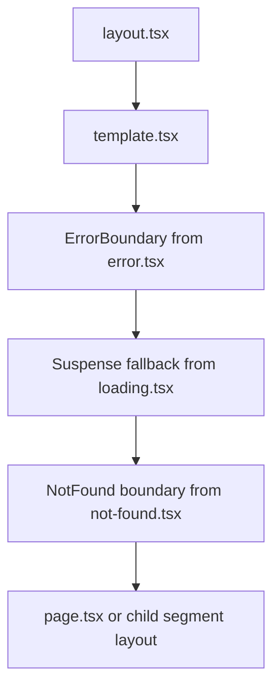

Consequence: `error.tsx` does **not** catch errors thrown by the `layout.tsx` of the same segment, because the layout sits above it. Errors in a layout are caught by the parent segment's `error.tsx`, and root layout errors by `global-error.tsx`.

### File conventions

| File | Role | Server or Client |
| --- | --- | --- |
| `page.tsx` | Makes the segment routable; receives `params`, `searchParams` (Promises) | Server by default |
| `layout.tsx` | Shared UI that persists across navigations; receives `children`, `params` | Server by default |
| `template.tsx` | Like layout but remounts on every navigation | Server by default |
| `loading.tsx` | Suspense fallback for the segment | Either |
| `error.tsx` | Error boundary; receives `error`, `reset` | Must be Client |
| `global-error.tsx` | Replaces root layout on fatal errors; must render `<html>` and `<body>` | Client |
| `not-found.tsx` | Rendered by `notFound()` and unmatched URLs | Server by default |
| `route.ts` | HTTP handler; cannot coexist with `page.tsx` in the same segment | Server |
| `default.tsx` | Fallback for a parallel slot on hard navigation (required in 16) | Server |

**Q1 \[I\]. Layout vs template?**

A layout is preserved across navigations between its child routes: its state, DOM and effects survive, and it does not re-render on the client. A template gets a new key per navigation, so it remounts, resets state and re-runs effects.

Use a template for per-page enter animations, logging page views with `useEffect`, or resetting a form between sibling pages. Default to layouts.

*Mistake:* expecting a layout to re-fetch or re-read `searchParams` on navigation. Layouts do not receive `searchParams` at all, precisely because they are not re-rendered for query changes.

**Q2 \[I\]. Explain dynamic segments.**

```tsx
// app/shop/[category]/[slug]/page.tsx
export default async function Product({
  params,
}: PageProps<'/shop/[category]/[slug]'>) {
  const { category, slug } = await params; // Promise since 15, sync removed in 16
  return <h1>{category} / {slug}</h1>;
}

export async function generateStaticParams() {
  const products = await getTopProducts();
  return products.map((p) => ({ category: p.category, slug: p.slug }));
}
```

- `[slug]` one segment, `[...slug]` catch-all (one or more), `[[...slug]]` optional catch-all (zero or more, matches the parent path too).
- `generateStaticParams` prerenders listed params at build. Unlisted params are rendered on demand unless `dynamicParams = false` (previous model), which returns 404.
- `PageProps<'/route'>` and `LayoutProps` are generated global helpers that type params from the route string.

**Q3 \[I\]. What are route groups and private folders?**

- `(group)` folders organize routes without affecting the URL. They can have their own layouts, which lets you create multiple root layouts, for example `(marketing)/layout.tsx` and `(app)/layout.tsx`.
- `_folder` opts the folder and children out of routing, useful for colocated components.

*Trap:* navigating between two different root layouts triggers a full page load, not a soft navigation.

**Q4 \[A\]. What are parallel routes?**

Named slots (`@slot` folders) render multiple pages in the same layout simultaneously, each with independent loading and error states.

```tsx
// app/dashboard/layout.tsx
export default function Layout({
  children, analytics, team,
}: LayoutProps<'/dashboard'>) {
  return (
    <>
      {children}
      <section>{analytics}</section>
      <section>{team}</section>
    </>
  );
}
```

On a soft navigation, slots that do not match the new URL keep their previously active state. On a hard load, Next.js cannot know that state, so it renders the slot's `default.tsx`. Since 16, a missing `default.tsx` fails the build; return `null` or call `notFound()` to keep old behavior.

Use cases: dashboards with independent panels, conditional rendering by role (`{isAdmin ? admin : user}`), modals.

**Q5 \[A\]. What are intercepting routes?**

They render a different route inside the current layout during client navigation while keeping the real URL. Conventions: `(.)` same level, `(..)` one level up, `(..)(..)` two up, `(...)` from the app root. The segments are route segments, not filesystem folders, so `@slot` folders do not count.

The classic pattern is a photo modal:

```text
app/
├─ layout.tsx            # renders {children} and {modal}
├─ @modal/
│  ├─ default.tsx        # return null
│  └─ (.)photo/[id]/page.tsx   # modal version
└─ photo/[id]/page.tsx   # full page on refresh/shared link
```

Clicking a thumbnail shows the modal with URL `/photo/42`; refreshing or sharing loads the full page. Close with `router.back()`.

**Q6 \[I\]. How do loading UI and error boundaries work?**

`loading.tsx` wraps the segment's page in `<Suspense>`. The layout renders immediately, the fallback shows, and the page streams in. `error.tsx` must be a Client Component:

```tsx
'use client';
export default function Error({ error, reset }: { error: Error & { digest?: string }; reset: () => void }) {
  return (
    <div>
      <p>Something went wrong.</p>
      <button onClick={() => reset()}>Try again</button>
    </div>
  );
}
```

In production, errors thrown in Server Components are sent to the client with a generic message and a `digest` that matches the server log, so secrets are not leaked.

*Version note:* `reset()` re-renders the boundary on the client but cannot re-run failed Server Components. Since 16.3, `catchError` from `next/error` builds custom boundaries with a `retry()` that re-fetches the boundary's children, including Server Components, and does not swallow `notFound()` or `redirect()`.

**Q7 \[I\]. How do `notFound()`, `redirect()` and `permanentRedirect()` work?**

They throw special errors that Next.js catches, so code after them does not run. Do not wrap them in `try/catch` without rethrowing. `redirect` returns 307 (303 inside Server Actions); `permanentRedirect` returns 308. In a streamed response that already sent headers, the redirect is performed with a client-side meta/JS fallback.

**Q8 \[E\]. How do you access params from deep in the tree without prop drilling?**

In Client Components, `useParams()`. In Server Components, either pass them down or, since 16.3, use root params (`import { lang } from 'next/root-params'`) for params defined above the root layout, such as `[lang]`. Root params also work inside `"use cache"` scopes.

**When not to use, and alternatives**

| Feature | Avoid when | Alternative |
| --- | --- | --- |
| `template.tsx` | You only need a key reset in one component | `key` prop on that component |
| Parallel routes | Panels are not independently loadable or routable | Plain components with their own Suspense boundaries |
| Intercepting routes | Modal content has no shareable URL | Client-side dialog state |
| Multiple root layouts | Users move often between the sections | One root layout with route-group nested layouts (avoids full reloads) |
| Catch-all routes | A fixed, known set of paths | Explicit segments; easier typing and static generation |

**Practice:** traps T15, T16, T18; challenge C2.

**Revision summary:** layout persists, template remounts; error boundaries sit below their layout; parallel slots need `default.tsx`; interception keeps the URL; `notFound`/`redirect` throw.

## C. Server Components and Client Components

In the App Router every component is a Server Component unless it is imported into a module graph that starts at a `"use client"` file; the directive marks a boundary in the import graph, not a single component.

### Component tree and the boundary

&#91;embedded content: Server/Client boundary in one product page tree\]

`QtyPicker` is a Client Component because `AddToCart` imports it. `Reviews` stays a Server Component even though it renders inside `Tabs`, because it is passed as `children` from a Server Component.

### What the server sends

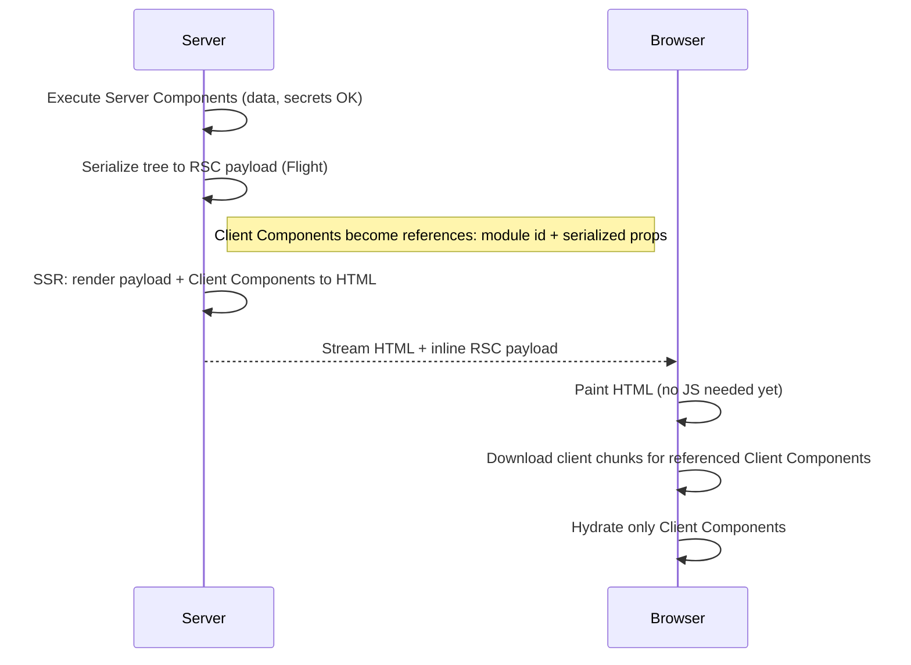

**Q1 \[I\]. Server vs Client Components: what is the difference?**

|  | Server Component | Client Component |
| --- | --- | --- |
| Runs | Server only (build or request time) | Server for SSR HTML, then browser |
| JS shipped to browser | None for the component itself | Yes |
| Can `await` data, use DB, secrets | Yes | No (no secrets; fetch via APIs or props) |
| State, effects, event handlers | No | Yes |
| Browser APIs | No | Yes, inside effects or handlers |
| Context | Cannot consume or provide | Yes |

Use Server Components for data fetching, layout and static content. Push Client Components to the leaves where interactivity lives.

**Q2 \[I\]. What does `"use client"` actually mean?**

It declares an entry point from the server module graph into the client module graph. The file and everything it imports are bundled for the browser. It does **not** mean "skip SSR": Client Components still render to HTML on the server for the first load. To skip SSR for a component, use `next/dynamic` with `ssr: false` from a Client Component, or render it only after mount.

You only need the directive at the boundary file, not on every client file.

**Q3 \[I\]. And `"use server"`?**

It marks **Server Functions** (Server Actions when used for mutations), not Server Components. At the top of a file, every export becomes a server function callable from the client via a POST request; inline inside a function body, it marks that one function. Server Components need no directive.

*Classic mistake:* adding `"use server"` to a component file to "make it a Server Component." That turns its exports into public RPC endpoints.

**Q4 \[A\]. What can be passed from a Server Component to a Client Component?**

Props cross the network, so they must be serializable by React: primitives, plain objects and arrays, `Date`, `Map`, `Set`, `BigInt`, typed arrays, Promises (consumed with `use()`), JSX elements (including Server Components as `children`), and Server Functions. Not allowed: regular functions, class instances, Symbols (other than registered), or anything with methods.

```tsx
// Server Component
import { Suspense } from 'react';
import Comments from './comments'; // client

export default function Page() {
  const commentsPromise = getComments(); // not awaited
  return (
    <Suspense fallback={<p>Loading…</p>}>
      <Comments commentsPromise={commentsPromise} />
    </Suspense>
  );
}

// comments.tsx
'use client';
import { use } from 'react';
export default function Comments({ commentsPromise }: { commentsPromise: Promise<Comment[]> }) {
  const comments = use(commentsPromise);
  return <ul>{comments.map((c) => <li key={c.id}>{c.body}</li>)}</ul>;
}
```

*Security note:* everything you pass as a prop lands in the HTML/RSC payload. Passing a full `user` row leaks `passwordHash`. Pass DTOs.

**Q5 \[A\]. How do you use a Server Component inside a Client Component?**

You cannot import it (the import would pull it into the client graph). You pass it as `children` or another JSX prop from a Server Component parent. This "donut" pattern keeps the heavy, data-backed part on the server.

**Q6 \[A\]. How do you share context or providers?**

Create a Client Component provider and render it in a Server layout, wrapping `children`. Render providers as deep as possible so static parts above them can still be optimized.

```tsx
// app/providers.tsx
'use client';
import { ThemeProvider } from './theme';
export function Providers({ children }: { children: React.ReactNode }) {
  return <ThemeProvider>{children}</ThemeProvider>;
}
```

Server Components cannot read context; use request-scoped helpers (`cookies()`, React `cache()`) instead.

**Q7 \[A\]. How do you stop server code from leaking into the client bundle?**

- `import 'server-only'` in data access modules: a build error if a Client Component imports them.
- `import 'client-only'` for browser-only modules.
- Only `NEXT_PUBLIC_*` env vars are inlined into client bundles; other vars read in client code become `undefined`.
- React taint APIs (`experimental_taintObjectReference`, `experimental_taintUniqueValue`) can block specific objects or tokens from crossing to the client; experimental, a defense-in-depth layer only.

**Q8 \[S\]. What are common architecture mistakes with RSC?**

- Putting `"use client"` in the root layout or a top-level page, turning the whole app into a client app.
- Fetching data in Client Components with `useEffect` when a Server Component could fetch it, creating waterfalls and spinners.
- Over-serializing large props into Client Components, bloating the RSC payload.
- Using global client state stores for server data that should stay on the server.
- Assuming a Server Component re-renders on client state changes. It re-renders only on a server round-trip (navigation, `router.refresh()`, an action).

**Q9 \[E\]. Can Server Components be stateful across requests?**

No. Module-level variables persist inside a single server process, which means they are shared between users and lost across instances. Never store per-user data in module scope.

**When not to use, and alternatives**

| Choice | Avoid when | Alternative |
| --- | --- | --- |
| Client Component | It only displays data | Server Component; pass interactive leaves as children |
| Server Component | Needs per-keystroke state, effects, browser APIs | Client Component leaf |
| Context provider high in tree | Only a few components need the value | Props or a provider wrapped only around that subtree |
| `ssr: false` dynamic import | Content matters for SEO or LCP | Render on server, hydrate normally |

**Practice:** traps T1, T2, T3, T24; debugging D1, D2, D4.

**Revision summary:** boundary is a module-graph concept; Client Components still SSR; props must be serializable and are public; pass Server Components as children; `server-only` everywhere data lives.

## D. Rendering strategies

In the App Router you do not pick SSR or SSG per page with special functions; the framework infers it from what your components touch, and with Cache Components a single page can mix static, cached and request-time parts.

### Strategy map

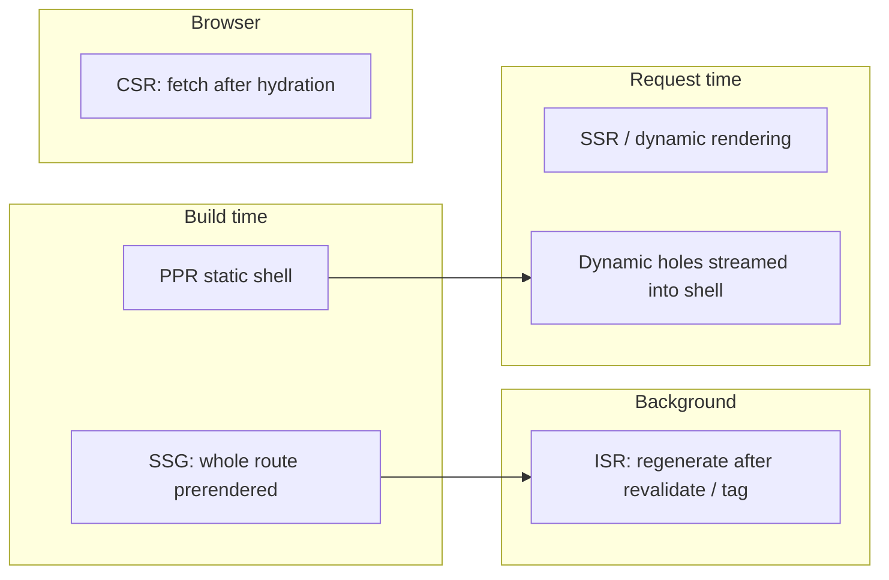

| Strategy | Previous model (13 to 15, cacheComponents off) | Cache Components model (16+) | Use for |
| --- | --- | --- | --- |
| SSG | Default when no dynamic APIs or uncached fetches; `generateStaticParams` | Components with no request data, or marked `"use cache"` | Marketing, docs, blogs |
| ISR | `export const revalidate = 60`, `fetch(url, { next: { revalidate } })`, `revalidateTag/Path` | `"use cache"` + `cacheLife(...)` + `cacheTag(...)`; on-demand via `revalidateTag`/`updateTag` | Catalogs, CMS content |
| SSR (dynamic) | Using `cookies()`, `headers()`, `searchParams`, `no-store` fetch, or `dynamic = 'force-dynamic'` | Default for any uncached data; must sit inside `<Suspense>` | Personalized, real-time pages |
| CSR | Client Component fetching after mount (SWR, TanStack Query) | Same | Highly interactive widgets, polling |
| PPR | Experimental flag in 14/15 (`experimental.ppr`, removed in 16) | Built in: static shell + streamed dynamic holes | Most real pages |

**Q1 \[I\]. Explain SSR, SSG, ISR and CSR.**

- **SSG:** HTML and RSC payload generated at build, served from CDN. Fastest TTFB, zero server compute per request, stale until rebuilt or revalidated.
- **ISR:** SSG plus regeneration. After the revalidate window, the next request gets the stale page while Next.js regenerates in the background (stale-while-revalidate). On-demand invalidation via tags or paths.
- **SSR:** rendered per request. Always fresh, can personalize, costs compute and adds latency.
- **CSR:** the server sends a shell; the browser fetches data. Good for after-login interactivity, bad for SEO and LCP if overused.

*Mistake:* claiming ISR regenerates exactly every N seconds. It is lazy: no traffic, no regeneration.

**Q2 \[A\]. What makes a route dynamic?**

Previous model: calling a dynamic API (`cookies()`, `headers()`, `connection()`, `draftMode()`, reading `searchParams`), an uncached `fetch`, or segment config `dynamic = 'force-dynamic'` / `revalidate = 0` made the **whole route** dynamic.

Cache Components model: dynamism is per component. Anything that reads request data or uncached I/O is dynamic and must either be inside a `<Suspense>` boundary (it streams in at request time) or be cached with `"use cache"`. If it is neither, the build fails with an error about uncached data accessed outside Suspense. That error is the framework forcing you to choose.

```tsx
// next.config.ts: cacheComponents: true
import { Suspense } from 'react';
import { cookies } from 'next/headers';
import { cacheLife } from 'next/cache';

export default function Page() {
  return (
    <>
      <ProductDetails />        {/* cached: part of static shell */}
      <Suspense fallback={<CartSkeleton />}>
        <CartPreview />         {/* dynamic hole: streams per request */}
      </Suspense>
    </>
  );
}

async function ProductDetails() {
  'use cache';
  cacheLife('hours');
  const p = await db.product.findFirst();
  return <h1>{p?.name}</h1>;
}

async function CartPreview() {
  const session = (await cookies()).get('session')?.value;
  const cart = await getCart(session);
  return <p>{cart.items.length} items</p>;
}
```

**Q3 \[A\]. How does streaming work?**

The server flushes HTML as soon as the shell (everything outside unresolved Suspense boundaries) is ready, then sends each boundary's content later in the same HTTP response as hidden HTML plus a tiny inline script that swaps it into place. The RSC payload for those parts streams the same way.

&#91;embedded content: Streaming response · 3 chunks\]

Implications:

- Status code and headers are sent with the first chunk. A `notFound()` thrown inside a streamed boundary cannot change the status to 404 anymore; Next.js injects a `noindex` meta tag instead. Validate existence before the first Suspense boundary if the status code matters.
- Buffering proxies (Nginx with `proxy_buffering on`, some CDNs, compression middlewares) can destroy streaming. Next.js sends `X-Accel-Buffering: no` for Nginx, but check your stack.
- Search engines receive the full HTML at the end of the stream; streamed content is indexable.

**Q4 \[A\]. What is Partial Prerendering (PPR) now?**

PPR is the rendering technique where one route has a static shell prerendered at build time and dynamic holes rendered per request, delivered in a single response. In 14/15 it was an experimental flag. In 16 the flag was removed and PPR became the behavior of Cache Components. In 16.3 Partial Prefetching extended the same idea to client navigation: links prefetch reusable shells, and `"use cache"` content is also cached in the browser.

**Q5 \[I\]. What is hydration?**

Hydration is React attaching to server-rendered HTML: it renders Client Components in the browser, compares the result with the existing DOM, and attaches event listeners instead of recreating nodes. Server Components are never hydrated; their output is already final.

React 18+ hydrates selectively: Suspense boundaries hydrate independently, and a boundary the user interacts with is prioritized.

&#91;embedded content: Hydration and what a mismatch costs\]

**Q6 \[A\]. What causes hydration mismatches and how do you fix them?**

| Cause | Fix |
| --- | --- |
| `Date.now()`, `new Date().toLocaleString()`, `Math.random()` in render | Compute on server and pass as prop, or render after mount |
| `typeof window !== 'undefined'` branches in render | Use `useEffect` + state, or `useSyncExternalStore` with a server snapshot |
| Locale or timezone differences | Format with explicit locale and timezone, or format on the server only |
| Invalid HTML nesting (`<div>` inside `<p>`, `<a>` inside `<a>`) | Fix markup; the browser parser rewrites invalid nesting |
| Browser extensions injecting attributes | Usually on `<html>`/`<body>`; `suppressHydrationWarning` on that element |
| Reading `localStorage` in render | Read in effect; or cookie-based preference read on the server |

```tsx
'use client';
import { useEffect, useState } from 'react';
export function LocalTime({ iso }: { iso: string }) {
  const [text, setText] = useState<string | null>(null);
  useEffect(() => setText(new Date(iso).toLocaleTimeString()), [iso]);
  return <time dateTime={iso}>{text ?? iso.slice(11, 16) + ' UTC'}</time>;
}
```

`suppressHydrationWarning` works one level deep and only silences the warning for text/attribute differences; it is not a general fix.

**Q7 \[S\]. How do you choose a rendering strategy for a page?**

Ask four questions: Does it vary per user? How fresh must it be? What is the traffic shape? What is the cost per render? Then compose: static shell for layout and SEO content, cached segments for shared data with a lifetime, dynamic holes for personalization, client fetching only for live interaction. Use `ensureStatic` (16.4) to make the build fail if someone accidentally adds request-time work to a page that must stay static.

**When not to use, and alternatives**

| Strategy | Avoid when | Alternative |
| --- | --- | --- |
| SSG | Data changes per user or every few seconds | Cached shell + dynamic hole |
| ISR | Strict consistency (prices at checkout, stock) | Dynamic rendering or `updateTag` on write |
| SSR for whole page | Only a small part is personal | Static shell + Suspense holes (PPR) |
| CSR | SEO or LCP content | Server render; CSR only for post-load interaction |
| `suppressHydrationWarning` | Anything beyond one known attribute/text node | Fix the source of the mismatch |

**Practice:** traps T4, T9, T10, T17; debugging D6, D7, D8, D15.

**Revision summary:** dynamism is inferred; with Cache Components it is per component and must be wrapped in Suspense or cached; streaming sends status early; hydration only touches Client Components.

## E. Data fetching and caching

Caching is where answers go stale fastest: Next.js 14 cached aggressively by default, 15 made `fetch` uncached by default, and 16 introduced opt-in Cache Components, which 16.4 recommends for all apps. State which model you are describing before you answer.

### The caching layers (previous model, still in most production apps)

&#91;embedded content: Four caching layers in the previous model\]

| Layer | Where | What it stores | Lifetime | Invalidated by |
| --- | --- | --- | --- | --- |
| Request memoization | Server, per request | Return values of identical `fetch` GETs and React `cache()` calls | One render pass | Ends with the request |
| Data Cache | Server, persistent (disk or custom handler) | `fetch` responses with `force-cache` / `next.revalidate`, `unstable_cache` results | Until revalidated | `revalidate` time, `revalidateTag`, `revalidatePath` |
| Full Route Cache | Server, persistent | HTML + RSC payload of static routes | Until data revalidates or redeploy | Revalidating its data; new build |
| Router Cache | Browser memory | RSC payloads of visited/prefetched segments | Session; `staleTimes` | `router.refresh()`, Server Action revalidation, cookies set in actions |

### Cache Components model (16+, recommended from 16.4)

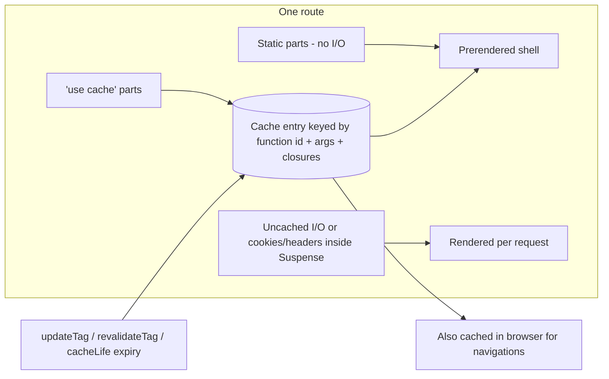

Key differences: nothing is cached unless you say `"use cache"`; `fetch` options and route segment config (`dynamic`, `revalidate`, `fetchCache`) are superseded; cache keys are generated by the compiler from the function's identity, its arguments and captured variables; `cacheLife` sets lifetimes; `cacheTag` attaches tags.

**Q1 \[I\]. How do you fetch data in a Server Component?**

Make the component `async` and await your data source directly. No API route is needed for your own database.

```tsx
import 'server-only';
export default async function Orders() {
  const user = await requireUser();            // auth in DAL
  const orders = await db.order.findMany({ where: { userId: user.id } });
  return <OrderTable rows={orders.map(toOrderRow)} />;
}
```

*Mistake:* calling your own Route Handler with `fetch('http://localhost:3000/api/orders')` from a Server Component. It adds a network hop, breaks at build time when no server is running, and loses types. Call the function directly.

**Q2 \[I\]. What is request memoization?**

During one server render, identical `fetch` GET calls (same URL and options) and calls to functions wrapped in React `cache()` return the same promise. It lets a layout and a page both call `getUser()` without double-querying.

```ts
import { cache } from 'react';
export const getUser = cache(async (id: string) => db.user.findUnique({ where: { id } }));
```

It is not persistent and not shared across users or requests. It only applies inside the React render tree; Route Handlers do not get it. Use `cache()` for ORM calls since they are not `fetch`.

**Q3 \[A\]. How does `"use cache"` work?**

```ts
import { cacheLife, cacheTag } from 'next/cache';

export async function getProduct(id: string) {
  'use cache';
  cacheLife('hours');          // built-in profiles: seconds, minutes, hours, days, weeks, max
  cacheTag('products', `product:${id}`);
  return db.product.findUnique({ where: { id } });
}
```

- Can be placed at file, component or function level.
- Arguments and closed-over values become part of the key, so they must be serializable. Non-serializable values such as JSX children can pass through without being part of the key.
- You **cannot** call `cookies()`, `headers()` or read `searchParams` inside a cached scope. Read them outside and pass the needed values as arguments.
- `cacheLife({ stale, revalidate, expire })` controls client staleness, background revalidation and hard expiry. The `default` profile is stale 5 min, revalidate 15 min, never expires. Custom profiles go in `next.config`.
- Avoid `Math.random()` or `Date.now()` inside a cached scope: they run once and the result is reused.
- **Three directives, all part of Cache Components since 16.0:**

| Directive | Where results live | Request APIs inside | Custom handler | Use for |
| --- | --- | --- | --- | --- |
| `"use cache"` | Server (in-memory LRU by default) and browser | No | Yes (`cacheHandlers.default`) | Shared data and UI |
| `"use cache: remote"` | Shared remote store (Redis, KV) via a handler | No (read outside, pass as args) | Yes (`cacheHandlers.remote`) | Shared data across instances |
| `"use cache: private"` | Browser memory only; runs on every server render, never in the static shell | Yes: `cookies()`, `headers()`, `searchParams` | No | Per-user data you still want cached client-side; not available in Route Handlers |

`connection()` is not allowed in any of them. A private cache cannot be nested inside a shared (`use cache` or `remote`) one.

**Q4 \[A\]. `revalidatePath` vs `revalidateTag` vs `updateTag` vs `refresh`?**

| API | Where | Semantics | Use when |
| --- | --- | --- | --- |
| `revalidateTag(tag, profile)` | Server Actions, Route Handlers | Marks tagged entries stale; next request gets stale data while fresh data is fetched (SWR). Single-arg form deprecated in 16 | CMS webhook, catalog update where eventual consistency is fine |
| `revalidateTag(tag, { expire: 0 })` | Route Handlers | Expire immediately | Webhook where stale data is unacceptable |
| `updateTag(tag)` | Server Actions only | Expires and re-reads in the same request: read-your-writes | A user edits their profile and must see the change immediately |
| `revalidatePath(path, 'page' or 'layout')` | Server Actions, Route Handlers | Invalidates everything rendered under that path | You do not know the tags, or the page combines many sources |
| `refresh()` | Server Actions only | Refreshes uncached data on the client; does not touch the cache | Updating a live counter after an action |
| `router.refresh()` | Client | Re-fetches the current route's RSC from the server, keeping client state | Polling or after a client-side mutation |

*Mistake:* calling `revalidatePath('/products')` and expecting `/products/42` to update. Paths are exact unless you pass `'layout'` for a layout path, which covers its subtree.

**Q5 \[A\]. What were the caching defaults across versions?**

| Behavior | 14 | 15 | 16 (cacheComponents off) | 16 (cacheComponents on) |
| --- | --- | --- | --- | --- |
| `fetch()` without options | Cached (`force-cache`) | Not cached | Not cached | Not cached; use `"use cache"` |
| GET Route Handlers | Cached when static | Not cached | Not cached | Dynamic unless cached |
| Router Cache for dynamic pages | Reused 30 s | Not reused (`staleTimes.dynamic` 0) | Not reused | Cached `"use cache"` content reused; prefetched shells |
| Static prerender of routes with no dynamic API | Yes | Yes, even with uncached fetch | Yes | Per component |

The 15 trap: a page that calls `fetch` without options but no dynamic API is still prerendered at build, so the "uncached" fetch runs once at build time. Add `await connection()` or a dynamic API to render per request.

**Q6 \[I\]. Parallel vs sequential fetching?**

```tsx
// Waterfall: 300 ms + 400 ms
const user = await getUser(id);
const posts = await getPosts(id);

// Parallel: max(300, 400) ms
const [user2, posts2] = await Promise.all([getUser(id), getPosts(id)]);
```

Sequential is correct only when the second call needs the first result. Better still, split into components behind separate Suspense boundaries so each streams when ready, or start a promise in a parent and `use()` it in a child.

**Q7 \[S\]. How do you design a data access layer (DAL)?**

- One `server-only` module per domain (`lib/dal/orders.ts`) that every read and write goes through.
- Each function checks authentication and authorization itself, so a new page cannot forget.
- Returns DTOs, never raw ORM rows.
- Wraps reads in `cache()` for per-request dedupe and `"use cache"` where safe to share.
- Owns cache tags, so invalidation lives next to the data it describes.

**Q8 \[E\]. How do caches work across multiple server instances?**

By default every cache is in memory plus the local `.next` directory, per instance. Behind a load balancer, instance A revalidating a tag does not invalidate instance B, so users see inconsistent pages. Fixes:

- **Cache Components:** configure `cacheHandlers: { default: require.resolve('./handlers/default.js'), remote: require.resolve('./handlers/remote.js') }` in `next.config.ts`. `default` backs `"use cache"`, `remote` backs `"use cache: remote"`; without config both are in-memory LRU. You can also define named handlers and use them as `"use cache: <name>"`. `"use cache: private"` is not configurable.
- **Previous model and ISR:** the singular `cacheHandler` option (plus `cacheMaxMemorySize: 0` to disable the in-memory layer) points at a shared store such as Redis.
- Keep the same build ID on all instances, or deploy to a platform whose adapter provides a shared cache.

**Q9 \[S\]. How do you handle stale data in the UI?**

Be explicit about consistency per feature: read-your-writes for the actor (`updateTag`), eventual consistency for everyone else (`revalidateTag` with a profile), live data via client polling or websockets only where it pays. Show timestamps for data that is allowed to be stale.

**When not to use, and alternatives**

| Tool | Avoid when | Alternative |
| --- | --- | --- |
| `"use cache"` | Data is per user or high-cardinality (search queries) | Uncached in Suspense; `"use cache: private"`; cache the low-cardinality parts |
| `revalidatePath` | You know the data's tags | `revalidateTag` / `updateTag`, more precise |
| `revalidateTag(tag, 'max')` | The actor must see their own write | `updateTag` |
| Calling own Route Handler from RSC | Data is in your own DB | Call the DAL function directly |
| In-memory cache handler | More than one instance | Redis via `cacheHandlers` / `cacheHandler` |

**Practice:** traps T4 to T8, T14, T23; debugging D3, D10; challenge C1.

**Revision summary:** name the model first; four legacy layers; `"use cache"` is opt-in with compiler keys; `updateTag` for read-your-writes, `revalidateTag` for SWR; caches are per instance unless you share them.

## F. Server Actions and mutations

A Server Action is an async function marked `"use server"` that the client calls through an automatically generated POST endpoint; treat every one exactly like a public API route.

### Action lifecycle

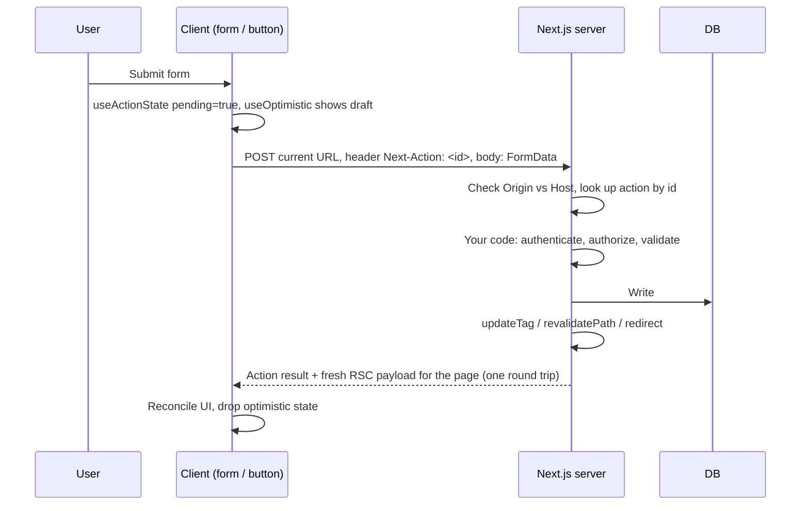

**Q1 \[I\]. Write a secure form action.**

```ts
// app/settings/actions.ts
'use server';
import { z } from 'zod';
import { updateTag } from 'next/cache';
import { requireUser } from '@/lib/dal/auth';
import { db } from '@/lib/db';

const Schema = z.object({
  displayName: z.string().trim().min(2).max(50),
  bio: z.string().max(280).optional(),
});

export type ProfileState = { ok: boolean; errors?: Record<string, string[]>; message?: string };

export async function updateProfile(_prev: ProfileState, formData: FormData): Promise<ProfileState> {
  const user = await requireUser();                      // 1. authenticate
  const parsed = Schema.safeParse(Object.fromEntries(formData)); // 2. validate
  if (!parsed.success) return { ok: false, errors: parsed.error.flatten().fieldErrors };
  await db.user.update({ where: { id: user.id }, data: parsed.data }); // 3. scoped write
  updateTag(`user:${user.id}`);                            // 4. read-your-writes
  return { ok: true, message: 'Saved' };
}
```

```tsx
// app/settings/profile-form.tsx
'use client';
import { useActionState } from 'react';
import { useFormStatus } from 'react-dom';
import { updateProfile, type ProfileState } from './actions';

function Submit() {
  const { pending } = useFormStatus(); // must be inside the <form>
  return <button disabled={pending}>{pending ? 'Saving…' : 'Save'}</button>;
}

export function ProfileForm({ initial }: { initial: { displayName: string; bio?: string } }) {
  const [state, action] = useActionState<ProfileState, FormData>(updateProfile, { ok: false });
  return (
    <form action={action}>
      <input name="displayName" defaultValue={initial.displayName} aria-describedby="dn-err" />
      <p id="dn-err" role="alert">{state.errors?.displayName?.[0]}</p>
      <textarea name="bio" defaultValue={initial.bio} />
      <Submit />
      {state.message && <p role="status">{state.message}</p>}
    </form>
  );
}
```

Note the user id comes from the session, never from a hidden input. Forms passed a Server Action work before JavaScript loads (progressive enhancement) when rendered from a Server Component.

**Q2 \[A\]. What does Next.js do for Server Action security, and what is still your job?**

| Built in | Your job |
| --- | --- |
| POST only; Origin header compared with Host (CSRF protection); `serverActions.allowedOrigins` for proxies | Authenticate inside every action |
| Action IDs are non-deterministic and rotate between builds; unused actions are removed from the bundle | Authorize: does this user own this resource? |
| Closed-over variables in inline actions are encrypted before going to the client | Validate and sanitize every argument; types are not runtime checks |
| Body size limit (1 MB default, `serverActions.bodySizeLimit`) | Rate limiting, idempotency, audit logs |

*Mistake:* "The action is only used on the admin page, which is protected, so it is safe." The endpoint can be called directly by anyone who obtains the ID.

*Expert follow-up:* for multi-instance self-hosting, set `NEXT_SERVER_ACTIONS_ENCRYPTION_KEY` so all instances share the key used for closure encryption, and keep the same build across instances.

**Q3 \[A\]. How do you do optimistic UI?**

```tsx
'use client';
import { useOptimistic, startTransition } from 'react';
import { addTodo } from './actions';

export function Todos({ todos }: { todos: { id: string; text: string; pending?: boolean }[] }) {
  const [optimistic, addOptimistic] = useOptimistic(todos, (state, text: string) => [
    ...state, { id: crypto.randomUUID(), text, pending: true },
  ]);
  async function submit(formData: FormData) {
    const text = String(formData.get('text'));
    addOptimistic(text);
    await addTodo(text); // server revalidates; real list replaces optimistic
  }
  return (
    <form action={submit}>
      <input name="text" />
      <ul>{optimistic.map((t) => <li key={t.id} style={{ opacity: t.pending ? 0.5 : 1 }}>{t.text}</li>)}</ul>
    </form>
  );
}
```

If the action throws, React discards the optimistic state when the transition ends; surface the error separately.

**Q4 \[I\]. Server Actions vs Route Handlers?**

| Use a Server Action | Use a Route Handler |
| --- | --- |
| Mutations triggered by your own UI | Public or third-party HTTP APIs |
| Forms with progressive enhancement | Webhooks (Stripe, GitHub), OAuth callbacks |
| You want one round trip that also returns fresh UI | Non-POST verbs, custom status codes, streaming files, CORS |
| Type-safe calls without writing fetch code | Mobile apps or other clients call it |

*Mistake:* using Server Actions for data reads in client components. Actions run sequentially per client and are not cached; reads belong in Server Components or GET Route Handlers.

**Q5 \[A\]. What are Server Action limitations?**

- Queued one at a time per client by the router; not suited to parallel reads.
- Arguments and return values must be serializable.
- Bound to the deployment's build; a client with an old page calling a removed action gets an error after deploys (version skew). Handle with skew protection or a reload prompt.
- Errors thrown are masked in production; return typed error states for expected failures.

**Q6 \[A\]. How do you redirect after a mutation?**

Call `redirect('/orders/123')` after revalidating. It throws, so put it outside `try/catch`, or rethrow with `unstable_rethrow(error)` in a catch.

**When not to use, and alternatives**

| Choice | Avoid when | Alternative |
| --- | --- | --- |
| Server Action | Reading data, external or mobile clients, webhooks, file downloads | Server Components for reads; Route Handlers for HTTP APIs |
| `useOptimistic` | Failure is likely or the result is hard to predict | Pending state with `useFormStatus` |
| React Hook Form | Simple forms that should work without JS | `<form action>` + `useActionState` |
| Throwing for expected errors | Validation or business-rule failures | Return a typed error state |

**Practice:** traps T6, T11, T13, T21; debugging D5, D11; challenges C3, C5.

**Revision summary:** actions are public POST endpoints; authenticate, authorize and validate inside each; `useActionState` + `useFormStatus` + `useOptimistic`; `updateTag` for immediate consistency; Route Handlers for external clients.

## G. Routing, navigation and Proxy

Navigation in the App Router is a client-side transition that fetches only the RSC payload for segments that changed, reusing shared layouts and anything already in the Router Cache.

### Soft navigation

```mermaid
sequenceDiagram
  participant L as Link in viewport
  participant R as Client router
  participant S as Server
  L->>R: Visible / hover: prefetch
  R->>S: Prefetch shell (loading states, cached parts); shared layouts fetched once
  U->>R: Click
  R->>R: Show prefetched shell instantly, keep shared layouts mounted
  R->>S: Fetch RSC for changed segments only (dynamic parts)
  S-->>R: Stream payload
  R->>R: Patch tree, update URL, restore scroll
```

**Q1 \[I\]. `Link` vs `useRouter` vs `<a>`?**

- `<Link href>`: soft navigation plus prefetching when visible in production. Use for all internal links.
- `useRouter()` from `next/navigation`: imperative `push`, `replace`, `back`, `refresh`, `prefetch` in Client Components.
- Plain `<a>`: full page load; use for external links or to deliberately reset all client state.

*Trap:* importing `useRouter` from `next/router` in the App Router throws; that is the Pages Router hook.

**Q2 \[A\]. How does prefetching behave now?**

- 16.0 rewrote prefetching: layout deduplication (a shared layout downloads once for many links) and incremental prefetching (only uncached parts), cancelled when links leave the viewport.
- 16.3 Partial Prefetching (`partialPrefetching: true`): links prefetch a reusable shell by default; `<Link prefetch>` can include more of the cached target content.
- 16.4: `await navigation()` inside a component defers it from prefetches until the real navigation; `await prefetch()` defers content from the shell until an explicit prefetch.
- `prefetch={false}` disables it, useful for long lists of rarely clicked links.
- Prefetching is disabled in development; test in production builds.

**Q3 \[I\]. Which hooks read the URL?**

| Hook | Returns | Notes |
| --- | --- | --- |
| `usePathname()` | `/shop/shoes` | Client only |
| `useSearchParams()` | Read-only `URLSearchParams` | Without a Suspense boundary, it can force client rendering up to the nearest boundary in static routes |
| `useParams()` | `{ category: 'shoes' }` | Dynamic params of current route |
| `useSelectedLayoutSegment(s)()` | Active child segment(s) | For active nav tabs in layouts |

In Server Components, use the `params` and `searchParams` page props (Promises).

**Q4 \[A\]. How do you keep UI state in the URL?**

For filters, sorting, pagination and tabs, the URL should be the source of truth: shareable, bookmarkable, back-button friendly and readable by Server Components.

```tsx
'use client';
import { usePathname, useRouter, useSearchParams } from 'next/navigation';
import { useTransition } from 'react';

export function SortSelect() {
  const router = useRouter();
  const pathname = usePathname();
  const params = useSearchParams();
  const [isPending, startTransition] = useTransition();
  return (
    <select
      value={params.get('sort') ?? 'newest'}
      aria-busy={isPending}
      onChange={(e) => {
        const next = new URLSearchParams(params);
        next.set('sort', e.target.value);
        next.delete('page');                       // reset pagination on filter change
        startTransition(() => router.replace(`${pathname}?${next}`, { scroll: false }));
      }}
    >
      <option value="newest">Newest</option>
      <option value="price-asc">Price: low to high</option>
    </select>
  );
}
```

**Q5 \[I\]. Redirects and rewrites: where do they belong?**

| Need | Tool |
| --- | --- |
| Static, known at build (old URL → new URL) | `redirects()` in `next.config` |
| Proxy a path to another origin without changing the URL | `rewrites()` (`beforeFiles`, `afterFiles`, `fallback`) |
| Request-dependent (cookie, geo, A/B bucket) | `proxy.ts` |
| After a mutation or auth check during render | `redirect()` in Server Component or Action |
| Thousands of redirects | Lookup table (e.g. Bloom filter or KV) in `proxy.ts` |

**Q6 \[A\]. What is `proxy.ts` and what are its limits?**

`proxy.ts` (formerly `middleware.ts`) runs before routing for paths matched by `config.matcher`. Since 16 it runs on the Node.js runtime. It can rewrite, redirect, set headers and cookies, or return a response.

```ts
// proxy.ts
import { NextResponse, type NextRequest } from 'next/server';

export function proxy(request: NextRequest) {
  const hasSession = request.cookies.has('session');
  if (!hasSession && request.nextUrl.pathname.startsWith('/dashboard')) {
    const url = new URL('/login', request.url);
    url.searchParams.set('next', request.nextUrl.pathname);
    return NextResponse.redirect(url); // UX redirect only, not authorization
  }
  const res = NextResponse.next();
  res.headers.set('x-request-id', crypto.randomUUID());
  return res;
}

export const config = {
  matcher: ['/((?!_next/static|_next/image|favicon.ico|api/webhooks).*)'],
};
```

Limits and rules:

- It runs on every matched request, including prefetches; keep it fast. No database calls per request if you can avoid them.
- It is an optimistic check, not authorization. In March 2025 (CVE-2025-29927) a crafted internal header let attackers skip middleware entirely on vulnerable versions. Apps that authorized only in middleware were exposed; apps that also checked in the DAL were not.
- It cannot render React or read the RSC tree.
- Matchers are evaluated at build; dynamic matcher values are not allowed.
- `middleware.ts` still exists for Edge runtime needs but is deprecated.

&#91;embedded content: proxy.ts request processing · 4 outcomes\]

**Q7 \[S\]. How do you implement i18n routing?**

Use an `app/[lang]/` segment as the root (often with root layouts per locale), detect the locale in `proxy.ts` from cookie or `Accept-Language` and redirect, generate static params for supported locales, and read the locale anywhere with root params (16.3+) or props. Set `<html lang>` in the root layout and add `alternates.languages` in metadata.

**When not to use, and alternatives**

| Tool | Avoid when | Alternative |
| --- | --- | --- |
| `proxy.ts` | Static redirects, DB lookups per request, authorization | `next.config` `redirects()`; DAL checks |
| `rewrites()` to another origin | High-volume API traffic | Route at the load balancer or CDN |
| `prefetch` on every link | Long lists of rarely clicked links | `prefetch={false}` or partial prefetching |
| Local state for filters | State should be shareable or bookmarkable | URL search params |

**Practice:** traps T12, T16, T22; debugging D6; challenge C1.

**Revision summary:** soft navigation fetches changed segments; prefetching is incremental and partial in 16.3+; URL holds shareable state; proxy is for routing and UX, never the only authorization.

## H. Authentication and security

Authorization must happen where data is read and written (the data access layer, Server Actions, Route Handlers); hiding a page or redirecting in `proxy.ts` only improves UX.

### Defense in depth

&#91;embedded content: Authorization defense in depth\]

Layouts do not re-render on client navigation between their children, so a layout-only check is not re-run for every page; another reason the DAL must check.

### Login flow with server sessions

```mermaid
sequenceDiagram
  participant B as Browser
  participant A as Server Action login()
  participant DB as DB / IdP
  B->>A: POST email + password (form)
  A->>A: Validate, rate limit by IP + account
  A->>DB: Verify credentials (argon2/bcrypt)
  DB-->>A: user
  A->>DB: Create session row (id, userId, expiresAt)
  A-->>B: Set-Cookie: session=opaque-id; HttpOnly; Secure; SameSite=Lax; Path=/
  A-->>B: redirect('/dashboard')
  B->>A: Next requests carry cookie automatically
```

**Q1 \[I\]. Where should tokens live?**

| Storage | XSS can read it | CSRF exposure | Verdict |
| --- | --- | --- | --- |
| `localStorage` | Yes | No | Avoid for session tokens |
| JS-readable cookie | Yes | Yes | Avoid |
| `HttpOnly; Secure; SameSite=Lax` cookie | No | Mitigated by SameSite + Origin checks | Default choice |
| In-memory only (SPA) | Only during session | No | Lost on reload; needs refresh flow |

**Q2 \[A\]. Stateful sessions vs JWT?**

- **Database sessions:** opaque ID in cookie, data on server. Instant revocation, easy "log out everywhere", needs a lookup per request (cache it in Redis).
- **Stateless JWT in cookie:** no lookup, works across services, but revocation needs short expiry plus refresh tokens or a denylist; payload size grows cookies; key rotation is your job.

A common senior answer: opaque session cookie at the Next.js edge of the system, short-lived JWT minted server-side for calls to internal services (the BFF pattern), never exposed to the browser.

**Q3 \[A\]. Implement a DAL check.**

```ts
// lib/dal/auth.ts
import 'server-only';
import { cache } from 'react';
import { cookies } from 'next/headers';
import { redirect } from 'next/navigation';

export const verifySession = cache(async () => {
  const id = (await cookies()).get('session')?.value;
  if (!id) return null;
  const session = await sessions.get(id);           // Redis / DB
  if (!session || session.expiresAt < Date.now()) return null;
  return { userId: session.userId, role: session.role, tenantId: session.tenantId };
});

export async function requireUser() {
  const s = await verifySession();
  if (!s) redirect('/login');
  return s;
}

export async function requireRole(role: 'admin' | 'editor') {
  const s = await requireUser();
  if (s.role !== role) throw new Error('Forbidden'); // or forbidden() where enabled
  return s;
}
```

`cache()` makes repeated checks within one render free. Note that `forbidden()` and `unauthorized()` exist behind `experimental.authInterrupts`; mention them as experimental.

**Q4 \[S\]. How do you implement RBAC (role-based access control)?**

Model permissions, not roles, in checks: `can(user, 'invoice:approve', invoice)`. Roles map to permission sets in one place. Enforce in the DAL and actions; use the same function in UI to hide buttons (UX only). For multi-tenant apps, every query filters by `tenantId` from the session, never from the URL or body; add database row-level security as a backstop.

**Q5 \[I\]. How do environment variables leak?**

- `NEXT_PUBLIC_*` values are inlined into client JS at **build time**; anyone can read them. Never put secrets there.
- Non-public vars are available only on the server. Reading them in a Client Component yields `undefined`, not a leak, unless you pass the value as a prop.
- Changing a `NEXT_PUBLIC_*` value requires a rebuild; the Docker image built for staging carries staging values into production. For runtime-configurable public values, render them from the server (e.g. a `<script>` with JSON from a Server Component, or an API).

**Q6 \[A\]. XSS, CSRF and injection in Next.js?**

- **XSS:** React escapes text. Risks: `dangerouslySetInnerHTML` (sanitize with DOMPurify), `href={userInput}` allowing `javascript:` URLs, unsanitized Markdown, and JSON injected into `<script>` (escape `<`). Add a Content Security Policy with nonces set in `proxy.ts`; note nonces force dynamic rendering.
- **CSRF:** Server Actions are POST with Origin checks; `SameSite=Lax` cookies. Route Handlers you write that mutate state need their own protection (Origin check or CSRF token) if they rely on cookies.
- **Injection:** use parameterized ORM queries; validate with Zod at every boundary.
- **SSRF:** never `fetch` a user-provided URL server-side without an allowlist; the image optimizer's `remotePatterns` exists for this reason.

**Q7 \[A\]. Which security headers do you set?**

```ts
// next.config.ts (static headers)
async headers() {
  return [{
    source: '/(.*)',
    headers: [
      { key: 'Strict-Transport-Security', value: 'max-age=63072000; includeSubDomains; preload' },
      { key: 'X-Content-Type-Options', value: 'nosniff' },
      { key: 'Referrer-Policy', value: 'strict-origin-when-cross-origin' },
      { key: 'X-Frame-Options', value: 'DENY' },
      { key: 'Permissions-Policy', value: 'camera=(), microphone=(), geolocation=()' },
    ],
  }];
}
```

Set `poweredByHeader: false`. CSP with nonces goes in `proxy.ts` because each request needs a fresh nonce.

**Q8 \[A\]. How do you rate limit?**

At the edge (CDN/WAF) for coarse protection, plus application-level limits keyed by IP and account for login, signup, password reset and expensive actions, stored in Redis (sliding window or token bucket). In-memory counters fail with multiple instances.

**Q9 \[S\]. How do you handle secure file uploads?**

Authenticate, then issue a short-lived presigned URL scoped to one object key (generated server-side, never user-chosen). Enforce content type and size in the presign policy, scan files asynchronously, serve from a separate domain, and never trust the client-reported MIME type.

**Q10 \[E\]. What happened with CVE-2025-66478?**

In December 2025 a critical vulnerability in the React Server Components protocol affected Next.js App Router apps; teams had to upgrade immediately. The lesson for interviews: RSC and Server Actions are a network protocol with an attack surface, so patch cadence matters. Next.js has published monthly scheduled security releases since July 2026 and supports active and maintenance LTS lines.

**When not to use, and alternatives**

| Choice | Avoid when | Alternative |
| --- | --- | --- |
| Stateless JWT sessions | You need instant revocation or role changes | Database sessions (cached in Redis) |
| Roll-your-own auth | Team lacks security review capacity | Auth.js, Better Auth, Clerk, WorkOS, Auth0 |
| Shared DB with `tenant_id` | Compliance demands physical isolation | Dedicated DB or schema per tenant |
| Layout-only auth checks | Ever, as the only check | DAL + action + handler checks |

**Practice:** traps T3, T11, T12; debugging D4, D12; challenges C3, C7; scenarios S2, S3.

**Revision summary:** authorize in the DAL; HttpOnly cookies; `NEXT_PUBLIC_` is public and build-time; validate every input; CSP via proxy; rate limit with shared storage; patch promptly.

## I. API integration and backend architecture

Next.js works best as a Backend-for-Frontend (BFF): it owns sessions, composes data for screens and renders UI, while domain logic, long-running work and other clients' APIs live in a dedicated backend such as NestJS.

### BFF with NestJS

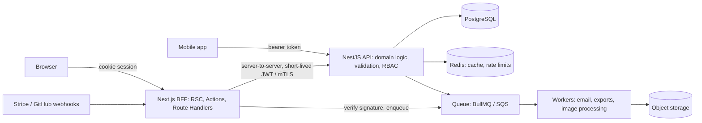

**Q1 \[A\]. Next.js with NestJS: who does what?**

| Next.js | NestJS |
| --- | --- |
| Rendering, routing, SEO | Domain model, business rules |
| Session cookie, CSRF, UI-level authorization hints | Authoritative authorization per resource |
| Screen-shaped data composition (parallel calls) | Resource APIs, transactions |
| Caching of rendered UI and screen data | Caching of domain data, DB pooling |
| Webhook endpoints that verify and enqueue | Jobs, schedules, integrations |

Trade-off: two deployables and a network hop versus clear ownership, reuse by mobile apps, and independent scaling. For a small product, a single Next.js app with a well-structured DAL is often the better call; say so.

**Q2 \[A\]. Write a resilient server-side API client.**

```ts
// lib/api/client.ts
import 'server-only';
import { headers } from 'next/headers';

export class ApiError extends Error {
  constructor(public status: number, message: string) { super(message); }
}

export async function api<T>(path: string, init: RequestInit & { retries?: number; timeoutMs?: number } = {}): Promise<T> {
  const { retries = 2, timeoutMs = 5000, ...rest } = init;
  const requestId = (await headers()).get('x-request-id') ?? crypto.randomUUID();
  const token = await getServiceToken(); // short-lived, server-only
  for (let attempt = 0; ; attempt++) {
    try {
      const res = await fetch(`${process.env.API_URL}${path}`, {
        ...rest,
        headers: { ...rest.headers, authorization: `Bearer ${token}`, 'x-request-id': requestId, 'content-type': 'application/json' },
        signal: AbortSignal.timeout(timeoutMs),
      });
      if (res.ok) return (await res.json()) as T;
      const retryable = res.status >= 500 || res.status === 429;
      const idempotent = !rest.method || rest.method === 'GET';
      if (!retryable || !idempotent || attempt >= retries) throw new ApiError(res.status, await res.text());
    } catch (e) {
      if (e instanceof ApiError || attempt >= retries) throw e;
    }
    await new Promise((r) => setTimeout(r, 2 ** attempt * 200 + Math.random() * 100)); // backoff + jitter
  }
}
```

Key points: timeouts on every call, retries only for idempotent requests, request ID propagation for tracing, typed errors mapped to UI states. Note: reading `headers()` makes the caller dynamic; pass the ID in as an argument inside cached functions.

**Q3 \[A\]. Route Handlers: what should they do?**

```ts
// app/api/webhooks/stripe/route.ts
import { revalidateTag } from 'next/cache';

export async function POST(req: Request) {
  const body = await req.text();                 // raw body for signature
  const sig = req.headers.get('stripe-signature');
  let event;
  try {
    event = stripe.webhooks.constructEvent(body, sig!, process.env.STRIPE_WEBHOOK_SECRET!);
  } catch {
    return new Response('Invalid signature', { status: 400 });
  }
  if (await processedEvents.has(event.id)) return new Response('ok'); // idempotency
  await queue.add('stripe-event', event);          // do heavy work async
  await processedEvents.add(event.id);
  revalidateTag(`order:${event.data.object.metadata.orderId}`, { expire: 0 });
  return new Response('ok');
}
```

Respond fast (providers time out and retry), verify signatures on the raw body, make processing idempotent, and enqueue slow work.

**Q4 \[A\]. How do you run background jobs?**

Serverless functions and request handlers are the wrong place for minutes-long work. Options: a queue plus workers (BullMQ on Redis, SQS, Cloud Tasks), a durable workflow engine (Temporal, Inngest, Trigger.dev), or `after()` from `next/server` for small post-response tasks such as logging and analytics. `after()` runs after the response is sent but within the same server lifetime; it is not a durable queue.

**Q5 \[S\]. Database access patterns and connection pooling?**

- Long-lived Node servers: one pooled client per process, created once at module scope (guard against hot-reload duplication in dev with a `globalThis` singleton).
- Serverless: each instance opens connections, so use a pooler (PgBouncer, RDS Proxy, Neon/Supabase poolers, Prisma Accelerate) and keep pool size small.
- Add read replicas for heavy reads; never let pages issue N+1 queries (batch with `IN` queries or DataLoader).

**Q6 \[I\]. REST vs GraphQL from Next.js?**

Both work from Server Components. GraphQL helps screen-shaped queries and avoids over-fetching across many services; REST is simpler to cache at the HTTP layer. With RSC, much of GraphQL's client-side value (normalized caches, avoiding waterfalls) moves to the server, so many teams use plain server-side calls.

**Q7 \[S\]. Proxying APIs through Next.js?**

`rewrites()` can forward `/api/*` to the backend to avoid CORS and hide origins, but every proxied request then consumes Next.js server capacity. For high-volume APIs, route at the load balancer or CDN instead.

**When not to use, and alternatives**

| Choice | Avoid when | Alternative |
| --- | --- | --- |
| Separate NestJS backend | Small team, one client, simple domain | Next.js with a strong DAL |
| GraphQL | Few clients, simple resources, HTTP caching matters | REST or direct server calls |
| `after()` for background work | Work must survive crashes or take minutes | Queue + workers or a workflow engine |
| Proxying APIs through Next.js | High throughput | Direct routing at the edge |

**Practice:** trap T13; challenges C4, C5; scenario S5.

**Revision summary:** Next.js as BFF; backend owns domain and authoritative authz; timeouts, idempotent retries, request IDs; webhooks verify and enqueue; pool connections.

## J. Performance optimization

Most Next.js performance wins come from three moves: ship less client JavaScript, remove server waterfalls, and serve as much as possible from a static shell or cache.

### Core Web Vitals ("good" thresholds, 75th percentile of real users)

| Metric | Measures | Good | Typical Next.js levers |
| --- | --- | --- | --- |
| LCP | Largest content paint | ≤ 2.5 s | Static shell, `next/image` with ` eager loading or  ``preload` on hero, fonts via `next/font`, fast TTFB, no client-side data fetch for hero |
| INP | Responsiveness to input | ≤ 200 ms | Less JS, smaller Client Components, `useTransition`, split long tasks, React Compiler |
| CLS | Layout stability | ≤ 0.1 | Image width/height, `next/font` size-adjust fallbacks, reserved space for streamed content and ads, skeletons matching final size |

**Q1 \[I\]. How do `next/image` and `next/font` help?**

`next/image` serves resized, modern-format images (AVIF/WebP) through the optimizer, requires dimensions (or `fill`) to prevent CLS, lazy-loads by default and sets `srcset`/`sizes`. For the LCP image, use `loading="eager"` or `fetchPriority="high"`, or `preload` when you need a `<link rel="preload">` in the head; `priority` is deprecated since 16 (same behavior, renamed to `preload`). Provide accurate `sizes`. Remote images need `images.remotePatterns` (`images.domains` is deprecated).

Version 16 defaults: `minimumCacheTTL` is 4 hours, `qualities` defaults to `[75]` (other `quality` values are coerced), local IP optimization is blocked unless `dangerouslyAllowLocalIP`, and local images with query strings need `images.localPatterns`.

`next/font` self-hosts Google or local fonts at build time (no runtime request to Google), generates size-adjusted fallbacks to avoid layout shift, and exposes a CSS variable.

**Q2 \[A\]. How do you reduce client JavaScript?**

1. Keep `"use client"` at the leaves; pass server-rendered content as `children`.
2. Avoid importing big libraries (date, charting, markdown, syntax highlighting) into Client Components; render them on the server where output is static.
3. `next/dynamic` / `import()` for heavy, below-the-fold or interaction-only components.
4. `optimizePackageImports` for barrel-heavy packages; avoid your own barrel files in client code.
5. Analyze: the Turbopack Bundle Analyzer (16.1+, expanded in 16.4 with route summaries, snapshots and diffs) shows which modules sit on the critical path.

```tsx
'use client';
import dynamic from 'next/dynamic';
const Chart = dynamic(() => import('./revenue-chart'), { ssr: false, loading: () => <div style={{ height: 320 }} /> });
```

**Q3 \[A\]. How do you find and fix a slow page?**

1. Measure in production: RUM (`useReportWebVitals`, Vercel Speed Insights or your APM) for field data; Lighthouse/WebPageTest for lab.
2. TTFB high → server: check for waterfalls and slow queries with OpenTelemetry spans from `instrumentation.ts`; move independent fetches to `Promise.all`; split behind Suspense; cache shared data.
3. LCP high with OK TTFB → hero image priority, font loading, render-blocking CSS, client-fetched hero data.
4. INP high → long tasks from hydration or handlers; reduce JS, defer non-critical hydration with dynamic imports, wrap state updates in transitions.
5. Regressions → in 16.3+ Instant Insights in DevTools surfaces non-instant navigations, and the `instant()` Playwright helper can fail CI when a navigation stops being instant.

**Q4 \[A\]. How do `Script` strategies differ?**

| Strategy | Loads | Use for |
| --- | --- | --- |
| `beforeInteractive` | Before hydration (root layout only) | Bot detection, consent managers that must run first |
| `afterInteractive` (default) | After hydration | Tag managers, analytics |
| `lazyOnload` | Browser idle | Chat widgets, social embeds |
| `worker` (experimental) | Web worker via Partytown | Heavy third-party scripts |

**Q5 \[S\]. Server-side performance at scale?**

- Cache shared data (`"use cache"` / Data Cache) and keep personalization in small dynamic holes.
- Avoid N+1 queries in nested components: batch at the data layer (DataLoader), or fetch once in a parent and pass down.
- Watch RSC payload size: large props serialized into Client Components bloat every navigation.
- Node-level: 16.3 moved App Router SSR to native Node.js streams (about 22% more throughput under load in the team's benchmarks), so upgrading is itself a lever.
- Set memory limits and horizontal scaling with health checks (see deployment).

**Q6 \[E\]. Does the React Compiler replace `useMemo`?**

Mostly. `reactCompiler: true` is stable since 16 (not on by default) and auto-memoizes components and hooks. It increases compile time (Babel-based; an experimental Rust version exists since 16.3). Keep manual memoization only where the compiler bails out or for referential stability guarantees you rely on.

**When not to use, and alternatives**

| Tool | Avoid when | Alternative |
| --- | --- | --- |
| `next/image` optimizer | Huge image volumes on self-hosted servers | External image CDN with a custom `loader` |
| `preload` on images | More than the single LCP image | Default lazy loading |
| React Compiler | Build time is the bottleneck and render cost is low | Targeted manual memoization |
| `next/dynamic` | Component is above the fold | Normal import |

**Practice:** traps T14, T20; debugging D10; scenario S7.

**Revision summary:** LCP/INP/CLS thresholds; image and font components; ship less JS; parallelize and cache server work; measure in production.

## K. SEO and metadata

The Metadata API generates `<head>` tags from exported `metadata` objects or `generateMetadata` functions in layouts and pages, merging them from the root down so child segments override parents.

**Q1 \[I\]. Static vs dynamic metadata?**

```tsx
// app/layout.tsx
import type { Metadata } from 'next';
export const metadata: Metadata = {
  metadataBase: new URL('https://shop.example.com'),
  title: { default: 'Example Shop', template: '%s | Example Shop' },
  description: 'Handmade goods',
  openGraph: { siteName: 'Example Shop', type: 'website' },
  twitter: { card: 'summary_large_image' },
};

// app/products/[slug]/page.tsx
import type { Metadata } from 'next';
import { notFound } from 'next/navigation';

export async function generateMetadata({ params }: PageProps<'/products/[slug]'>): Promise<Metadata> {
  const { slug } = await params;
  const p = await getProduct(slug);           // memoized: page calls it too
  if (!p) return { title: 'Not found', robots: { index: false } };
  return {
    title: p.name,                             // "Shoe | Example Shop"
    description: p.summary,
    alternates: { canonical: `/products/${p.slug}` },
    openGraph: { images: [{ url: p.imageUrl, width: 1200, height: 630, alt: p.name }] },
  };
}
```

- `metadataBase` resolves relative URLs for canonical and OG images.
- `title.template` applies to children, not the segment that defines it.
- Fetches in `generateMetadata` and the page are deduplicated by memoization or `cache()`.
- `metadata` and `generateMetadata` are Server Component only.

**Q2 \[A\]. What is streaming metadata?**

Previously, `generateMetadata` had to finish before any HTML was sent, so a slow metadata fetch blocked the whole page. Since 15.2, for dynamically rendered pages Next.js streams the UI first and injects metadata once `generateMetadata` resolves. Bots that expect metadata in the initial `<head>` (for example Twitterbot, Slackbot, Bingbot) are detected by User-Agent and still get blocking metadata. The `htmlLimitedBots` config overrides that default bot list; `htmlLimitedBots: /.*/` disables streaming metadata entirely. Prerendered pages never stream metadata because it is resolved at build time.

**Q3 \[I\]. Sitemap and robots?**

```ts
// app/sitemap.ts
import type { MetadataRoute } from 'next';
export default async function sitemap(): Promise<MetadataRoute.Sitemap> {
  const products = await getAllProductSlugs();
  return [
    { url: 'https://shop.example.com', changeFrequency: 'daily', priority: 1 },
    ...products.map((p) => ({ url: `https://shop.example.com/products/${p.slug}`, lastModified: p.updatedAt })),
  ];
}

// app/robots.ts
export default function robots(): MetadataRoute.Robots {
  return { rules: { userAgent: '*', allow: '/', disallow: ['/admin', '/api'] }, sitemap: 'https://shop.example.com/sitemap.xml' };
}
```

For more than 50,000 URLs, use `generateSitemaps` to split into multiple sitemaps.

**Q4 \[A\]. Dynamic Open Graph images?**

Add `opengraph-image.tsx` in a segment and return an `ImageResponse` from `next/og` (JSX rendered to PNG via Satori, a CSS subset with flexbox only). It is cached like other route outputs. Since 16 the `params` argument is a Promise.

**Q5 \[A\]. Structured data?**

Render JSON-LD in the page as a script tag, escaping `<` to prevent script injection from CMS content:

```tsx
<script type="application/ld+json" dangerouslySetInnerHTML={{ __html: JSON.stringify(jsonLd).replace(/</g, '\\u003c') }} />
```

**Q6 \[S\]. SEO pitfalls in App Router apps?**

- Hero content fetched client-side (CSR) is missing from initial HTML.
- `notFound()` inside a streamed boundary returns 200 with `noindex`; check existence before streaming if a real 404 status matters.
- Faceted search URLs (`?color=red&size=9`) create crawl traps; canonicalize or `noindex` filtered combinations.
- Missing `metadataBase` produces broken relative OG URLs in production.
- Duplicate content across locales without `alternates.languages` (hreflang).

**When not to use, and alternatives**

| Tool | Avoid when | Alternative |
| --- | --- | --- |
| `generateMetadata` | Metadata is constant | Static `metadata` export |
| Dynamic `opengraph-image` | Images rarely change | Static `opengraph-image.png` file |
| `htmlLimitedBots: /.*/` | You want fast TTFB for users | Keep the default bot list |

**Practice:** trap T17; debugging D13.

**Revision summary:** metadata merges top-down; `generateMetadata` dedupes with the page; sitemap/robots as route files; OG images via `ImageResponse`; watch status codes when streaming.

## L. Forms, UI and state management

With Server Components, most "global state" disappears: server data stays on the server, shareable UI state goes in the URL, and only genuinely client-side state needs a store.

### Where state should live

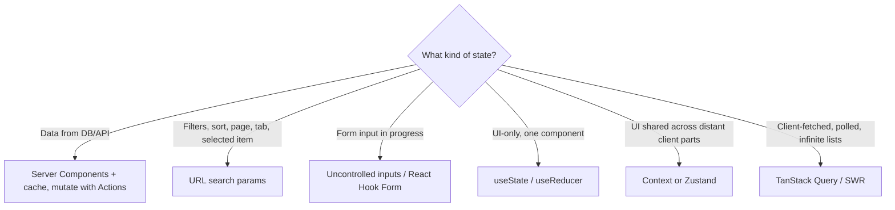

**Q1 \[A\]. React Hook Form with Server Actions?**

Use one Zod schema for both sides. RHF gives instant client validation and field-level UX; the action re-validates because client checks can be bypassed.

```tsx
'use client';
import { useForm } from 'react-hook-form';
import { zodResolver } from '@hookform/resolvers/zod';
import { useTransition } from 'react';
import { ContactSchema, type Contact } from '@/lib/schemas';
import { sendContact } from './actions';

export function ContactForm() {
  const [pending, start] = useTransition();
  const form = useForm<Contact>({ resolver: zodResolver(ContactSchema) });
  const onSubmit = form.handleSubmit((values) => start(async () => {
    const res = await sendContact(values);         // action calls ContactSchema.parse again
    if (!res.ok) Object.entries(res.errors ?? {}).forEach(([k, v]) => form.setError(k as keyof Contact, { message: v[0] }));
  }));
  return (
    <form onSubmit={onSubmit} noValidate>
      <input {...form.register('email')} aria-invalid={!!form.formState.errors.email} />
      <span role="alert">{form.formState.errors.email?.message}</span>
      <button disabled={pending}>Send</button>
    </form>
  );
}
```

Trade-off: this path loses progressive enhancement (needs JS). For simple forms, prefer `<form action>` + `useActionState`.

**Q2 \[A\]. Redux Toolkit or Zustand in the App Router?**

Both work in Client Components, with two rules: create the store per request (in a provider with `useRef`/`useState`), never as a module-level singleton on the server, because the server process is shared by all users; and do not mirror server data into the store if a Server Component can render it. Zustand suits small shared UI state; Redux Toolkit suits large teams wanting strict patterns, devtools and RTK Query.

**Q3 \[A\]. Where does TanStack Query fit?**

For client-driven data: infinite scrolling, polling, optimistic lists with complex rollback, or data fetched in response to client interaction. Pattern: prefetch on the server, dehydrate into a `HydrationBoundary`, and let the client continue. Do not use it to replace server rendering for initial page data. Watch for double caching: Next.js cache plus Query cache with different lifetimes.

**Q4 \[I\]. Loading, empty and error states?**

Design all four for every data view: loading (skeleton matching final layout to avoid CLS), empty (explain and give an action), error (retry, preserve user input), and success. In App Router: `loading.tsx` or inline `<Suspense>` for loading, `error.tsx` or `catchError` (16.3+) for errors, returned error states from actions for expected failures.

**Q5 \[A\]. Accessible UI patterns to mention?**

Labels tied to inputs, `aria-invalid` and `aria-describedby` for errors, `role="status"` / `aria-live` for async results, focus management after route changes (Next.js announces route changes for screen readers) and in modals (trap focus, restore on close), keyboard support for custom widgets, and `prefers-reduced-motion` for View Transitions.

**When not to use, and alternatives**

| Tool | Avoid when | Alternative |
| --- | --- | --- |
| Redux Toolkit | Mostly server data, small UI state | URL state + local state; Zustand |
| TanStack Query | Initial page data | Server Components |
| Global store for form state | Single form | React Hook Form or uncontrolled inputs |

**Practice:** challenges C1, C6; debugging D6.

**Revision summary:** server data on the server, shareable state in the URL; stores per request; validate on both sides; four UI states per view.

## M. Testing and quality

Async Server Components are awkward to unit test, so the effective strategy is: unit-test pure logic and the DAL, component-test Client Components, and cover routing, caching and Server Components end to end with Playwright against a production build.

| Layer | Tool | What to test |
| --- | --- | --- |
| Pure functions, schemas, DAL authorization | Vitest / Jest | `can()` rules, Zod schemas, DTO mappers |
| Server Actions | Vitest with mocked session and DB | Unauthenticated, unauthorized, invalid input, happy path |
| Route Handlers | Vitest calling exported `GET`/`POST` with a `Request` | Status codes, signature checks, idempotency |
| Client Components | React Testing Library | Interaction, accessibility queries, error states |
| Full pages, navigation, caching | Playwright on `next build && next start` | Auth flows, redirects, revalidation, streaming fallbacks |
| Accessibility | axe (`@axe-core/playwright`) | Violations per page |
| Visual | Playwright screenshots | Layout regressions |

**Q1 \[A\]. Test a Server Action's authorization.**

```ts
// actions.test.ts
import { describe, it, expect, vi } from 'vitest';
vi.mock('next/cache', () => ({ updateTag: vi.fn(), revalidateTag: vi.fn() }));
vi.mock('@/lib/dal/auth', () => ({ requireUser: vi.fn() }));
import { requireUser } from '@/lib/dal/auth';
import { deleteInvoice } from './actions';

describe('deleteInvoice', () => {
  it('rejects users from another tenant', async () => {
    vi.mocked(requireUser).mockResolvedValue({ userId: 'u1', tenantId: 't1', role: 'admin' });
    await expect(deleteInvoice('inv-of-tenant-t2')).rejects.toThrow('Forbidden');
  });
});
```

**Q2 \[A\]. Test a Route Handler.**

```ts
import { POST } from '@/app/api/webhooks/stripe/route';
it('rejects bad signatures', async () => {
  const res = await POST(new Request('http://x/api/webhooks/stripe', { method: 'POST', body: '{}', headers: { 'stripe-signature': 'bad' } }));
  expect(res.status).toBe(400);
});
```

**Q3 \[A\]. E2E test for an auth-protected page.**

```ts
import { test, expect } from '@playwright/test';

test.use({ storageState: 'e2e/.auth/user.json' }); // created once in a setup project

test('dashboard shows own orders only', async ({ page }) => {
  await page.goto('/dashboard/orders');
  await expect(page.getByRole('heading', { name: 'Orders' })).toBeVisible();
  await expect(page.getByText('ORDER-OF-OTHER-USER')).toHaveCount(0);
});

test('anonymous users are redirected', async ({ browser }) => {
  const page = await (await browser.newContext()).newPage();
  await page.goto('/dashboard');
  await expect(page).toHaveURL(/\/login\?next=%2Fdashboard/);
});
```

Since 16.3, `instant()` from `@next/playwright` asserts what is visible instantly during a navigation, catching regressions where a refactor makes a route block.

**Q4 \[A\]. How do you mock external APIs?**

MSW (Mock Service Worker) in Node for unit/integration tests; for E2E, point `API_URL` to a mock server or use Playwright `page.route` for browser-side requests. Remember Playwright `page.route` cannot intercept server-side fetches made by Server Components; those need a server-side mock.

**Q5 \[S\]. What does CI look like?**

Typecheck, lint (ESLint or Biome directly; `next lint` was removed in 16), unit tests, `next build` (catches prerender and Cache Components errors), Playwright against the built app with a seeded DB, bundle-size budget check, Lighthouse CI on key pages, dependency audit. Cache Turbopack's build cache between runs.

**Q6 \[S\]. How do you debug production-only bugs?**

Reproduce with `next build && next start` and production env vars; compare the error `digest` with server logs; check caching (stale data from Data Cache or CDN), env vars baked at build, `NODE_ENV` differences, multiple instances with different builds (version skew), and proxies buffering streams. Use `instrumentation.ts` `onRequestError` to ship errors with route context to your error tracker.

**When not to use, and alternatives**

| Tool | Avoid when | Alternative |
| --- | --- | --- |
| Unit tests for async Server Components | Behavior depends on routing, caching or streaming | Playwright on a production build |
| Snapshot tests | UI changes often | Role-based RTL assertions, visual tests on key pages |
| E2E for every branch | Logic is pure | Unit tests on the DAL and schemas |

**Practice:** challenge C1 tests, C4 tests, Round 4.

**Revision summary:** test logic and authz in units, Client Components with RTL, everything else E2E on a production build; never test caching in dev mode.

## N. Deployment and production

Self-hosting Next.js on one Node server is easy; the senior part is running several instances behind a load balancer without breaking caches, Server Actions, streaming or zero-downtime deploys.

### Self-hosted multi-instance architecture

&#91;embedded content: Self-hosted multi-instance deployment\]

**Q1 \[I\]. What is `output: 'standalone'`?**

It traces the files each route needs and writes `.next/standalone` with a minimal `server.js` and only the required `node_modules`, producing much smaller Docker images. You must copy `public/` and `.next/static` next to it yourself (or serve them from a CDN).

**Q2 \[A\]. Write a production Dockerfile.**

```dockerfile
FROM node:22-alpine AS deps
WORKDIR /app
COPY package.json package-lock.json ./
RUN npm ci

FROM node:22-alpine AS build
WORKDIR /app
COPY --from=deps /app/node_modules ./node_modules
COPY . .
# Only NEXT_PUBLIC_* needs to exist at build; server secrets come at runtime
ARG NEXT_PUBLIC_SITE_URL
ENV NEXT_TELEMETRY_DISABLED=1
RUN npm run build

FROM node:22-alpine AS run
WORKDIR /app
ENV NODE_ENV=production PORT=3000 HOSTNAME=0.0.0.0
RUN addgroup -S app && adduser -S app -G app
COPY --from=build --chown=app:app /app/.next/standalone ./
COPY --from=build --chown=app:app /app/.next/static ./.next/static
COPY --from=build --chown=app:app /app/public ./public
USER app
EXPOSE 3000
HEALTHCHECK CMD wget -qO- http://127.0.0.1:3000/api/health || exit 1
CMD ["node", "server.js"]
```

**Q3 \[A\]. Nginx in front of Next.js?**

```nginx
upstream next_upstream { server 127.0.0.1:3000; keepalive 64; }
server {
  listen 443 ssl http2;
  server_name shop.example.com;
  location /_next/static/ {
    proxy_pass http://next_upstream;
    add_header Cache-Control "public, max-age=31536000, immutable";
  }
  location / {
    proxy_pass http://next_upstream;
    proxy_http_version 1.1;
    proxy_set_header Host $host;
    proxy_set_header X-Forwarded-For $proxy_add_x_forwarded_for;
    proxy_set_header X-Forwarded-Proto $scheme;
    proxy_set_header Connection "";
    proxy_buffering off;            # keep streaming working
  }
}
```

Check that the Host/Origin seen by Next.js matches the browser's origin, or Server Actions fail the CSRF check; configure `serverActions.allowedOrigins` when proxies rewrite hosts.

**Q4 \[A\]. PM2 or containers?**

PM2 on a VPS gives process supervision, cluster mode across CPU cores and log rotation; fine for small deployments. In cluster mode each worker has its own in-memory cache, so the multi-instance cache problem appears even on one machine. Containers with an orchestrator (Kubernetes, ECS, Fly, Railway) add rolling deploys, health-based restarts and horizontal scaling. Do not run PM2 cluster mode inside containers that are already scaled by the orchestrator.

**Q5 \[S\]. What breaks with multiple instances, and how do you fix it?**

| Problem | Fix |
| --- | --- |
| ISR / `"use cache"` entries differ per instance; tag revalidation hits only one | Shared cache handler (Redis) via `cacheHandler` / `cacheHandlers` |
| Server Actions fail across instances after deploy | Same build on all instances; shared `NEXT_SERVER_ACTIONS_ENCRYPTION_KEY` |
| Version skew: old client calls new server | `deploymentId` / skew protection, keep old assets available, prompt reload |
| Static assets 404 during rolling deploy | Serve `/_next/static` from CDN or object storage that keeps previous builds; 16.3 can reuse immutable assets across deploys |
| In-memory rate limits and sessions | Redis |
| Image optimizer cache per instance | Shared volume or CDN in front of `/_next/image`, or an external image service |

**Q6 \[A\]. Build-time vs runtime environment variables?**

`NEXT_PUBLIC_*` values are inlined at build. Server-side `process.env` values are read at runtime in dynamic code, but code that runs during prerendering at build time captures build-time values into static output. To promote one image across environments: keep public config out of `NEXT_PUBLIC_*` (serve it from the server), and make env-dependent pages dynamic or read config at request time.

**Q7 \[A\]. Health checks and graceful shutdown?**

Expose a cheap `GET /api/health` (liveness) and a readiness check that verifies DB/Redis. On SIGTERM, the orchestrator should stop routing traffic first (readiness fails or deregistration delay), then Next.js finishes in-flight requests; set a termination grace period longer than your longest request. Close DB pools in a shutdown handler registered from `instrumentation.ts`.

**Q8 \[S\]. Vercel vs self-hosting vs other platforms?**

Vercel gives zero-config ISR, shared caches, skew protection, image optimization and edge networking, at a usage-based cost and some lock-in. Self-hosting gives control and predictable infrastructure cost but you own the problems above. Since 16.2 a stable Adapter API and public adapter test suite (plus OpenNext) make other platforms more consistent. A senior answer chooses by team ops capacity, traffic profile, compliance and cost, not by preference.

**Q9 \[S\]. Zero-downtime deployment and rollback?**

Blue/green or rolling deploys with readiness gates; keep the previous build's static assets reachable for in-flight clients; database migrations must be backward compatible (expand, deploy, contract); rollbacks re-point traffic to the previous image; caches keyed by build ID avoid serving new HTML with old data shapes.

**Q10 \[A\]. Observability?**

`instrumentation.ts` with `@vercel/otel` or the OpenTelemetry SDK traces rendering, fetches and route handlers; `onRequestError` reports errors with route and render context; structured JSON logs with request IDs; RUM for Web Vitals; dashboards on p95 TTFB per route, cache hit ratio, error rate and memory.

**When not to use, and alternatives**

| Choice | Avoid when | Alternative |
| --- | --- | --- |
| Self-hosting | Small team, no ops capacity, spiky traffic | Vercel or a managed adapter platform |
| Vercel | Strict data residency, cost at very high volume | Containers on your cloud with adapters/OpenNext |
| PM2 cluster mode | Running inside an orchestrator | One process per container, scale replicas |
| `output: 'export'` | You need SSR, actions, ISR, proxy | Standalone server output |

**Practice:** debugging D11, D14; scenarios S4, S8.

**Revision summary:** standalone + Docker; streaming needs unbuffered proxies; multi-instance needs shared cache, same build, shared action key, skew handling; env vars are partly build-time; health checks and graceful shutdown.

## O. Senior-level architecture and engineering

Senior rounds test whether you can keep a large Next.js codebase fast, secure and changeable by many people; organize by feature, enforce boundaries with tooling, and justify every architectural choice with trade-offs.

### Feature-based structure with enforced boundaries

```text
src/
├─ app/                       # routing only: thin pages that compose features
│  ├─ (shop)/products/[slug]/page.tsx
│  └─ (admin)/admin/orders/page.tsx
├─ features/
│  ├─ catalog/
│  │  ├─ components/          # server + client UI for this feature
│  │  ├─ server/              # 'server-only': queries, actions, DAL, cache tags
│  │  ├─ schemas.ts           # zod, shared client/server
│  │  └─ index.ts             # public API of the feature
│  ├─ cart/
│  └─ orders/
├─ shared/
│  ├─ ui/                     # design system primitives
│  ├─ lib/                    # db, auth, api client, logger
│  └─ config/
```

Rules: `app/` imports features only through their `index.ts`; features never import each other's `server/` internals; `shared` imports nothing from features. Enforce with ESLint import rules (`eslint-plugin-boundaries`, `no-restricted-imports`) or Nx/Turborepo module boundaries.

### Monorepo layout

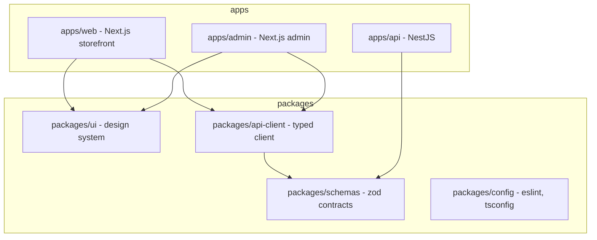

**Q1 \[S\]. When do you split into multiple Next.js apps or micro-frontends?**

Split when teams need independent deploy cadences, very different security postures (public storefront vs internal admin), or different scaling profiles. Next.js multi-zones route path prefixes to separate apps under one domain. Costs: duplicated shared layouts, cross-app navigation becomes full page loads, shared state through cookies only, version drift of the design system. Prefer one app with strong module boundaries until team topology forces a split.

**Q2 \[S\]. How do you design a shared component library for RSC?**

- Mark interactive primitives with `"use client"` inside the package; keep presentational ones server-compatible.
- Export server-safe and client entry points separately so importing a `Button` does not pull a date picker into every page.
- No global CSS side effects on import; use CSS Modules, Tailwind presets or zero-runtime CSS-in-JS (runtime CSS-in-JS needs client registries).
- `transpilePackages` for internal packages if not prebuilt.
- Visual regression and accessibility tests in the package's own CI.

**Q3 \[S\]. How do you handle technical debt such as migrating to Cache Components?**

Inventory routes by type (static, ISR, dynamic), enable `cacheComponents` in a branch, fix build errors route by route (wrap request data in Suspense or add `"use cache"`), replace `unstable_cache`/fetch options with `"use cache"` + tags, use `ensureStatic` on routes that must remain static, compare cost and latency dashboards before and after, and roll out behind deployments rather than a big bang. Next.js 16.4 ships `next upgrade --agent` and migration skills; mention tooling but own the plan.

**Q4 \[S\]. What do you look for in a Next.js code review?**

- New `"use client"` high in the tree, or big imports in Client Components.
- Data access outside the DAL; missing authz in actions and handlers.
- Secrets or full DB rows passed as props.
- Sequential awaits that could be parallel; missing Suspense around slow parts.
- Cache tags and invalidation added with every new mutation.
- Hydration risks (dates, randomness, `window` in render).
- Errors: expected failures returned as states, unexpected ones logged with context.

**Q5 \[S\]. Incident analysis: a deploy made checkout 3x slower. Walk through it.**

Mitigate first (roll back), then investigate: compare traces before and after for the checkout route, look for a new dynamic API in a shared layout (for example `cookies()` added to the header de-opting a static shell), new sequential fetches, a cache tag no longer applied, or a dependency that grew the client bundle. Write a blameless postmortem with a guardrail: an `instant()` E2E test, `ensureStatic` on the route, a bundle budget, or a lint rule.

**Q6 \[S\]. Leadership: how do you get a team to adopt a new pattern?**

Write a short RFC with the problem, options and trade-offs; build one reference feature; add lint rules and templates so the right way is the easy way; pair on the first migrations; measure outcomes (TTFB, bundle size, incident count) and report them.

**When not to use, and alternatives**

| Choice | Avoid when | Alternative |
| --- | --- | --- |
| Micro-frontends / multi-zones | One team, shared release cadence | One app with module boundaries |
| Monorepo | A single app with no shared packages | Single repo, simple tooling |
| Feature folders | Tiny app | Flat `components/` and `lib/` |

**Practice:** scenarios S1 to S8; mock Round 3.

**Revision summary:** thin `app/`, feature modules with public APIs, enforced boundaries; split apps only for organizational reasons; review for client-boundary creep, authz and waterfalls; migrations are incremental and measured.

## Tricky and trap questions

Each trap gives the setup, the correct answer, the execution flow, why tempting answers are wrong, and version notes. Cover the answer and predict first.

### T1. Does this log in the browser console?

```tsx
// app/page.tsx (no directive)
export default function Page() {
  console.log('rendered');
  return <h1>Hi</h1>;
}
```

**Answer:** No. It logs in the server terminal (at build if the page is static, per request if dynamic). **Flow:** Server Component executes on the server → output serialized to RSC → browser never runs this function. **Wrong answers:** "Both, like SSR in the Pages Router" confuses RSC with SSR of Client Components. *Version note:* 16.2+ can forward browser logs to the terminal in dev, which confuses people the other way round.

### T2. Does this component render on the server?

```tsx
'use client';
export function Counter() {
  const [n, setN] = useState(0);
  console.log('Counter render');
  return <button onClick={() => setN(n + 1)}>{n}</button>;
}
```

**Answer:** Yes. It logs once on the server during SSR of the first request, and again in the browser during hydration and every update. **Wrong answer:** "`use client` means browser only." Use `dynamic(() => import(...), { ssr: false })` for browser-only.

### T3. What is wrong here?

```tsx
'use client';
export default function Panel() {
  const key = process.env.STRIPE_SECRET_KEY;
  return <Checkout apiKey={key} />;
}
```

**Answer:** `key` is `undefined` in the browser (only `NEXT_PUBLIC_*` are inlined) and during SSR it is the real secret, so SSR HTML and client render differ, producing a hydration mismatch at best and a leak at worst if it is rendered. Never read secrets in client modules. **Wrong answer:** "Rename to `NEXT_PUBLIC_STRIPE_SECRET_KEY`." That publishes the secret in the JS bundle.

### T4. Is this page static or dynamic? (Next.js 15, cacheComponents off)

```tsx
export default async function Page() {
  const res = await fetch('https://api.example.com/rates');
  const rates = await res.json();
  return <Rates data={rates} />;
}
```

**Answer:** Static. In 15+ the fetch is not cached in the Data Cache, but no dynamic API is used, so the route is prerendered at build: the fetch runs once at build and the HTML is frozen until the next build. **Fix:** `await connection()` before fetching (per-request), or `fetch(url, { next: { revalidate: 60 } })` (ISR). **Version notes:** In 14 the fetch was cached by default and the page was static too. With Cache Components (16), this uncached fetch outside Suspense fails the build until you wrap it in `<Suspense>` or add `"use cache"`.

### T5. Request memoization vs Data Cache

```tsx
async function getUser() { return fetch('https://api/me', { cache: 'no-store' }).then(r => r.json()); }
// layout.tsx and page.tsx both call getUser()
```

**Question:** How many requests per page view? **Answer:** One. Memoization dedupes identical GET fetches within a render pass regardless of `no-store`, which only opts out of the persistent Data Cache. With an ORM, you would get two queries unless wrapped in React `cache()`.

### T6. Why does the user not see their new comment?

```ts
'use server';
export async function addComment(postId: string, text: string) {
  await db.comment.create({ data: { postId, text } });
  revalidateTag(`post:${postId}`, 'max');
}
```

**Answer:** `revalidateTag` with a profile is stale-while-revalidate: the next request may still receive the stale cached entry while it regenerates. The author expects read-your-writes. **Fix:** call `updateTag('post:' + postId)` in the Server Action. Use `revalidateTag(tag, 'max')` for other users' eventual consistency (for example from a webhook). **Version note:** In 14/15 the single-arg `revalidateTag(tag)` behaved closer to immediate expiry; the one-arg form is deprecated in 16.

### T7. `revalidatePath` scope

**Question:** After `revalidatePath('/blog')`, does `/blog/my-post` refresh? **Answer:** No. It invalidates the exact path. Use `revalidatePath('/blog/[slug]', 'page')` for all posts, `revalidatePath('/blog', 'layout')` for the subtree, or tags.

### T8. Cookies inside a cache

```ts
async function getCart() {
  'use cache';
  const id = (await cookies()).get('cart')?.value;
  return db.cart.find(id);
}
```

**Answer:** Error. Request APIs cannot be read inside `"use cache"` because the result would be shared across users. Read the cookie outside and pass `id` as an argument (it becomes part of the key), or do not cache per-user data on the server.

### T9. Hydration mismatch

```tsx
'use client';
export function Greeting() {
  const hour = new Date().getHours();
  return <p>{hour < 12 ? 'Good morning' : 'Good evening'}</p>;
}
```

**Answer:** Mismatch when the server's timezone or render time differs from the user's (e.g. server in UTC, user in Dhaka at UTC+6). React warns and patches the text on the client (React 19 recovers by client-rendering to the nearest Suspense boundary). **Fix:** Render a neutral value on the server and set the greeting in `useEffect`, or compute on the server using a timezone from a cookie.

### T10. `useEffect` during SSR

**Question:** Does `useEffect` run on the server? **Answer:** No. Effects never run during SSR; neither does `useLayoutEffect` (React only warns in older versions). Code inside effects can safely touch `window`. The flip side: state set only in effects is absent from SSR HTML.

### T11. Server Action security

```ts
'use server';
export async function deleteUser(id: string) {
  await db.user.delete({ where: { id } });
}
// Only rendered on /admin, which proxy.ts protects
```

**Answer:** Critical vulnerability. The action is a public POST endpoint; anyone with the action ID can call it with any `id`. Proxy protection of `/admin` does not protect the endpoint. **Fix:** `const s = await requireRole('admin')` inside the action, validate `id`, audit-log, and consider soft deletes.

### T12. Proxy authorization

**Question:** "We check the JWT in `proxy.ts`, so our Route Handlers and pages are safe." True? **Answer:** No. Matchers can miss paths (static exclusions, new routes), CVE-2025-29927 showed middleware could be bypassed entirely, and Server Actions POST to page URLs. Proxy is a first gate for UX and cheap rejections; authorize in the DAL.

### T13. Route Handler vs Server Action

**Question:** A mobile app must create orders; you already have a `createOrder` Server Action. Reuse it? **Answer:** No. Server Action IDs are internal, rotate per build and are tied to the Next.js client protocol. Expose a Route Handler (or the backend API) with a stable contract and token auth; share the underlying service function.

### T14. Sequential vs parallel

```tsx
export default async function Page() {
  const user = await getUser();          // 200 ms
  const products = await getProducts();  // 500 ms
  const promos = await getPromos();      // 300 ms
  return <Shop user={user} products={products} promos={promos} />;
}
```

**Answer:** About 1000 ms before any byte of the page (beyond the layout) renders, because each await blocks the next. `Promise.all` cuts it to about 500 ms; separate Suspense-wrapped components let the user section paint at 200 ms.

### T15. `loading.tsx` and layouts

**Question:** The dashboard layout awaits a 2-second query. Will `dashboard/loading.tsx` show during that time? **Answer:** No. `loading.tsx` wraps the page, below the layout of the same segment. A slow layout blocks the segment; the parent's `loading.tsx` (if any) shows instead. Move slow data into a Suspense-wrapped child component.

### T16. Layouts and searchParams

**Question:** Why can't the layout read `?page=2`? **Answer:** Layouts do not receive `searchParams` because they are not re-rendered when only the query changes; reading it would give stale values. Read it in the page, or in a Client Component with `useSearchParams()`.

### T17. `notFound()` in a streamed component

**Question:** A product component inside `<Suspense>` calls `notFound()`. What status does the crawler get? **Answer:** 200, because headers were already sent with the shell. Next.js injects `<meta name="robots" content="noindex">`. If a true 404 matters, check existence in the page before any Suspense boundary.

### T18. Dynamic params in layouts

**Question:** `/shop/[category]/layout.tsx` reads `params`. Navigating from `/shop/shoes/1` to `/shop/shoes/2`, does the layout re-render? **Answer:** No; its segment did not change, so it is preserved. Navigating to `/shop/hats/1` changes the `[category]` segment, so that layout re-renders.

### T19. Edge vs Node runtime

**Question:** Should you set `export const runtime = 'edge'` on routes for speed? **Answer:** Usually not. The Next.js docs recommend the Node.js runtime for rendering. Edge has a restricted API surface (many npm packages and DB drivers fail), does not support ISR, and is **not supported at all with Cache Components**; the migration guide tells you to remove `runtime = 'edge'` and use Proxy for edge-style behavior. It also often runs far from your database, so total latency can rise. `proxy.ts` is Node-only since 16, and the Edge `middleware.ts` is deprecated. Use Edge only for latency-critical, I/O-light routes in apps without Cache Components.

### T20. Remote image configuration

```tsx
<Image src="https://cdn.partner.com/a.jpg" width={400} height={300} alt="" />
```

**Answer:** Error: hostname not configured. Add an `images.remotePatterns` entry with protocol, hostname and ideally pathname. `images.domains` is deprecated because it allows any path on the host. Also in 16, `quality={90}` silently becomes 75 unless 90 is in `images.qualities`.

### T21. Redirect in try/catch

```ts
try {
  await save();
  redirect('/done');
} catch (e) {
  return { error: 'Failed' };
}
```

**Answer:** The user never gets redirected; `redirect()` throws a control-flow error that the catch swallows, returning `{ error }`. Call `redirect` after the try block, or `unstable_rethrow(e)` first in the catch.

### T22. Rewrites vs redirects

**Question:** You rewrite `/blog/:path*` to `https://blog-host.com/:path*`. What URL does the user see, and who pays for traffic? **Answer:** The original `/blog/...` URL stays; Next.js proxies the request, so your server handles every blog request and its latency. A redirect would change the URL and offload traffic.

### T23. Router Cache staleness

**Question:** User A edits a product; user B, who visited the page a minute ago in a still-open tab, clicks back to it. Does B see the edit? (15/16, cacheComponents off) **Answer:** For a dynamic page, yes, because dynamic pages are not reused from the Router Cache by default since 15 (`staleTimes.dynamic` 0), though back/forward navigation restores from cache. In 14 B would see a 30-second-old copy. For static/ISR pages B gets whatever the server cache has, which updates only after revalidation.

### T24. `"use client"` on a page with metadata

**Question:** Why does `export const metadata` stop working after adding `"use client"` to `page.tsx`? **Answer:** Metadata exports are only supported in Server Components. Keep the page a Server Component and move interactivity into a child Client Component.

## Code output and debugging questions

Each exercise is a realistic bug: identify it, explain the mechanism, then fix it. Try before reading the fix.

### D1. "Event handlers cannot be passed to Client Component props"

```tsx
// app/page.tsx (Server Component)
import { Button } from './button'; // 'use client'
export default function Page() {
  return <Button onClick={() => console.log('hi')}>Hi</Button>;
}
```

**Bug:** Functions are not serializable across the server-to-client boundary. **Fix:** Define the handler inside the Client Component, or pass a Server Action (`action={myAction}`), which React serializes as a reference.

### D2. The whole app became client-rendered

```tsx
// app/layout.tsx
'use client';
import { ThemeProvider } from 'next-themes';
export default function RootLayout({ children }) {
  return <html><body><ThemeProvider>{children}</ThemeProvider></body></html>;
}
```

**Bug:** `"use client"` in the root layout. Metadata exports break, and any component imported by the layout ships to the browser. (Pages passed as `children` are still Server Components, but the layout's own imports and anything it renders directly are client.) **Fix:** Move the provider to `app/providers.tsx` with `"use client"`, keep the layout a Server Component, and add `suppressHydrationWarning` on `<html>` for theme class injection.

### D3. Stale price after admin update

```ts
// lib/products.ts (previous model)
export const getProduct = (id: string) =>
  fetch(`${API}/products/${id}`, { next: { revalidate: 3600 } }).then((r) => r.json());

// admin action
export async function updatePrice(id: string, price: number) {
  'use server';
  await api.patch(`/products/${id}`, { price });
  revalidatePath('/admin/products');
}
```

**Bug:** The storefront page `/products/[id]` and its Data Cache entry were never invalidated; only the admin path was. **Fix:** Tag the fetch (`next: { revalidate: 3600, tags: ['product:' + id] }`) and call `revalidateTag('product:' + id, 'max')` (or `updateTag` if the admin must see it immediately in the same request). With Cache Components: `cacheTag('product:' + id)` inside a `"use cache"` function.

### D4. Unauthorized data leak through props

```tsx
export default async function Profile() {
  const user = await db.user.findUnique({ where: { id: await currentUserId() } });
  return <ProfileCard user={user} />; // 'use client'
}
```

**Bug:** The full row (hashed password, MFA secret, internal flags) is serialized into the RSC payload visible in page source. **Fix:** Select only needed fields or map to a DTO in the DAL: `select: { name: true, avatarUrl: true }`.

### D5. Infinite re-render after a Server Action

```tsx
'use client';
export function Tracker() {
  const router = useRouter();
  useEffect(() => { logView().then(() => router.refresh()); });
  return null;
}
```

**Bug:** No dependency array: every refresh re-renders, the effect runs again, calls the action, refreshes again. **Fix:** `useEffect(..., [])`, and drop `router.refresh()` if nothing visible changes. Better, log on the server with `after()`.

### D6. `useSearchParams` breaks the static build

**Symptom:** Build error or the entire page renders client-side after adding a search box using `useSearchParams()`. **Cause:** In a statically rendered route, `useSearchParams` cannot be known at build time, so rendering bails out to the client up to the nearest Suspense boundary; without one, the whole page is affected (and the build warns or errors). **Fix:** Wrap the component in `<Suspense fallback={...}>`, or read `searchParams` in the page (making it dynamic) and pass values down.

### D7. Cache Components build error

```tsx
// cacheComponents: true
export default async function Page() {
  const orders = await db.order.findMany(); // uncached I/O at top level
  return <OrderList orders={orders} />;
}
```

**Symptom:** `next build` fails, reporting uncached data accessed outside of `<Suspense>`. **Explanation:** Next.js must decide what goes into the static shell. Uncached I/O outside Suspense would block the whole shell, so you must make an explicit choice. **Fix (dynamic):** move the query into `<Orders />` and wrap it in `<Suspense fallback={<Skeleton/>}>`. **Fix (cached):** add `"use cache"` + `cacheLife` + `cacheTag` to a `getOrders()` function if the data is shared and can be stale.

### D8. Hydration error from markup

```tsx
export function Price({ cents }: { cents: number }) {
  return <p>Price: <div className="amount">{(cents / 100).toFixed(2)}</div></p>;
}
```

**Bug:** `<div>` inside `<p>` is invalid HTML. The browser's parser closes the `<p>` early, so the DOM differs from React's expected tree. **Fix:** Use `<span>` or change `<p>` to `<div>`.

### D9. Cookie set in a Server Component

```tsx
export default async function Page() {
  (await cookies()).set('seen', '1');
  return <p>Welcome</p>;
}
```

**Bug:** Throws: cookies can only be modified in Server Actions, Route Handlers or `proxy.ts`, because by the time a Server Component renders, headers may already be streaming. **Fix:** Set it in `proxy.ts` or in an action triggered by the client.

### D10. Slow dashboard (performance)

```tsx
export default async function Dashboard() {
  const user = await getUser();
  const teams = await getTeams(user.id);
  const stats = [];
  for (const t of teams) stats.push(await getStats(t.id)); // N sequential calls
  return <View user={user} teams={teams} stats={stats} />;
}
```

**Bugs:** waterfall plus N+1. With 10 teams at 150 ms each, about 1.5 s of stats alone. **Fix:** batch at the API (`getStatsForTeams(ids)`) or run `Promise.all(teams.map(...))` with a concurrency limit; stream stats behind Suspense so the user and team list paint first; cache stats with a short `cacheLife`.

### D11. Server Action works locally, 403/"Invalid Server Actions request" behind proxy

**Cause:** The reverse proxy rewrites `Host` (or forwards to an internal hostname), so the Origin header does not match, failing CSRF protection. **Fix:** Forward the original host (`proxy_set_header Host $host` and `X-Forwarded-Host`) or set `serverActions.allowedOrigins`.

### D12. Auth flicker

**Symptom:** Protected page briefly shows the logged-out header, then switches. **Cause:** Auth state fetched client-side in a `useEffect` (CSR) instead of read on the server. **Fix:** Read the session in the Server Component (DAL) and render the correct header in the first HTML; pass minimal user info to client context.

### D13. Metadata missing in production previews

**Symptom:** Social cards show `http://localhost:3000/og.png`. **Cause:** No `metadataBase`; relative URLs resolved against the build-time default. **Fix:** Set `metadataBase` from a runtime-known site URL in the root layout.

### D14. Memory grows until the pod is killed

**Suspects:** module-level `Map` used as a cache without eviction; per-request objects stored globally (e.g. a Zustand store created at module scope on the server); event listeners added on every request; an unbounded in-memory cache handler. **Fix:** LRU with limits or Redis; per-request stores; heap snapshots with `node --inspect` and `--heapsnapshot-signal`.

### D15. Predict the output order

```tsx
import { Suspense } from 'react';
async function A() { await sleep(300); return <p>A</p>; }
async function B() { await sleep(100); return <p>B</p>; }
export default function Page() {
  return (<>
    <h1>Title</h1>
    <Suspense fallback={<p>loading A</p>}><A /></Suspense>
    <Suspense fallback={<p>loading B</p>}><B /></Suspense>
  </>);
}
```

**Answer:** First chunk: Title, "loading A", "loading B". At about 100 ms, B replaces its fallback. At about 300 ms, A replaces its fallback. DOM order stays A then B; arrival order is B then A. If both were in one Suspense boundary, both would appear together at 300 ms.

## Senior-level real-world scenarios

In scenario rounds, structure every answer the same way: clarify requirements, state constraints, propose an architecture, show the critical code path, then name trade-offs, failure modes and what you would monitor.

### S1. E-commerce storefront: product listing, search, filters, cart

**Requirements:** 200k products, SEO for category and product pages, filters (price, size, brand), sort, pagination, personalized cart, flash sales with 20x traffic. **Constraints:** price and stock change often; catalog edits come from a PIM via webhook.

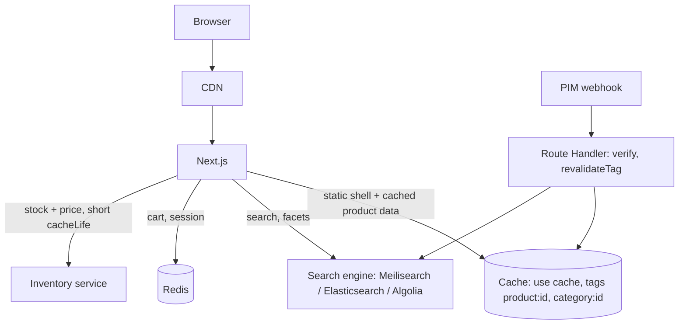

**Recommended solution**

- Product page: static shell with cached product content (`cacheLife('days')`, tag `product:<id>`), stock and price in a small Suspense hole with `cacheLife('minutes')` or uncached, cart badge as a dynamic hole reading the session cookie.
- Category and search pages: URL-driven state (`?brand=x&sort=price-asc&page=2`); the Server Component reads `searchParams`, queries the search engine with facets, and streams results under Suspense. Canonicalize filter combinations for SEO.
- Pagination: cursor-based in the API; page numbers for SEO category pages.
- Webhook invalidation per product and category tag; search index updated by the same event.
- Flash sale: pre-warm caches, put hot pages behind the CDN, queue checkout writes, protect inventory with atomic decrements (Redis or DB row locks), rate limit add-to-cart.

```tsx
// app/(shop)/c/[category]/page.tsx
export default async function Category({ params, searchParams }: PageProps<'/c/[category]'>) {
  const { category } = await params;
  const sp = await searchParams;
  const filters = FiltersSchema.parse(sp);           // validate untrusted query
  return (
    <>
      <CategoryHeader slug={category} />             {/* cached */}
      <FilterBar />                                  {/* client, writes URL */}
      <Suspense key={JSON.stringify(filters)} fallback={<GridSkeleton />}>
        <Results category={category} filters={filters} />
      </Suspense>
    </>
  );
}
```

The `key` on Suspense re-shows the fallback when filters change instead of keeping stale results.

**Trade-offs:** caching search results is low value (high cardinality); cache facets and category metadata instead. **Failure cases:** search engine down (fall back to DB query with limited filters), webhook missed (scheduled reconciliation job), overselling under concurrency. **Follow-ups:** How do you prevent crawl traps from facets? How would you A/B test the listing without breaking caching (bucket in a cookie, read it inside a dynamic hole)?

### S2. Secure admin dashboard with RBAC

**Requirements:** roles admin, manager, support; audit trail; impersonation for support; separate from public site.

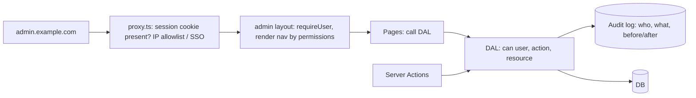

**Solution:** separate subdomain or app with stricter cookies (`SameSite=Strict`, shorter sessions), SSO with MFA, permission checks in the DAL for every read and action, audit logging inside the DAL, step-up re-authentication for destructive actions, impersonation recorded as `actorId` + `subjectId` in sessions and logs, and no admin data ever cached in shared caches.

```ts
export async function refundOrder(orderId: string, amount: number) {
  'use server';
  const actor = await requirePermission('order:refund');
  const order = await orders.getForTenant(orderId, actor.tenantId);
  if (!order) throw new Error('Not found');
  if (amount > order.total) return { ok: false, error: 'Amount exceeds total' };
  await payments.refund(order, amount, { idempotencyKey: `refund:${orderId}:${amount}` });
  await audit.log({ actor, action: 'order:refund', resource: orderId, data: { amount } });
  updateTag(`order:${orderId}`);
  return { ok: true };
}
```

**Failure cases:** permission cached in a long-lived JWT after role removal (keep sessions server-side or short-lived), forgotten check in a new Route Handler (lint rule requiring DAL imports), CSV export of PII without logging. **Follow-ups:** How do you test that every action checks permissions? How would you add field-level permissions?

### S3. Multi-tenant SaaS dashboard

**Requirements:** tenants on subdomains (`acme.app.com`) and custom domains, per-tenant branding, strict data isolation, some enterprise tenants need dedicated databases.

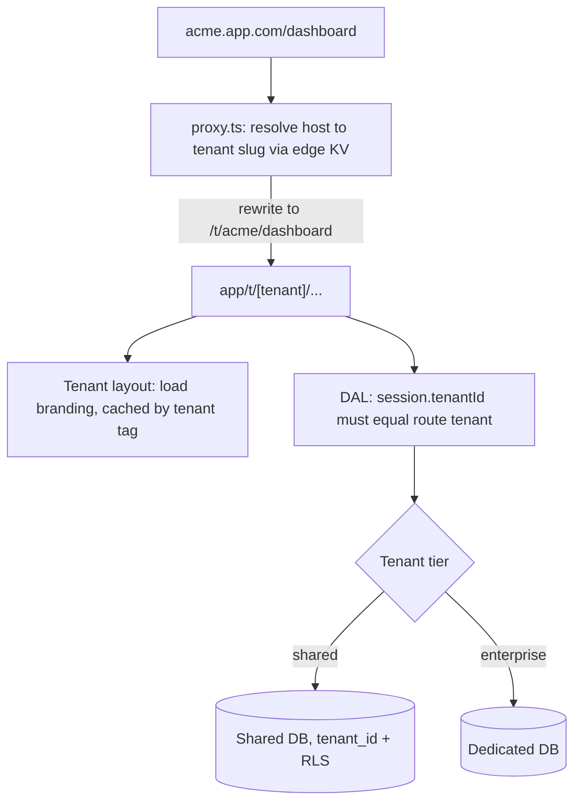

**Solution:** rewrite in `proxy.ts` from host to an internal `[tenant]` segment (users never see it), branding via cached tenant config (`cacheTag('tenant:' + slug)`), DAL that verifies the session's tenant matches the URL's tenant and adds `tenant_id` to every query, Postgres row-level security as a backstop, a tenant-aware DB router for dedicated databases, cache keys always including the tenant.

**Trade-offs:** shared DB is cheaper and simpler; dedicated DBs give isolation and noisy-neighbor protection but complicate migrations. **Failure cases:** a cached component that forgot the tenant argument serves Tenant A's data to Tenant B (the worst bug in multi-tenancy). Guard with tests that render the same route for two tenants and compare. **Follow-ups:** How do you issue TLS for custom domains? How do you run migrations across 500 dedicated databases?

### S4. Handling traffic spikes (product launch, news event)

**Plan:** maximize what the CDN can serve (static shells, `ensureStatic` on launch pages), keep dynamic holes small and cheap, set long `cacheLife` on shared content, shed load gracefully (queue checkout, rate limit, waiting room), autoscale on CPU and concurrency with pre-scaled minimum replicas, warm caches before the event, protect the DB with pooling and read replicas, and load test with realistic mixes (k6). Watch p95 TTFB, error rate, DB connections and cache hit ratio.

**Failure case:** cache stampede when a hot tag expires; mitigate with stale-while-revalidate profiles (serve stale while one request regenerates) and request coalescing in the cache handler.

### S5. File uploads, background jobs and notifications

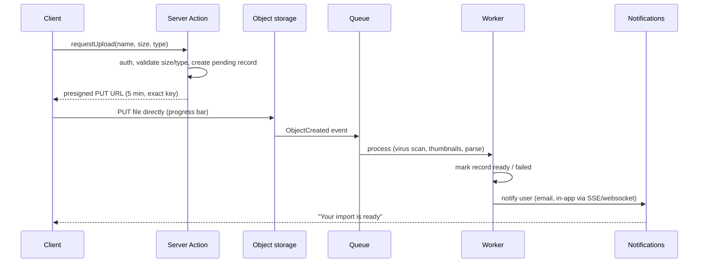

**Why:** files never stream through Next.js servers (memory and timeouts), work is retried by the queue, and the UI subscribes to status. **Failure cases:** client uploads but never confirms (expire pending records), duplicate events (idempotent workers), huge files (multipart uploads). **Follow-up:** how do you show progress for a 10-minute import? (Job status table polled with `router.refresh()` or pushed via SSE.)

### S6. Large datasets: a 2-million-row orders table in the UI

Server-side pagination with cursors, filtering and sorting in the database with indexes that match the sort, URL-driven state, virtualization on the client for long pages (TanStack Virtual), exports as background jobs rather than in-request, aggregated counts from materialized views or approximate counts. Never ship the dataset to the client and filter there.

### S7. Optimizing Core Web Vitals on an existing slow app

1. Measure field data per route; pick the worst high-traffic routes.
2. LCP: move hero data to the server, add `priority`/preload to hero image, `next/font`, remove client-side redirects.
3. INP: audit the largest Client Components, move static parts to the server, dynamic-import heavy widgets, adopt the React Compiler.
4. CLS: dimensions on media, skeletons that match final size, reserve ad slots.
5. Prevent regressions: bundle budgets in CI, `instant()` tests, RUM alerts.

### S8. Production debugging: intermittent 500s after deploy

Correlate error `digest`s with logs and traces, check which instance and build ID served them (version skew or mixed builds), look for Server Action "failed to find action" errors from old clients, examine cache handler errors, and compare with the previous release. Mitigate by rolling back, then add the missing guardrail.

**Senior follow-up bank:** What would you do differently with 10x traffic? What would you cut with half the team? What is your rollback plan? Which metric proves the design works? What is the most likely security bug here?

## Hands-on coding challenges

Each challenge lists requirements and edge cases, then a working solution in Next.js 16 with TypeScript; adapt the data layer (`db`) to Prisma, Drizzle or your API.

### C1. Server-side search, filtering, sorting and pagination

**Requirements:** `/products?q=shoe&brand=nike&sort=price-asc&page=2`; shareable URLs; invalid params never crash; debounced search input; 24 items per page; loading state while results change. **Edge cases:** page beyond last page, negative or non-numeric page, unknown sort, empty results, special characters in `q`.

```ts
// features/catalog/schemas.ts
import { z } from 'zod';
export const SORTS = ['newest', 'price-asc', 'price-desc'] as const;
export const ProductQuery = z.object({
  q: z.string().trim().max(100).optional().catch(undefined),
  brand: z.string().max(50).optional().catch(undefined),
  sort: z.enum(SORTS).catch('newest'),
  page: z.coerce.number().int().min(1).max(1000).catch(1),
});
export type ProductQuery = z.infer<typeof ProductQuery>;
export const PAGE_SIZE = 24;
```

```ts
// features/catalog/server/search.ts  (Prisma shown; mode: 'insensitive' is Prisma + PostgreSQL specific)
import 'server-only';
import { cache } from 'react';
import { PAGE_SIZE, type ProductQuery } from '../schemas';

const ORDER = { newest: { createdAt: 'desc' }, 'price-asc': { price: 'asc' }, 'price-desc': { price: 'desc' } } as const;

function whereFor({ q, brand }: Pick<ProductQuery, 'q' | 'brand'>) {
  return {
    ...(q && { name: { contains: q, mode: 'insensitive' as const } }), // parameterized by the ORM, no SQL injection
    ...(brand && { brand }),
  };
}

// cache(): page and Results share one count query per request
export const countProducts = cache(async (q?: string, brand?: string) =>
  db.product.count({ where: whereFor({ q, brand }) }));

export async function searchProducts({ q, brand, sort, page }: ProductQuery) {
  return db.product.findMany({
    where: whereFor({ q, brand }),
    orderBy: ORDER[sort],
    skip: (page - 1) * PAGE_SIZE,
    take: PAGE_SIZE,
    select: { id: true, slug: true, name: true, price: true, imageUrl: true },
  });
}
```

```tsx
// app/(shop)/products/page.tsx
import { Suspense } from 'react';
import { redirect } from 'next/navigation';
import { PAGE_SIZE, ProductQuery } from '@/features/catalog/schemas';
import { countProducts, searchProducts } from '@/features/catalog/server/search';
import { SearchBox } from '@/features/catalog/components/search-box';
import { Pagination } from '@/features/catalog/components/pagination';

export default async function ProductsPage({ searchParams }: PageProps<'/products'>) {
  const query = ProductQuery.parse(await searchParams);

  // Clamp BEFORE any Suspense boundary: a real 307 with headers, not a client-side redirect mid-stream
  const total = await countProducts(query.q, query.brand);
  const pages = Math.max(1, Math.ceil(total / PAGE_SIZE));
  if (query.page > pages) {
    redirect(`/products?${new URLSearchParams({ ...stringify(query), page: String(pages) })}`);
  }

  return (
    <main>
      <Suspense fallback={null}>
        <SearchBox />                 {/* useSearchParams needs a boundary */}
      </Suspense>
      <p>{total} results</p>
      <Suspense key={JSON.stringify(query)} fallback={<p aria-busy="true">Loading products…</p>}>
        <Results query={query} pages={pages} />
      </Suspense>
    </main>
  );
}

async function Results({ query, pages }: { query: ProductQuery; pages: number }) {
  const items = await searchProducts(query);
  if (items.length === 0) return <p>No products match. Try removing a filter.</p>;
  return (
    <>
      <ul className="grid">{items.map((p) => <li key={p.id}><a href={`/p/${p.slug}`}>{p.name}</a> {p.price}</li>)}</ul>
      <Pagination page={query.page} pages={pages} />
    </>
  );
}

function stringify(q: ProductQuery) {
  return Object.fromEntries(Object.entries(q).filter(([, v]) => v !== undefined).map(([k, v]) => [k, String(v)]));
}
```

**Why the count runs first:** the page-out-of-range check must happen before the first Suspense boundary, because once the shell has streamed the status code is fixed and `redirect()` can only navigate on the client. The trade-off is that the count is on the critical path; it is cheap with an index, and the heavier `findMany` still streams. Alternatives: render a "page not found, go to last page" message inside `Results` instead of redirecting, or drop totals and use cursor pagination.

```tsx
// features/catalog/components/search-box.tsx
'use client';
import { usePathname, useRouter, useSearchParams } from 'next/navigation';
import { useEffect, useState, useTransition } from 'react';

export function SearchBox() {
  const params = useSearchParams();
  const router = useRouter();
  const pathname = usePathname();
  const [value, setValue] = useState(params.get('q') ?? '');
  const [pending, start] = useTransition();
  useEffect(() => {
    const t = setTimeout(() => {
      if ((params.get('q') ?? '') === value) return;
      const next = new URLSearchParams(params);
      value ? next.set('q', value) : next.delete('q');
      next.delete('page');
      start(() => router.replace(`${pathname}?${next}`, { scroll: false }));
    }, 300);
    return () => clearTimeout(t);
  }, [value, params, pathname, router]);
  return <input type="search" aria-label="Search products" value={value} onChange={(e) => setValue(e.target.value)} aria-busy={pending} />;
}
```

`<SearchBox />` sits in its own Suspense boundary: without one, `useSearchParams()` in a prerendered route fails the build (missing-suspense-with-csr-bailout) or opts the whole page into client rendering.

**Complexity:** offset pagination costs O(offset + page size) in the database; for deep pages or infinite feeds switch to cursor pagination (O(page size) with an index on the sort key). **Tests:** unit-test `ProductQuery` with garbage input (`page=-3`, `sort=drop table`); E2E: type, wait for URL change, assert results and that back button restores the previous query.

### C2. Reusable dashboard layout with active navigation and independent panels

```tsx
// app/(app)/dashboard/layout.tsx
import { requireUser } from '@/lib/dal/auth';
import { NavLink } from './nav-link';

export default async function DashboardLayout({ children, stats, activity }: LayoutProps<'/dashboard'>) {
  const user = await requireUser();
  return (
    <div className="shell">
      <aside>
        <nav aria-label="Dashboard">
          <NavLink href="/dashboard">Overview</NavLink>
          <NavLink href="/dashboard/orders">Orders</NavLink>
          {user.role === 'admin' && <NavLink href="/dashboard/settings">Settings</NavLink>}
        </nav>
      </aside>
      <main>
        {children}
        <div className="panels">{stats}{activity}</div>
      </main>
    </div>
  );
}
```

```tsx
// app/(app)/dashboard/nav-link.tsx
'use client';
import Link from 'next/link';
import { usePathname } from 'next/navigation';
export function NavLink({ href, children }: { href: string; children: React.ReactNode }) {
  const pathname = usePathname();
  const active = href === '/dashboard' ? pathname === href : pathname.startsWith(href);
  return <Link href={href} aria-current={active ? 'page' : undefined} className={active ? 'active' : ''}>{children}</Link>;
}
```

Slots `@stats/page.tsx`, `@stats/loading.tsx`, `@stats/error.tsx`, `@stats/default.tsx` (returns `null`), same for `@activity`. Each panel streams and fails independently. Remember the layout check is UX; each page and the DAL still authorize.

### C3. Authentication with protected routes

```ts
// app/(auth)/login/actions.ts
'use server';
import { z } from 'zod';
import { cookies } from 'next/headers';
import { redirect } from 'next/navigation';

const Login = z.object({ email: z.string().email(), password: z.string().min(8), next: z.string().optional() });

export async function login(_: unknown, formData: FormData) {
  const parsed = Login.safeParse(Object.fromEntries(formData));
  if (!parsed.success) return { error: 'Invalid email or password' };
  if (!(await rateLimit.allow(`login:${parsed.data.email}`))) return { error: 'Too many attempts, try later' };
  const user = await users.verifyPassword(parsed.data.email, parsed.data.password); // constant-time compare
  if (!user) return { error: 'Invalid email or password' };                          // same message: no user enumeration
  const session = await sessions.create(user.id);                                     // new ID: prevents fixation
  (await cookies()).set('session', session.id, { httpOnly: true, secure: true, sameSite: 'lax', path: '/', expires: session.expiresAt });
  const next = parsed.data.next?.startsWith('/') && !parsed.data.next.startsWith('//') ? parsed.data.next : '/dashboard'; // open-redirect guard
  redirect(next);
}

export async function logout() {
  const jar = await cookies();
  const id = jar.get('session')?.value;
  if (id) await sessions.revoke(id);
  jar.delete('session');
  redirect('/login');
}
```

Pair with the `proxy.ts` redirect (section G), `requireUser()` in the DAL (section H) and the Playwright tests (section M). **Edge cases:** expired session mid-form submit (action returns an auth error, client redirects), open redirect via `next=//evil.com` (guarded), logout from all devices (revoke all sessions by user).

### C4. Route Handler: validated JSON API with errors

```ts
// app/api/v1/notes/route.ts
import { z } from 'zod';
import { verifyBearer } from '@/lib/dal/api-auth';

const CreateNote = z.object({ title: z.string().min(1).max(120), body: z.string().max(10_000) });

export async function GET(req: Request) {
  const user = await verifyBearer(req);
  if (!user) return Response.json({ error: 'unauthorized' }, { status: 401 });
  const cursor = new URL(req.url).searchParams.get('cursor') ?? undefined;
  const notes = await notesRepo.list(user.id, { cursor, limit: 20 });
  return Response.json(notes, { headers: { 'Cache-Control': 'private, no-store' } });
}

export async function POST(req: Request) {
  const user = await verifyBearer(req);
  if (!user) return Response.json({ error: 'unauthorized' }, { status: 401 });
  let json: unknown;
  try { json = await req.json(); } catch { return Response.json({ error: 'invalid_json' }, { status: 400 }); }
  const parsed = CreateNote.safeParse(json);
  if (!parsed.success) return Response.json({ error: 'validation', issues: parsed.error.flatten() }, { status: 422 });
  const note = await notesRepo.create(user.id, parsed.data);
  return Response.json(note, { status: 201, headers: { Location: `/api/v1/notes/${note.id}` } });
}
```

**Tests:** call `POST` directly with crafted `Request`s for 401, 400, 422 and 201 (section M).

### C5. File upload with presigned URLs

```ts
// features/files/server/actions.ts
'use server';
import { z } from 'zod';
import { requireUser } from '@/lib/dal/auth';

const Req = z.object({ name: z.string().max(200), size: z.number().int().positive().max(20 * 1024 * 1024), type: z.enum(['image/png', 'image/jpeg', 'application/pdf']) });

export async function requestUpload(input: z.infer<typeof Req>) {
  const user = await requireUser();
  const { size, type, name } = Req.parse(input);
  const key = `u/${user.userId}/${crypto.randomUUID()}`;               // server-chosen key
  await files.createPending({ key, ownerId: user.userId, name, size, type });
  const url = await storage.presignPut({ key, contentType: type, contentLength: size, expiresIn: 300 });
  return { url, key };
}
```

```tsx
'use client';
export function Uploader() {
  const [status, setStatus] = useState<'idle' | 'uploading' | 'processing' | 'error'>('idle');
  async function onChange(e: React.ChangeEvent<HTMLInputElement>) {
    const file = e.target.files?.[0];
    if (!file) return;
    setStatus('uploading');
    try {
      const { url } = await requestUpload({ name: file.name, size: file.size, type: file.type as never });
      const res = await fetch(url, { method: 'PUT', body: file, headers: { 'Content-Type': file.type } });
      setStatus(res.ok ? 'processing' : 'error');
    } catch { setStatus('error'); }
  }
  return <label>Upload <input type="file" accept="image/png,image/jpeg,application/pdf" onChange={onChange} /> <span role="status">{status}</span></label>;
}
```

Storage events trigger a worker that scans and marks the file ready (scenario S5). The `size` and `type` are re-enforced by the presigned policy, so a lying client fails at the storage layer.

### C6. Infinite scrolling list

```tsx
// app/feed/page.tsx: first page server-rendered for fast LCP and SEO
export default async function Feed() {
  const first = await getPosts({ cursor: null, limit: 20 });
  return <FeedList initial={first.items} initialCursor={first.nextCursor} />;
}
```

```tsx
// app/feed/feed-list.tsx
'use client';
import { useEffect, useRef, useState, useTransition } from 'react';
import { loadMorePosts } from './actions'; // 'use server' wrapper around getPosts with auth

export function FeedList({ initial, initialCursor }: { initial: Post[]; initialCursor: string | null }) {
  const [items, setItems] = useState(initial);
  const [cursor, setCursor] = useState(initialCursor);
  const [error, setError] = useState(false);
  const [pending, start] = useTransition();
  const sentinel = useRef<HTMLDivElement>(null);

  useEffect(() => {
    if (!cursor || !sentinel.current) return;
    const io = new IntersectionObserver(([entry]) => {
      if (!entry.isIntersecting || pending) return;
      start(async () => {
        try {
          const page = await loadMorePosts(cursor);
          setItems((prev) => [...prev, ...page.items.filter((p) => !prev.some((x) => x.id === p.id))]); // dedupe
          setCursor(page.nextCursor);
          setError(false);
        } catch { setError(true); }
      });
    }, { rootMargin: '600px' });
    io.observe(sentinel.current);
    return () => io.disconnect();
  }, [cursor, pending]);

  return (
    <>
      <ul>{items.map((p) => <li key={p.id}>{p.title}</li>)}</ul>
      {error && <button onClick={() => setError(false)}>Retry loading</button>}
      {cursor ? <div ref={sentinel} aria-hidden /> : <p>You are all caught up.</p>}
      {pending && <p role="status">Loading more…</p>}
    </>
  );
}
```

Trade-off: Server Actions run one at a time per client, which suits sequential page loads; for heavy read traffic or cacheable pages use a GET Route Handler (cacheable at the CDN) or TanStack Query's `useInfiniteQuery`. For thousands of rows add virtualization. Complexity: each load is O(limit) with cursor pagination; the dedupe shown is O(n·m), use a `Set` of ids for very long lists.

### C7. Multi-tenant dashboard: tenant resolution and isolation

```ts
// proxy.ts
import { NextResponse, type NextRequest } from 'next/server';
export async function proxy(req: NextRequest) {
  const host = req.headers.get('host')!.toLowerCase();
  const tenant = await tenantForHost(host);       // edge-cached KV lookup, not the main DB
  if (!tenant) return new NextResponse('Unknown tenant', { status: 404 });
  const url = req.nextUrl.clone();
  url.pathname = `/t/${tenant}${url.pathname}`;
  return NextResponse.rewrite(url);
}
export const config = { matcher: ['/((?!_next|favicon.ico).*)'] };
```

```ts
// lib/dal/tenant.ts
import 'server-only';
export async function requireTenantMember(tenantSlug: string) {
  const s = await requireUser();
  const membership = await memberships.find(s.userId, tenantSlug);
  if (!membership) notFound();                      // do not reveal tenant existence
  return { ...s, tenantId: membership.tenantId, role: membership.role };
}

export async function listInvoices(tenantSlug: string) {
  const ctx = await requireTenantMember(tenantSlug);
  return db.invoice.findMany({ where: { tenantId: ctx.tenantId }, select: { id: true, number: true, total: true } });
}
```

**Test:** log in as a member of tenant A, request `b.app.com/dashboard` and the B invoice IDs directly; expect 404s.

### Other challenges and where they are solved

| Challenge | Solution location |
| --- | --- |
| Dynamic route-based app (blog with `[slug]`, `generateStaticParams`) | Section B Q2 + section K Q1 |
| Secure Server Actions | Section F Q1, scenario S2 |
| Dynamic metadata | Section K Q1 |
| API errors and retries | Section I Q2 |
| Cache invalidation | Section E Q4, debugging D3 |
| Fixing hydration mismatches | Section D Q6, trap T9, debugging D8 |
| Optimizing a slow page | Debugging D10, section J Q3, scenario S7 |

## Pages Router (legacy) and migration

The Pages Router is still supported in Next.js 16 and still runs many production apps; interviews test whether you can maintain it and migrate incrementally, since `pages/` and `app/` can coexist in one project.

### API mapping

| Pages Router | App Router equivalent |
| --- | --- |
| `getStaticProps` | Async Server Component; static by default or `"use cache"` |
| `getStaticProps` + `revalidate` | `cacheLife(...)` (or `revalidate` segment config / fetch option in the previous model) |
| `getStaticPaths` + `fallback` | `generateStaticParams` + dynamic params (`dynamicParams`) |
| `getServerSideProps` | Async Server Component reading request data, inside Suspense |
| `pages/api/*.ts` (`req`, `res`) | `app/**/route.ts` with Web `Request`/`Response`; or Server Actions for UI mutations |
| `_app.tsx` | Root `layout.tsx` + providers |
| `_document.tsx` | Root `layout.tsx` (`<html>`, `<body>`) |
| `next/head` | Metadata API |
| `next/router` (`useRouter`) | `next/navigation` (`useRouter`, `usePathname`, `useSearchParams`) |
| `res.revalidate('/path')` | `revalidatePath` / `revalidateTag` |
| `getInitialProps` | Avoid; migrate to the above |
| `pages/404.tsx`, `pages/500.tsx` | `not-found.tsx`, `error.tsx`, `global-error.tsx` |

**Q1 \[I\]. Explain `getStaticPaths` fallback modes.**

`false`: unknown paths 404. `true`: serve a fallback page immediately (`router.isFallback`), generate in the background, then swap in. `'blocking'`: server-render the unknown path on first request (no fallback UI), then cache it. The App Router equivalent of `'blocking'` is the default behavior for params not returned by `generateStaticParams`; 16.3 improved this further by serving an instant loading shell to the first visitor and upgrading in the background with Cache Components.

**Q2 \[A\]. Why is `getServerSideProps` everywhere a performance problem?**

The whole page waits for all data before sending any HTML (no streaming), every page ships full hydration JavaScript for all components, and client navigations fetch JSON then render on the client. App Router fixes these with streaming, Server Components that ship no JS, and partial updates of changed segments.

**Q3 \[S\]. How do you migrate a large Pages Router app?**

1. Upgrade Next.js and React on the Pages Router first; fix deprecations.
2. Add `app/` with a root layout that mirrors `_app`/`_document` (fonts, global CSS, providers).
3. Move routes one at a time, starting with simple, high-value static pages; the same path cannot exist in both routers.
4. Extract data fetching from `getServerSideProps` into a `server-only` DAL that both routers can call during the transition.
5. Replace `next/router` usage in shared components; components used in both routers must avoid router-specific hooks or receive data via props.
6. Move API routes when convenient; they can stay in `pages/api` indefinitely.
7. Measure each step (TTFB, JS size, error rate); navigation between the two routers is a full page load, so migrate tightly linked flows together.

**Trade-offs:** coexistence means two mental models and two layouts for a while; some libraries need RSC-compatible versions; the team needs training on caching and the server boundary. **Failure modes:** migrating a page that relies on `_app` global state without porting the provider; duplicate CSS; auth checks living in `getServerSideProps` not ported to the DAL.

**Q4 \[A\]. Migration traps between Next.js 14, 15 and 16?**

- 14 → 15: `fetch` and GET handlers no longer cached by default (pages that were silently cached become dynamic or static-at-build); Router Cache no longer reuses dynamic pages; async request APIs; React 19.
- 15 → 16: sync request APIs removed; `middleware.ts` → `proxy.ts` (Node runtime); `revalidateTag` needs a profile; parallel slots need `default.tsx`; `next lint` removed (CI scripts break); `serverRuntimeConfig`/`publicRuntimeConfig` removed; image default changes; Node 20.9+; Turbopack default (custom webpack configs need `--webpack` or migration); `experimental.ppr` and `dynamicIO` replaced by `cacheComponents`.
- Tooling: `npx @next/codemod@canary upgrade latest`, and from 16.4 `next upgrade --agent` for agent-assisted upgrades. Codemods do not fix semantic caching changes; review those by hand.

**Revision summary:** know the mapping table; fallback modes; migrate route by route behind a shared DAL; read every version's caching change carefully.

## Mock interview rounds

Run each round timed, out loud, without notes; then check your answers against the referenced sections and note every gap.

### Round 1: Intermediate screen (45 min)

1. Server vs Client Components; what does `"use client"` do? (C)
2. Layout vs template; where does `error.tsx` sit relative to `layout.tsx`? (B)
3. Explain SSR, SSG, ISR and CSR with one example each. (D)
4. How do you fetch data in a Server Component, and why not call your own API route? (E)
5. Write a form that updates a profile with a Server Action and shows validation errors. (F)
6. What causes hydration mismatches? Fix trap T9 live. (D, Tricky)
7. Which env vars reach the browser? (H)
8. How does `next/image` prevent layout shift? (J)

**Pass bar:** correct mental model of where code runs, no "use client means browser only", knows async `params`.

### Round 2: Advanced technical (60 min)

1. Draw the four caching layers of the previous model; then explain what changes with Cache Components. (E)
2. `revalidatePath` vs `revalidateTag(tag, profile)` vs `updateTag`; when is each wrong? (E, T6, T7)
3. A page using `cookies()` became slow after a refactor; diagnose. (D, scenario S8)
4. Explain streaming end to end, including status codes and proxies. (D, N)
5. Parallel and intercepting routes: build the photo modal. (B)
6. Server Action security: what does Next.js provide, what must you do? (F)
7. Debug D7 and D10 live.
8. What are `proxy.ts` limits? Mention CVE-2025-29927. (G)

**Pass bar:** version-aware caching answers, security reflexes, can reason about request flow.

### Round 3: Senior system design (60 min)

Prompt: "Design a multi-tenant B2B analytics dashboard on Next.js for 2,000 tenants, with custom domains, SSO, role-based access, heavy charts, CSV exports, and an SLA of p95 TTFB under 500 ms."

Expected coverage:

- Tenant resolution in `proxy.ts`, rewrite to `[tenant]`, isolation in DAL and RLS. (S3, C7)
- Auth: SSO (OIDC/SAML) via an auth service, server sessions, permission model. (H, S2)
- Rendering: static shell, cached tenant config, dynamic chart data in Suspense holes, charts as dynamically imported Client Components. (D, J)
- Caching: tags per tenant and dataset, cache keys always include tenant, shared cache handler across instances. (E, N)
- Exports as background jobs to object storage with notifications. (S5)
- Deployment: containers, autoscaling, Redis, pooler, observability, SLO dashboards. (N)
- Trade-offs: shared vs dedicated DB, Vercel vs self-host, NestJS backend vs Next.js-only.

**Follow-ups the interviewer will push:** a tenant reports seeing another tenant's chart; walk through the incident. Traffic doubles overnight; what breaks first? How do you roll out Cache Components safely?

### Round 4: Live coding (60 min)

Build C1 (search + filters + pagination) in 40 minutes, then add: a `revalidateTag` call when an admin edits a product (10 min), and a Playwright test for the back button restoring filters (10 min).

### Round 5: Behavioral and leadership (30 min)

1. Tell me about a production incident you led. What guardrail did you add?
2. You disagree with a staff engineer's choice to add a separate NestJS service. How do you handle it?
3. How would you introduce the App Router to a team that only knows the Pages Router?
4. How do you decide what technical debt to pay down this quarter?

Use STAR (situation, task, action, result) and end with a measurable result.

## Final revision checklist

Tick each item only when you can explain it aloud in under a minute with an example.

**Fundamentals and routing**

- [ ] Three rendering steps: RSC render, SSR to HTML, hydration
- [ ] Request order: config headers/redirects → proxy → rewrites/filesystem → route
- [ ] Special files and their nesting; why `error.tsx` misses its own layout's errors
- [ ] Layout vs template; layouts do not get `searchParams`
- [ ] Dynamic, catch-all, optional catch-all; `generateStaticParams`; async `params`
- [ ] Route groups, private folders, multiple root layouts
- [ ] Parallel routes + `default.tsx` (required in 16); intercepting route modal

**Server and Client Components**

- [ ] `"use client"` marks a module-graph boundary; Client Components still SSR
- [ ] `"use server"` marks Server Functions, not Server Components
- [ ] Serializable props; Server Components as `children`; DTOs, not rows
- [ ] `server-only`, `NEXT_PUBLIC_*` inlining at build

**Rendering and caching**

- [ ] SSG / ISR / SSR / CSR / PPR in both caching models
- [ ] Cache Components: `"use cache"`, `cacheLife`, `cacheTag`, Suspense requirement, no request APIs inside cache
- [ ] Previous model: memoization, Data Cache, Full Route Cache, Router Cache
- [ ] Version defaults: 14 cached fetch, 15 uncached fetch but still prerendered, 16 opt-in
- [ ] `revalidateTag(tag, profile)` vs `updateTag` vs `revalidatePath` vs `refresh`
- [ ] Streaming chunks, status codes, buffering proxies, `notFound()` in a stream
- [ ] Hydration mismatch causes and fixes
- [ ] Multi-instance caching and a shared cache handler

**Mutations and security**

- [ ] Server Actions are public POST endpoints; authenticate, authorize, validate inside
- [ ] `useActionState`, `useFormStatus`, `useOptimistic`
- [ ] Actions vs Route Handlers
- [ ] DAL pattern; proxy is UX, not authorization (CVE-2025-29927)
- [ ] HttpOnly cookies, sessions vs JWT, RBAC, tenant isolation
- [ ] CSP with nonces, security headers, rate limiting, upload safety

**Performance, SEO, production**

- [ ] LCP ≤ 2.5 s, INP ≤ 200 ms, CLS ≤ 0.1 and the Next.js levers for each
- [ ] Waterfalls, N+1, `Promise.all`, Suspense splitting
- [ ] Metadata API, `metadataBase`, sitemap, robots, OG images, JSON-LD escaping
- [ ] Standalone Docker image, Nginx streaming config, health checks, graceful shutdown
- [ ] Version skew, shared action encryption key, build-time vs runtime env vars
- [ ] Observability via `instrumentation.ts` and `onRequestError`

**Senior**

- [ ] Feature-based structure with enforced boundaries; monorepo packages
- [ ] BFF with NestJS: who owns what
- [ ] One full system design answered end to end (Round 3)
- [ ] One incident story with a guardrail
- [ ] Pages Router mapping and an incremental migration plan
- [ ] What changed in 15, 16, 16.3 and 16.4

**Before the interview:** check the current Next.js release notes for anything newer than 16.4 (a security release was scheduled for Nov 3, 2026), and ask which version and caching model the company uses so you answer for their stack.

## Sources

Version-sensitive facts in this guide were checked against these pages on 1 Nov 2026:

- [Next.js 16 release notes](https://nextjs.org/blog/next-16) (proxy.ts, Cache Components, caching APIs, breaking changes)
- [Next.js 16.3 release notes](https://nextjs.org/blog/next-16-3) (Instant Navigations, Partial Prefetching, `catchError`, root params)
- [Next.js 16.4 release notes](https://nextjs.org/blog/next-16-4) (Cache Components recommended, `ensureStatic`, `navigation()`/`prefetch()`)
- [Next.js blog index](https://nextjs.org/blog) (16.2 Adapter API, security release program, CVE-2025-66478 advisory)
- [Next.js release and version history](https://www.versio.io/de/product-release-end-of-life-eol-vercel-nextjs.html) (latest 16.4.1, Oct 2026)
- [revalidateTag reference](https://nextjs.org/docs/app/api-reference/functions/revalidateTag) (profile argument, `{ expire: 0 }` for webhooks)
- [Image component reference](https://nextjs.org/docs/app/api-reference/components/image?ref=trap.jp) (`priority` deprecated for `preload`)
- [cacheHandlers config](https://nextjs.org/docs/app/api-reference/config/next-config-js/cacheHandlers), [use cache: remote](https://nextjs.org/docs/app/api-reference/directives/use-cache-remote), [use cache: private](https://nextjs.org/docs/app/api-reference/directives/use-cache-private) (directive comparison, handler config)
- [runtime segment config](https://nextjs.org/docs/app/api-reference/file-conventions/route-segment-config/runtime) and [Migrating to Cache Components](https://nextjs.org/docs/app/guides/migrating-to-cache-components) (Edge unsupported with Cache Components)
- [htmlLimitedBots config](https://nextjs.org/docs/app/api-reference/config/next-config-js/htmlLimitedBots) and [Metadata guide](https://nextjs.org/docs/app/getting-started/metadata-and-og-images) (streaming metadata)
- [Missing Suspense with useSearchParams](https://nextjs.org/docs/messages/missing-suspense-with-csr-bailout) (CSR bailout and build error)
