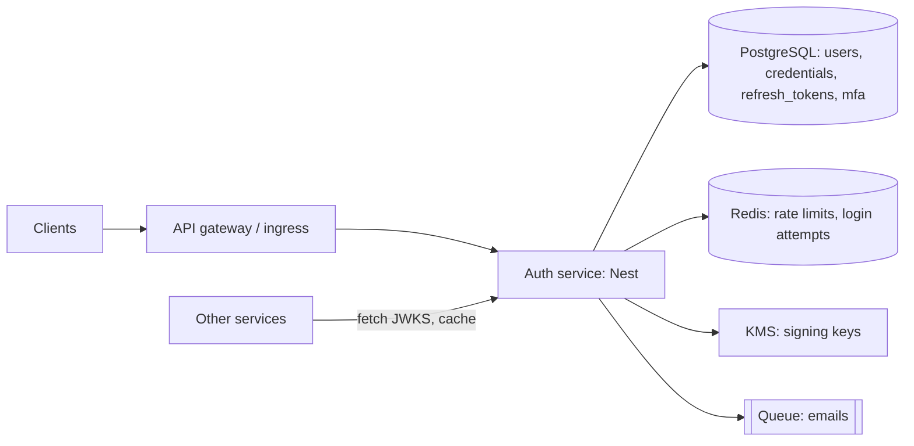
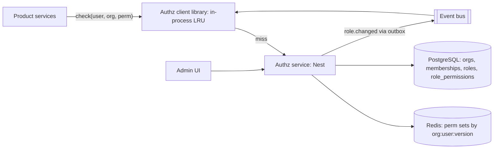
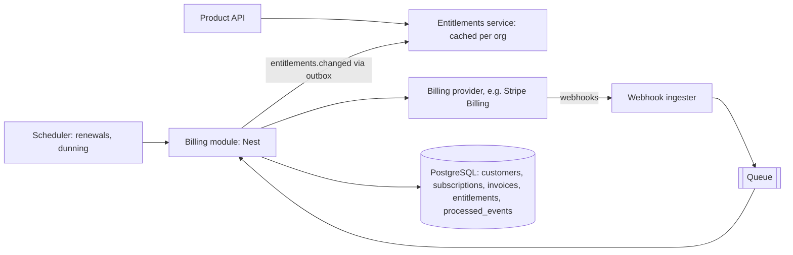
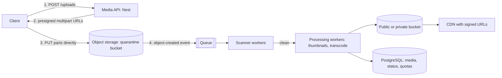
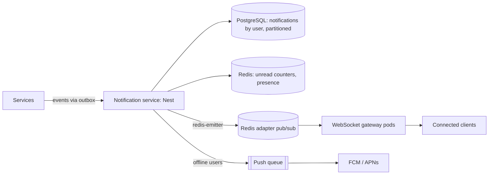
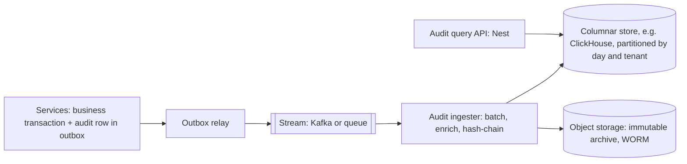
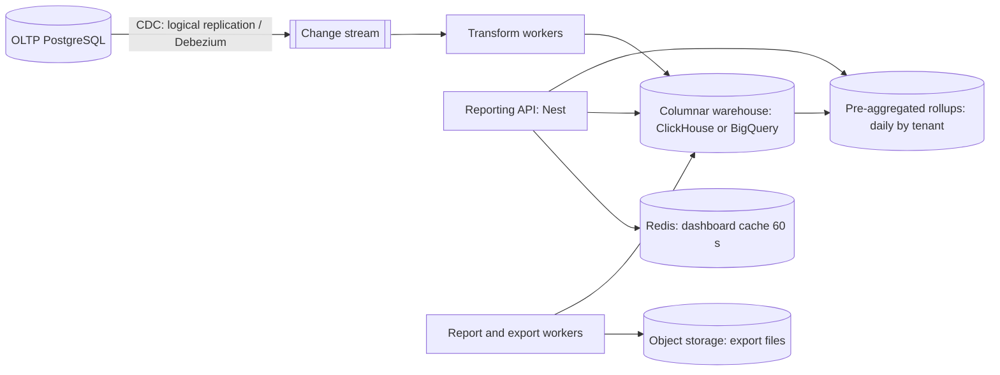
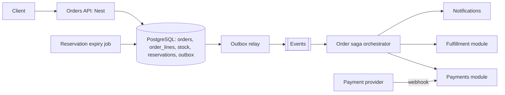

# NestJS Interview Preparation Guide

Nov 2, 2026 · @Beejoyi

Intermediate → Senior. Fundamentals, internals, architecture, production engineering and system design, with diagrams, code, traps and mock rounds.

## Version assumptions

This guide targets **NestJS 12.1** (stable line since August 2026), with notes wherever behavior differs from v11, because many interviewers and codebases are still on v11.

| Component | Version assumed | Why it matters in an interview |
| --- | --- | --- |
| NestJS (`@nestjs/core`, `common`) | 12.1.x | All packages ship as ESM; CommonJS apps still work through Node's `require(esm)` |
| Node.js (runtime) | Latest active LTS recommended (the Nest team's advice); v12 floor is 20.19+ or 22.12+ | 21.x is unsupported; Jest needs Node 24.9+ to load ESM-only v12 packages |
| Node.js (CLI generators) | 22.22.3+, 24.15+ or 26+ | `@nestjs/schematics` has a higher floor than the runtime |
| TypeScript | 6.x | Schematics v12 declare TypeScript 6 as a peer; examples use `experimentalDecorators` + `emitDecoratorMetadata` |
| HTTP adapter | Express (default) or Fastify | Express adapter now drains in-flight requests on shutdown in v12 |
| Validation | `class-validator` + `ValidationPipe`, or Standard Schema (Zod, Valibot, ArkType) + `StandardSchemaValidationPipe` | Both are first-class in v12; class-validator is not deprecated |
| Config | `@nestjs/config` with Standard Schema `validationSchema` | Joi still works only on v18+, with options under `validationOptions.libraryOptions` |
| Testing | Jest 30 (CommonJS projects) or Vitest (ESM default) | `@nestjs/testing` is runner-agnostic |
| Queues | BullMQ via `@nestjs/bullmq` | Third-party library; Redis-backed |
| ORMs | TypeORM, Prisma, Mongoose | All third-party; labelled per example |
| Microservices NATS | `@nats-io/transport-node` (NATS v3) | The old `nats` package is replaced in v12 |

**v12 changes worth naming in interviews** (each is a good "what changed recently?" answer):

- ESM packages, optional ESM for your own code; `nest new` asks CommonJS or ESM.
- `schema` option on `@Body()`, `@Query()`, `@Param()`, `@RawBody()` plus `StandardSchemaValidationPipe` and `StandardSchemaSerializerInterceptor`.
- `errorCode` in `HttpExceptionOptions` for machine-readable errors.
- Opt-in route conflict diagnostics: `routeConflictPolicy` and `routeResolutionStrategy: 'specificity'`.
- Lifecycle hooks now run by component hierarchy level, which can change `onModuleInit` ordering.
- `@Optional()` is no longer inherited by a subclass that redeclares its constructor.
- Terminus: the legacy `HealthIndicator` / `HealthCheckError` API is removed; use `HealthIndicatorService`.
- Request-scoped WebSocket gateways; `handleDisconnect` receives a reason.
- Native observability through `@nestjs/observe` (opt-in, new).
- Tooling: Vitest and oxlint for new ESM projects; Rspack replaces webpack for monorepos.

**New official reliability packages** now documented alongside v12: `@nestjs/idempotency`, `@nestjs/outbox`, `@nestjs/locks` and `@nestjs/resilience` (plus durable workflows and `@nestjs/drizzle`). Interviewers in late 2026 may expect you to know they exist and what they guarantee; Section 15 covers them.

**v11 changes still asked about** (most codebases upgraded through them): Express 5 path syntax and the simple query parser, dynamic modules compared by object reference, shutdown hooks in reverse order, global-module middleware first, `@nestjs/cache-manager` on Keyv with millisecond TTLs, and `@nestjs/config` 4 reading internal config before `process.env`. Section 3 Q14 and Section 9 T44–T46 cover them.

**Code conventions used here.** Examples are written for a CommonJS project (no `.js` import extensions) because that is what most production codebases still run. For ESM, add `.js` to relative imports and use `import.meta.dirname` instead of `__dirname`. Snippets omit `package.json` and boilerplate imports when they are obvious; each section says what is omitted.

Sources: [NestJS v11 → v12 migration guide](https://raw.githubusercontent.com/nestjs/docs.nestjs.com/master/content/migration.md) · [v12.0.0 release notes](https://github.com/nestjs/nest/releases/tag/v12.0.0) · [NestJS on Wikipedia (12.1.1, Sep 28 2026)](https://en.wikipedia.org/wiki/NestJS)

## How to use this guide

Each section is one interview area; read them in order the first time, then drill by weakness.

| Section | Covers (topic letters from the brief) | Diagrams |
| --- | --- | --- |
| 1 · Fundamentals & DI | A, B, P: bootstrap, modules, providers, scopes, dynamic modules, internals | Module graph, DI resolution, bootstrap + shutdown |
| 2 · Request Lifecycle | C: middleware, guards, interceptors, pipes, filters, ExecutionContext, Reflector | Full lifecycle, onion model |
| 3 · APIs, DTOs & Validation | D, E: routing, versioning, pagination, DTOs, serialization, OpenAPI | Validation pipeline |
| 4 · Auth & Security | F: JWT, refresh rotation, sessions, OAuth/OIDC, RBAC/ABAC, multi-tenant, OWASP | Login + refresh flow |
| 5 · Databases | G: PostgreSQL (TypeORM, Prisma), MongoDB (Mongoose), transactions, locking, outbox | Transaction flow |
| 6 · Caching, Queues & Async | H, I: Redis patterns, stampede, BullMQ, retries, idempotency | Cache-aside, job lifecycle |
| 7 · Microservices, Events & WebSockets | J, K: transports, delivery guarantees, sagas, gateways, scaling | Event flow, socket scaling |
| 8 · Performance, Testing, Observability & Deploy | L, M, N, O | Production architecture |
| 9 · Tricky & Trap Questions | Section 4 of the brief | Execution-order traces |
| 10 · Code Output & Debugging | Section 5 | Before/after fixes |
| 11 · Coding Challenges | Section 7 (24 challenges) | — |
| 12 · Senior Scenarios & Architecture | Sections 6 and Q | Architecture per scenario |
| 13 · System Design | Section 9 (12 designs) | One per design |
| 14 · Mock Interviews | Section 10 | — |

**Section 15 · Official Reliability Packages** covers `@nestjs/idempotency`, `@nestjs/outbox`, `@nestjs/locks` and `@nestjs/resilience`: what each guarantees, how it compares with the hand-built versions in Sections 5, 6, 7 and 11, and when you'd still build your own.

**Difficulty labels** on every question: **\[I\]** Intermediate (2–4 years), **\[A\]** Advanced (4–6 years, owns features end to end), **\[S\]** Senior (owns systems, makes trade-offs), **\[E\]** Expert follow-up an interviewer uses to find your ceiling.

**Answer format.** Most answers follow the same order so you can rehearse them aloud: the 20-second answer first, then internals, code, when to use and when not, the trap, and follow-ups. In a real interview, give the 20-second answer, then let the interviewer pull depth.

**Theory vs production.** Where it matters, answers end with a "Production" note: what a textbook answer leaves out (timeouts, retries, idempotency, observability, tests). Saying that part unprompted is the clearest senior signal you can send.

## High-priority topics

If you have one week, these ten topics cover most of what NestJS interviews actually probe. Ranked by how often they appear and how badly a weak answer hurts.

| # | Topic | Why it is asked | Minimum you must be able to do | Section |
| --- | --- | --- | --- | --- |
| 1 | Request lifecycle order | Tests whether you understand the framework or just use it | Recite middleware → guards → interceptors (before) → pipes → handler → interceptors (after) → filters, and say where each can short-circuit | 2 |
| 2 | Dependency injection and scopes | Most production bugs in Nest are DI bugs | Explain token resolution, module encapsulation, scope bubbling, and fix a circular dependency properly | 1 |
| 3 | Validation and DTOs | Runtime safety vs TypeScript types | Configure `ValidationPipe` with `whitelist`, `forbidNonWhitelisted`, `transform`; validate nested objects | 3 |
| 4 | Auth: JWT, refresh rotation, guards | Every backend has it, many get it wrong | Draw the login and refresh flow, explain reuse detection and revocation | 4 |
| 5 | Transactions and concurrency | Separates CRUD developers from backend engineers | Wrap a multi-write operation in a transaction; choose optimistic vs pessimistic locking | 5 |
| 6 | Idempotency | Payments, queues, retries all depend on it | Implement an idempotency key with a unique constraint and stored response | 5, 6 |
| 7 | Queues and retries | Background work is everywhere | Explain at-least-once delivery and why handlers must be idempotent | 6 |
| 8 | Caching | Easy to add, hard to keep correct | Cache-aside with TTL and explicit invalidation; name stampede mitigation | 6 |
| 9 | Testing | Signals engineering maturity | Unit-test a service with `Test.createTestingModule` and overrides; e2e with a real database | 8 |
| 10 | Architecture trade-offs | The core of senior rounds | Defend a modular monolith over microservices with concrete reasons | 12, 13 |

At senior level, add: outbox pattern, multi-tenancy, graceful shutdown, observability, zero-downtime migrations.

## Preparation roadmap

Six weeks at about 90 minutes a day gets a working NestJS developer to senior-interview readiness. Compress to two weeks by skipping the build exercises you have already done at work.

| Week | Read | Build (one small repo, extended each week) | Done when you can |
| --- | --- | --- | --- |
| 1 | Sections 1, 2 | Users module with custom providers, a global guard via `APP_GUARD`, a logging interceptor, an exception filter | Draw the lifecycle and DI graph from memory |
| 2 | Sections 3, 4 | DTO validation with nested objects; JWT login + refresh rotation; `@Roles()` + `@Public()` decorators | Explain why types are not runtime validation; whiteboard refresh-token reuse detection |
| 3 | Section 5 | PostgreSQL with Prisma or TypeORM: transactional transfer endpoint with idempotency key; one MongoDB aggregation | Pick an isolation level and justify it |
| 4 | Sections 6, 7 | BullMQ notification queue with retries and a dead-letter path; Redis cache-aside; one event emitter or microservice | Explain at-least-once delivery and make a handler idempotent |
| 5 | Sections 8, 9, 10 | Unit tests with overrides; e2e with Testcontainers; health checks; graceful shutdown; Dockerfile | Predict outputs of trap snippets without running them |
| 6 | Sections 11–14 | Two timed coding challenges, two system designs aloud, one full mock interview | Talk for 45 minutes on a design without losing structure |

### Final readiness checklist

- [ ] I can state the request lifecycle order and where each component can short-circuit.
- [ ] I can explain how Nest resolves a provider token, including module encapsulation and `exports`.
- [ ] I can explain scope bubbling and the performance cost of request-scoped providers.
- [ ] I can fix a circular dependency without reaching for `forwardRef()` first.
- [ ] I can configure `ValidationPipe` correctly and explain each option.
- [ ] I can draw JWT login, refresh rotation, and revocation.
- [ ] I can implement RBAC with a guard, `Reflector`, and organization-scoped roles.
- [ ] I can write a transactional service method and explain isolation levels.
- [ ] I can implement an idempotent endpoint and an idempotent queue consumer.
- [ ] I can explain the outbox pattern and why it exists.
- [ ] I can explain cache-aside, invalidation, and stampede protection.
- [ ] I can write unit, integration, and e2e tests and explain what I mock and why.
- [ ] I can describe graceful shutdown end to end, including queue workers.
- [ ] I can defend a modular monolith vs microservices decision.
- [ ] I can run a system design from requirements to failure modes in 45 minutes.
- [ ] I have three stories ready: a production incident, a design trade-off, and a disagreement I resolved.

# 1 · Fundamentals & Dependency Injection

Nest is an inversion-of-control container with an HTTP layer on top; most hard interview questions are really DI questions. This section covers topics A (fundamentals), B (modules and DI) and P (internals).

Omitted from snippets: `package.json`, obvious imports from `@nestjs/common` and `@nestjs/core`.

&#91;embedded content: DI token resolution · 3 lookups, 1 failure path\]

The injector never searches sibling modules: if a provider is not exported by something you import, it does not exist for you.

## A. Fundamentals

### Q1 \[I\] What is NestJS, and why use it instead of plain Express?

**20-second answer.** Nest is a framework that adds architecture to Node.js: modules for boundaries, a DI container for wiring, and a fixed request pipeline (guards, pipes, interceptors, filters) for cross-cutting concerns. It runs on Express or Fastify underneath, so you keep their ecosystem.

**What it actually buys you.**

- **Consistency across a team.** Every feature looks the same: module, controller, service, DTOs. New engineers find things.
- **Testability.** Because dependencies are injected, `Test.createTestingModule()` can swap any provider for a fake.
- **Cross-cutting concerns in one place.** Auth, validation, logging and error mapping are declared once instead of copy-pasted per route.
- **Transport independence.** The same guards, pipes and interceptors work for HTTP, WebSockets and microservices.

**When not to use it.** A 200-line webhook relay, a single Lambda function, or a team that dislikes decorators and OOP. Nest's startup cost (module scanning, reflection) is small but real and grows with module count, which matters for cold-start-sensitive serverless.

**Trap.** Saying "Nest is faster than Express." It runs on Express by default, so it cannot be faster than Express; with the Fastify adapter it can approach Fastify's throughput.

**Follow-ups.** What does Nest add on top of Express at runtime? (Router explorer, DI container, pipeline execution, exception zone.) Would you use Nest for a serverless function? (Yes if you cache the app instance across invocations; no if cold starts dominate.)

### Q2 \[I\] Express vs Fastify adapter: what changes?

| Concern | Express adapter (`@nestjs/platform-express`) | Fastify adapter (`@nestjs/platform-fastify`) |
| --- | --- | --- |
| Default | Yes | Opt-in |
| Throughput | Lower | Higher, with schema-based serialization |
| Middleware | Express middleware works directly | Needs `@fastify/*` plugins or middie-compatible middleware |
| `@Req()` / `@Res()` types | Express `Request` / `Response` | `FastifyRequest` / `FastifyReply` |
| File upload | `FileInterceptor` (Multer) built in | Use `@fastify/multipart` |
| Route matching | Declaration order matters | Radix tree; static routes win over params |

```ts
// main.ts — Fastify
import { NestFactory } from '@nestjs/core';
import { FastifyAdapter, NestFastifyApplication } from '@nestjs/platform-fastify';
import { AppModule } from './app.module';

async function bootstrap() {
  const app = await NestFactory.create<NestFastifyApplication>(
    AppModule,
    new FastifyAdapter({ logger: false, bodyLimit: 1_048_576 }),
  );
  app.enableShutdownHooks();
  await app.listen({ port: 3000, host: '0.0.0.0' }); // 0.0.0.0 matters in Docker
}
bootstrap();
```

**Trap.** Using `@Res()` ties your controller to one adapter and disables Nest's response handling (interceptors that map the response stop working) unless you pass `{ passthrough: true }`.

**Production note.** Switch adapters only with evidence from a load test. Most APIs are database-bound, and the adapter is rarely the bottleneck.

### Q3 \[I\] Controllers, providers, modules: what is each for?

- **Controller**: maps a transport (HTTP route, message pattern) to a method. Thin. Parses input, calls a service, returns output.
- **Provider**: anything the container can instantiate and inject: services, repositories, factories, config objects. Marked with `@Injectable()` or registered as a custom provider.
- **Module**: a boundary. It declares which providers exist, which other modules it depends on (`imports`) and which providers it makes public (`exports`).

```ts
@Module({
  imports: [PrismaModule],          // providers I can use from elsewhere
  controllers: [OrdersController],  // routes I expose
  providers: [OrdersService],       // things I create
  exports: [OrdersService],         // what importers may inject
})
export class OrdersModule {}
```

**Trap.** "Modules are just for organization." They are enforcement boundaries: a provider that is not exported cannot be injected by an importing module, and the container throws at startup.

### Q4 \[I\] How does Nest know what to inject into a constructor?

TypeScript's `emitDecoratorMetadata` writes the constructor parameter types into `design:paramtypes` metadata whenever a class has a decorator. `@Injectable()` (or `@Controller()`) is that decorator. At startup, the injector reads `Reflect.getMetadata('design:paramtypes', OrdersService)` and gets `[PrismaService, Logger]`, then uses each class as a token.

```ts
@Injectable()
export class OrdersService {
  constructor(private readonly prisma: PrismaService) {}
}
// Compiled roughly to:
// __metadata('design:paramtypes', [PrismaService])
```

**Why it fails.**

- **Interfaces and type aliases** are erased at runtime, so `design:paramtypes` records `Object`. Use a token: `@Inject(PAYMENT_GATEWAY) gateway: PaymentGateway`.
- **`import type { PrismaService }`** for a constructor parameter also erases it. Some linters auto-fix to `import type`; that breaks DI silently until startup.
- **Compilers that skip decorator metadata** (default esbuild, some Vitest setups) produce no `design:paramtypes`. Nest's own Vitest setup uses OXC with decorator support; check this first when tests fail with "can't resolve dependencies".

**Follow-up \[E\].** Why does `@Injectable()` matter on a class with no constructor parameters? Strictly, it does not: a class with no dependencies can be provided without it. It matters when the class has dependencies, because without any decorator TypeScript emits no metadata. Keep it on every provider for consistency.

## B. Modules & Dependency Injection

### Q5 \[I\] "Nest can't resolve dependencies of OrdersService (?). Please make sure that the argument PrismaService at index \[0\] is available in the OrdersModule context." Walk through the causes.

The message tells you exactly what the injector tried: the token at constructor index 0, looked up in `OrdersModule`'s scope. In order of frequency:

1. `PrismaModule` is not in `OrdersModule.imports`.
2. `PrismaModule` does not list `PrismaService` in `exports`.
3. `PrismaService` was added to `OrdersModule.providers` *and* is exported elsewhere: now there are two instances (not an error, but a classic bug, e.g. two connection pools).
4. The token is `Object` or `undefined`: interface type, `import type`, or a circular file import that made the class `undefined` when the decorator ran.
5. The provider is in a module imported by a *sibling*, not by this module. Imports are not transitive unless the intermediate module re-exports.

**Resolution order the injector uses.** Own providers → providers exported by imported modules (recursively through re-exports) → global modules. Nothing else.

&#91;embedded content: Module dependency graph · 5 modules, 1 visibility trap\]

OrdersModule sees PrismaService and PaymentsService because it imports both modules and each exports its provider; AppModule sees PrismaService (it imports PrismaModule) but not PaymentsService, which it would have to import itself.

### Q6 \[I\] When should you use `@Global()`?

Almost never in feature code. Legitimate cases: configuration, logging, a database client, and other infrastructure that literally every module needs. A global module still has to be imported once (usually in `AppModule`).

**Why not everywhere.** Global modules hide dependencies: you can no longer read a module's `imports` to know what it uses, and extracting the module later becomes guesswork. `ConfigModule.forRoot({ isGlobal: true })` is the canonical acceptable use.

### Q7 \[A\] Explain the four custom provider forms with a real use case for each.

```ts
export const PAYMENT_GATEWAY = Symbol('PAYMENT_GATEWAY');

export interface PaymentGateway {
  charge(input: { amountMinor: number; currency: string; idempotencyKey: string }): Promise<{ id: string }>;
}

@Module({
  providers: [
    // 1. useClass — choose an implementation behind an abstraction
    {
      provide: PAYMENT_GATEWAY,
      useClass: process.env.NODE_ENV === 'test' ? FakeGateway : StripeGateway,
    },
    // 2. useValue — constants, pre-built objects, test doubles
    { provide: 'FEATURE_FLAGS', useValue: { newCheckout: true } as const },
    // 3. useFactory — build from other providers, can be async
    {
      provide: 'REDIS',
      inject: [ConfigService],
      useFactory: async (config: ConfigService) => {
        const client = new Redis(config.getOrThrow<string>('REDIS_URL'), { lazyConnect: true });
        await client.connect();           // Nest awaits this before creating dependents
        return client;
      },
    },
    // 4. useExisting — alias one token to another (same instance)
    { provide: 'LegacyPaymentGateway', useExisting: PAYMENT_GATEWAY },
  ],
  exports: [PAYMENT_GATEWAY, 'REDIS'],
})
export class PaymentsModule {}
```

| Form | Instance | Use when | Avoid when |
| --- | --- | --- | --- |
| `useClass` | Nest instantiates the class | Swappable implementations | You need runtime inputs to construct it |
| `useValue` | The exact object you pass | Constants, mocks | The value needs other providers |
| `useFactory` | Return value of the factory | Third-party clients, async setup | A plain class would do |
| `useExisting` | Same instance as the target token | Aliases during refactors, one class behind several tokens | You actually want a second instance (use `useClass`) |

**Trap.** `useClass` and `useExisting` differ: `{ provide: A, useClass: B }` creates a new `B`; `{ provide: A, useExisting: B }` reuses the already-registered `B`. Mixing them up gives two connection pools.

**Production note.** Choosing the implementation with `process.env` inside a module is common but hides configuration. Prefer a dynamic module that receives the choice explicitly, so tests and environments are declared, not inferred.

### Q8 \[A\] What can be an injection token, and which should you use?

Any value: a class, a string, a symbol. Class tokens are inferred automatically; strings and symbols need `@Inject(TOKEN)`.

- **Class tokens**: default for services.
- **Symbols**: best for interfaces and third-party clients. Unique, so two libraries cannot collide.
- **Strings**: readable but collide easily (`'CONFIG'` in two libraries). Fine inside one app if namespaced.
- **Abstract classes as tokens**: a useful pattern. An abstract class exists at runtime, so it can be a token *and* a type, with no `@Inject()` needed:

```ts
export abstract class Clock { abstract now(): Date; }

@Injectable() export class SystemClock extends Clock { now() { return new Date(); } }

@Module({ providers: [{ provide: Clock, useClass: SystemClock }], exports: [Clock] })
export class ClockModule {}

@Injectable()
export class InvoiceService {
  constructor(private readonly clock: Clock) {} // no @Inject needed
}
```

**Interview signal.** Mentioning the abstract-class-as-token pattern shows you understand that the token is a runtime value and the type is a compile-time annotation.

### Q9 \[A\] Dynamic modules: what are `register()`, `forRoot()`, `forFeature()`, and how do you build one properly?

A dynamic module is a module whose providers depend on input. The method names are conventions, not framework rules:

| Convention | Meaning | Example |
| --- | --- | --- |
| `forRoot()` | Configure once for the whole app; usually creates shared infrastructure | `TypeOrmModule.forRoot()`, `BullModule.forRoot()` |
| `forFeature()` | Use the root's infrastructure with per-module settings | `TypeOrmModule.forFeature([Order])`, `BullModule.registerQueue({ name })` |
| `register()` | A fresh configuration per import; each importer gets its own instance | `HttpModule.register({ timeout: 5000 })` |
| `*Async()` variants | Same, but options come from a factory that can inject `ConfigService` | `JwtModule.registerAsync({...})` |

Since v9, `ConfigurableModuleBuilder` generates all of this, including the async variant, so you do not hand-write `useFactory` plumbing:

```ts
// sms.module-definition.ts
export interface SmsModuleOptions {
  provider: 'twilio' | 'local';
  apiKey: string;
  senderId: string;
}

export const {
  ConfigurableModuleClass,
  MODULE_OPTIONS_TOKEN: SMS_OPTIONS,
  OPTIONS_TYPE,
  ASYNC_OPTIONS_TYPE,
} = new ConfigurableModuleBuilder<SmsModuleOptions>()
  .setClassMethodName('forRoot')
  .setExtras({ isGlobal: false }, (def, extras) => ({ ...def, global: extras.isGlobal }))
  .build();

// sms.module.ts
@Module({ providers: [SmsService], exports: [SmsService] })
export class SmsModule extends ConfigurableModuleClass {}

// sms.service.ts
@Injectable()
export class SmsService {
  constructor(@Inject(SMS_OPTIONS) private readonly options: SmsModuleOptions) {}
}

// app.module.ts
SmsModule.forRootAsync({
  inject: [ConfigService],
  useFactory: (c: ConfigService) => ({
    provider: c.getOrThrow('SMS_PROVIDER'),
    apiKey: c.getOrThrow('SMS_API_KEY'),
    senderId: c.getOrThrow('SMS_SENDER_ID'),
  }),
});
```

**Trap.** Calling `forRoot()` in two feature modules. With `register()` semantics that creates two instances; with libraries that create a connection in `forRoot()`, you get two connections or a duplicate-name error. Root config belongs in `AppModule` (or one infrastructure module).

**Follow-up \[E\]. Does Nest dedupe a dynamic module imported twice with identical options?** Not since v11. Up to v10, Nest hashed each dynamic module's metadata, so two `TypeOrmModule.forFeature([User])` calls collapsed into one module node. From v11, modules are compared by **object reference**: two calls produce two module nodes (and, for modules that create clients, two clients). To share one, assign it to a variable and import that variable everywhere:

```ts
export const UserRepositoryModule = TypeOrmModule.forFeature([User]);

@Module({ imports: [UserRepositoryModule] }) export class UsersModule {}
@Module({ imports: [UserRepositoryModule] }) export class BillingModule {}
```

In tests, duplicates mean several instances of the same provider; stub them with `moduleRef.get(Target, { each: true })`, target one with `moduleRef.select(ParentModule).get(Target)`, or restore the old behavior with `Test.createTestingModule({...}, { moduleIdGeneratorAlgorithm: 'deep-hash' })`.

### Q10 \[A\] Explain provider scopes and scope bubbling.

| Scope | Instances | Lifecycle hooks | Cost |
| --- | --- | --- | --- |
| `DEFAULT` (singleton) | One per app (per module that declares it) | Yes | None per request |
| `REQUEST` | One per incoming request (per context id) | No | Allocation of the whole dependent chain on every request |
| `TRANSIENT` | One per consumer that injects it | Yes for singleton consumers | One instance per injection point |

**Scope bubbling.** Scope propagates *up* the injection chain. If `TenantContext` is request-scoped and `OrdersService` injects it, `OrdersService` becomes request-scoped, and so does `OrdersController`. One request-scoped provider deep in the graph can turn half the app into per-request allocations.

```ts
@Injectable({ scope: Scope.REQUEST })
export class TenantContext {
  constructor(@Inject(REQUEST) private readonly req: Request) {}
  get tenantId(): string {
    return this.req.headers['x-tenant-id'] as string;
  }
}

@Injectable() // declared singleton...
export class OrdersService {
  constructor(private readonly tenant: TenantContext) {} // ...but now request-scoped implicitly
}
```

&#91;embedded content: Singleton vs request scope · 3 requests, 1 chain vs 3 chains\]

Only `TenantContext` asked for request scope (solid boxes), but every provider that depends on it (dashed) is rebuilt per request too.

**Better alternatives, in order of preference.**

1. **Pass context explicitly**: `ordersService.list(tenantId, query)`. Boring, fast, testable.
2. **AsyncLocalStorage** via `nestjs-cls` (third-party) or a small custom provider: singletons read the current request context without becoming request-scoped.
3. **Durable providers** (below) when you need per-tenant instances, not per-request ones.

**Transient trap.** Transient providers are *not* per-call. A transient logger injected into a singleton service is created once for that service and lives forever.

**Production note.** Request scope is fine for low-traffic admin APIs. In hot paths, measure: the cost is the allocation of every provider in the chain, plus loss of lifecycle hooks.

### Q11 \[E\] What are durable providers, and when would you use them?

A durable request-scoped provider is cached per *context key you define* (usually tenant) rather than per request. Each tenant gets its own sub-tree of instances, reused across that tenant's requests.

```ts
export class TenantContextIdStrategy implements ContextIdStrategy {
  private readonly tenants = new Map<string, ContextId>();

  attach(contextId: ContextId, request: Request) {
    const tenantId = request.headers['x-tenant-id'] as string;
    let tenantSubTreeId = this.tenants.get(tenantId);
    if (!tenantSubTreeId) {
      tenantSubTreeId = ContextIdFactory.create();
      this.tenants.set(tenantId, tenantSubTreeId);
    }
    return {
      resolve: (info: HostComponentInfo) => (info.isTreeDurable ? tenantSubTreeId : contextId),
      payload: { tenantId },
    };
  }
}

// main.ts
ContextIdFactory.apply(new TenantContextIdStrategy());

@Injectable({ scope: Scope.REQUEST, durable: true })
export class TenantDataSource {
  constructor(@Inject(REQUEST) private readonly payload: { tenantId: string }) {}
}
```

**Watch out.** With `durable: true`, `REQUEST` injects the *payload* you returned, not the HTTP request. The map grows with tenant count, so bound it or evict, and validate the header against the authenticated user before trusting it.

### Q12 \[S\] How do you handle circular dependencies? Is `forwardRef()` the answer?

There are two different circular problems; interviewers want you to separate them.

1. **Circular file imports** (`a.ts` imports `b.ts` imports `a.ts`). At decoration time one class is `undefined`. Symptom: `index [0] is undefined` or "A circular dependency between modules". Common cause: barrel `index.ts` files.
2. **Circular provider dependencies** (`UsersService` needs `OrdersService`, which needs `UsersService`).

`forwardRef()` defers token resolution so the container can create both:

```ts
@Module({ imports: [forwardRef(() => OrdersModule)], providers: [UsersService], exports: [UsersService] })
export class UsersModule {}

@Injectable()
export class UsersService {
  constructor(@Inject(forwardRef(() => OrdersService)) private readonly orders: OrdersService) {}
}
```

**Limitations.** Instantiation order becomes undefined; using the other service inside a constructor can see a partially built instance; it does not work for request-scoped providers in a cycle; and it hides a design smell.

**Senior answer: break the cycle.**

- **Extract the shared logic** into a third provider both depend on.
- **Invert with events**: `OrdersService` emits `order.created`; `UsersService` listens. Neither imports the other.
- **Depend on an interface owned by the consumer** (ports and adapters): `UsersModule` defines `OrderLookup` and `OrdersModule` provides it.
- **Resolve lazily** with `ModuleRef.get()` inside a method, only as a last resort.

Catch cycles in CI with `madge --circular src` (third-party) before they reach the container.

### Q13 \[A\] What is `ModuleRef`, and when is it legitimate to use?

`ModuleRef` gives programmatic access to the container from inside a module:

- `get(token, { strict: false })`: returns an existing singleton (any module with `strict: false`).
- `resolve(token, contextId?)`: creates or returns scoped or transient instances; each call without a shared `contextId` gives a new instance.
- `create(Class)`: instantiates a class that is not registered, injecting its dependencies.
- `registerRequestByContextId(request, contextId)`: makes `REQUEST` available when you resolve outside an HTTP request (e.g. in a queue consumer).

```ts
@Injectable()
export class NotificationDispatcher {
  constructor(private readonly moduleRef: ModuleRef) {}

  async send(channel: 'email' | 'sms', msg: Message) {
    const token = channel === 'email' ? EmailSender : SmsSender;
    const sender = this.moduleRef.get(token, { strict: false });
    return sender.send(msg);
  }
}
```

**Legitimate uses.** Strategy selection at runtime, plugin systems, resolving request-scoped providers in non-HTTP contexts. **Smell.** Using it to dodge a circular dependency or to hide what a class depends on: a service locator defeats the readability of constructor injection.

`LazyModuleLoader` is related: `await lazyModuleLoader.load(() => ReportsModule)` loads a module after bootstrap, useful for serverless cold starts or rarely used heavy features. Lazily loaded modules cannot register controllers or gateways.

### Q14 \[A\] List the lifecycle hooks in order. What changed in v12?

&#91;embedded content: Application lifecycle · 5 startup steps, 5 shutdown steps\]

Read each column top to bottom; the only thing that connects a Kubernetes SIGTERM to the right-hand column is `app.enableShutdownHooks()`.

**Startup** (triggered by `app.init()` or `app.listen()`):

1. Providers instantiated, async factories awaited.
2. `onModuleInit()`, per module, after that module's dependencies are resolved.
3. `onApplicationBootstrap()`, after all modules are initialized.
4. Server starts listening.

**Shutdown** (triggered by `app.close()`, or by SIGTERM/SIGINT only if `app.enableShutdownHooks()` was called):

1. `onModuleDestroy()`
2. `beforeApplicationShutdown(signal?)`
3. HTTP server and connections closed (v12: the Express adapter drains in-flight requests)
4. `onApplicationShutdown(signal?)`

**v12 change.** Hooks now run by component hierarchy level, so the relative order of `onModuleInit` between dependent providers may differ from v11. Code that relied on accidental ordering ("cache warmer runs after DB connects because it happened to") should make the dependency explicit by injecting the thing it needs or awaiting a readiness promise.

**v11 change.** Shutdown hooks (`onModuleDestroy`, `beforeApplicationShutdown`, `onApplicationShutdown`) run in the reverse order of initialization: with modules A → B → C, `onModuleInit` runs C, B, A and `onModuleDestroy` runs A, B, C. Global modules count as a dependency of every module, so they initialize first and are destroyed last.

**Traps.**

- Request-scoped providers receive **no** lifecycle hooks.
- Without `enableShutdownHooks()`, a SIGTERM from Kubernetes kills the process without running `onModuleDestroy`: open DB transactions and in-flight jobs are cut.
- `enableShutdownHooks()` adds signal listeners per app instance; creating many app instances in tests triggers `MaxListenersExceededWarning`.

### Q15 \[E\] How does the DI container work internally?

A compact mental model of `@nestjs/core` during `NestFactory.create()`:

1. **`DependenciesScanner`** walks the module tree from the root module, reading `@Module()` metadata. Each module becomes a `Module` object in the `NestContainer`, keyed by a token (for dynamic modules, an object reference since v11; a metadata hash before that).
2. Each provider, controller and injectable becomes an **`InstanceWrapper`**: token, metatype or factory, scope, and a map of instances per context id.
3. Imports and exports are linked so each `Module` knows which tokens it can see.
4. **`InstanceLoader`** asks the **`Injector`** to instantiate everything. For each wrapper, the injector reads constructor dependencies (`design:paramtypes` plus `@Inject()` overrides), looks each token up in the module's own providers, then imported modules' exports, then global modules, and recurses. Async factories are awaited; results are cached on the wrapper.
5. Static (singleton) wrappers are instantiated at startup. Request-scoped and transient wrappers are prepared but instantiated later per context id.
6. **`RoutesResolver`** / **`RouterExplorer`** read controller metadata and register routes on the HTTP adapter, wrapping each handler in the pipeline built by `RouterExecutionContext` (guards, interceptors, pipes, filters).

Why this matters in an interview: it explains every DI error message, why scope bubbles (a wrapper with a non-static dependency is itself non-static), and why startup time grows with module count.

## P. TypeScript & framework internals

### Q16 \[A\] What does a decorator actually do in Nest?

A decorator is a function that runs **once, when the class is defined**, not per request. Nest decorators mostly just attach metadata with `Reflect.defineMetadata`; the framework reads it later.

```ts
// Roughly what @Roles('admin') does
export const Roles = (...roles: string[]) => SetMetadata('roles', roles);

// v10+ preferred: a typed decorator with its own key
export const RequireRoles = Reflector.createDecorator<string[]>();

// Reading it inside a guard
const roles = this.reflector.getAllAndOverride(RequireRoles, [ctx.getHandler(), ctx.getClass()]);
```

**Trap.** Putting logic in a decorator that you expect to run per request ("my decorator logs each call"). It runs at class definition. Per-request behavior belongs in an interceptor or guard that *reads* the decorator's metadata.

**v12 note.** `nest g decorator` now generates the `Reflector.createDecorator()` form, which gives typed metadata without string keys.

### Q17 \[A\] Which TypeScript features does Nest rely on, and which do interviewers probe?

- **Experimental decorators + `emitDecoratorMetadata`**: DI and validation depend on them. TC39 standard decorators do not emit parameter types, which is why Nest still uses the legacy flag.
- **Generics**: typed repositories, `ConfigService<EnvSchema, true>`, typed `Reflector.createDecorator<T>()`.
- **Utility and mapped types**: `PartialType`, `PickType`, `OmitType`, `IntersectionType` from `@nestjs/mapped-types` (or `@nestjs/swagger`) build DTO classes *at runtime* with validation metadata copied; TypeScript's `Partial<T>` only builds a type and would lose validation.
- **Abstract classes** as tokens (Q8).
- **`strict` mode**: `strictPropertyInitialization` is usually turned off in Nest projects because DTO properties are assigned by `class-transformer`, not constructors.

```ts
// Typed config access
type Env = { DATABASE_URL: string; PORT: number };

@Injectable()
export class Db {
  constructor(private readonly config: ConfigService<Env, true>) {}
  url() {
    return this.config.get('DATABASE_URL', { infer: true }); // typed as string
  }
}
```

### Q18 \[S\] How do you design a reusable shared module for several services or teams?

Checklist a senior engineer would state:

1. **One responsibility** (e.g. audit logging), named for the capability, not the team.
2. **Configurable via `ConfigurableModuleBuilder`**, with `forRootAsync` so consumers inject config.
3. **Public API = exports only.** Export a facade service and tokens; keep implementations private.
4. **Depend on abstractions** for anything environment-specific (storage, clock, transport).
5. **No hidden globals**; opt-in `isGlobal` via extras.
6. **Versioned and tested** independently, with a test helper (e.g. `AuditTestingModule` that provides an in-memory sink).
7. **No circular reach-back** into consumer modules.

**Trap.** A `SharedModule` that exports 40 unrelated providers. It becomes the dependency of everything and the reason nothing can be extracted later. Prefer several small modules.

### Q19 \[I\] Development vs production behavior: what differs?

- Logging levels: configure `logger: ['error', 'warn', 'log']` in production; avoid `debug`/`verbose` noise.
- `abortOnError: false` in development lets the app print the full DI error instead of exiting immediately.
- Swagger UI: often disabled or protected in production.
- Error details: never leak stack traces; the default exception filter returns a generic 500 body for unknown errors, but custom filters often leak `error.message` by mistake.
- Config validation must fail fast at boot, not at the first request that reads a missing variable.

### Q20 \[A\] You're moving a Nest app from Express to Fastify. What changes in your code?

```ts
const app = await NestFactory.create<NestFastifyApplication>(
  AppModule,
  new FastifyAdapter({ trustProxy: 1, bodyLimit: 1_048_576 }),
  { rawBody: true },
);
await app.register(fastifyHelmet);                    // @fastify/helmet instead of helmet()
await app.register(fastifyCookie, { secret: cookieSecret });
await app.register(fastifyMultipart, { limits: { fileSize: 5_000_000 } });
app.enableCors({ origin: ['https://app.example.com'], methods: ['GET', 'POST', 'PATCH', 'DELETE'] });
await app.listen({ port: 3000, host: '0.0.0.0' });
```

| Area | Express | Fastify |
| --- | --- | --- |
| Request and response objects | `Request` / `Response`; `res.setHeader()`, `res.cookie()` | `FastifyRequest` / `FastifyReply`; `reply.header()`, `reply.setCookie()` |
| Middleware | Runs on Express's own objects | Receives raw Node `req`/`res`; properties set there live on `request.raw`, not the Fastify request (Section 9 T38) |
| Plugins | Express middleware packages | `@fastify/*` plugins registered with `app.register()` |
| File uploads | `FileInterceptor` (Multer) built in | `@fastify/multipart`; Multer interceptors don't apply |
| Route matching | Declaration order; `:id` can shadow `me` | Radix tree; static segments win, so no shadowing |
| CORS (v11+, Fastify v5) | Default methods include PUT, PATCH, DELETE | Only CORS-safelisted methods unless you list them in `methods` |
| Proxy trust | `app.set('trust proxy', 1)` | `new FastifyAdapter({ trustProxy: 1 })` |
| Default body limit | Set by body-parser options | 1 MiB unless `bodyLimit` is raised |

**What doesn't change.** Controllers, providers, guards, pipes, interceptors and filters, as long as they use `HttpAdapterHost` and `ExecutionContext` instead of `@Res()` and Express-only APIs. That is the practical argument for writing platform-agnostic enhancers from day one.

**Follow-ups.** Is the speed-up worth it? (Measure: database-bound APIs often gain little.) Which part of your code is Express-specific today? (Grep for `@Res()`, `express` imports, and Express middleware.)

### Q21 \[A\] What is `LazyModuleLoader`, and when would you use it?

It loads a module after bootstrap, on first use, instead of at startup. Loaded modules are cached, so later calls are cheap.

```ts
@Injectable()
export class ReportsFacade {
  constructor(private readonly lazyModuleLoader: LazyModuleLoader) {}

  async generate(id: string) {
    const { PdfReportsModule } = await import('./pdf-reports/pdf-reports.module');
    const moduleRef = await this.lazyModuleLoader.load(() => PdfReportsModule);
    const { PdfReportService } = await import('./pdf-reports/pdf-report.service');
    return moduleRef.get(PdfReportService).render(id);
  }
}
```

**When.** Serverless functions where cold-start time matters and a heavy dependency (PDF rendering, a large SDK) is needed by few invocations; rarely used admin features in a big monolith.

**Limits interviewers probe.** Lazily loaded modules can't register controllers, resolvers or gateways (routes are mapped at startup), and can't contribute global enhancers. Don't rely on their lifecycle hooks running as they would at startup. Anything that must self-register at bootstrap (for example the official idempotency, outbox and lock stores, which register in their constructors before the registry locks) must not live in a lazy module.

**Alternative.** Often simpler: keep the module eager but defer the expensive client creation inside a factory that runs on first use.

## Section 1 follow-ups and production notes

After your answer, expect one of these. The production note is what separates a textbook answer from an experienced one.

| Q | Expert follow-up (expected answer) | Production note |
| --- | --- | --- |
| Q1 | What does Nest do per request? (Runs the enhancer pipeline; DI wiring happened at startup.) | On serverless, cache the app instance across invocations and measure cold start. |
| Q2 | How do you stay adapter-agnostic? (`HttpAdapterHost`, no `@Res()`, no Express types in services.) | Load-test with real database calls before switching adapters. |
| Q3 | Can a controller be injected into a service? (No; controllers aren't providers.) | Thin controllers let queues and microservices reuse the same services. |
| Q4 | What metadata does a union-typed parameter emit? (`Object`, so it needs a token.) | Lint against `import type` for injected classes; boot `AppModule` in CI. |
| Q5 | How do you find the missing export fast? (Read the module named in the error; Nest Devtools graph.) | A smoke test that only boots the app catches DI errors before deploy. |
| Q6 | Must a global module still be imported? (Yes, once, usually in the root.) | Keep globals to config, logging and the database client. |
| Q7 | When does a factory run? (Once at startup for singletons, awaited if async.) | Factories that connect should time out and fail with a clear message. |
| Q8 | Symbol or string tokens in shared libraries? (Symbols; they can't collide.) | Export each module's tokens from one file. |
| Q9 | Are identical dynamic modules deduplicated? (Not since v11; share a constant.) | Configure roots once; watch connection counts after upgrades (Section 9 T45). |
| Q10 | How do you measure scope cost? (Load-test the route both ways; compare allocations.) | Prefer AsyncLocalStorage for request context on hot paths. |
| Q11 | What does `REQUEST` inject in a durable provider? (The payload returned by the strategy.) | Bound the per-tenant map and validate the tenant against the token. |
| Q12 | How do you catch cycles early? (`madge --circular` in CI.) | Treat a new `forwardRef()` in review as a design discussion. |
| Q13 | `get()` vs `resolve()`? (Existing singleton vs a new scoped or transient instance.) | Keep constructor injection the default; `ModuleRef` is the exception. |
| Q14 | Which hook warms caches? (`onApplicationBootstrap`, after every module initialized.) | `enableShutdownHooks()` plus a grace period longer than the slowest drain. |
| Q15 | Why does startup slow with many modules? (Scanning and instantiation; v11 removed metadata hashing.) | Track bootstrap time in CI; SWC builds speed up compile, not DI. |
| Q16 | When does a decorator's body run? (Once, at class definition.) | Typed metadata with `Reflector.createDecorator()` avoids string-key typos. |
| Q17 | Why not TC39 standard decorators? (No parameter type metadata for DI.) | Make sure every compiler (tsc, SWC, OXC in Vitest) emits decorator metadata. |
| Q18 | How do you change a shared module safely? (Contract tests in consumers; versioning or monorepo CI.) | Name an owner for each shared module. |
| Q19 | How do you fail fast on bad config? (Schema validation in `ConfigModule`.) | Protect or disable Swagger UI and debug endpoints in production. |
| Q20 | Which code is Express-specific today? (`@Res()`, Express imports, Express middleware.) | Measure before and after; the database usually dominates. |
| Q21 | Can a lazy module register routes? (No.) | Measure the cold-start gain; often a lazy factory is simpler. |

# 2 · Request Lifecycle & Core Components

If you can draw this pipeline from memory and say where each piece can stop the request, you will pass most intermediate NestJS rounds. Topic C.

&#91;embedded content: HTTP request lifecycle · 8 stages, 1 error path\]

Interceptors wrap pipes and the handler like an onion: their "before" code runs before validation, their "after" code unwinds in reverse. Errors thrown in middleware reach only global filters.

### Q1 \[I\] State the exact order of the request lifecycle.

**20-second answer.** Middleware → guards → interceptors (before) → pipes → handler → interceptors (after, in reverse) → response. If anything throws, exception filters handle it.

**Full order with scopes.**

1. **Middleware**: global (`app.use()`), then module-bound (`MiddlewareConsumer`), in the order they were applied. Since v11, middleware bound in global modules runs first, then the root module's, then other modules' by distance from the root.
2. **Guards**: global → controller → method.
3. **Interceptors, pre-handler code**: global → controller → method.
4. **Pipes**: global → controller → method → parameter. When several parameters have pipes, Nest processes the last parameter first and the first parameter last (at every level), a detail interviewers like to probe.
5. **Handler** (controller method) → service calls.
6. **Interceptors, post-handler code** (the RxJS stream): method → controller → global. The onion unwinds.
7. **Exception filters** (only on error): method → controller → global. The first filter whose `@Catch()` matches wins; filters do not chain.
8. Response serialized by the adapter.

**Why this order makes sense.** Middleware knows nothing about routes, so it does generic HTTP work. Guards need to know *which handler* (for metadata) but should run before any expensive work. Interceptors wrap the call, so they see timing and the result. Pipes run last before the handler because they shape exactly the arguments it receives.

**Trap.** "Pipes run before interceptors." They do not: interceptors' pre-handler code runs first, so a logging interceptor sees the *raw*, unvalidated arguments.

### Q2 \[I\] Middleware vs guard vs interceptor vs pipe vs filter: when do you use which?

|  | Middleware | Guard | Interceptor | Pipe | Exception filter |
| --- | --- | --- | --- | --- | --- |
| Question it answers | Generic HTTP pre-processing | Should this request reach the handler? | What should happen around the call? | Are these arguments valid, and what type? | How should this error look to the client? |
| Knows the target handler | No | Yes (`ExecutionContext`) | Yes | Yes (`ArgumentMetadata`) | Yes (`ArgumentsHost`) |
| Can stop the request | Yes (don't call `next()`) | Yes (return `false` → 403, or throw) | Yes (return without calling `next.handle()`) | Yes (throw) | It *is* the stop path |
| Can change the response | Via raw `res` | No | Yes (map the stream) | No | Yes (writes the error response) |
| Typical uses | Request ID, body parsing, CORS, helmet | Auth, roles, feature flags, tenant access | Logging, timing, caching, timeouts, response envelope | Validation, parsing (`ParseUUIDPipe`) | Error mapping, logging, error codes |
| Works for WebSockets / RPC | No | Yes | Yes | Yes | Yes (different base classes) |

**Rule of thumb.** If it needs route metadata (roles, `@Public()`), it is not middleware. If it decides access, it is a guard, not an interceptor, because interceptors run after guards and their pre-code still lets other interceptors run.

### Q3 \[A\] `APP_GUARD` vs `app.useGlobalGuards()`: what is the real difference?

Both make the guard apply to every route. The differences:

|  | `app.useGlobalGuards(new AuthGuard(...))` | `{ provide: APP_GUARD, useClass: AuthGuard }` |
| --- | --- | --- |
| Who instantiates it | You, with `new` | The DI container |
| Can inject `Reflector`, services | Only by passing them manually | Yes, constructor injection |
| Applied in e2e tests via `Test.createTestingModule` | No, unless you repeat the `main.ts` call | Yes, it is part of the module graph |
| Hybrid apps (HTTP + microservice) | Only HTTP unless `inheritAppConfig` | Applies to all |
| Where declared | `main.ts` | Any module's `providers`, still global |

The same holds for `APP_INTERCEPTOR`, `APP_PIPE`, `APP_FILTER`.

```ts
@Module({
  providers: [
    { provide: APP_GUARD, useClass: JwtAuthGuard },   // runs first
    { provide: APP_GUARD, useClass: RolesGuard },     // runs second
    { provide: APP_PIPE, useValue: new ValidationPipe({ whitelist: true, transform: true }) },
    { provide: APP_FILTER, useClass: AllExceptionsFilter },
  ],
})
export class AppModule {}
```

**Order of multiple `APP_GUARD`s** follows module and provider registration order. Make that explicit: register auth-related global guards together in one `CoreModule`.

**Trap.** Validation works locally but not in e2e tests: `useGlobalPipes` lives in `main.ts`, which the test never runs. Prefer `APP_PIPE`, or share a `configureApp(app)` function between `main.ts` and the e2e setup.

### Q4 \[A\] Write a global JWT guard with a `@Public()` escape hatch and role checks.

```ts
// decorators.ts
export const Public = Reflector.createDecorator<boolean>();
export const Roles = Reflector.createDecorator<Role[]>();

// jwt-auth.guard.ts
@Injectable()
export class JwtAuthGuard implements CanActivate {
  constructor(private readonly reflector: Reflector, private readonly jwt: JwtService) {}

  async canActivate(ctx: ExecutionContext): Promise<boolean> {
    const isPublic = this.reflector.getAllAndOverride(Public, [ctx.getHandler(), ctx.getClass()]);
    if (isPublic) return true;

    const req = ctx.switchToHttp().getRequest<Request & { user?: AuthUser }>();
    const token = req.headers.authorization?.replace(/^Bearer /, '');
    if (!token) throw new UnauthorizedException();
    try {
      req.user = await this.jwt.verifyAsync<AuthUser>(token, { algorithms: ['RS256'] });
      return true;
    } catch {
      throw new UnauthorizedException(); // do not leak 'jwt expired' vs 'invalid signature'
    }
  }
}

// roles.guard.ts
@Injectable()
export class RolesGuard implements CanActivate {
  constructor(private readonly reflector: Reflector) {}
  canActivate(ctx: ExecutionContext): boolean {
    const required = this.reflector.getAllAndOverride(Roles, [ctx.getHandler(), ctx.getClass()]);
    if (!required?.length) return true;
    const user = ctx.switchToHttp().getRequest().user as AuthUser | undefined;
    return !!user && required.some((r) => user.roles.includes(r)); // false → 403 Forbidden
  }
}
```

**`getAllAndOverride` vs `getAllAndMerge`.** Override returns the first defined value (method beats class): a method `@Roles('admin')` replaces a class `@Roles('user')`. Merge concatenates arrays from both levels. Pick deliberately; interviewers ask which one your guard uses and why.

**Trap.** Returning `false` from a guard yields `403 Forbidden`. For a missing or invalid token you want `401`, so throw `UnauthorizedException` yourself.

### Q5 \[A\] What are `ExecutionContext` and `ArgumentsHost`? How do you write a transport-agnostic guard?

`ArgumentsHost` wraps the handler's arguments for any transport. `ExecutionContext` extends it with `getClass()` and `getHandler()`, which is what makes metadata reflection possible.

```ts
function getUser(ctx: ExecutionContext): AuthUser | undefined {
  switch (ctx.getType<'http' | 'ws' | 'rpc' | 'graphql'>()) {
    case 'http':
      return ctx.switchToHttp().getRequest().user;
    case 'ws':
      return ctx.switchToWs().getClient().data.user;
    case 'rpc':
      return ctx.switchToRpc().getContext().user; // depends on transport
    case 'graphql':
      return GqlExecutionContext.create(ctx).getContext().req.user;
  }
}
```

Filters receive only `ArgumentsHost`, because by the time an exception is handled the routing decision is over.

### Q6 \[A\] Write a `@CurrentUser()` parameter decorator. Do global pipes validate it?

```ts
export const CurrentUser = createParamDecorator(
  (field: keyof AuthUser | undefined, ctx: ExecutionContext) => {
    const user = ctx.switchToHttp().getRequest().user as AuthUser;
    return field ? user?.[field] : user;
  },
);

@Get('me')
me(@CurrentUser() user: AuthUser, @CurrentUser('orgId') orgId: string) { ... }
```

**Trap.** Global `ValidationPipe` does **not** run on custom parameter decorators unless you set `validateCustomDecorators: true`. Usually that is what you want, because the user object came from a verified token, not from the client.

### Q7 \[A\] Write interceptors for timing, a response envelope, and a timeout. Why Observables?

```ts
@Injectable()
export class TimingInterceptor implements NestInterceptor {
  private readonly logger = new Logger('HTTP');
  intercept(ctx: ExecutionContext, next: CallHandler): Observable<unknown> {
    const start = performance.now();
    const req = ctx.switchToHttp().getRequest();
    return next.handle().pipe(
      tap({
        next: () => this.logger.log('request done', { route: req.route?.path, ms: Math.round(performance.now() - start) }),
        error: (err) => this.logger.warn('request failed', { route: req.route?.path, err: err?.name }),
      }),
    );
  }
}

@Injectable()
export class EnvelopeInterceptor<T> implements NestInterceptor<T, { data: T }> {
  intercept(_: ExecutionContext, next: CallHandler<T>) {
    return next.handle().pipe(map((data) => ({ data })));
  }
}

@Injectable()
export class TimeoutInterceptor implements NestInterceptor {
  intercept(_: ExecutionContext, next: CallHandler) {
    return next.handle().pipe(
      timeout(5_000),
      catchError((err) => throwError(() => (err instanceof TimeoutError ? new RequestTimeoutException() : err))),
    );
  }
}
```

**Why Observables.** `next.handle()` returns a stream so an interceptor can transform, retry, time out, or replace the result, and so streaming responses (SSE) and microservice replies use the same abstraction. A handler returning a Promise is wrapped into an Observable automatically.

**Trap.** `TimeoutInterceptor` returns a 408 to the client but does **not** cancel the database query or HTTP call underneath. True cancellation needs an `AbortSignal` passed down to the client libraries, plus statement timeouts in the database.

**Ordering trap.** With `@UseInterceptors(A, B)`, A's pre-code runs before B's, and B's `map` runs before A's. So an envelope interceptor listed *before* a serializer will wrap already-serialized data; listed after, the serializer receives `{ data }`.

### Q8 \[A\] Write a catch-all exception filter that is safe for production.

```ts
@Catch()
export class AllExceptionsFilter implements ExceptionFilter {
  private readonly logger = new Logger(AllExceptionsFilter.name);
  constructor(private readonly adapterHost: HttpAdapterHost) {}

  catch(exception: unknown, host: ArgumentsHost): void {
    if (host.getType() !== 'http') throw exception; // let ws/rpc filters handle their own
    const { httpAdapter } = this.adapterHost;
    const ctx = host.switchToHttp();
    const req = ctx.getRequest();

    const isHttp = exception instanceof HttpException;
    const status = isHttp ? exception.getStatus() : HttpStatus.INTERNAL_SERVER_ERROR;
    const body = isHttp
      ? exception.getResponse()
      : { statusCode: 500, message: 'Internal server error' }; // never leak internals

    if (status >= 500) {
      this.logger.error('unhandled', { requestId: req.id, path: req.url, err: exception });
    }

    httpAdapter.reply(ctx.getResponse(), { ...(typeof body === 'string' ? { message: body } : body), requestId: req.id }, status);
  }
}
```

**Why `HttpAdapterHost`.** It keeps the filter working on Express and Fastify; `response.status().json()` is Express-only.

**Mapping domain and database errors.** Do it in a *specific* filter (e.g. `@Catch(Prisma.PrismaClientKnownRequestError)` mapping `P2002` unique violation to 409), or better, translate in the repository layer so controllers never see ORM errors.

**v12.** Use `errorCode` so clients branch on a stable identifier: `throw new ConflictException('Email already registered', { errorCode: 'EMAIL_TAKEN' })`.

**Traps.** Only one filter handles an exception; a method-level `@Catch(HttpException)` will shadow your global catch-all for HTTP errors on that route. A filter that throws produces a raw 500 from the adapter.

### Q9 \[S\] Trace error propagation: what does the client see in each case?

| Thrown from | Who catches | Client sees |
| --- | --- | --- |
| Middleware | Global filters only (no route context for scoped ones) | Filter output, or the default 500 |
| Guard returns `false` | Nest throws `ForbiddenException` | 403 through filters |
| Guard throws `UnauthorizedException` | Filters | 401 |
| Pipe throws `BadRequestException` | Filters; the handler never runs | 400 with validation messages |
| Handler throws a plain `Error` | Interceptors' `catchError` first, then filters | 500 `Internal server error` |
| Interceptor `map()` throws | Filters | 500 |
| Exception filter throws | Adapter default error handler | Raw 500, possibly a broken response |
| Async work not awaited in the handler | Nobody; `unhandledRejection` | Response already sent; error lost |

The last row is the production killer: fire-and-forget promises inside handlers. Either await them, push to a queue, or attach `.catch()` with logging.

### Q10 \[A\] How do you register middleware, and what are its limits?

```ts
@Module({ controllers: [OrdersController] })
export class OrdersModule implements NestModule {
  configure(consumer: MiddlewareConsumer) {
    consumer
      .apply(RequestIdMiddleware, RawBodyForWebhooksMiddleware)
      .exclude({ path: 'health', method: RequestMethod.GET })
      .forRoutes(OrdersController);
  }
}

@Injectable()
export class RequestIdMiddleware implements NestMiddleware {
  use(req: Request & { id?: string }, res: Response, next: NextFunction) {
    req.id = (req.headers['x-request-id'] as string) ?? randomUUID();
    res.setHeader('x-request-id', req.id);
    next();
  }
}
```

**Limits.** No `ExecutionContext`, so no route metadata. Not applied to WebSocket gateways or microservice handlers. With Fastify, Express-style middleware runs through a compatibility layer, and `req`/`res` are raw Node objects.

### Q11 \[S\] How does the lifecycle differ for WebSockets and microservices?

- **No middleware** in either. Use guards and interceptors.
- **Guards, interceptors, pipes** work the same, but `ExecutionContext.getType()` returns `'ws'` or `'rpc'`.
- **Exceptions**: throw `WsException` / `RpcException`. A `BaseWsExceptionFilter` emits an `exception` event to the client; an RPC filter must return an Observable (`throwError(() => ...)`). An `HttpException` thrown in a gateway is not turned into an HTTP status.
- **Validation**: a `ValidationPipe` throws `BadRequestException` by default; in gateways set `exceptionFactory` to throw `WsException`, otherwise the client gets a generic error.
- **v12**: gateways can use request-scoped providers (socket injectable via `REQUEST`), `handleDisconnect` receives a reason, and microservices gain a pre-request hook before handler invocation.

### Q12 \[E\] How does Nest build the pipeline for a route, and what does that imply for enhancer state?

At startup, `RouterExplorer` registers each route with a proxy produced by `RouterExecutionContext.create()`. It resolves the route's guards, interceptors, pipes and filters **once**, reads parameter metadata, and builds a closure that, per request, runs guards, then the interceptor chain around a function that applies pipes and calls the method.

Implications:

- Enhancers are effectively **singletons** (unless request-scoped), so storing per-request state on `this` inside a guard or interceptor is a race condition under concurrency.
- `@UseGuards(AuthGuard)` with a class lets Nest inject dependencies; `@UseGuards(new AuthGuard())` bypasses DI.
- A request-scoped dependency inside an enhancer makes that enhancer, and the controller, request-scoped for every route it touches.

### Q13 \[A\] How do guards, decorators and errors work for GraphQL resolvers?

GraphQL runs through the same enhancers, but `ExecutionContext` wraps resolver arguments `(root, args, context, info)`, so HTTP helpers like `switchToHttp().getRequest()` return the wrong thing.

```ts
// A Passport guard that reads the request from the GraphQL context
@Injectable()
export class GqlJwtGuard extends AuthGuard('jwt') {
  getRequest(ctx: ExecutionContext) {
    return GqlExecutionContext.create(ctx).getContext().req;
  }
}

export const GqlUser = createParamDecorator((_: unknown, ctx: ExecutionContext) =>
  GqlExecutionContext.create(ctx).getContext().req.user,
);

@Resolver(() => Invoice)
export class InvoicesResolver {
  @UseGuards(GqlJwtGuard)
  @Query(() => Invoice)
  invoice(@Args('id') id: string, @GqlUser() user: AuthUser) {
    return this.invoices.findOneInOrg(user.orgId, id);
  }

  @ResolveField(() => Customer)
  customer(@Parent() invoice: Invoice, @Context('loaders') loaders: Loaders) {
    return loaders.customerById.load(invoice.customerId); // DataLoader, created per request
  }
}
```

**What differs from REST.**

- **Transport-agnostic enhancers** check `ctx.getType<GqlContextType>() === 'graphql'`.
- **Field resolvers** run per field and per parent, so N+1 is the default; create DataLoaders per request in the GraphQL context factory (not as request-scoped providers, which bubble scope).
- **Errors** become entries in the `errors` array with `extensions` (code, and the HTTP status Nest derived); the HTTP status is usually 200 because other fields may have succeeded.
- **Interceptors** run per resolver call; a response envelope interceptor would wrap each field, so don't apply REST-style envelopes to resolvers.
- **v12**: GraphiQL is the default IDE; subscriptions use `graphql-ws` (`subscriptions-transport-ws` support is removed).

**Follow-ups.** How do you limit query cost? (Depth and complexity limits, persisted queries for public clients.) How do you authorize a field, not just a query? (A guard or field middleware on `@ResolveField`, or authorization inside the resolver using the parent.)

## Section 2 follow-ups and production notes

| Q | Expert follow-up (expected answer) | Production note |
| --- | --- | --- |
| Q1 | Where does a pipe's error go? (To filters; the handler never runs, interceptors' `catchError` sees it.) | Put the request ID in every log line so you can trace a request through each layer. |
| Q2 | Rate limiting: guard or interceptor? (Guard; it decides access before any work.) | Keep auth in guards so WebSocket and RPC handlers reuse them. |
| Q3 | In what order do several `APP_GUARD`s run? (Registration order.) | Share one `configureApp(app)` between `main.ts` and e2e tests. |
| Q4 | How do you test the `@Public()` path? (E2e with and without a token on both kinds of route.) | Pin algorithms and cache the JWKS with rotation. |
| Q5 | What does `getType()` return for a resolver? (`'graphql'`.) | Write enhancers once for every transport you run. |
| Q6 | Do global pipes validate custom decorators? (Only with `validateCustomDecorators`.) | Never take the user ID from the client when the token has it. |
| Q7 | Does a timeout cancel the query? (No; pass an `AbortSignal` and set `statement_timeout`.) | `@nestjs/resilience` timeouts abort the attempt's signal (Section 15 R5). |
| Q8 | Is your filter Fastify-safe? (Yes if it uses `HttpAdapterHost`.) | Map errors to stable codes; log 5xx with stack and request ID only. |
| Q9 | What happens to a floating promise's error? (Unhandled rejection; the response already went out.) | Alert on `unhandledRejection` and treat it as a bug. |
| Q10 | Which filters see middleware errors? (Global filters only; the docs confirm it.) | Keep middleware generic; route-aware logic belongs in guards. |
| Q11 | How do you validate WebSocket messages? (`ValidationPipe` with an `exceptionFactory` that throws `WsException`.) | Hybrid apps need `inheritAppConfig: true` for global enhancers. |
| Q12 | Why is `this.state` in a guard a bug? (Enhancers are shared singletons; requests race.) | Keep enhancers stateless; use AsyncLocalStorage for per-request data. |
| Q13 | How do you stop expensive GraphQL queries? (Depth and complexity limits, persisted queries.) | DataLoaders per request in the context factory, not request-scoped providers. |

# 3 · Controllers, APIs, DTOs & Validation

TypeScript types disappear at runtime; every byte from a client is `unknown` until a pipe proves otherwise. Topics D and E.

Omitted: imports from `class-validator`, `class-transformer`, `@nestjs/swagger`.

## E. DTOs, validation & serialization

### Q1 \[I\] Why don't TypeScript types validate requests? Why are DTOs classes, not interfaces?

`@Body() dto: CreateUserDto` is a compile-time annotation. At runtime, Express hands Nest a parsed JSON object; nothing checks that `email` is a string or that `role` is absent. A client can send `{ "email": 42, "role": "admin" }` and, without a pipe, your service receives exactly that.

DTOs are **classes** because classes exist at runtime and can carry decorator metadata (`@IsEmail()`), which `class-validator` reads. Interfaces are erased, so there is nothing to attach rules to and nothing for `ValidationPipe` to instantiate.

```ts
export class CreateUserDto {
  @IsEmail()
  @MaxLength(254)
  email!: string;

  @IsString()
  @MinLength(12)
  password!: string;

  @IsOptional()
  @IsString()
  @MaxLength(100)
  displayName?: string;
}
```

**Trap.** "I have `strict: true`, so my inputs are typed." Strict mode checks your code, not your users.

&#91;embedded content: ValidationPipe on a request body · 4 steps, 1 rejection\]

The instance is built before validation runs, which is why a missing `@Type()` breaks nested validation and why `transform: false` hands you an object that was never the validated one.

### Q2 \[I\] Configure `ValidationPipe` for production and explain every option.

```ts
new ValidationPipe({
  whitelist: true,              // strip properties without any decorator
  forbidNonWhitelisted: true,   // ...or reject them with 400 instead of stripping
  transform: true,              // handler receives a DTO instance; primitives converted for @Param/@Query
  transformOptions: { enableImplicitConversion: false },
  stopAtFirstError: true,       // one message per property
  disableErrorMessages: false,  // true hides details; usually keep messages, they are client-facing
  errorFormat: 'grouped',       // v12: 'list' (default shape) or 'grouped' by property
})
```

| Option | What it does | Trap |
| --- | --- | --- |
| `whitelist` | Removes undecorated properties | A property with *no* decorator is stripped even if it is in the class; add `@IsOptional()` or `@Allow()` |
| `forbidNonWhitelisted` | Rejects instead of stripping | Requires `whitelist: true`; breaks old clients that send extra fields, so roll out carefully |
| `transform` | Returns the class instance and converts `@Param('id') id: number` | Without it, validation runs on a copy and your handler gets the original plain object |
| `enableImplicitConversion` | Converts by the TS type | `"false"` becomes `true` for a `boolean` query param; prefer explicit `@Type(() => Number)` or `@Transform` |

**Mass-assignment.** `whitelist` is a security control: without it, `{ "role": "admin" }` reaches `prisma.user.update({ data: dto })`.

### Q3 \[A\] Validate nested objects and arrays. What breaks if you forget `@Type()`?

```ts
class AddressDto {
  @IsString() @MaxLength(200) line1!: string;
  @IsISO31661Alpha2() country!: string;
}

class OrderItemDto {
  @IsUUID() productId!: string;
  @IsInt() @Min(1) @Max(100) quantity!: number;
}

export class CreateOrderDto {
  @ValidateNested()
  @Type(() => AddressDto)
  shippingAddress!: AddressDto;

  @IsArray()
  @ArrayMinSize(1)
  @ArrayMaxSize(50)
  @ValidateNested({ each: true })
  @Type(() => OrderItemDto)
  items!: OrderItemDto[];
}
```

`@ValidateNested()` validates *class instances*. `class-transformer` only knows to turn the nested JSON into `AddressDto` because of `@Type()`. Without it, the nested value stays a plain object with no metadata: depending on your `class-validator` version and `forbidUnknownValues`, it is either silently unvalidated or rejected with a confusing "unknown value" error. Also cap array sizes, or a 50 MB array of items becomes a CPU problem.

### Q4 \[A\] Write a custom validator. Should validators query the database?

```ts
@ValidatorConstraint({ name: 'isAfter', async: false })
class IsAfterConstraint implements ValidatorConstraintInterface {
  validate(value: Date, args: ValidationArguments) {
    const [field] = args.constraints as [string];
    const other = (args.object as Record<string, unknown>)[field];
    return value instanceof Date && other instanceof Date && value > other;
  }
  defaultMessage(args: ValidationArguments) {
    return `${args.property} must be after ${args.constraints[0]}`;
  }
}

export const IsAfter = (field: string, opts?: ValidationOptions) =>
  (target: object, propertyName: string) =>
    registerDecorator({ target: target.constructor, propertyName, constraints: [field], options: opts, validator: IsAfterConstraint });

class CreateCampaignDto {
  @Type(() => Date) @IsDate() startsAt!: Date;
  @Type(() => Date) @IsDate() @IsAfter('startsAt') endsAt!: Date;

  @ValidateIf((o) => o.channel === 'sms')
  @IsPhoneNumber()
  senderNumber?: string;
}
```

**Database checks in validators ("email must be unique").** Possible with `useContainer(app.select(AppModule), { fallbackOnErrors: true })` and an injectable constraint, but it is a race: two requests both pass the check, both insert. The unique constraint in the database is the real guarantee; catch the violation and map it to 409. Validators are for shape, not for invariants that depend on shared state.

### Q5 \[A\] `PartialType` from `@nestjs/mapped-types` vs TypeScript's `Partial<T>`?

`Partial<CreateUserDto>` is a type; it vanishes at runtime and carries no validation. `PartialType(CreateUserDto)` returns a **new class** at runtime, copies the validation metadata, and adds `@IsOptional()` to every property.

```ts
export class UpdateUserDto extends PartialType(OmitType(CreateUserDto, ['password'] as const)) {}
export class AdminCreateUserDto extends IntersectionType(CreateUserDto, RoleAssignmentDto) {}
```

If you use Swagger, import these helpers from `@nestjs/swagger` instead, so the OpenAPI metadata is copied too.

**Trap.** An `UpdateUserDto` with every field optional accepts `{}`. Decide whether an empty PATCH is a 400 or a no-op, and say so in the API contract.

### Q6 \[A\] How do you stop a `passwordHash` from leaking in responses?

**Option 1: `ClassSerializerInterceptor`** with `@Exclude()` / `@Expose()` on an entity or response class.

```ts
export class UserResponse {
  @Expose() id!: string;
  @Expose() email!: string;
  @Exclude() passwordHash!: string;
  constructor(partial: Partial<UserResponse>) { Object.assign(this, partial); }
}

@UseInterceptors(ClassSerializerInterceptor)
@SerializeOptions({ excludeExtraneousValues: true })
@Get(':id')
async findOne(@Param('id', ParseUUIDPipe) id: string) {
  return new UserResponse(await this.users.findById(id));
}
```

**Trap.** `ClassSerializerInterceptor` only processes **class instances**. Prisma, Mongoose `.lean()` and raw SQL return plain objects, so `@Exclude()` does nothing and the hash leaks. You must wrap results in the response class.

**Option 2 (often better): explicit mapping.** A `toUserResponse(user)` function that picks fields. No decorators, no magic, obvious in review, and the default is "not exposed".

**Option 3 (v12): `StandardSchemaSerializerInterceptor`** with a response schema; fields not in the schema are dropped.

### Q7 \[A\] What is Standard Schema validation in v12, and when would you choose it over class-validator?

```ts
import { z } from 'zod';

const createUserSchema = z.object({
  email: z.string().email().max(254),
  password: z.string().min(12),
  displayName: z.string().max(100).optional(),
}).strict(); // reject unknown keys

type CreateUser = z.infer<typeof createUserSchema>;

@Post()
create(@Body({ schema: createUserSchema }) body: CreateUser) {
  return this.users.create(body);
}

// main.ts (or APP_PIPE)
app.useGlobalPipes(new StandardSchemaValidationPipe());
```

The `schema` option only attaches metadata; `StandardSchemaValidationPipe` does the validation.

|  | class-validator DTOs | Standard Schema (Zod, Valibot, ArkType) |
| --- | --- | --- |
| Type source | Class declared separately from rules | Type inferred from the schema; one source of truth |
| Shared with a frontend | Hard (decorators, classes) | Easy; the same schema package in Next.js and Nest |
| OpenAPI | Swagger CLI plugin | Supported in v12 |
| Ecosystem in Nest codebases | Dominant, many examples | Newer |

Both are first-class in v12, and class-validator is not deprecated. A strong answer: "Pick one per codebase. Zod if we share contracts with a TypeScript frontend; class-validator if the team and existing code already use it."

## D. Controllers, routing & API design

### Q8 \[I\] Route parameters, status codes, headers: the essentials, plus the shadowing trap.

```ts
@Controller({ path: 'users', version: '1' })
export class UsersController {
  @Get('me')                           // must come before ':id' on Express
  me(@CurrentUser() user: AuthUser) { return this.users.findById(user.id); }

  @Get(':id')
  findOne(@Param('id', ParseUUIDPipe) id: string) { return this.users.findById(id); }

  @Post()
  @HttpCode(HttpStatus.CREATED)
  @Header('Cache-Control', 'no-store')
  create(@Body() dto: CreateUserDto) { return this.users.create(dto); }

  @Delete(':id')
  @HttpCode(HttpStatus.NO_CONTENT)
  remove(@Param('id', ParseUUIDPipe) id: string) { return this.users.remove(id); }
}
```

**Shadowing.** On Express, routes register in declaration order, so `@Get(':id')` declared first swallows `GET /users/me` and `ParseUUIDPipe` returns 400. v12 adds opt-in diagnostics: `NestFactory.create(AppModule, { routeConflictPolicy: { duplicate: 'error', shadow: 'warn' }, routeResolutionStrategy: 'specificity' })`.

**Defaults to know.** `POST` returns 201, everything else 200. Returning `undefined` gives an empty 200, not 204. Throwing `NotFoundException` gives 404 with `{ statusCode, message, error }`.

### Q9 \[A\] API versioning: which strategy and why?

```ts
app.enableVersioning({ type: VersioningType.URI, defaultVersion: '1' });
// alternatives: VersioningType.HEADER ({ header: 'X-API-Version' }),
//               VersioningType.MEDIA_TYPE ({ key: 'v=' }), VersioningType.CUSTOM

@Controller({ path: 'orders', version: ['1', '2'] })
@Version(VERSION_NEUTRAL) // on a route that serves every version
```

| Strategy | Pros | Cons |
| --- | --- | --- |
| URI (`/v1/orders`) | Visible, cacheable, easy to route at the gateway | Version in every link |
| Header | Clean URLs | Invisible in logs and browser; caches need `Vary` |
| Media type | REST-purist | Hard for clients; rarely worth it |

**Senior view.** Versioning is a last resort. Most change should be additive (new optional fields, new endpoints). Introduce v2 only for breaking changes, run both, measure v1 traffic, announce with `Deprecation` and `Sunset` headers, then remove.

### Q10 \[A\] Build reusable pagination, filtering and sorting. Offset or cursor?

```ts
export class PageQueryDto {
  @IsOptional() @Type(() => Number) @IsInt() @Min(1) @Max(100)
  limit = 20;

  @IsOptional() @IsString()
  cursor?: string; // opaque, base64 of { createdAt, id }

  @IsOptional() @IsIn(['createdAt', 'amount']) // whitelist sort fields
  sortBy: 'createdAt' | 'amount' = 'createdAt';

  @IsOptional() @IsIn(['asc', 'desc'])
  order: 'asc' | 'desc' = 'desc';
}

export interface Page<T> {
  items: T[];
  nextCursor: string | null;
}
```

|  | Offset (`?page=3`) | Cursor / keyset (`?cursor=...`) |
| --- | --- | --- |
| Jump to page N | Yes | No |
| Cost at depth | `OFFSET 100000` scans and discards rows | Constant, uses the index |
| Stable under inserts | No: rows shift, duplicates or gaps | Yes |
| Total count | Easy but expensive (`COUNT(*)`) | Usually omitted |

Keyset query (PostgreSQL), with a tie-breaker so ordering is total:

```sql
SELECT * FROM orders
WHERE tenant_id = $1 AND (created_at, id) < ($2, $3)
ORDER BY created_at DESC, id DESC
LIMIT $4 + 1;  -- fetch one extra to know if there is a next page
```

Index: `(tenant_id, created_at DESC, id DESC)`.

**Trap.** Passing `sortBy` straight into `ORDER BY ${sortBy}` is SQL injection; the `@IsIn` whitelist plus a mapping to column names is the fix.

### Q11 \[A\] OpenAPI with `@nestjs/swagger`: what do you set up, and how do you keep it truthful?

```ts
const config = new DocumentBuilder()
  .setTitle('Orders API').setVersion('1.0').addBearerAuth().build();
const document = SwaggerModule.createDocument(app, config);
SwaggerModule.setup('docs', app, document);
```

Enable the Swagger CLI plugin in `nest-cli.json` so DTO properties are documented without `@ApiProperty()` on every field. Keep it truthful by generating the client SDK (or contract tests) from the spec in CI: if the spec drifts from reality, the build fails. Protect `/docs` in production or publish the spec at build time instead.

### Q12 \[S\] Design a standard error response.

Use one shape everywhere, close to RFC 9457 (Problem Details):

```json
{
  "type": "https://api.example.com/errors/insufficient-funds",
  "title": "Insufficient funds",
  "status": 422,
  "errorCode": "INSUFFICIENT_FUNDS",
  "detail": "Wallet balance is lower than the transfer amount.",
  "requestId": "01J9...",
  "errors": [{ "field": "amount", "message": "must be at most 1250.00" }]
}
```

Rules: a stable `errorCode` clients branch on (v12 `HttpExceptionOptions.errorCode` helps); a `requestId` that matches your logs; field errors for 400/422; no stack traces, SQL, or internal hostnames. Implement once in a global filter and document it in OpenAPI.

### Q13 \[S\] How do you keep an API backward compatible?

- **Safe**: add optional request fields, add response fields, add endpoints, add enum values *only if clients are told to tolerate unknown values*.
- **Breaking**: remove or rename fields, change types, make optional fields required, change error codes or status codes, change pagination semantics.
- **Process**: consumer-driven contract tests (e.g. Pact) or generated SDKs checked in CI, a changelog, `Deprecation`/`Sunset` headers, and usage metrics per endpoint and version before removal.

**Theory vs production.** In theory you "just version it". In production, the expensive part is knowing who still calls v1; log the client identity and version on every request so removal is a data decision.

### Q14 \[A\] What changed for routing and request parsing in Nest 11 (Express 5), and what breaks on upgrade?

| Express 4 (Nest ≤ 10) | Express 5 (Nest 11+) | Note |
| --- | --- | --- |
| `@Get('files/*')` | `@Get('files/*path')` | Wildcards must be named |
| `forRoutes('*')` | `forRoutes('{*splat}')` | Braces make the group optional, so it also matches the root path |
| `@Get(':file.:ext?')` | `@Get(':file{.:ext}')` | `?` for optional parts is replaced by braces |
| Regex characters in paths | Not supported | `( ) [ ] ? + !` are reserved; escape with `\` |
| `?a[b]=1&ids[]=2` → nested objects (qs) | Flat keys (simple parser) | Restore with `app.set('query parser', 'extended')` |

Nest converts some legacy patterns automatically and logs a warning, so an upgraded app may keep working while printing warnings; fix them before the next major. On the Fastify adapter, route matching is unchanged, but middleware paths like `(.*)` must become `*splat`.

```ts
// Restore nested query parsing if your API relies on it
const app = await NestFactory.create<NestExpressApplication>(AppModule);
app.set('query parser', 'extended');
```

**Senior view.** Prefer flat, explicit query parameters (`?status=paid&ids=1,2`) validated by a DTO over nested query objects; they survive framework changes, cache keys stay simple, and validation is clearer.

**Follow-ups.** How would you find every affected route before upgrading? (Run the app on v11 in CI and fail on route-conversion warnings; grep for `*`, `?` and `(` in route strings and `forRoutes`.) What else changed in v11 that touches HTTP? (Reflector `getAllAndOverride` now returns `T | undefined`; `@nestjs/cache-manager` moved to Keyv with millisecond TTLs.)

## Section 3 follow-ups and production notes

| Q | Expert follow-up (expected answer) | Production note |
| --- | --- | --- |
| Q1 | Can you skip DTO classes with Zod in v12? (Yes: `@Body({ schema })` + `StandardSchemaValidationPipe`.) | Pick one validation approach per codebase. |
| Q2 | Why is `whitelist` a security control? (It blocks mass assignment of fields like `role`.) | Roll out `forbidNonWhitelisted` with logging first; old clients may send extras. |
| Q3 | How do you cap a nested array? (`@ArrayMaxSize`.) | Also cap the body size at the proxy and adapter. |
| Q4 | Why not check uniqueness in a validator? (Race; the database constraint is the guarantee.) | Map unique violations (`23505`, `P2002`) to 409 in one place. |
| Q5 | Why `@nestjs/swagger`'s `PartialType`? (It copies OpenAPI metadata too.) | Decide and document what an empty PATCH means. |
| Q6 | Why doesn't `@Exclude()` work with Prisma? (Prisma returns plain objects.) | Prefer explicit response mappers; add a test that sensitive fields never appear. |
| Q7 | Can the same schema feed OpenAPI? (Yes in v12.) | Share schemas with the frontend through a package, versioned. |
| Q8 | How do v12 route conflict options help? (`routeConflictPolicy` errors or warns on shadowing.) | Turn on `routeConflictPolicy` in CI builds. |
| Q9 | When is header versioning better? (Internal APIs with strong clients; clean URLs.) | Log the API version per request to know when v1 can go. |
| Q10 | How do you sort by a non-unique column with cursors? (Add `id` as a tie-breaker in order and cursor.) | Index matches the sort exactly, including direction. |
| Q11 | How do you keep the spec honest? (Generate clients or run contract tests from it in CI.) | Publish the spec at build time instead of exposing `/docs` publicly. |
| Q12 | 400 or 422 for business rule failures? (400 for malformed input, 422 for valid input that breaks a rule; be consistent.) | Return a `requestId` that matches your logs. |
| Q13 | Is adding an enum value breaking? (For clients that don't tolerate unknown values, yes.) | Track per-client usage before removing anything. |
| Q14 | How do you find routes affected by Express 5? (Run on v11 in CI and fail on conversion warnings.) | Prefer flat query parameters validated by DTOs. |

# 4 · Authentication, Authorization & Security

Auth questions test precision: interviewers listen for the exact word (authentication vs authorization, 401 vs 403, revoke vs expire). Topic F.

Library labels: Passport (`@nestjs/passport`, `passport-jwt`), `@nestjs/jwt`, `@nestjs/throttler`, `argon2`, Prisma for persistence. All are third-party or optional Nest packages.

### Q1 \[I\] Define authentication, authorization, identity, roles, permissions and resource-level access.

| Term | Question | Example | HTTP failure |
| --- | --- | --- | --- |
| Identity | Who is this principal? | User `u_42`, service `billing-worker` | — |
| Authentication | Can they prove it? | Valid JWT signature, session cookie, mTLS cert | 401 Unauthorized |
| Authorization | May they do this action? | `orders:refund` permitted | 403 Forbidden |
| Role | A named bundle of permissions | `org_admin` = `members:invite`, `billing:read`, ... | — |
| Permission | One allowed action on a resource type | `invoices:read` | 403 |
| Resource-level access | May they act on *this* record? | Invoice belongs to the caller's organization | 404 (to avoid leaking existence) or 403 |

**Trap.** "401 means not allowed." 401 means *not authenticated* (despite its name); 403 means authenticated but not permitted.

&#91;embedded content: Authentication and authorization flow · 7 steps, 4 failure exits\]

Steps 4, 5 and 6 answer three different questions: who is calling, may they read invoices in this org, and is this invoice in this org. Skipping step 6 is the IDOR bug from Q9.

### Q2 \[I\] How does Passport fit into Nest? Do you need it?

Passport is a strategy library. `@nestjs/passport` wraps each strategy in a guard (`AuthGuard('jwt')`). The strategy's `validate()` return value becomes `req.user`.

```ts
@Injectable()
export class JwtStrategy extends PassportStrategy(Strategy, 'jwt') {
  constructor(config: ConfigService) {
    super({
      jwtFromRequest: ExtractJwt.fromAuthHeaderAsBearerToken(),
      ignoreExpiration: false,
      secretOrKey: config.getOrThrow<string>('JWT_PUBLIC_KEY'),
      algorithms: ['RS256'],          // pin the algorithm
      issuer: 'https://auth.example.com',
      audience: 'orders-api',
    });
  }
  validate(p: { sub: string; org: string; perms: string[] }): AuthUser {
    return { id: p.sub, orgId: p.org, permissions: p.perms };
  }
}

@Injectable()
export class LocalStrategy extends PassportStrategy(LocalStrat, 'local') {
  constructor(private readonly auth: AuthService) { super({ usernameField: 'email' }); }
  async validate(email: string, password: string) {
    const user = await this.auth.verifyCredentials(email, password);
    if (!user) throw new UnauthorizedException();
    return user;
  }
}
```

**Do you need it?** For OAuth providers (Google, GitHub) and SAML, Passport saves real work. For plain JWT verification, a 20-line guard with `JwtService.verifyAsync` (Section 2, Q4) is clearer and has fewer moving parts. Either answer is fine if you justify it.

**Traps.** Not pinning `algorithms` (historic `alg: none` and HS/RS confusion attacks); not validating `iss`/`aud` when several services share a key.

### Q3 \[A\] Design access and refresh tokens. Where does each live, and how long?

|  | Access token | Refresh token |
| --- | --- | --- |
| Format | Signed JWT (RS256/ES256) | Opaque random string (256 bits) |
| Lifetime | 5–15 minutes | Days to weeks, sliding, with an absolute cap |
| Verified by | Any service, locally, with the public key | Only the auth service, against the database |
| Stored server-side | No | Yes, as a SHA-256 hash, with family, expiry, revocation |
| Browser storage | Memory (or httpOnly cookie) | `httpOnly`, `Secure`, `SameSite=Strict` cookie scoped to `/auth/refresh` |
| Revocable | Not individually (wait for expiry, or denylist `jti`) | Yes, immediately |

**Why opaque refresh tokens.** You must look them up anyway to rotate and revoke, so a JWT adds nothing but size and the temptation to trust it without a lookup.

**Why a fast hash is fine for refresh tokens but not passwords.** A 256-bit random token cannot be brute-forced, so SHA-256 is enough and lets you look the token up by its hash. Passwords are low-entropy, so they need a slow, salted hash (argon2id).

### Q4 \[S\] Implement refresh-token rotation with reuse detection.

&#91;embedded content: Refresh-token rotation · 2 checks, 1 atomic consume\]

The atomic consume step is what makes rotation safe under concurrency; without it, two requests carrying the same token can both mint successors.

Each login starts a **family**. Every refresh consumes the presented token and issues its successor in the same family. If a consumed token is presented again, someone has a copy: revoke the whole family.

```prisma
model RefreshToken {
  id           String    @id @default(uuid())
  tokenHash    String    @unique
  userId       String
  familyId     String
  expiresAt    DateTime
  revokedAt    DateTime?
  replacedById String?   @unique
  createdAt    DateTime  @default(now())
  @@index([familyId])
}
```

```ts
@Injectable()
export class RefreshService {
  constructor(private readonly prisma: PrismaService, private readonly tokens: TokenFactory, private readonly audit: AuditService) {}

  async rotate(presented: string): Promise<{ accessToken: string; refreshToken: string }> {
    const tokenHash = sha256(presented);
    const current = await this.prisma.refreshToken.findUnique({ where: { tokenHash } });
    if (!current || current.expiresAt < new Date()) throw new UnauthorizedException();

    if (current.revokedAt) {
      // Reuse of a consumed or revoked token: assume theft.
      await this.prisma.refreshToken.updateMany({
        where: { familyId: current.familyId, revokedAt: null },
        data: { revokedAt: new Date() },
      });
      await this.audit.record({ type: 'auth.refresh_reuse', userId: current.userId, familyId: current.familyId });
      throw new UnauthorizedException();
    }

    return this.prisma.$transaction(async (tx) => {
      // Conditional update: only one concurrent request can consume this token.
      const consumed = await tx.refreshToken.updateMany({
        where: { id: current.id, revokedAt: null },
        data: { revokedAt: new Date() },
      });
      if (consumed.count !== 1) throw new UnauthorizedException();

      const raw = randomBytes(32).toString('base64url');
      const next = await tx.refreshToken.create({
        data: { tokenHash: sha256(raw), userId: current.userId, familyId: current.familyId, expiresAt: addDays(new Date(), 30) },
      });
      await tx.refreshToken.update({ where: { id: current.id }, data: { replacedById: next.id } });

      return { accessToken: await this.tokens.signAccess(current.userId), refreshToken: raw };
    });
  }
}

const sha256 = (s: string) => createHash('sha256').update(s).digest('hex');
```

**Production edge case interviewers love.** Two browser tabs refresh at the same moment with the same token. The second request looks like reuse and logs the user out. Mitigations: a single-flight refresh on the client; or a short grace window (for example 10–30 seconds) during which a just-consumed token returns the *same* successor instead of triggering revocation. State the trade-off: the window is a small theft window.

**Follow-ups.** Absolute session lifetime (force re-login after N days even with activity). Logout = revoke the family. "Log out everywhere" = revoke all families for the user, plus bump a `tokenVersion` checked by access-token validation if you need immediate effect.

### Q5 \[A\] JWTs cannot be revoked. How do you handle logout, password change, or a fired employee?

Options, in increasing cost:

1. **Short access-token TTL** (5–15 min) and revoke refresh tokens. Most systems stop here.
2. **Denylist by `jti`** in Redis with TTL equal to the token's remaining life. Checked in the guard: one Redis `GET` per request.
3. **`tokenVersion` (or `sessionVersion`) per user** embedded in the token, compared with a cached value. Bumping it invalidates all tokens at once.
4. **Introspection** on every request (back to sessions, effectively).

**Senior framing.** JWT trades revocability for statelessness. Decide how many minutes of stale authorization your domain tolerates; for a bank, the answer may be "zero", and then sessions or introspection are the honest design.

### Q6 \[A\] Sessions vs JWT: which would you choose?

|  | Server sessions (cookie + Redis) | JWT access tokens |
| --- | --- | --- |
| Revocation | Immediate | Delayed (TTL) or extra state |
| Per-request cost | Store lookup | Signature verify, no I/O |
| Cross-service | Needs shared store or gateway | Any service verifies with a public key |
| Browser security | httpOnly cookie, needs CSRF protection | If in `localStorage`, exposed to XSS |
| Best fit | First-party web apps, monoliths | APIs consumed by many services, mobile clients |

A common strong answer: a BFF (backend-for-frontend, e.g. Next.js) holds the session cookie; it calls Nest APIs with short-lived JWTs. Browsers never see the JWT.

### Q7 \[A\] Cookies, CSRF, XSS, CORS: what does each protect against, and what do you configure?

```ts
res.cookie('__Host-refresh', raw, {
  httpOnly: true,          // JavaScript cannot read it (limits XSS impact)
  secure: true,            // HTTPS only; required by the __Host- prefix
  sameSite: 'strict',      // not sent on cross-site requests (main CSRF defence)
  path: '/',               // __Host- requires path=/ and no Domain
  maxAge: 30 * 24 * 3600 * 1000,
});

app.use(helmet());          // security headers incl. CSP baseline, HSTS, nosniff
app.enableCors({
  origin: ['https://app.example.com'],  // never '*' with credentials
  credentials: true,
  methods: ['GET', 'POST', 'PATCH', 'DELETE'],
});
```

- **XSS**: attacker runs script in your origin. Defences: output encoding in the frontend, CSP, no tokens in `localStorage`.
- **CSRF**: a third-party site makes the browser send your cookies. Defences: `SameSite`, plus a CSRF token or custom header for cookie-authenticated state-changing requests. Bearer-token APIs are not CSRF-prone because browsers do not attach the header automatically.
- **CORS** is not a security control for your server; it controls which origins' *JavaScript* may read responses. It does not stop curl.

**Trap.** "We enabled CORS, so we're protected from CSRF." A simple form POST does not need CORS to send cookies.

### Q8 \[A\] OAuth 2.0 and OpenID Connect: what is Nest's role?

- **OIDC** adds identity (ID token, `userinfo`) on top of OAuth 2.0 authorization.
- For browser and mobile apps, use the **authorization code flow with PKCE**. Implicit flow and password grant are deprecated practice.
- Nest usually plays one of two roles: **resource server** (validates access tokens from an IdP such as Keycloak, Auth0, Cognito, using the IdP's JWKS endpoint, with key caching and rotation) or **OAuth client / BFF** (runs the code exchange and stores the session).
- Do not build your own identity provider unless identity is your product.

```ts
// Resource server: verify tokens against the IdP's rotating keys
const jwks = createRemoteJWKSet(new URL('https://idp.example.com/.well-known/jwks.json')); // 'jose' library
const { payload } = await jwtVerify(token, jwks, { issuer: 'https://idp.example.com', audience: 'orders-api' });
```

### Q9 \[S\] Design organization-scoped RBAC with resource ownership checks.

A user can be `admin` in org A and `viewer` in org B, so roles attach to a **membership**, not to the user.

```prisma
model Membership {
  userId String
  orgId  String
  roleId String
  @@id([userId, orgId])
}
model Role {
  id          String @id
  orgId       String?             // null = system role
  name        String
  permissions RolePermission[]
}
model RolePermission {
  roleId     String
  permission String               // 'invoices:read', 'members:invite'
  @@id([roleId, permission])
}
```

```ts
export const RequirePermissions = Reflector.createDecorator<string[]>();

@Injectable()
export class PermissionsGuard implements CanActivate {
  constructor(private readonly reflector: Reflector, private readonly perms: PermissionService) {}

  async canActivate(ctx: ExecutionContext) {
    const required = this.reflector.getAllAndOverride(RequirePermissions, [ctx.getHandler(), ctx.getClass()]);
    if (!required?.length) return true;
    const req = ctx.switchToHttp().getRequest();
    const orgId = req.params.orgId;                       // org from the route...
    const granted = await this.perms.forMember(req.user.id, orgId); // ...checked against membership (cached)
    if (!required.every((p) => granted.has(p))) throw new ForbiddenException();
    req.org = { id: orgId, permissions: granted };
    return true;
  }
}

@RequirePermissions(['invoices:read'])
@Get('orgs/:orgId/invoices/:invoiceId')
findOne(@Param('orgId') orgId: string, @Param('invoiceId') id: string) {
  return this.invoices.findOneInOrg(orgId, id); // WHERE id = $1 AND org_id = $2 → 404 if absent
}
```

**Two layers, both required.** The guard answers "may this member read invoices in this org?" The query answers "is this invoice in this org?" Missing the second layer is IDOR (insecure direct object reference), the most common real-world authorization bug.

**Caching.** Cache `forMember()` in Redis for 30–60 seconds and invalidate on membership or role change; otherwise a permission check is a join on every request.

**RBAC vs ABAC.** RBAC: permissions from roles. ABAC: decisions from attributes ("may approve expenses under 1,000 in own department"). Most products need RBAC plus a few ABAC rules in a policy service (or CASL, a third-party library), not a full policy engine.

### Q10 \[S\] How does authorization change in a multi-tenant system?

- The tenant comes from the **verified token or membership**, never from a client header alone.
- Every query is tenant-scoped. Enforce it structurally: a repository that requires `tenantId`, Prisma client extensions that inject the filter, or PostgreSQL **row-level security** with `SET app.tenant_id` per transaction.
- Caches, queues, file paths and search indexes include the tenant in keys.
- Tests include a cross-tenant suite: user from tenant A requests every endpoint with tenant B's IDs and must get 404.

### Q11 \[A\] Password storage and brute-force protection.

```ts
const hash = await argon2.hash(password, { type: argon2.argon2id, memoryCost: 19_456, timeCost: 2, parallelism: 1 });
const ok = await argon2.verify(hash, attempt);
```

- argon2id (or bcrypt with cost ≥ 12 when argon2 is unavailable). Parameters above follow the OWASP baseline; tune so one hash takes roughly 100–300 ms on your hardware.
- Hashing is CPU-heavy and runs off the main thread in `argon2`'s native binding, but many concurrent logins still saturate the libuv pool: rate-limit login.
- Return the same error and similar timing for "unknown email" and "wrong password".
- Rate limit by IP and by account. `@nestjs/throttler` with Redis storage for multiple instances:

```ts
ThrottlerModule.forRoot({ throttlers: [{ name: 'login', ttl: 60_000, limit: 5 }], storage: new ThrottlerStorageRedisService(redis) });

@Throttle({ login: { ttl: 60_000, limit: 5 } })
@Post('login')
login(@Body() dto: LoginDto) { ... }
```

Hard lockout lets attackers lock out real users; prefer progressive delays plus CAPTCHA after N failures, and alert on credential-stuffing patterns.

### Q12 \[S\] Secret management and audit logging.

**Secrets.** Load from a secret manager (AWS Secrets Manager, Vault, GCP Secret Manager) at boot or via the orchestrator; never commit `.env`; validate presence at startup; rotate signing keys with `kid` headers and publish old and new public keys during the overlap. Never log tokens, passwords, or full card numbers; add redaction to the logger.

**Audit log for auth events.** Append-only records of login success and failure, refresh reuse, password change, role change, permission denial on sensitive actions, with actor, target, org, IP, user agent, timestamp, and request ID. Store separately from application logs, with retention rules; see Section 13, design 10, for the full audit design.

## Section 4 follow-ups and production notes

| Q | Expert follow-up (expected answer) | Production note |
| --- | --- | --- |
| Q1 | 404 or 403 for another org's resource? (404, so existence doesn't leak.) | Use the same choice everywhere and test it. |
| Q2 | When is Passport worth it? (OAuth, SAML, many strategies.) | Pin algorithms, issuer and audience whatever you use. |
| Q3 | Why opaque refresh tokens? (You must look them up to rotate and revoke anyway.) | Absolute session lifetime on top of sliding refresh. |
| Q4 | Two tabs refresh at once: what happens? (Second looks like reuse; use single-flight or a short grace window.) | Alert on reuse detections per user; they can mean theft. |
| Q5 | How fast must a fired employee lose access? (Decide minutes vs zero; zero means sessions or introspection.) | `tokenVersion` bump on password change and role removal. |
| Q6 | Why a BFF for web apps? (No tokens in the browser, no CORS.) | Keep authorization in the API so every client gets the same rules. |
| Q7 | Does CORS stop CSRF? (No.) | `SameSite` cookies plus an `Origin` check on state-changing routes. |
| Q8 | Why PKCE? (Stops code interception for public clients.) | Cache JWKS and handle `kid` rotation without restarts. |
| Q9 | Where does resource ownership get checked? (In the query, scoped by org.) | A cross-tenant e2e suite that requests every route with foreign IDs. |
| Q10 | Where does the tenant ID come from? (Verified token or membership, never a header alone.) | Row-level security as a second, independent check. |
| Q11 | Lockout or throttling? (Progressive delays and CAPTCHA; lockout helps attackers lock users out.) | Raise `UV_THREADPOOL_SIZE` on login-heavy pods. |
| Q12 | How do you rotate signing keys safely? (Publish new `kid`, switch signing, retire old after max token lifetime.) | Keep keys in a KMS so the private key never sits in app memory. |

# 5 · Databases: PostgreSQL, MongoDB & Consistency

The question behind every database question is "what happens when two requests do this at the same time?" Topic G.

Library labels: Prisma (`@prisma/client`), TypeORM (`@nestjs/typeorm`), Mongoose (`@nestjs/mongoose`). Examples use PostgreSQL 16+ and MongoDB 7+ semantics.

### Q1 \[S\] PostgreSQL or MongoDB? Give the trade-offs, not a preference.

| Dimension | PostgreSQL | MongoDB |
| --- | --- | --- |
| Data model | Relational tables, joins, constraints | Documents; nest what is read together |
| Integrity | Foreign keys, `CHECK`, unique, exclusion constraints, enforced by the engine | Unique indexes and JSON Schema validation; referential integrity is your code's job |
| Transactions | Mature, multi-row, multi-table, configurable isolation | Multi-document transactions since 4.0; need a replica set; designed to be the exception |
| Single-record atomicity | Row | Document (so embedding gives atomic updates for free) |
| Query flexibility | Ad-hoc SQL, window functions, CTEs | Aggregation pipeline; joins via `$lookup` are costlier |
| Schema evolution | Migrations, explicit | Flexible; old shapes linger unless you migrate |
| Horizontal write scaling | Harder (partitioning, Citus, application sharding) | Built-in sharding |
| Good fit | Money, inventory, orders, anything with invariants across records | Content, catalogs, event payloads, per-entity aggregates read as a whole |

**Strong answer.** "Default to PostgreSQL for transactional business data because constraints and transactions do correctness work for us. Choose MongoDB when the domain is naturally document-shaped and read as a unit, and when we don't need cross-document invariants. Many systems use both."

**Trap.** "MongoDB doesn't support transactions." It does; the point is cost and design intent.

### Q2 \[A\] TypeORM vs Prisma vs Mongoose in a Nest app.

|  | Prisma | TypeORM | Mongoose |
| --- | --- | --- | --- |
| Source of truth | `schema.prisma` | Entity classes (decorators) | Schema classes (`@Schema()`) |
| Types | Generated, very precise | Entity types; query results less precise | Document types |
| Raw SQL | `$queryRaw` tagged templates (parameterized) | `query()`, QueryBuilder | N/A (native driver) |
| Row locks | Raw SQL only | `lock: { mode: 'pessimistic_write' }` | N/A |
| Migrations | `prisma migrate` | Generated migrations | None built in |
| Nest integration | A `PrismaService` provider you write | `TypeOrmModule.forRoot/forFeature` | `MongooseModule.forRoot/forFeature` |

```ts
@Injectable()
export class PrismaService extends PrismaClient implements OnModuleInit, OnModuleDestroy {
  async onModuleInit() { await this.$connect(); }       // fail fast at boot
  async onModuleDestroy() { await this.$disconnect(); } // graceful shutdown
}
```

### Q3 \[A\] Implement a transfer between two wallets atomically. Show Prisma, TypeORM and Mongoose.

&#91;embedded content: Transfer transaction with outbox · 7 steps, then relay, broker, consumers\]

Everything left of the relay is atomic; everything right of it is at-least-once, which is why consumers dedupe.

**Prisma (interactive transaction with row locks).**

```ts
async transfer(cmd: { fromId: string; toId: string; amountMinor: bigint; idempotencyKey: string }) {
  return this.prisma.$transaction(async (tx) => {
    // Lock both rows in a fixed order to avoid deadlocks.
    const ids = [cmd.fromId, cmd.toId].sort();
    const rows = await tx.$queryRaw<{ id: string; balance_minor: bigint }[]>`
      SELECT id, balance_minor FROM wallets WHERE id IN (${Prisma.join(ids)}) ORDER BY id FOR UPDATE`;
    const from = rows.find((r) => r.id === cmd.fromId);
    if (!from || rows.length !== 2) throw new NotFoundException();
    if (from.balance_minor < cmd.amountMinor) throw new UnprocessableEntityException({ errorCode: 'INSUFFICIENT_FUNDS' });

    const transfer = await tx.transfer.create({ data: { ...cmd, status: 'COMPLETED' } }); // unique(idempotencyKey)
    await tx.ledgerEntry.createMany({ data: [
      { transferId: transfer.id, walletId: cmd.fromId, amountMinor: -cmd.amountMinor },
      { transferId: transfer.id, walletId: cmd.toId, amountMinor: cmd.amountMinor },
    ] });
    await tx.wallet.update({ where: { id: cmd.fromId }, data: { balanceMinor: { decrement: cmd.amountMinor } } });
    await tx.wallet.update({ where: { id: cmd.toId }, data: { balanceMinor: { increment: cmd.amountMinor } } });
    await tx.outboxEvent.create({ data: { type: 'transfer.completed', payload: { transferId: transfer.id } } });
    return transfer;
  }, { timeout: 5_000 });
}
```

**TypeORM.**

```ts
return this.dataSource.transaction(async (m) => {
  const [a, b] = [cmd.fromId, cmd.toId].sort();
  await m.findOne(Wallet, { where: { id: a }, lock: { mode: 'pessimistic_write' } });
  await m.findOne(Wallet, { where: { id: b }, lock: { mode: 'pessimistic_write' } });
  const res = await m.createQueryBuilder().update(Wallet)
    .set({ balanceMinor: () => 'balance_minor - :amt' })
    .where('id = :id AND balance_minor >= :amt', { id: cmd.fromId, amt: cmd.amountMinor.toString() })
    .execute();
  if (res.affected !== 1) throw new UnprocessableEntityException({ errorCode: 'INSUFFICIENT_FUNDS' });
  // ...credit, ledger entries, outbox, same manager `m`
});
```

**Mongoose (replica set required).**

```ts
const session = await this.connection.startSession();
try {
  await session.withTransaction(async () => {
    const debited = await this.wallets.updateOne(
      { _id: cmd.fromId, balanceMinor: { $gte: cmd.amountMinor } },
      { $inc: { balanceMinor: -cmd.amountMinor } },
      { session },
    );
    if (debited.modifiedCount !== 1) throw new UnprocessableEntityException();
    await this.wallets.updateOne({ _id: cmd.toId }, { $inc: { balanceMinor: cmd.amountMinor } }, { session });
    await this.transfers.create([{ ...cmd }], { session });
  });
} finally {
  await session.endSession();
}
```

**What interviewers check.** Every write uses the transaction handle (`tx`, `m`, `session`); a single write through the outer client silently escapes the transaction. Money is stored as integer minor units (`BIGINT`), never floats. `withTransaction` retries on transient errors, so the callback must be safe to re-run.

### Q4 \[S\] Where should transaction boundaries live in a Nest app, and how do you pass the transaction around?

The boundary belongs to the **use case** (application service method), not to the controller and not to individual repositories. Ways to share the transaction across repositories:

1. **Explicit parameter**: `repo.save(entity, tx)`. Verbose, completely obvious, easy to test.
2. **Unit of Work** object created per use case that owns the repositories bound to one transaction.
3. **AsyncLocalStorage** (`@nestjs-cls/transactional`, third-party): `@Transactional()` on the service method; repositories pick up the current transaction implicitly. Clean, but hidden: a call that escapes the CLS context (a queue callback, `setTimeout`) runs outside the transaction.

**Rules regardless of mechanism.**

- No network calls (payment gateway, email, other services) inside a database transaction: they hold locks for seconds and cannot be rolled back. Use the outbox (Q12) or a saga.
- Keep transactions short; set `statement_timeout` and `idle_in_transaction_session_timeout` in PostgreSQL.
- Retry the whole use case on serialization failures and deadlocks, not single statements.

### Q5 \[S\] Explain isolation levels with a concrete anomaly for each.

| Level (PostgreSQL) | Prevents | Still allows | Example that breaks |
| --- | --- | --- | --- |
| Read Committed (default) | Dirty reads | Non-repeatable reads, lost updates with read-modify-write, write skew | Two requests read balance 100, both subtract 80 in app code, both write 20 |
| Repeatable Read (snapshot) | Non-repeatable reads, lost updates (conflicting update errors with 40001) | Write skew | Two doctors both see "2 on call", both go off call → 0 on call |
| Serializable (SSI) | All of the above | Nothing, at the cost of aborts | Must retry on `40001` |

MySQL InnoDB defaults to Repeatable Read with different semantics (gap locks), so do not generalize from one engine to another in an interview.

**Practical answer.** Stay on Read Committed and make writes safe with atomic statements (`SET balance = balance - $1 WHERE balance >= $1`), row locks, or unique constraints. Reach for Serializable for complex invariants across rows, and wrap it in a retry loop:

```ts
async function withSerializableRetry<T>(fn: () => Promise<T>, attempts = 3): Promise<T> {
  for (let i = 1; ; i++) {
    try { return await fn(); }
    catch (e) {
      const code = (e as { code?: string }).code;
      const retryable = code === '40001' || code === '40P01' || code === 'P2034'; // serialization, deadlock, Prisma write conflict
      if (!retryable || i >= attempts) throw e;
      await sleep(2 ** i * 20 + Math.random() * 20); // backoff with jitter
    }
  }
}
```

### Q6 \[S\] Optimistic vs pessimistic locking: when do you use each?

|  | Optimistic (version column) | Pessimistic (`SELECT … FOR UPDATE`) |
| --- | --- | --- |
| Mechanism | `UPDATE … SET …, version = version + 1 WHERE id = $1 AND version = $2`; 0 rows = conflict | Row lock held until commit |
| Best when | Conflicts are rare; long user think-time (edit forms) | Conflicts are frequent and short (balances, seat inventory) |
| Failure mode | Client gets 409 and retries | Waiting, lock timeouts, deadlocks |
| Works across requests | Yes (version travels with the client, e.g. `If-Match` ETag) | No, must be inside one transaction |

**TypeORM trap.** `@VersionColumn()` increments the version on `save()`, but `save()` does **not** add `WHERE version = ?`. You must check it yourself (an `update()` with the version in the `where` clause and `affected === 1`).

### Q7 \[A\] What is the N+1 problem, how do you detect it, and how do you fix it in each ORM?

Fetching 50 orders, then their customers one query at a time, is 51 queries. It hides in serializers and GraphQL resolvers.

- **Detect**: query logging in tests (count queries per request), APM traces showing repeated identical statements, `pg_stat_statements` call counts.
- **Fix**: Prisma `include` / `select` with relations (batched queries); TypeORM `relations` or `leftJoinAndSelect`; Mongoose `populate()` (one extra query per path, not per document) or `$lookup`; GraphQL `DataLoader` (request-scoped) to batch per tick.
- **Avoid overcorrection**: one giant join can be slower than two queries. Measure with `EXPLAIN (ANALYZE, BUFFERS)`.

### Q8 \[A\] How do you design indexes in PostgreSQL and MongoDB?

**PostgreSQL.**

- A composite B-tree index serves queries that filter on a **left prefix** of its columns. `(tenant_id, status, created_at)` serves `WHERE tenant_id = ? AND status = ? ORDER BY created_at`, but not `WHERE status = ?` alone.
- Put equality columns first, then range/sort columns.
- **Partial indexes** for hot subsets: `CREATE INDEX ON jobs (run_at) WHERE status = 'pending'`.
- **Covering**: `INCLUDE (amount)` enables index-only scans.
- **Unique indexes are business rules**: `UNIQUE (tenant_id, lower(email))`.
- Create indexes on large live tables with `CREATE INDEX CONCURRENTLY` (outside a transaction, so your migration tool must allow it).
- Verify with `EXPLAIN (ANALYZE, BUFFERS)`; watch for `Seq Scan` on large tables and row-estimate mismatches.

**MongoDB.** Follow the ESR rule for compound indexes: **E**quality fields, then **S**ort fields, then **R**ange fields. `{ tenantId: 1, status: 1, createdAt: -1 }` for "pending orders of a tenant, newest first". Check `explain('executionStats')` for `IXSCAN` vs `COLLSCAN` and `totalDocsExamined` vs `nReturned`.

**Cost of indexes.** Every index slows writes and uses memory. Remove unused ones (`pg_stat_user_indexes.idx_scan = 0`).

### Q9 \[A\] Connection pooling: how big should the pool be, and what breaks in production?

- Each Node process holds a pool (Prisma `connection_limit`, TypeORM `extra.max`, Mongoose `maxPoolSize`). Total connections = pool size × processes × pods. Ten pods with pools of 20 is 200 connections; PostgreSQL's default `max_connections` is 100.
- PostgreSQL performs best with a small number of active connections (a common starting point is roughly 2–4 per CPU core on the database server). More connections add contention, not throughput.
- Use **PgBouncer** (or RDS Proxy) in transaction mode when you have many pods or serverless functions. Caveat: session features (session-level prepared statements, `SET`, advisory locks held across transactions) break in transaction mode; Prisma needs `pgbouncer=true` (or a recent Prisma version with compatible settings) for this.
- Symptoms of exhaustion: requests hang, then time out; `Timed out fetching a new connection from the connection pool`. Usual root causes: long transactions, a transaction left open on an error path, N+1 under load, or external calls inside transactions.
- Set pool acquire timeouts so requests fail fast instead of queueing forever.

### Q10 \[A\] How do you run migrations safely, including zero-downtime changes?

- **Never `synchronize: true`** (TypeORM) outside local development: it can drop columns.
- Run migrations as a **separate step** (CI job or Kubernetes Job/init container) before the new version rolls out, not inside `main.ts` of every replica (races, slow boots).
- **Expand and contract** for breaking changes, because old and new app versions run side by side during a rolling deploy:

1. Expand: add the new column (nullable, no default rewrite), deploy code that writes both old and new.
2. Backfill in batches (for example 5,000 rows per batch, with pauses), outside the deploy.
3. Switch reads to the new column.
4. Contract: stop writing the old column, then drop it in a later release.

- Dangerous operations on big tables: adding a `NOT NULL` column with a volatile default, changing a column type, adding a foreign key without `NOT VALID` then `VALIDATE CONSTRAINT`, non-concurrent index creation. Set `lock_timeout` in migrations so a blocked `ALTER` fails instead of queueing all traffic behind it.

### Q11 \[A\] MongoDB data modeling: embed or reference? Show an atomic update and an aggregation.

| Embed when | Reference when |
| --- | --- |
| Data is read together and owned by the parent (order lines in an order) | Child is shared or has its own lifecycle (products in many orders) |
| Child set is small and bounded | Child set grows without limit (comments, events) |
| You need atomic updates across parent and child | Child is updated independently and frequently |

Hard limit: a document is at most 16 MB; unbounded arrays also make every update rewrite a growing document.

```ts
@Schema({ timestamps: true })
export class Order {
  @Prop({ required: true, index: true }) tenantId!: string;
  @Prop({ type: [{ productId: String, qty: Number, priceMinor: Number }], default: [] })
  lines!: { productId: string; qty: number; priceMinor: number }[];
  @Prop({ enum: ['pending', 'paid', 'shipped'], default: 'pending' }) status!: string;
}
export const OrderSchema = SchemaFactory.createForClass(Order);
OrderSchema.index({ tenantId: 1, status: 1, createdAt: -1 });

// Atomic, conditional state transition: no read-modify-write race
const updated = await this.orders.findOneAndUpdate(
  { _id: id, tenantId, status: 'pending' },
  { $set: { status: 'paid', paidAt: new Date() } },
  { new: true },
);
if (!updated) throw new ConflictException({ errorCode: 'ORDER_NOT_PENDING' });

// Revenue per day for a tenant
await this.orders.aggregate([
  { $match: { tenantId, status: 'paid', createdAt: { $gte: from, $lt: to } } },
  { $unwind: '$lines' },
  { $group: {
      _id: { $dateTrunc: { date: '$createdAt', unit: 'day', timezone: 'Asia/Dhaka' } },
      revenueMinor: { $sum: { $multiply: ['$lines.qty', '$lines.priceMinor'] } },
  } },
  { $sort: { _id: 1 } },
]);
```

**Production pitfalls.** `.lean()` for read paths (much less overhead, but returns plain objects without getters or virtuals); `$match` first so indexes are used; `allowDiskUse` for large groups; write concern `majority` for data you cannot lose; reads from secondaries are eventually consistent.

### Q12 \[S\] What is the outbox pattern, and why does it exist?

**The dual-write problem.** You commit an order, then publish `order.created` to a broker. If the process dies between the two, the event is lost; if you publish first and the commit fails, consumers act on an order that does not exist. No ordering of two independent writes is safe.

**The fix.** Write the event to an `outbox` table **in the same transaction** as the business change (see the transfer diagram above). A relay process reads unsent rows and publishes them, marking them sent afterwards.

```ts
@Injectable()
export class OutboxRelay {
  constructor(private readonly prisma: PrismaService, private readonly bus: EventBus) {}

  @Interval(1_000) // @nestjs/schedule; or a BullMQ repeatable job
  async drain() {
    await this.prisma.$transaction(async (tx) => {
      const batch = await tx.$queryRaw<OutboxRow[]>`
        SELECT id, type, payload FROM outbox_events
        WHERE sent_at IS NULL ORDER BY id LIMIT 100
        FOR UPDATE SKIP LOCKED`;            // several relay replicas can run safely
      for (const e of batch) {
        await this.bus.publish(e.type, e.payload, { messageId: e.id }); // id = dedupe key downstream
      }
      if (batch.length) {
        await tx.$executeRaw`UPDATE outbox_events SET sent_at = now() WHERE id IN (${Prisma.join(batch.map((b) => b.id))})`;
      }
    });
  }
}
```

**Guarantee.** At-least-once delivery: a crash after publishing but before `sent_at` is written republishes the batch. Consumers must therefore be idempotent (dedupe on `messageId`). Alternatives: change data capture (Debezium reading the WAL) instead of polling. Also: keep the publish loop short, because this transaction holds row locks while publishing; for high volume, claim rows in one short transaction and publish outside it.

### Q13 \[S\] Idempotency keys: how do you make a POST safe to retry?

The client sends `Idempotency-Key: <uuid>`. The server stores the key with the request fingerprint and the final response:

```sql
CREATE TABLE idempotency_keys (
  user_id       uuid        NOT NULL,
  key           text        NOT NULL,
  request_hash  text        NOT NULL,
  status        text        NOT NULL,      -- 'in_progress' | 'completed'
  response_code int,
  response_body jsonb,
  created_at    timestamptz NOT NULL DEFAULT now(),
  PRIMARY KEY (user_id, key)
);
```

Flow: `INSERT … ON CONFLICT DO NOTHING`. If inserted, execute and store the response. If it already exists: same `request_hash` and `completed` → replay the stored response; `in_progress` → 409 (or wait); different `request_hash` → 422 (key reused for a different request). Expire keys after 24–72 hours. Full implementation: Section 11, challenge 14.

**Trap.** Checking in Redis "have I seen this key?" and then doing the work is a race; the claim must be atomic (unique insert, or Redis `SET NX`) and the business write still needs its own constraint (`transfers.idempotency_key UNIQUE`).

### Q14 \[S\] Read replicas: what goes wrong?

Replication lag. A user updates their profile (primary), the next GET hits a replica and shows old data. Approaches: route reads-after-writes to the primary for a few seconds per user (sticky by session), read critical data from the primary always, or use the write's LSN and wait for the replica to catch up (rarely worth it). Never run read-modify-write logic against a replica. Prisma (`@prisma/extension-read-replicas`) and TypeORM (`replication` option) both support primary/replica routing.

### Q15 \[S\] Backups and recovery: what would you put in place?

- Define **RPO** (how much data you may lose) and **RTO** (how long you may be down) with the business first.
- PostgreSQL: continuous WAL archiving for point-in-time recovery (managed services do this), plus daily snapshots retained per policy; MongoDB: managed continuous backups or `mongodump` for small sets only.
- Store backups in another account or region; encrypt them.
- **Test restores** on a schedule. An untested backup is a hope, not a backup.
- Runbook: who decides to restore, how to restore into a new instance and repoint the app, how to replay or reconcile events produced after the restore point.

### Q16 \[A\] Do you need a repository layer on top of Prisma or TypeORM?

- **For**: domain code depends on an interface you own (`OrderRepository`), so tests can use an in-memory fake and the ORM can change; queries with tenant scoping live in one place.
- **Against**: Prisma already is a typed data-access layer; wrapping every call in a repository adds code without abstraction value in a CRUD service.
- **Senior position**: introduce repositories where there is domain logic worth isolating or invariants worth centralizing (tenant scoping, soft delete), and let thin CRUD modules call the ORM from the service. Be consistent within a bounded context.

## Section 5 follow-ups and production notes

| Q | Expert follow-up (expected answer) | Production note |
| --- | --- | --- |
| Q1 | When would you run both databases? (Documents or events in MongoDB, money and orders in PostgreSQL.) | Each extra datastore adds backups, monitoring and on-call. |
| Q2 | Which ORM gives row locks without raw SQL? (TypeORM; Prisma needs `$queryRaw`.) | Log slow queries with their ORM call site. |
| Q3 | Why lock in ID order? (Prevents deadlocks between opposite transfers.) | Statement and idle-in-transaction timeouts on every connection. |
| Q4 | What escapes a CLS-based transaction? (Work started in timers, queues or event listeners.) | Never call external services inside a transaction. |
| Q5 | Which anomaly does Repeatable Read still allow? (Write skew.) | Retry the whole use case on `40001` and `40P01`, with jitter. |
| Q6 | How does optimistic locking cross requests? (Version or ETag with `If-Match`.) | TypeORM `save()` does not check the version; write the `WHERE` yourself. |
| Q7 | How do you prove N+1 is gone? (Count queries per request in a test.) | Watch `pg_stat_statements` call counts after releases. |
| Q8 | Why equality columns first? (B-tree prefix rules.) | Create indexes `CONCURRENTLY`; drop unused ones. |
| Q9 | Pool size × pods vs `max_connections`? (Total must fit; use PgBouncer or RDS Proxy.) | Alert on pool wait time, not only on errors. |
| Q10 | How do you roll back after the contract step? (You don't; the drop waits a release.) | `lock_timeout` in every migration. |
| Q11 | When does embedding hurt? (Unbounded arrays, 16 MB limit, hot documents.) | Write concern `majority` for data you can't lose. |
| Q12 | What guarantee does an outbox give? (At-least-once; consumers dedupe.) | `@nestjs/outbox` implements leases, ordering by key and dead letters (Section 15 R3). |
| Q13 | What if the key is reused with a different body? (422.) | `@nestjs/idempotency` covers HTTP, GraphQL and events (Section 15 R2); keep the business unique constraint too. |
| Q14 | How do you give read-your-writes? (Route the user's next reads to the primary for a short window.) | Monitor replica lag; never do read-modify-write on a replica. |
| Q15 | When did you last test a restore? (The only acceptable answer is a date.) | Store backups in another account or region, encrypted. |
| Q16 | When is a repository worth it with Prisma? (Domain logic or invariants like tenant scoping.) | Be consistent within a bounded context. |

# 6 · Caching, Redis, Queues & Async Processing

Caching and queues both trade correctness for speed or resilience; interviews probe whether you know exactly what you gave up. Topics H and I.

Library labels: `@nestjs/cache-manager` (with `cache-manager` v6 and Keyv stores), `ioredis`, `@nestjs/bullmq` + `bullmq`. Verify option names against your installed versions; these libraries change faster than Nest core.

## H. Caching & Redis

### Q1 \[I\] Cache-aside, write-through, write-behind: explain each and when to use it.

&#91;embedded content: Cache-aside · read path and write path\]

The database stays the source of truth on both paths; the cache only ever holds a copy that a write can throw away.

| Pattern | Read | Write | Use when | Risk |
| --- | --- | --- | --- | --- |
| Cache-aside (lazy) | App reads cache; on miss reads DB and fills cache | App writes DB, then deletes the key | Default for read-heavy data | Brief staleness; stampede on hot misses |
| Write-through | Cache always populated | App writes cache and DB synchronously | Data read right after write | Write latency; caching data nobody reads |
| Write-behind | From cache | Cache first, DB later asynchronously | Counters, analytics, high write volume | Data loss if Redis dies before flush |

**Delete, don't update, on write.** Updating the cache after a DB write races: request A writes v1, request B writes v2, B updates cache with v2, A updates cache with v1 → cache holds stale v1 indefinitely. Deleting the key forces the next read to fetch fresh data.

### Q2 \[A\] What does Nest's `CacheInterceptor` do, and why can it leak data?

```ts
CacheModule.registerAsync({
  isGlobal: true,
  inject: [ConfigService],
  useFactory: (c: ConfigService) => ({
    stores: [new KeyvRedis(c.getOrThrow('REDIS_URL'))],
    ttl: 30_000, // milliseconds in cache-manager v5+
  }),
});

@UseInterceptors(CacheInterceptor)
@CacheTTL(60_000)
@Get('products')
list() { ... }
```

It caches GET responses keyed by **URL only**. Two traps:

1. **Per-user data.** `GET /me/orders` returns user A's orders to user B, because the key ignores the `Authorization` header. Override `trackBy()` to include user and tenant, or don't use it for personalized routes.
2. **No invalidation.** Writes do not clear it; data is stale until TTL.

```ts
@Injectable()
export class UserAwareCacheInterceptor extends CacheInterceptor {
  protected trackBy(ctx: ExecutionContext): string | undefined {
    const req = ctx.switchToHttp().getRequest();
    if (req.method !== 'GET') return undefined;            // undefined = don't cache
    return `${req.user?.orgId ?? 'anon'}:${req.user?.id ?? 'anon'}:${req.originalUrl}`;
  }
}
```

**Production view.** Response caching at the HTTP layer is fine for public, cacheable data (better still at a CDN with `Cache-Control`). For domain data, use an explicit cache service where you control keys and invalidation.

### Q3 \[A\] Write a cache-aside service with invalidation and TTL jitter.

```ts
@Injectable()
export class ProductCache {
  constructor(@Inject('REDIS') private readonly redis: Redis, private readonly repo: ProductRepository) {}

  private key(tenantId: string, id: string) {
    return `t:${tenantId}:product:${id}:v3`; // version suffix lets you invalidate on schema change
  }

  async get(tenantId: string, id: string): Promise<Product | null> {
    const k = this.key(tenantId, id);
    const hit = await this.redis.get(k).catch(() => null);  // Redis down → treat as miss (fail open)
    if (hit) return hit === '__null__' ? null : (JSON.parse(hit) as Product);

    const product = await this.repo.findById(tenantId, id);
    const ttl = 300 + Math.floor(Math.random() * 60);         // jitter avoids synchronized expiry
    await this.redis
      .set(k, product ? JSON.stringify(product) : '__null__', 'EX', product ? ttl : 30) // negative cache, short TTL
      .catch(() => undefined);
    return product;
  }

  async invalidate(tenantId: string, id: string) {
    await this.redis.del(this.key(tenantId, id));
  }
}
```

Call `invalidate()` **after** the DB transaction commits (not inside it), otherwise a concurrent read can refill the cache with the old value before your commit. For multi-instance in-process caches, broadcast invalidations via Redis pub/sub.

### Q4 \[S\] Explain cache stampede, penetration and avalanche, with mitigations.

| Problem | What happens | Mitigation |
| --- | --- | --- |
| Stampede (dogpile) | A hot key expires; 2,000 concurrent requests all miss and hit the DB | Single-flight: one request recomputes under a short Redis lock (`SET lock NX PX 5000`), others wait briefly or serve stale; probabilistic early refresh before expiry |
| Penetration | Requests for keys that never exist (random IDs, attacks) always miss | Negative caching with short TTL; input validation; Bloom filter of valid IDs |
| Avalanche | Many keys expire at once (bulk load with the same TTL) or Redis restarts | TTL jitter; warm critical keys; rate-limit DB fallback; circuit breaker |

```ts
// In-process single-flight: collapses concurrent misses for the same key within one instance
private inflight = new Map<string, Promise<unknown>>();
async once<T>(key: string, load: () => Promise<T>): Promise<T> {
  const existing = this.inflight.get(key) as Promise<T> | undefined;
  if (existing) return existing;
  const p = load().finally(() => this.inflight.delete(key));
  this.inflight.set(key, p);
  return p;
}
```

In-process single-flight protects per instance; with 20 pods you still get up to 20 loads, which is usually fine. Add a Redis lock only if that is still too many.

### Q5 \[S\] How do you implement a distributed lock in Redis, and what are its limits?

```ts
const token = randomUUID();
const ok = await redis.set(`lock:${name}`, token, 'PX', 10_000, 'NX');
if (!ok) throw new ConflictException('busy');
try {
  await work();
} finally {
  // release only if we still own it: compare-and-delete atomically
  await redis.eval(
    "if redis.call('get', KEYS[1]) == ARGV[1] then return redis.call('del', KEYS[1]) else return 0 end",
    1, `lock:${name}`, token,
  );
}
```

**Limits.** If `work()` outlives the TTL (GC pause, slow I/O), another process takes the lock and both run. Redis failover can lose a lock. So a Redis lock is an **efficiency** mechanism (avoid duplicate work), not a **correctness** one. For correctness, use database constraints, row locks, or fencing tokens checked by the resource being protected. Redlock across several Redis nodes does not remove the timing problem.

### Q6 \[A\] Implement Redis-based rate limiting.

Fixed window is simplest (`INCR` + `EXPIRE` in one Lua script) but allows bursts of 2× at window edges. Sliding window with a sorted set is precise:

```ts
const SLIDING_WINDOW = `
local key, now, window, limit = KEYS[1], tonumber(ARGV[1]), tonumber(ARGV[2]), tonumber(ARGV[3])
redis.call('ZREMRANGEBYSCORE', key, 0, now - window)
local count = redis.call('ZCARD', key)
if count >= limit then return 0 end
redis.call('ZADD', key, now, ARGV[4])
redis.call('PEXPIRE', key, window)
return 1`;

async allow(id: string, limit = 100, windowMs = 60_000): Promise<boolean> {
  const allowed = await this.redis.eval(SLIDING_WINDOW, 1, `rl:${id}`, Date.now(), windowMs, limit, randomUUID());
  return allowed === 1;
}
```

Return `429` with `Retry-After`. Key by user or API key for authenticated traffic and by IP for anonymous traffic. `@nestjs/throttler` with a Redis storage adapter covers most needs without custom Lua. Rate limiting at the edge (API gateway, Nginx, CDN) catches abuse before it reaches Node.

### Q7 \[S\] When should you not use Redis, and how do you handle Redis failures?

**Not Redis:** as the only copy of business data (unless you've configured persistence and accept its trade-offs); for strong consistency; for large blobs; as a cache in front of a query that is already fast (you add a network hop and a consistency problem for nothing).

**Failure policy per use case.**

| Use | If Redis is down | Why |
| --- | --- | --- |
| Cache | Fail open: read the DB | Slower beats down; protect the DB with limits |
| Rate limiter | Usually fail open, alert | Blocking all users is worse than brief abuse; fail closed for login if credential stuffing is a known risk |
| Idempotency store | Fail closed (reject writes) | Duplicates cost money |
| Queue (BullMQ) | Producers fail; use outbox to buffer | Jobs must not vanish |
| Sessions | Users logged out or blocked | Pick a replicated Redis |

**Config traps.** BullMQ requires `maxmemory-policy noeviction`; a cache-style `allkeys-lru` policy will silently evict jobs. Use separate Redis instances (or at least logical separation) for cache and queues.

## I. Asynchronous processing & queues

### Q8 \[I\] Async fundamentals interviewers still check.

- **Event loop**: one thread runs JavaScript; I/O completes in the background and callbacks queue up. Microtasks (promise callbacks) run before the next macrotask (timers, I/O callbacks).
- `await` in a loop runs sequentially; `Promise.all` runs concurrently and rejects on the first failure; `Promise.allSettled` waits for all.
- Unbounded `Promise.all(10_000 items)` exhausts connection pools and rate limits; cap concurrency (`p-limit`, or batches).
- A floating promise (not awaited, no `.catch`) crashes the process on rejection in modern Node (`--unhandled-rejections=throw` is the default).

```ts
const limit = pLimit(10);
const results = await Promise.allSettled(userIds.map((id) => limit(() => this.notify(id))));
const failed = results.filter((r) => r.status === 'rejected').length;
```

### Q9 \[A\] Set up BullMQ in Nest: producer, consumer, retries.

```ts
@Module({
  imports: [
    BullModule.forRootAsync({
      inject: [ConfigService],
      useFactory: (c: ConfigService) => ({
        connection: { host: c.getOrThrow('REDIS_HOST'), port: c.getOrThrow<number>('REDIS_PORT') },
        defaultJobOptions: {
          attempts: 5,
          backoff: { type: 'exponential', delay: 2_000 },  // 2s, 4s, 8s, 16s
          removeOnComplete: { age: 3_600, count: 1_000 },
          removeOnFail: { age: 7 * 24 * 3_600 },
        },
      }),
    }),
    BullModule.registerQueue({ name: 'notifications' }),
  ],
  providers: [NotificationsProducer, NotificationsProcessor],
})
export class NotificationsModule {}

@Injectable()
export class NotificationsProducer {
  constructor(@InjectQueue('notifications') private readonly queue: Queue<SendSmsJob>) {}
  enqueueSms(n: { notificationId: string; to: string; text: string }) {
    return this.queue.add('sms', n, { jobId: `sms:${n.notificationId}` }); // same id twice = one job
  }
}

@Processor('notifications', { concurrency: 10 })
export class NotificationsProcessor extends WorkerHost {
  private readonly logger = new Logger(NotificationsProcessor.name);
  constructor(private readonly sms: SmsService) { super(); }

  async process(job: Job<SendSmsJob>): Promise<void> {
    switch (job.name) {
      case 'sms':
        return this.sms.sendOnce(job.data); // idempotent, see Q10
      default:
        throw new UnrecoverableError(`unknown job ${job.name}`); // no retries
    }
  }

  @OnWorkerEvent('failed')
  onFailed(job: Job, err: Error) {
    this.logger.warn('job failed', { id: job.id, attempt: job.attemptsMade, err: err.message });
  }
}
```

**Trap.** `jobId` dedupes only while the job still exists in Redis; once removed on completion, the same id can be added again. For time-window dedupe, BullMQ has a `deduplication` option; for business-level once-only, rely on the database (Q10).

### Q10 \[S\] Retries create duplicate side effects. Make an SMS job idempotent.

A worker sends the SMS, then crashes before marking the job complete. BullMQ sees a stalled job and runs it again: the customer gets two messages. Retries guarantee *at-least-once*, never exactly-once.

```ts
async sendOnce(job: SendSmsJob) {
  // 1. Claim the send in the database; a unique row per notification
  const claimed = await this.prisma.notificationDelivery.updateMany({
    where: { notificationId: job.notificationId, status: { in: ['PENDING', 'FAILED_RETRYABLE'] } },
    data: { status: 'SENDING', attempts: { increment: 1 } },
  });
  if (claimed.count === 0) return; // already sent or being sent: no-op

  try {
    // 2. Pass a stable idempotency key if the provider supports it
    const res = await this.provider.send({ to: job.to, text: job.text, idempotencyKey: job.notificationId });
    await this.prisma.notificationDelivery.update({
      where: { notificationId: job.notificationId },
      data: { status: 'SENT', providerMessageId: res.id, sentAt: new Date() },
    });
  } catch (err) {
    const retryable = isRetryable(err); // timeouts, 5xx, 429
    await this.prisma.notificationDelivery.update({
      where: { notificationId: job.notificationId },
      data: { status: retryable ? 'FAILED_RETRYABLE' : 'FAILED', lastError: String(err) },
    });
    if (!retryable) throw new UnrecoverableError(String(err));
    throw err; // let BullMQ back off and retry
  }
}
```

**The remaining gap.** If the crash happens after the provider accepted the SMS but before `SENT` is written, the row stays `SENDING`. Without a provider-side idempotency key you cannot know if it was sent; a reconciler checks stuck `SENDING` rows against the provider's delivery API. Saying this out loud is the senior part of the answer.

### Q11 \[A\] How do you handle jobs that fail permanently? Is there a dead-letter queue?

&#91;embedded content: BullMQ job lifecycle · states, retries, stalls, dead-letter\]

Two arrows lead back into processing (retry and stall), and each one is a chance to run your side effect twice.

BullMQ has no built-in DLQ; failed jobs stay in the queue's **failed** set after the last attempt. Common patterns:

- Listen for `failed` and, when `job.attemptsMade >= job.opts.attempts`, copy the job to a `notifications-dlq` queue (or a database table) with the error, then alert.
- Throw `UnrecoverableError` for errors that will never succeed (validation, 4xx from the provider) to skip pointless retries.
- Provide a replay tool (admin endpoint or script) that re-enqueues DLQ items after a fix, with the same idempotency keys.
- Keep failed jobs long enough to investigate (`removeOnFail` age), but not forever.

### Q12 \[A\] Delayed, prioritized and scheduled jobs.

```ts
await queue.add('reminder', data, { delay: 24 * 3_600_000 });   // run in 24 h
await queue.add('otp-sms', data, { priority: 1 });               // lower number = higher priority
await queue.upsertJobScheduler('daily-report', { pattern: '0 2 * * *', tz: 'Asia/Dhaka' }, { name: 'report', data: {} });
```

**Trap.** A delay of days in Redis is fine for reminders, but for business deadlines that must survive Redis data loss, store the due date in the database and let a scheduler enqueue due items.

Use **flows** (`FlowProducer`) for parent/child jobs, such as "render 50 thumbnails, then notify".

### Q13 \[S\] Graceful worker shutdown and stalled jobs.

- `WorkerHost` workers are closed by Nest on shutdown; `worker.close()` stops taking new jobs and waits for active ones. Your orchestrator's grace period (Kubernetes `terminationGracePeriodSeconds`) must exceed your longest job, or the process is killed mid-job.
- A worker holds a **lock** on each active job and renews it. If the process dies or the event loop is blocked longer than `lockDuration`, the job is considered **stalled** and moved back to waiting (up to `maxStalledCount`), so it runs again. CPU-heavy synchronous work in a processor causes false stalls; use sandboxed processors or worker threads.
- Long jobs should checkpoint progress (`job.updateProgress`, or state in the DB) so a rerun resumes rather than restarts.

### Q14 \[A\] How do you monitor queues?

Track per queue: waiting count, active count, failed rate, job duration (p50/p95), and **age of the oldest waiting job**, which is the best single alert because it captures both slow workers and stuck consumers. Bull Board (`@bull-board/nestjs`, third-party) gives an admin UI; protect it behind auth. Export metrics to Prometheus and alert on oldest-waiting-age and failure spikes.

### Q15 \[S\] Explain delivery guarantees precisely.

| Guarantee | Meaning | How you get it |
| --- | --- | --- |
| At-most-once | Never duplicated, may be lost | Ack before processing; no retries |
| At-least-once | Never lost (given durable storage), may be duplicated | Ack after processing; retries |
| Exactly-once *effect* | Duplicates happen, but the effect is applied once | At-least-once delivery + idempotent consumer (dedupe table, unique constraints, conditional updates) |

True exactly-once delivery across a network is not something you can buy from a queue; you build exactly-once *effects* in your own storage.

## Section 6 follow-ups and production notes

| Q | Expert follow-up (expected answer) | Production note |
| --- | --- | --- |
| Q1 | Why delete instead of update on write? (Racing writers can cache the older value.) | Invalidate after commit, never inside the transaction. |
| Q2 | What does `CacheInterceptor` key on? (URL only.) | Never use it for per-user routes without a custom `trackBy`. |
| Q3 | Why cache "not found"? (Stops penetration by missing IDs.) | Short TTL for negative entries; jitter on all TTLs. |
| Q4 | Single-flight per instance or global? (Per instance is usually enough.) | Serve stale while one request refreshes. |
| Q5 | Is a Redis lock safe for correctness? (No; use fencing tokens or database constraints.) | `@nestjs/locks` provides fencing tokens and lease renewal (Section 15 R4). |
| Q6 | Why sliding window over fixed? (No double burst at window edges.) | Rate-limit at the edge too, not only in Node. |
| Q7 | Fail open or closed when Redis is down? (Depends on the use: cache open, idempotency closed.) | Separate Redis instances for cache (`allkeys-lru`) and queues (`noeviction`). |
| Q8 | `Promise.all` vs `allSettled`? (First rejection vs all outcomes.) | Cap concurrency to protect pools and partners. |
| Q9 | Does `jobId` dedupe forever? (Only while the job exists.) | Set `removeOnComplete` and `removeOnFail` ages so Redis doesn't grow forever. |
| Q10 | Where is the remaining duplicate gap? (Provider accepted, crash before recording.) | Provider idempotency keys plus a reconciler for stuck rows. |
| Q11 | Is there a built-in DLQ? (No; the failed set plus your listener.) | A replay tool that reuses idempotency keys. |
| Q12 | Where should multi-day delays live? (In the database, with a scheduler enqueueing due items.) | Use job schedulers with an explicit time zone. |
| Q13 | What causes false stalls? (Synchronous CPU work blocking lock renewal.) | Grace period longer than the longest job. |
| Q14 | Single best queue alert? (Age of the oldest waiting job.) | Protect Bull Board behind auth. |
| Q15 | Can a queue give exactly-once? (No; you build exactly-once effects.) | Dedupe tables with unique keys per consumer. |

# 7 · Microservices, Events & WebSockets

Every transport makes a delivery promise; most production incidents come from assuming a stronger promise than the transport makes. Topics J and K.

Library labels: `@nestjs/microservices` (built-in transports), `@nestjs/event-emitter`, `@nestjs/websockets` + `@nestjs/platform-socket.io`, `@socket.io/redis-adapter` (third-party).

## J. Microservices & event-driven architecture

### Q1 \[A\] `@MessagePattern` vs `@EventPattern`; `send()` vs `emit()`.

```ts
// Consumer (orders service)
@Controller()
export class OrdersMessages {
  @MessagePattern('orders.get')            // request-response: caller waits for a reply
  getOrder(@Payload() data: { id: string }) {
    return this.orders.findById(data.id);
  }

  @EventPattern('payment.succeeded')       // fire-and-forget: no reply
  async onPaid(@Payload() e: PaymentSucceeded, @Ctx() ctx: RmqContext) {
    await this.orders.markPaid(e.orderId, e.paymentId); // idempotent
  }
}

// Producer (gateway or another service)
const order = await firstValueFrom(
  this.ordersClient.send<Order>('orders.get', { id }).pipe(timeout(2_000)),
);
await firstValueFrom(this.ordersClient.emit('order.created', event));
```

**Traps.**

- `send()` returns a **cold** Observable: nothing is sent until you subscribe (`firstValueFrom`, `lastValueFrom`, or returning it from a handler). A forgotten subscription is a silent no-op.
- No timeout means a request can hang until the transport's default (or forever). Always pipe `timeout()`.
- Request-response over a message bus recreates synchronous coupling with extra failure modes. Use it sparingly; prefer events for cross-service side effects and HTTP/gRPC for queries.

### Q2 \[S\] Compare the transports by delivery guarantee.

| Transport | Model | Delivery | Ordering | Persistence | Use for |
| --- | --- | --- | --- | --- | --- |
| TCP | Point-to-point | At-most-once; lost if consumer is down | Per connection | None | Internal request-response in simple setups |
| Redis (pub/sub) | Broadcast | At-most-once; offline subscribers miss messages | Per channel | None | Cache invalidation, presence, non-critical signals |
| NATS (core, v3 client in Nest 12) | Subjects, queue groups | At-most-once | Per subject, single publisher | None (JetStream needs a custom transport or direct client) | Low-latency fan-out |
| RabbitMQ | Queues, exchanges | At-least-once with manual ack | Per queue, single consumer | Durable queues | Commands and work distribution |
| Kafka | Partitioned log, consumer groups | At-least-once (commit after processing) | Per partition, by key | Retained log, replayable | Event streams, high volume, replay |
| gRPC | RPC over HTTP/2 | Request-response; caller handles retry | Per stream | None | Typed synchronous service calls |

**The sentence to say.** "Redis and TCP transports will drop messages when a consumer is down, so I would not use them for business events. For those I use RabbitMQ or Kafka with manual acks and idempotent consumers, fed from an outbox."

### Q3 \[A\] Manual acknowledgements with RabbitMQ: why and how?

```ts
app.connectMicroservice<MicroserviceOptions>({
  transport: Transport.RMQ,
  options: {
    urls: [process.env.RABBITMQ_URL!],
    queue: 'billing',
    queueOptions: { durable: true, arguments: { 'x-dead-letter-exchange': 'billing.dlx' } },
    noAck: false,     // we ack explicitly
    prefetchCount: 20, // back-pressure: at most 20 unacked messages per consumer
  },
});

@EventPattern('invoice.requested')
async handle(@Payload() e: InvoiceRequested, @Ctx() ctx: RmqContext) {
  const channel = ctx.getChannelRef();
  const msg = ctx.getMessage();
  try {
    await this.invoices.createOnce(e); // dedupe on e.eventId
    channel.ack(msg);
  } catch (err) {
    channel.nack(msg, false, false);  // no requeue → goes to the dead-letter exchange
  }
}
```

With auto-ack, a crash after receipt loses the message. With manual ack, a crash before `ack` redelivers it, so the handler must be idempotent. `nack` with requeue on a poison message creates a hot loop; dead-letter it instead and retry via a delayed queue.

### Q4 \[S\] Kafka: ordering, keys, consumer groups and idempotency.

&#91;embedded content: Event-driven flow · 1 producer, 3 partitions, 3 consumer groups\]

Adding a new consumer (say, a fraud service) is a new group reading the same topic; the producer does not change.

- Ordering is guaranteed **per partition only**. Use the aggregate ID (`orderId`) as the message key so all events of one order land in one partition, in order.
- Each **consumer group** gets every message once per group; within a group, partitions are split across instances. Max useful parallelism = partition count.
- Commit offsets **after** processing (at-least-once). A rebalance or crash replays from the last commit, so consumers dedupe on `eventId` or use conditional updates (`WHERE version < :eventVersion`).
- A slow message blocks its partition. Handle poison messages with a retry topic and a dead-letter topic rather than infinite retries.
- v12: `@EventPattern()` and `@MessagePattern()` accept a `RegExp` on the Kafka transport.

### Q5 \[S\] How do you handle a business transaction across services? Explain sagas.

There is no distributed `BEGIN/COMMIT` you should use in practice (two-phase commit is rarely available across brokers and services, and couples availability). Instead, a **saga** is a sequence of local transactions, each publishing an event, with **compensating actions** for undo.

|  | Choreography | Orchestration |
| --- | --- | --- |
| Control | Each service reacts to events | A coordinator tells services what to do next |
| Visibility | Flow is implicit, spread across services | Flow is explicit in one place (state machine) |
| Coupling | Low, but cycles and hidden dependencies grow | Coordinator knows all participants |
| Good for | 2–3 steps | 4+ steps, timeouts, human approvals |

Example (orchestrated order): `ReserveInventory` → `ChargePayment` → `ConfirmOrder`. If payment fails: `ReleaseInventory`, `CancelOrder`. The orchestrator persists saga state (`order_sagas` table: step, status, deadlines) so it survives restarts, and every step and compensation is idempotent.

**Trap.** Compensation is not rollback. A sent email cannot be unsent; you send a correction. Design steps so the irreversible ones come last.

### Q6 \[S\] How do you evolve event schemas without breaking consumers?

```ts
interface EventEnvelope<T> {
  eventId: string;        // dedupe key
  type: 'order.created';
  version: 2;             // schema version of `data`
  occurredAt: string;     // ISO timestamp
  tenantId: string;
  traceparent?: string;   // W3C trace context
  data: T;
}
```

Rules: additive changes only within a version (new optional fields); consumers ignore unknown fields; never repurpose a field; for breaking changes publish `v3` alongside `v2` until consumers migrate. Validate events at the consumer boundary (a schema per version). A schema registry (Avro/Protobuf with compatibility checks) enforces this in CI for Kafka-heavy systems.

### Q7 \[A\] Service-to-service authentication and resilience.

- **Authentication**: mTLS inside the mesh, or OAuth 2.0 client-credentials tokens with a narrow `aud` and scopes. Never trust "it came from inside the VPC".
- **Timeouts** on every call (shorter than the caller's own timeout), **retries** only for idempotent operations, with exponential backoff and jitter, and a retry budget.
- **Circuit breaker** (e.g. `opossum`, third-party) around flaky dependencies so failures fail fast instead of exhausting connections.
- **Bulkheads**: separate connection pools per dependency so one slow service cannot starve the rest.
- **Tracing**: propagate `traceparent` in HTTP headers and message headers so one trace spans the saga.

### Q8 \[I\] When is `@nestjs/event-emitter` the right tool?

In-process events decouple modules inside one app: `OrdersService` emits `order.created`; `NotificationsModule` listens. No broker, no network.

```ts
this.events.emit('order.created', new OrderCreatedEvent(order.id));

@OnEvent('order.created', { async: true })
async handle(e: OrderCreatedEvent) { await this.queue.add('welcome-email', { orderId: e.orderId }); }
```

**Limits.** Not durable (a crash loses pending listeners' work), same process only, and a listener error does not roll back the emitter. Emitting inside a transaction before commit means listeners can act on data that is later rolled back. Use it for decoupling modules in a modular monolith; enqueue durable work from listeners, or use the outbox for anything that must not be lost.

## K. WebSockets & real-time

### Q9 \[I\] Build a gateway. Socket.IO or native `ws`?

```ts
@WebSocketGateway({ namespace: '/notifications', cors: { origin: ['https://app.example.com'] } })
export class NotificationsGateway implements OnGatewayConnection, OnGatewayDisconnect {
  @WebSocketServer() server!: Server;

  constructor(private readonly auth: WsAuthService) {}

  async handleConnection(client: Socket) {
    try {
      const user = await this.auth.verify(client.handshake.auth?.token);
      client.data.user = user;
      await client.join([`user:${user.id}`, `org:${user.orgId}`]);
    } catch {
      client.disconnect(true); // reject unauthenticated sockets immediately
    }
  }

  handleDisconnect(client: Socket, reason?: string) { /* v12: reason available */ }

  @UseGuards(WsPermissionsGuard)
  @SubscribeMessage('mark-read')
  markRead(@MessageBody(new ValidationPipe({ exceptionFactory: (e) => new WsException(e) })) dto: MarkReadDto, @ConnectedSocket() client: Socket) {
    return this.notifications.markRead(client.data.user.id, dto.ids); // returned value = ack to the client
  }

  notifyUser(userId: string, payload: unknown) {
    this.server.to(`user:${userId}`).emit('notification', payload);
  }
}
```

|  | Socket.IO | Native `ws` |
| --- | --- | --- |
| Protocol | Own protocol over WebSocket (with long-polling fallback) | Plain WebSocket |
| Rooms, namespaces, acks, reconnection | Built in | You build them |
| Client | Must use the Socket.IO client | Any WebSocket client |
| Scaling | Redis adapter | Your own pub/sub |

**Trap.** Guards run on **message handlers**, not on `handleConnection`. A global auth guard does not stop an unauthenticated socket from connecting and receiving room broadcasts. Authenticate in `handleConnection` (or a Socket.IO middleware registered in `afterInit`).

### Q10 \[S\] How do you scale WebSockets horizontally?

&#91;embedded content: WebSocket scaling · 2 gateway pods, Redis adapter, worker emitter\]

Follow the numbers: the pod that emits and the pod that holds the socket are usually different.

- **Fan-out across pods**: a user connected to pod A must receive events emitted on pod B. The Socket.IO **Redis adapter** relays `server.to(room).emit()` through Redis pub/sub to every pod.
- **Sticky sessions** at the load balancer are required for Socket.IO when HTTP long-polling is enabled, because the handshake spans several requests. If you force `transports: ['websocket']`, stickiness is not needed.
- **Emit from anywhere**: a BullMQ worker or another service can emit through `@socket.io/redis-emitter` without holding sockets.
- **Presence**: store `presence:{userId}` in Redis with a TTL refreshed by heartbeats; online = key exists. Do not trust in-memory maps on one pod.
- **Delivery**: WebSocket emits are at-most-once. For notifications the user must not miss, persist them first and let the client fetch missed items on reconnect (`since` cursor).
- **Load**: each socket holds memory and a file descriptor; load-test connection counts, and drain sockets gradually during deploys to avoid a reconnect storm.

### Q11 \[A\] How do you test gateways and microservice handlers?

- **Unit**: call gateway or handler methods directly with a fake `Socket` or payload; assert emits on a mocked `server`.
- **Integration**: start the app with `app.listen(0)`, connect a real `socket.io-client`, assert events; for microservices, `app.connectMicroservice()` against a Testcontainers RabbitMQ or Kafka and assert idempotency by delivering the same message twice.
- **Contract**: share event schemas between producer and consumer and test both against them.

## Section 7 follow-ups and production notes

| Q | Expert follow-up (expected answer) | Production note |
| --- | --- | --- |
| Q1 | What if nobody subscribes to `send()`? (Nothing is sent.) | Always pipe `timeout()`; prefer events over request-response on a bus. |
| Q2 | Which transports lose messages when a consumer is down? (TCP, Redis pub/sub, core NATS.) | Business events go through a broker with acks, fed by an outbox. |
| Q3 | Why not requeue a poison message? (Hot loop; dead-letter it.) | `prefetchCount` as back-pressure; alert on DLQ depth. |
| Q4 | How many consumers per group help? (Up to the partition count.) | Retry and dead-letter topics instead of blocking a partition. |
| Q5 | Orchestration or choreography for 5 steps? (Orchestration: explicit, observable state.) | Persist saga state; every step and compensation idempotent. |
| Q6 | How do you remove a field from an event? (New version alongside the old until consumers move.) | Schema compatibility checks in CI. |
| Q7 | Retries at which layer? (One layer only; budgets and jitter.) | `@nestjs/resilience` gives timeouts, breakers, bulkheads and fallbacks (Section 15 R5). |
| Q8 | Is `@OnEvent` durable? (No; same process, lost on crash.) | Emit after commit; durable work goes through the outbox. |
| Q9 | Do guards protect connections? (No; only message handlers.) | Authenticate in `handleConnection` and on every room join. |
| Q10 | Are sticky sessions required? (Only with long-polling enabled.) | Drain sockets gradually during deploys to avoid reconnect storms. |
| Q11 | How do you test cross-pod delivery? (Two app instances on one Redis in an integration test.) | Load-test connection counts per pod before launch. |

# 8 · Performance, Testing, Observability & Deployment

Senior interviews test whether you measure before you optimize, test against real infrastructure where it matters, and can ship without downtime. Topics L, M, N, O.

## L. Performance & scalability

### Q1 \[A\] What blocks the event loop in a Nest app, and how do you detect and fix it?

One thread runs all JavaScript, so any synchronous work longer than a few milliseconds delays every other request on that process.

**Common blockers.** `JSON.parse`/`stringify` of multi-MB payloads; `bcrypt`/crypto with sync APIs; regex with catastrophic backtracking on user input; sorting or mapping large arrays; synchronous file I/O; PDF or image generation; heavy `class-transformer` work on big responses.

**Detect.**

```ts
import { monitorEventLoopDelay } from 'node:perf_hooks';
const h = monitorEventLoopDelay({ resolution: 20 });
h.enable();
setInterval(() => {
  metrics.gauge('event_loop_delay_p99_ms', h.percentile(99) / 1e6);
  h.reset();
}, 10_000).unref();
```

Alert when p99 event-loop delay climbs (a sustained 100 ms+ is a strong signal). Confirm with a CPU profile (`node --cpu-prof`, Clinic.js, or `0x` flame graphs): wide plateaus are your hot functions.

**Fix.** Make it async (streaming parsers), cap input sizes, move CPU work to **worker threads** (`piscina`, third-party) or to a queue worker on separate pods, or precompute.

### Q2 \[A\] Cluster mode, PM2 or more pods?

- **Containers/Kubernetes**: one Node process per container, scale with replicas; the orchestrator handles restarts and balancing. Set CPU requests near one core per pod.
- **VMs without an orchestrator**: PM2 cluster mode or Node's `cluster` module uses all cores.
- In-memory state (rate-limit counters, caches, socket rooms) breaks under either: move shared state to Redis.

### Q3 \[S\] A p95 latency alert fires on `GET /reports`. Walk through your diagnosis.

1. **Scope**: one endpoint or all? One tenant or all? Started with a deploy? (metrics by route, tenant, version)
2. **Where the time goes**: a trace of a slow request: DB spans, external calls, or time inside Node?
3. **If DB**: `pg_stat_statements`, `EXPLAIN (ANALYZE, BUFFERS)` on the slow query; missing index, plan change, lock waits, pool waits.
4. **If Node**: event-loop delay and CPU; profile under realistic load.
5. **If dependency**: their latency, our timeouts and retries (retry storms amplify).
6. **Fix the cause**, then **load test** the fix (k6, autocannon) with production-like data volumes, and add a regression alert.

**Trap.** Jumping to "add Redis". Caching a slow query hides a missing index and adds an invalidation problem.

### Q4 \[S\] Memory leaks in Nest: causes and diagnosis.

**Typical causes.**

- Unbounded `Map`s used as caches in singletons (keyed by user or request ID).
- Event listeners added per request and never removed (`emitter.on` inside a handler).
- Request-scoped providers captured by singletons (closures, subscriptions).
- RxJS subscriptions without completion in long-lived services.
- Huge responses buffered in memory instead of streamed.

**Diagnosis.** Watch heap used after GC trend upward across hours; take two heap snapshots under load several minutes apart (`--inspect`, Chrome DevTools, or `v8.writeHeapSnapshot()` behind an admin endpoint) and compare retained sizes by constructor. Set `--max-old-space-size` below the container memory limit (roughly 75%) so V8 collects before the kernel OOM-kills the pod.

### Q5 \[A\] Stream a large CSV export without loading everything into memory.

```ts
@Get('exports/orders.csv')
@Header('Content-Type', 'text/csv')
@Header('Content-Disposition', 'attachment; filename="orders.csv"')
async export(@CurrentUser('orgId') orgId: string): Promise<StreamableFile> {
  const rows = this.orders.streamByOrg(orgId); // async iterator over a DB cursor, keyset batches of 1,000
  const csv = Readable.from((async function* () {
    yield 'id,amount,created_at\n';
    for await (const r of rows) yield `${r.id},${r.amountMinor},${r.createdAt.toISOString()}\n`;
  })());
  return new StreamableFile(csv);
}
```

`Readable.from` respects backpressure: the generator pauses when the client reads slowly. For very large exports, run them as a background job writing to object storage and send a signed download link instead.

### Q6 \[A\] Logging and serialization overhead.

- `console.log` is synchronous to a TTY; use a fast structured logger (`pino` via `nestjs-pino`, or v12 `ConsoleLogger` in JSON mode) writing to stdout.
- Do not log full request bodies at `info`; sample debug logs.
- `ClassSerializerInterceptor` on large arrays costs real CPU; explicit mapping functions are cheaper.
- Request-scoped providers allocate the dependency chain per request: measure before using them on hot paths.

### Q7 \[S\] Graceful degradation under a traffic spike.

Timeouts everywhere; bounded queues instead of unbounded concurrency; load shedding (return 503 with `Retry-After` when event-loop delay or in-flight count crosses a threshold); feature flags to turn off expensive features (recommendations, live counters); serve stale cache; move non-critical writes to queues; autoscale on a leading signal (CPU or in-flight requests), knowing scaling takes minutes.

## M. Testing & code quality

### Q8 \[I\] Unit-test a service with `TestingModule`.

```ts
describe('OrdersService', () => {
  let service: OrdersService;
  const repo = { findById: jest.fn(), save: jest.fn() };
  const clock: Clock = { now: () => new Date('2026-01-01T00:00:00Z') };

  beforeEach(async () => {
    jest.resetAllMocks();
    const moduleRef = await Test.createTestingModule({
      providers: [
        OrdersService,
        { provide: OrderRepository, useValue: repo },
        { provide: Clock, useValue: clock },
      ],
    }).compile();
    service = moduleRef.get(OrdersService);
  });

  it('refuses to cancel a shipped order', async () => {
    repo.findById.mockResolvedValue({ id: 'o1', status: 'SHIPPED' });
    await expect(service.cancel('o1')).rejects.toBeInstanceOf(ConflictException);
    expect(repo.save).not.toHaveBeenCalled();
  });
});
```

Vitest is the same with `vi.fn()`. For a pure class with no DI needs, `new OrdersService(repo, clock)` is simpler and faster than a testing module.

### Q9 \[A\] Test a guard and an interceptor.

```ts
it('RolesGuard denies a viewer on an admin route', () => {
  const reflector = new Reflector();
  jest.spyOn(reflector, 'getAllAndOverride').mockReturnValue(['admin']);
  const ctx = {
    getHandler: () => () => undefined,
    getClass: () => class {},
    switchToHttp: () => ({ getRequest: () => ({ user: { roles: ['viewer'] } }) }),
  } as unknown as ExecutionContext;

  expect(new RolesGuard(reflector).canActivate(ctx)).toBe(false);
});

it('EnvelopeInterceptor wraps the result', async () => {
  const next: CallHandler = { handle: () => of({ id: 1 }) };
  const out = await lastValueFrom(new EnvelopeInterceptor().intercept({} as ExecutionContext, next));
  expect(out).toEqual({ data: { id: 1 } });
});
```

Also test the integration: an e2e request to a protected route with and without the right role, because unit tests cannot catch a guard that was never registered.

### Q10 \[S\] Write an e2e test against a real database.

```ts
describe('Orders (e2e)', () => {
  let app: INestApplication;
  let pg: StartedPostgreSqlContainer;

  beforeAll(async () => {
    pg = await new PostgreSqlContainer('postgres:16-alpine').start(); // Testcontainers
    process.env.DATABASE_URL = pg.getConnectionUri();
    execSync('npx prisma migrate deploy', { env: process.env, stdio: 'inherit' });

    const moduleRef = await Test.createTestingModule({ imports: [AppModule] })
      .overrideProvider(PAYMENT_GATEWAY).useClass(FakePaymentGateway) // third party faked at the boundary
      .compile();
    app = moduleRef.createNestApplication();
    configureApp(app); // the same pipes, filters, versioning as main.ts
    await app.init();
  }, 120_000);

  afterAll(async () => { await app.close(); await pg.stop(); });

  it('rejects an invalid body', () =>
    request(app.getHttpServer()).post('/v1/orders').set('Authorization', `Bearer ${token}`).send({}).expect(400));

  it('is idempotent for a repeated Idempotency-Key', async () => {
    const send = () => request(app.getHttpServer()).post('/v1/orders')
      .set('Authorization', `Bearer ${token}`).set('Idempotency-Key', 'k-1').send(validOrder);
    const [a, b] = [await send(), await send()];
    expect(b.body.id).toBe(a.body.id);
  });
});
```

### Q11 \[S\] What do you mock, and what do you test against real infrastructure?

| Layer | Test with | Why |
| --- | --- | --- |
| Domain logic, services | Unit tests, fakes for ports | Fast, deterministic, many cases |
| Repositories, queries, migrations, transactions, locks | Real PostgreSQL/MongoDB (Testcontainers) | Mocks cannot reproduce constraints, isolation, or SQL behavior |
| Guards, pipes, filters wiring | e2e through HTTP | Registration mistakes only show up end to end |
| Third-party APIs (payments, SMS) | Fakes or recorded stubs; a few sandbox tests nightly | You do not control their uptime or rate limits |
| Other internal services | Contract tests (Pact or shared schemas) | Catch breaking changes without deploying both |
| Queues | Real Redis + worker in integration tests; assert idempotency by processing twice | Retry behavior is the bug source |

**Trap.** Mocking the ORM in repository tests. You end up testing that you called `findMany` with the arguments you wrote, which proves nothing about the SQL.

### Q12 \[S\] How do you keep tests deterministic and isolated?

- Inject time (`Clock`) and randomness (ID generator); use fake timers only where needed.
- Isolate data per test: truncate tables between tests, or wrap each test in a transaction that rolls back (only works if the code under test doesn't open its own connection).
- Parallel test workers get separate databases or schemas.
- Never depend on test order; never sleep for async work, poll with a timeout or await events.
- CI: lint (oxlint or ESLint) and type-check as separate fast jobs; unit tests on every push; integration and e2e on PRs; coverage as a signal, not a target (aim coverage at domain logic, not DTOs).

## N. Logging, monitoring & observability

### Q13 \[A\] Implement structured logs with a correlation ID on every line.

```ts
export const requestContext = new AsyncLocalStorage<{ requestId: string; userId?: string; tenantId?: string }>();

@Injectable()
export class RequestContextMiddleware implements NestMiddleware {
  use(req: Request, res: Response, next: NextFunction) {
    const incoming = req.headers['x-request-id'];
    const requestId = typeof incoming === 'string' && incoming.length <= 64 ? incoming : randomUUID();
    res.setHeader('x-request-id', requestId);
    requestContext.run({ requestId }, () => next());
  }
}

// Any singleton can now read the context without becoming request-scoped
const ctx = requestContext.getStore();
this.logger.log('order created', { orderId, requestId: ctx?.requestId }); // v12 structured params
```

`nestjs-pino` (third-party) does this out of the box with `pino-http`, JSON output and redaction paths (`redact: ['req.headers.authorization', '*.password']`). Propagate the ID to queue jobs (in job data) and outgoing calls (header) so one ID follows the work end to end. After an auth guard runs, add `userId` and `tenantId` to the store.

### Q14 \[S\] Which metrics, SLIs and SLOs would you define for an API?

- **RED per route**: Rate, Errors (5xx ratio), Duration (p50/p95/p99 histograms).
- **USE for resources**: utilization, saturation, errors: CPU, memory, event-loop delay, DB pool waiting count, queue depth and oldest-job age.
- **SLIs** are measured from the user's side: share of requests faster than 300 ms and successful. **SLOs** set the target (99.9% of requests successful over 30 days), which defines an **error budget** (about 43 minutes a month).
- **Alert on symptoms** (SLO burn rate, oldest-job age), not causes (CPU 80%). Every alert needs an owner and a runbook.

`@willsoto/nestjs-prometheus` (third-party) exposes `/metrics`; protect it or serve it on an internal port.

### Q15 \[S\] Add distributed tracing with OpenTelemetry.

```ts
// tracing.ts — must load before the app imports http, express, pg, ioredis
const sdk = new NodeSDK({
  serviceName: 'orders-api',
  traceExporter: new OTLPTraceExporter({ url: process.env.OTEL_EXPORTER_OTLP_ENDPOINT }),
  instrumentations: [getNodeAutoInstrumentations({ '@opentelemetry/instrumentation-fs': { enabled: false } })],
});
sdk.start();
process.on('SIGTERM', () => { void sdk.shutdown(); });
```

Start with `node --require ./dist/tracing.js dist/main.js` (CommonJS) or `--import` (ESM). Auto-instrumentation creates spans for HTTP, Express, database drivers and Redis; add manual spans around business steps. Propagate `traceparent` through message headers for queues and brokers. Sample (for example 10% plus all errors) to control cost.

**v12 alternative.** `@nestjs/observe` hooks into Nest's own lifecycle (`instrument` option), so traces are named after controllers, providers and queue consumers. It is new and opt-in; OpenTelemetry remains the vendor-neutral standard.

### Q16 \[A\] Liveness vs readiness: implement health checks.

```ts
@Injectable()
export class DatabaseHealth {
  constructor(private readonly health: HealthIndicatorService, private readonly prisma: PrismaService) {}
  isHealthy() {
    return this.health.check('database').attempt(() => this.prisma.$queryRaw`SELECT 1`).withTimeout(1_500); // Terminus v12 API
  }
}

@Controller('health')
export class HealthController {
  constructor(private readonly health: HealthCheckService, private readonly db: DatabaseHealth, private readonly shutdown: ShutdownState) {}

  @Public() @Get('live') @HealthCheck()
  live() { return this.health.check([]); }                  // the process responds: nothing else

  @Public() @Get('ready') @HealthCheck()
  ready() {
    if (this.shutdown.isShuttingDown) throw new ServiceUnavailableException();
    return this.health.check([() => this.db.isHealthy()]); // can serve traffic now
  }
}
```

**Trap.** Checking the database in **liveness**. When the database blips, Kubernetes restarts every pod at once, turning a 10-second blip into an outage. Liveness = "am I wedged?"; readiness = "should I get traffic?".

**v12 note.** The old `HealthIndicator` base class and `HealthCheckError` are removed; indicators return `up()`/`down()` or use `attempt()`.

## O. Configuration, deployment & DevOps

### Q17 \[A\] Validate configuration at boot (v12 Standard Schema).

```ts
const Env = z.object({
  NODE_ENV: z.enum(['development', 'test', 'production']).default('development'),
  PORT: z.coerce.number().int().default(3000),
  DATABASE_URL: z.string().url(),
  REDIS_URL: z.string().url(),
  JWT_PUBLIC_KEY: z.string().min(1),
});
export type Env = z.infer<typeof Env>;

ConfigModule.forRoot({ isGlobal: true, validationSchema: Env, cache: true });
```

The app refuses to start with a missing or malformed variable, instead of failing on the first request that reads it. Inject typed config with `ConfigService<Env, true>`. Secrets come from the platform (Kubernetes secrets fed by a secret manager), never from images or committed `.env` files.

### Q18 \[A\] Write a production Dockerfile for a Nest app.

```dockerfile
FROM node:24-alpine AS deps
WORKDIR /app
COPY package*.json ./
RUN npm ci

FROM deps AS build
COPY . .
RUN npx prisma generate && npm run build && npm prune --omit=dev

FROM node:24-alpine AS runtime
ENV NODE_ENV=production
WORKDIR /app
RUN apk add --no-cache tini
COPY --from=build --chown=node:node /app/node_modules ./node_modules
COPY --from=build --chown=node:node /app/dist ./dist
COPY --from=build --chown=node:node /app/package.json ./
USER node
EXPOSE 3000
ENTRYPOINT ["/sbin/tini", "--"]
CMD ["node", "dist/main.js"]
```

Why each choice: multi-stage keeps compilers and dev dependencies out; non-root user; `tini` as PID 1 forwards signals and reaps zombies; **`node` directly, not `npm start`**, because npm may not forward SIGTERM to the app, which then never runs its shutdown hooks. Verify where your Prisma version generates its client before pruning.

### Q19 \[S\] Describe graceful shutdown end to end in Kubernetes.

1. Pod is marked Terminating. Kubernetes removes it from Service endpoints **and** sends SIGTERM at roughly the same time; load balancers may still route to it for a few seconds.
2. A `preStop` hook (`sleep 10`) delays SIGTERM so routing updates first.
3. On SIGTERM (with `app.enableShutdownHooks()`): flip readiness to failing, stop queue workers from taking jobs and let active jobs finish, stop consumers, let the HTTP server drain in-flight requests (the v12 Express adapter drains; set a cap), close DB pools, Redis, and flush telemetry.
4. Exit before `terminationGracePeriodSeconds` (default 30 s) or the kubelet sends SIGKILL. Workers with long jobs need a longer grace period.

```yaml
spec:
  terminationGracePeriodSeconds: 60
  containers:
    - name: api
      lifecycle: { preStop: { exec: { command: ["sleep", "10"] } } }
      readinessProbe: { httpGet: { path: /health/ready, port: 3000 }, periodSeconds: 5 }
      livenessProbe:  { httpGet: { path: /health/live,  port: 3000 }, periodSeconds: 10, failureThreshold: 3 }
      resources: { requests: { cpu: "500m", memory: "512Mi" }, limits: { memory: "768Mi" } }
```

### Q20 \[S\] How do you deploy with zero downtime?

- **Rolling update** with `maxUnavailable: 0`, `maxSurge: 25%`, and a readiness probe that only passes when the app can serve.
- **Old and new versions run together**, so database migrations follow expand/contract (Section 5, Q10), APIs stay backward compatible, and event schemas are additive.
- **Migrations run before rollout** as a separate job, idempotent, with `lock_timeout`.
- **Feature flags** decouple deploy from release; **canary** a small share of traffic and watch SLOs before full rollout.
- **Rollback plan**: the previous image must work with the migrated schema, which expand/contract guarantees.

### Q21 \[A\] What do you configure on the reverse proxy (Nginx or an ingress)?

```nginx
location /api/ {
  proxy_pass http://nest_upstream;
  proxy_set_header Host $host;
  proxy_set_header X-Forwarded-For $proxy_add_x_forwarded_for;
  proxy_set_header X-Forwarded-Proto $scheme;
  proxy_set_header X-Request-Id $request_id;
  proxy_read_timeout 30s;
  client_max_body_size 10m;
}
location /ws/ {
  proxy_pass http://nest_upstream;
  proxy_http_version 1.1;
  proxy_set_header Upgrade $http_upgrade;
  proxy_set_header Connection "upgrade";
  proxy_read_timeout 3600s;
}
```

In Nest (Express), `app.set('trust proxy', 1)` so `req.ip` and `req.protocol` use the forwarded headers from exactly one trusted hop; trusting all hops lets clients spoof their IP and bypass IP rate limits.

### Q22 \[S\] Sketch a production architecture for a Nest API with PostgreSQL, Redis and queues.

&#91;embedded content: Production deployment · edge, 3 pod roles, managed data, third parties\]

Only the API pods take user traffic; workers and jobs reach the same data stores but never sit behind the load balancer.

Key decisions to state: API and workers are separate deployments from the same image (different entrypoints), so a slow job cannot starve HTTP; Redis for cache and Redis for queues are separate (different eviction policies); migrations and singletons (outbox relay, schedulers) run as jobs with one active instance; everything is stateless so pods can be replaced at any time.

### Q23 \[S\] Disaster recovery: what is in the plan?

RPO and RTO agreed with the business; PITR for PostgreSQL; infrastructure as code so the stack can be rebuilt in another region; images in a registry with retention; secrets recoverable; a restore drill each quarter with a measured RTO; a runbook covering DNS failover, cache warm-up and reconciling events produced after the restore point.

## Section 8 follow-ups and production notes

| Q | Expert follow-up (expected answer) | Production note |
| --- | --- | --- |
| Q1 | How do you find the blocking function? (CPU profile or flame graph under load.) | Alert on p99 event-loop delay. |
| Q2 | Why one process per container? (The orchestrator handles restarts and balancing.) | Move in-memory state to Redis before scaling out. |
| Q3 | What do you check first? (Scope: one route, tenant or version.) | Deploy markers on every dashboard. |
| Q4 | How do you prove a leak? (Heap after GC trends up; compare snapshots.) | `--max-old-space-size` below the container limit. |
| Q5 | Does `Readable.from` respect backpressure? (Yes.) | Huge exports as background jobs with signed download links. |
| Q6 | Is `console.log` safe in production? (Synchronous to a TTY; use a structured logger.) | Sample debug logs; redact secrets. |
| Q7 | What do you shed first? (Non-critical features and writes that can be queued.) | Autoscale on a leading signal; scaling takes minutes. |
| Q8 | When is `new Service(fake)` better than a testing module? (No DI needed.) | Keep unit tests under a second each. |
| Q9 | Why also an e2e test for guards? (Registration mistakes only show end to end.) | One helper to build fake `ExecutionContext`s. |
| Q10 | Why Testcontainers over mocks for repositories? (Constraints, isolation and SQL behavior.) | Reuse one container per run; truncate between tests. |
| Q11 | What do you never mock? (Your own database queries.) | Nightly sandbox tests for third parties. |
| Q12 | How do you make time deterministic? (Inject a clock.) | Separate databases per parallel worker. |
| Q13 | How does the request ID reach a queue worker? (In job data; restored into AsyncLocalStorage.) | Log route patterns, not raw URLs. |
| Q14 | What is an error budget? (Allowed unreliability under the SLO.) | Every alert has an owner and a runbook. |
| Q15 | Why load tracing before the app? (Instrumentation patches modules at import.) | Sample traces, keep all errors. |
| Q16 | Why no database in liveness? (A blip would restart every pod.) | Readiness fails during shutdown. |
| Q17 | Zod `.default()` before or after `.transform()`? (Before, in Zod 4; or use `.prefault()`.) | Config errors stop startup, not the first request. |
| Q18 | Why `node` and not `npm start`? (npm may not forward SIGTERM.) | Non-root user, multi-stage build, scanned image. |
| Q19 | Why a preStop sleep? (Endpoint removal and SIGTERM happen at the same time.) | Grace period longer than the longest job. |
| Q20 | What makes rollback safe? (Expand/contract migrations.) | Canary with automatic rollback on SLO burn. |
| Q21 | Why `trust proxy` 1 and not true? (Clients could spoof `X-Forwarded-For`.) | Set WebSocket upgrade headers and long read timeouts for `/ws`. |
| Q22 | Why separate API and worker deployments? (A slow job can't starve HTTP.) | Separate Redis for cache and queues. |
| Q23 | What's your measured RTO? (From the last drill, not a guess.) | Restore drills on a schedule. |

# 9 · Tricky & Trap Questions

Each trap: the question, the answer, the step-by-step reason, and why the tempting answer is wrong. Cover the answer and predict first.

## Lifecycle and execution order

### T1 \[I\] What does this print for `GET /t/7`?

```ts
@Injectable() class LogMw implements NestMiddleware { use(_q: any, _s: any, next: () => void) { console.log('middleware'); next(); } }
@Injectable() class G implements CanActivate { canActivate() { console.log('guard'); return true; } }
@Injectable() class P implements PipeTransform { transform(v: string) { console.log('pipe'); return v; } }
@Injectable() class I implements NestInterceptor {
  intercept(_c: ExecutionContext, next: CallHandler) {
    console.log('interceptor:before');
    return next.handle().pipe(tap(() => console.log('interceptor:after')));
  }
}

@UseInterceptors(I)
@UseGuards(G)
@Controller('t')
class C { @Get(':id') get(@Param('id', P) id: string) { console.log('handler'); return id; } }
// LogMw applied to C via MiddlewareConsumer
```

**Answer.** `middleware`, `guard`, `interceptor:before`, `pipe`, `handler`, `interceptor:after`.

**Why.** Decorator order on the class does not matter; the lifecycle order is fixed. Pipes run inside the interceptor chain, immediately before the handler.

**Wrong answer.** "`interceptor` before `guard` because `@UseInterceptors` is written first." Decorator position never changes lifecycle order.

### T2 \[A\] Two interceptors on one route. In what order do their parts run?

&#91;embedded content: Interceptor onion · 2 interceptors, 5 steps\]

Read the numbers left to right: the request goes in through A then B, and the result comes out through B then A.

```ts
@UseInterceptors(A, B)
@Get()
find() { return { n: 1 }; }
// A: map(x => ({ ...x, a: true }))   B: map(x => ({ ...x, b: true }))
```

**Answer.** Before-code: A then B. After-code (`map`): B then A. The response is `{ n: 1, b: true, a: true }`, built by B first.

**Why.** `A.intercept` calls `next.handle()`, which is B's `intercept`, whose `next.handle()` is the handler. The stream returns through B's pipe operators before A's. Global interceptors are outermost, then controller, then method.

**Where it bites.** A response envelope interceptor and a serializer: whichever is inner runs first on the way out.

### T3 \[A\] A global guard denies. Does the method-level guard run? Does the global interceptor run?

**Answer.** No and no. Guards run global → controller → method and stop at the first `false` or throw; interceptors run after all guards. Only exception filters see the resulting `ForbiddenException`.

### T4 \[I\] A guard returns `false` for a missing token. What status does the client get?

**Answer.** 403 Forbidden, not 401. Nest converts `false` into `ForbiddenException`. Throw `UnauthorizedException` yourself for authentication failures.

### T5 \[A\] Validation passes, but `ValidationPipe` didn't seem to run. The DTO is declared like this:

```ts
export interface CreateUserDto { email: string; age: number }
@Post() create(@Body() dto: CreateUserDto) { ... }
```

**Answer.** Nothing is validated. The interface is erased, so the parameter's metatype is `Object`, and `ValidationPipe` skips validation for primitive and `Object` metatypes by design. Any body passes through.

**Fix.** A class with decorators, or a Standard Schema via `@Body({ schema })` in v12.

### T6 \[I\] `@Get() list(@Query('page') page: number) { return page + 1; }` with `?page=2`. What is returned?

**Answer.** `"21"` (a string), unless `ValidationPipe` with `transform: true` or `ParseIntPipe` is applied. Query values are always strings; the `number` annotation does nothing at runtime.

**Follow-up.** With `transform: true` and `enableImplicitConversion: true`, `?active=false` on a `boolean` becomes `true` (non-empty string). Use explicit transforms for booleans.

### T7 \[A\] `whitelist: true` is on. A client sends `{ "email": "a@b.co", "nickname": "x" }`. The DTO has `email` (decorated) and `nickname?: string` with no decorator. What reaches the handler?

**Answer.** `{ email: 'a@b.co' }`. `nickname` is stripped because whitelisting keeps only properties with at least one validation decorator. Add `@IsOptional() @IsString()`. With `forbidNonWhitelisted: true`, the request fails with 400 instead.

### T8 \[A\] With `transform: false`, does your handler receive the DTO class instance?

**Answer.** No. The pipe validates a transformed copy and returns the **original** plain object. `dto instanceof CreateUserDto` is `false`; getters, methods and `@Transform`ed values are absent.

### T9 \[A\] Nested object validation "doesn't work".

```ts
class CreateOrderDto { @ValidateNested() address!: AddressDto; }
```

**Answer.** Missing `@Type(() => AddressDto)`. Without it `class-transformer` leaves `address` as a plain object, so the nested rules never attach. Arrays also need `{ each: true }`.

### T10 \[S\] A filter is registered globally with `@Catch()`. One route throws `BadRequestException`, but the global filter's custom format doesn't appear. Why?

**Answer.** A more specific filter is bound closer to the route (method or controller, e.g. `@UseFilters(HttpExceptionFilter)`). Filters resolve method → controller → global and only the **first** matching filter runs. They never chain.

### T11 \[A\] An interceptor uses `catchError(() => of(null))`. What does the client see when the handler throws?

**Answer.** `200 OK` with an empty body. The error was converted into a successful value, so filters never see it. Re-throw (`throwError(() => mapped)`) unless swallowing is truly intended.

### T12 \[A\] What does a handler returning `of(1, 2, 3)` respond with?

**Answer.** `3`. For HTTP, Nest subscribes and sends the **last** emitted value. (Server-Sent Events with `@Sse()` are the streaming exception.)

### T13 \[A\] A handler injects `@Res() res` and returns an object. What happens?

**Answer.** The request hangs until timeout, because with `@Res()` Nest hands control of the response to you and ignores the return value. Interceptors that map the result have no effect. Use `@Res({ passthrough: true })` to set headers or cookies and still return a value.

## Dependency injection and scopes

### T14 \[S\] A singleton service stores `this.currentUserId = req.user.id` in one method and reads it in another. What goes wrong?

**Answer.** Under concurrency, request B overwrites the field between request A's two calls, so A reads B's user ID: a data leak. Singletons are shared across all requests. Pass the value as a parameter, or use AsyncLocalStorage.

### T15 \[S\] `AuditContext` is request-scoped. `PaymentsService` (singleton) injects it, and a BullMQ processor injects `PaymentsService`. What happens?

**Answer.**

1. Scope bubbles: `PaymentsService` becomes request-scoped, and so does the processor's dependency chain.
2. In the queue worker there is no HTTP request, so a fresh instance is created per job (or per resolution) with `REQUEST` undefined unless you register one via `ModuleRef.registerRequestByContextId`.
3. Any code reading `this.req.user` throws `Cannot read properties of undefined`.

**Fix.** Pass audit context explicitly in job data, or use AsyncLocalStorage set by the worker.

### T16 \[A\] A transient `LoggerService` is injected into `OrdersService` twice (two constructor params) and once into `UsersService`. How many instances?

**Answer.** Three: one per injection point. Transient means "not shared", not "new per call".

### T17 \[A\] `PrismaService` appears in the `providers` array of both `OrdersModule` and `UsersModule`. What is the consequence?

**Answer.** Two `PrismaService` instances, so two connection pools, double the connections, and transactions in one don't see the other's handle. No error is thrown. Fix: provide it once in a `PrismaModule` that exports it.

### T18 \[A\] `AppModule` imports `OrdersModule`, which imports `PaymentsModule` (exports `PaymentsService`). Can `AppController` inject `PaymentsService`?

**Answer.** No. Imports are not transitive. `OrdersModule` would have to re-export `PaymentsModule` (`exports: [PaymentsModule]`), or `AppModule` imports it directly.

### T19 \[S\] Two services use `forwardRef()` and one calls the other in its constructor. What happens?

**Answer.** The call can hit `undefined` (or a partially constructed instance), because with a cycle one side must be created first. Never use a forward-referenced dependency in a constructor; use it in methods or in `onModuleInit`. Better: break the cycle (Section 1, Q12).

### T20 \[A\] `{ provide: CacheService, useClass: RedisCacheService }` and `{ provide: 'CACHE', useClass: RedisCacheService }`. Same instance?

**Answer.** No, two instances, two Redis connections. For one instance behind two tokens: `{ provide: 'CACHE', useExisting: CacheService }`.

### T21 \[A\] A unit test compiles the testing module and calls a method that relies on state set in `onModuleInit`. It fails. Why?

**Answer.** `Test.createTestingModule(...).compile()` builds the container but does **not** run lifecycle hooks. Call `await moduleRef.init()` (or `app.init()` for an application) to trigger `onModuleInit` and `onApplicationBootstrap`.

### T22 \[A\] A Kubernetes rollout restarts pods, and in-flight jobs and transactions get cut. `onModuleDestroy` is implemented everywhere. Why didn't it run?

**Answer.** Likely causes, in order: `app.enableShutdownHooks()` was never called; the container runs `npm start`, which doesn't forward SIGTERM; the grace period expired and the kubelet sent SIGKILL. Also, request-scoped providers never receive lifecycle hooks.

### T23 \[A\] `APP_GUARD` with `useClass: JwtAuthGuard`. In e2e tests, `.overrideGuard(JwtAuthGuard)` has no effect. Why?

**Answer.** The global guard is registered under the `APP_GUARD` token with `useClass`, so `JwtAuthGuard` itself is not a provider token that can be overridden. Register `JwtAuthGuard` as a provider and use `{ provide: APP_GUARD, useExisting: JwtAuthGuard }`; then `overrideProvider(JwtAuthGuard)` works.

## Auth and security

### T24 \[A\] `JwtModule.register({ signOptions: { expiresIn: process.env.JWT_EXPIRES_IN } })` with `JWT_EXPIRES_IN=3600`. How long do tokens live?

**Answer.** 3.6 seconds. Environment variables are strings, and `jsonwebtoken` treats a unit-less string as **milliseconds** (`"3600"` = 3600 ms), while a number means seconds. Use `'1h'`, or coerce to a number in your config schema.

### T25 \[A\] The global guard checks `reflector.get(Public, ctx.getHandler())`. A controller is decorated with `@Public()`. Are its routes public?

**Answer.** No. `get()` reads only the handler's metadata, so class-level `@Public()` is ignored. Use `getAllAndOverride(Public, [ctx.getHandler(), ctx.getClass()])`.

### T26 \[S\] The route has `@RequirePermissions(['invoices:read'])` and the guard passes. Is the endpoint secure?

```ts
@Get('invoices/:id') findOne(@Param('id') id: string) { return this.invoices.findById(id); }
```

**Answer.** No: IDOR. The guard checks the *permission type*, not that invoice `id` belongs to the caller's organization. Any user with `invoices:read` in any org can read any invoice by guessing IDs. Scope the query: `findOneInOrg(orgId, id)`, returning 404 when absent.

### T27 \[S\] Refresh tokens are JWTs signed with the same secret and verified without a database lookup. What can't you do?

**Answer.** You can't revoke them, detect reuse, or log out a stolen session until they expire (often 30 days). Store refresh tokens (hashed) server-side and rotate them (Section 4, Q4).

## Data, concurrency and transactions

### T28 \[S\] Is this transfer atomic?

```ts
await this.prisma.$transaction(async (tx) => {
  await tx.wallet.update({ where: { id: from }, data: { balance: { decrement: amt } } });
  await this.prisma.wallet.update({ where: { id: to }, data: { balance: { increment: amt } } });
});
```

**Answer.** No. The second write uses `this.prisma`, a different connection outside the transaction. If the transaction rolls back, the credit stays. Every statement inside must use `tx`. (The same bug in TypeORM is using an injected repository instead of `manager.getRepository()`.)

### T29 \[S\] Two requests register the same email at the same time. The service does `findByEmail` and, if null, `create`. What happens?

**Answer.** Both checks see `null`, both insert: a duplicate user, unless a `UNIQUE (lower(email))` constraint exists. With the constraint, the second insert fails; catch the violation (Prisma `P2002`, PostgreSQL `23505`) and return 409. The constraint is the guarantee; the pre-check is only for a friendly message.

### T30 \[S\] At Read Committed, this runs twice concurrently with `amt = 80` and balance 100. Final balance?

```ts
const w = await repo.findOne({ where: { id } });
if (w.balance < amt) throw new Error('insufficient');
w.balance -= amt;
await repo.save(w);
```

**Answer.** 20, and both requests succeed: a lost update. Each read 100 before either wrote. The total spent was 160 from a balance of 100. Fix with an atomic conditional update (`UPDATE … SET balance = balance - $1 WHERE id = $2 AND balance >= $1`, check affected rows), `SELECT … FOR UPDATE`, or optimistic versioning.

### T31 \[A\] A MongoDB transaction works in staging but fails locally with "Transaction numbers are only allowed on a replica set member or mongos". Why?

**Answer.** The local MongoDB runs as a standalone server. Transactions need a replica set; run a single-node replica set locally (`--replSet rs0` plus `rs.initiate()`) or use a container image configured that way.

### T32 \[A\] The service deletes the cache key *inside* the transaction, before commit. What can go wrong?

**Answer.** Between the delete and the commit, another request misses the cache, reads the **old** committed row, and writes it back to the cache. After your commit, the cache holds stale data until TTL. Invalidate after commit (or delete both before and after).

### T33 \[A\] `@CacheTTL(60)` on a route. How long is the response cached?

**Answer.** With `cache-manager` v5 and later (used by current `@nestjs/cache-manager`), TTL is in **milliseconds**: 60 ms, effectively no caching. Older versions used seconds. Write `@CacheTTL(60_000)` and check your installed major version.

## Queues, events and messaging

### T34 \[S\] Jobs are added with `jobId: order:${id}` to prevent duplicates, and `removeOnComplete: true`. A webhook retry arrives 10 minutes later. How many jobs run?

**Answer.** Two. The `jobId` dedupe only holds while a job with that ID exists in Redis; after completion it was removed. Durable "once per order" needs a database record (unique constraint or status transition), not queue IDs.

### T35 \[A\] `this.client.send('invoices.create', dto);` is called in a service and the result is ignored. Was the message sent?

**Answer.** No. `send()` returns a cold Observable; nothing happens until something subscribes. Use `await firstValueFrom(this.client.send(...).pipe(timeout(3_000)))`.

### T36 \[S\] Orders emit `order.paid` over the Redis transport. The shipping service was redeploying for 20 seconds. What happened to events in that window?

**Answer.** Lost. Redis pub/sub delivers only to currently connected subscribers and stores nothing. Use a durable broker with acks (RabbitMQ, Kafka), fed by an outbox.

### T37 \[A\] An `@OnEvent('order.created')` listener sends a welcome email. The order transaction then rolls back. What did the customer get?

**Answer.** A welcome email for an order that doesn't exist, if the event was emitted inside the transaction. In-process events are not transactional. Emit after commit, and for anything that must not be lost or must be retried, write an outbox row in the transaction instead.

## Platform and infrastructure

### T38 \[A\] On the Fastify adapter, a middleware sets `req.user`, but the guard reads `request.user` as `undefined`. Why?

**Answer.** On Fastify, Nest middleware receives the raw Node `IncomingMessage`, while guards see the `FastifyRequest` wrapper. A property set on the raw request is on `request.raw.user`. Do authentication in a guard, or use a Fastify hook (`onRequest`) that decorates the Fastify request.

### T39 \[A\] A webhook signature check fails even though the secret is right. The code signs `JSON.stringify(req.body)`. Why?

**Answer.** The provider signed the **raw bytes**. Re-serializing the parsed body changes whitespace and key order. Enable `NestFactory.create(AppModule, { rawBody: true })` and verify against `req.rawBody` (`RawBodyRequest<Request>`), with a constant-time comparison.

### T40 \[S\] `FileInterceptor('file')` plus `ParseFilePipe` with `MaxFileSizeValidator({ maxSize: 5_000_000 })`. Is the server protected from a 2 GB upload?

**Answer.** No. The pipe validates **after** Multer has received the whole file, and the default memory storage buffers it in RAM. Set `limits: { fileSize: 5_000_000 }` in the interceptor's Multer options so the upload is aborted while streaming, put a body-size limit on the proxy, and stream large files to object storage (or use pre-signed direct uploads).

### T41 \[A\] `export const STRIPE_KEY = process.env.STRIPE_KEY;` at the top of a file is `undefined`, though `.env` has it. Why?

**Answer.** The file was evaluated before `ConfigModule.forRoot()` loaded `.env` (module import order). Top-level reads of `process.env` are evaluated once, at import time. Read config through `ConfigService` (or `registerAs` namespaces) at runtime.

### T42 \[S\] Name three ways a Nest app commonly leaks secrets.

**Answer.** Logging the whole config or request headers (`Authorization`, cookies); exception filters returning `error.message` from a database driver that includes connection details; Swagger examples or `/debug` endpoints left enabled in production; secrets baked into Docker image layers via `COPY .env`; frontend env vars prefixed for public exposure (e.g. Next.js `NEXT_PUBLIC_*`) holding server keys.

### T43 \[A\] A user double-clicks "Pay". Two `POST /payments` arrive 30 ms apart. What prevents a double charge?

**Answer.** Nothing in Nest core. You need an idempotency key from the client (generated once per checkout attempt), an atomic claim of that key, and the payment provider's own idempotency key on the outgoing call. The official `@nestjs/idempotency` package does the first two with `@Idempotent({ required: true })` and a shared store (your database or Redis): a concurrent duplicate gets 409 `IDEMPOTENCY_KEY_IN_USE`, a retry after completion replays the stored response, and the same key with a different body gets 422. Without a `scope` (for example the user ID), one user's key can replay another user's response. Disabling the button in the UI helps but is not a guarantee.

### T44 \[A\] Version-dependent: what changed for route wildcards in Nest 11?

**Answer.** Nest 11 moved to Express 5, whose path matching (path-to-regexp v8) requires named wildcards: `users/*` becomes `users/*splat` (or `{*splat}` to also match the empty path). Nest converts some legacy patterns with a warning, but custom regex-like paths may break. Mention this when an interviewer asks about upgrading from v10.

### T45 \[S\] After upgrading from Nest 10 to 11, PostgreSQL starts rejecting connections with "too many clients". Nothing else changed. Why?

```ts
@Module({ imports: [DatabaseModule.forRoot({ url: process.env.DATABASE_URL })] }) export class OrdersModule {}
@Module({ imports: [DatabaseModule.forRoot({ url: process.env.DATABASE_URL })] }) export class UsersModule {}
```

**Answer.** In v10, Nest deduplicated dynamic modules by hashing their metadata, so these two identical `forRoot()` calls became one module and one pool. In v11, dynamic modules are compared by **object reference**, so each call is a separate module that opens its own pool. With 10 feature modules and 5 pods, that is 50 pools.

**Fix.** Configure the root module once in `AppModule` (or one infrastructure module) and export it, or assign the dynamic module to a constant and import that constant everywhere. For tests that relied on the old behavior, `moduleIdGeneratorAlgorithm: 'deep-hash'` restores it.

**Wrong answer.** "Lower the pool size." That treats the symptom; the duplicate modules still exist.

### T46 \[A\] A client sends `GET /orders?filter[status]=paid&ids[]=1&ids[]=2`. On Nest 11 with Express, what does `@Query()` receive?

**Answer.** Flat string keys such as `'filter[status]': 'paid'`, not nested objects or arrays. Express 5 switched the default query parser from `qs` (extended) to the simple parser. Restore it with `app.set('query parser', 'extended')` on a `NestExpressApplication`, or redesign the API to use flat parameters (`?status=paid&ids=1,2`), which validates more simply anyway.

**Related v11 routing changes.** Wildcards must be named (`users/*splat`; `users/{*splat}` also matches `/users`), `?` for optional segments is replaced by braces (`/:file{.:ext}`), and regex characters in paths are no longer supported. Nest converts some legacy patterns automatically and warns. On Fastify, route matching is unchanged, but middleware paths like `(.*)` must become `*splat`.

# 10 · Code Output & Debugging

Each exercise shows broken code, asks what you observe, then gives the root cause, the fix, why it works, and a test that would have caught it. In a live round, say your hypothesis before you read the answer.

### D1 \[A\] Startup fails: "Nest can't resolve dependencies of the OrdersService (?). Please make sure that the argument dependency at index \[0\] is available". The import looks right.

```ts
// orders/orders.service.ts
import { UsersService } from '../users';          // barrel: users/index.ts
@Injectable()
export class OrdersService { constructor(private readonly users: UsersService) {} }

// users/index.ts
export * from './users.module';                    // users.module imports OrdersModule...
export * from './users.service';
```

**Observed.** The token is shown as `?` / "dependency" instead of `UsersService`.

**Root cause.** A circular **file** import through the barrel: when `orders.service.ts` is evaluated, `UsersService` has not been defined yet, so `design:paramtypes` records `undefined`.

**Fix.** Import the class from its file (`'../users/users.service'`), remove the cycle between modules (Section 1, Q12), and add `madge --circular --extensions ts src` to CI.

**Why it works.** Direct imports make evaluation order deterministic; no class is read before it is defined.

### D2 \[A\] The first requests after each deploy fail with `Connection is closed`, then everything works.

```ts
{
  provide: 'REDIS',
  useFactory: (c: ConfigService) => new Redis(c.getOrThrow('REDIS_URL'), { lazyConnect: true }),
  inject: [ConfigService],
}
```

**Root cause.** The client is returned before it connects, and readiness passes immediately, so traffic arrives while Redis is still connecting.

**Fix.**

```ts
useFactory: async (c: ConfigService) => {
  const r = new Redis(c.getOrThrow('REDIS_URL'), { lazyConnect: true, maxRetriesPerRequest: 3 });
  await r.connect();   // Nest awaits async factories before building dependents
  return r;
},
```

Add a Redis check to the readiness probe and `await r.quit()` in a shutdown hook.

**Alternative.** Keep lazy connect but make callers tolerate it (cache fails open). Choose based on whether Redis is critical for the app.

### D3 \[A\] After adding `@Roles('admin')`, every user, including admins, gets 403.

```ts
providers: [
  { provide: APP_GUARD, useClass: RolesGuard },   // registered first
  { provide: APP_GUARD, useClass: JwtAuthGuard },
]
```

**Root cause.** Global guards run in registration order. `RolesGuard` runs before `JwtAuthGuard` has set `req.user`, sees `undefined`, and returns `false`.

**Fix.** Register `JwtAuthGuard` first (ideally both in one `AuthModule` so order is visible), or have `RolesGuard` return `true` when no roles are required and throw 401 itself if `req.user` is missing.

**Test.**

```ts
it('admin can access admin route', () =>
  request(app.getHttpServer()).get('/admin/stats').set('Authorization', `Bearer ${adminToken}`).expect(200));
```

### D4 \[A\] File downloads return `{"data":{"options":{}...}}` instead of the file.

```ts
@Injectable()
export class EnvelopeInterceptor implements NestInterceptor {
  intercept(_: ExecutionContext, next: CallHandler) {
    return next.handle().pipe(map((data) => ({ data })));
  }
}
```

**Root cause.** The global envelope wraps everything, including `StreamableFile`, which then gets JSON-serialized.

**Fix.**

```ts
return next.handle().pipe(
  map((data) => (data instanceof StreamableFile || data === undefined ? data : { data })),
);
```

Better: a `@SkipEnvelope()` decorator read via `Reflector`, so exceptions are explicit.

### D5 \[I\] Every error returns HTTP 200 with an error body.

```ts
@Catch()
export class AllExceptionsFilter implements ExceptionFilter {
  catch(e: unknown, host: ArgumentsHost) {
    const res = host.switchToHttp().getResponse<Response>();
    res.json({ message: e instanceof Error ? e.message : 'error' });
  }
}
```

**Root cause.** The filter never sets a status, so Express defaults to 200. It also leaks internal `message` text for unknown errors.

**Fix.** Derive the status from `HttpException`, default to 500, and return a generic message for non-HTTP errors (full version in Section 2, Q8).

### D6 \[I\] Some requests hang until the client times out.

```ts
use(req: Request, res: Response, next: NextFunction) {
  const key = req.headers['x-api-key'];
  if (!key) { res.status(401); return; }   // forgot to send
  next();
}
```

**Root cause.** On the error path the middleware neither ends the response nor calls `next()`.

**Fix.** `res.status(401).json({ message: 'Unauthorized' })`, or better, move API-key checks into a guard and throw `UnauthorizedException` so the normal error format applies.

### D7 \[S\] A service throws, the client gets 500, and the logs say `Error: Order not found`. What should change?

```ts
async findOne(id: string) {
  const order = await this.repo.findById(id);
  if (!order) throw new Error('Order not found');
  return order;
}
```

**Prediction.** 500 with `Internal server error`, because a plain `Error` is not an `HttpException`.

**Fix options.**

1. Throw `NotFoundException` in the service. Simple, but couples domain code to HTTP.
2. Throw a domain error (`OrderNotFoundError extends DomainError`) and map domain errors to HTTP in one filter:

```ts
@Catch(DomainError)
export class DomainErrorFilter implements ExceptionFilter {
  private static readonly map: Record<string, number> = { ORDER_NOT_FOUND: 404, INSUFFICIENT_FUNDS: 422 };
  catch(e: DomainError, host: ArgumentsHost) {
    const status = DomainErrorFilter.map[e.code] ?? 400;
    host.switchToHttp().getResponse<Response>().status(status).json({ errorCode: e.code, message: e.message });
  }
}
```

Option 2 keeps services reusable from queues and microservices.

### D8 \[A\] Predict: concurrent `POST /posts/:id/view` 1,000 times. What is `views` afterwards?

```ts
const post = await this.posts.findById(id);              // Mongoose
post.views = post.views + 1;
await post.save();
```

**Prediction.** Well under 1,000: lost updates from concurrent read-modify-write.

**Fix.** One atomic operation: `await this.posts.updateOne({ _id: id }, { $inc: { views: 1 } })` (PostgreSQL: `UPDATE posts SET views = views + 1 WHERE id = $1`). For very hot counters, increment in Redis and flush periodically (write-behind), accepting small loss on Redis failure.

### D9 \[S\] Predict: two transfers run concurrently, A→B and B→A. Both lock the sender, then the receiver.

**Prediction.** Transfer 1 locks A and waits for B; transfer 2 locks B and waits for A. PostgreSQL detects the deadlock after `deadlock_timeout` (default 1 s) and aborts one with `40P01`; the client sees a 500 unless you retry.

**Fix.** Always lock rows in a global order (`ORDER BY id`), as in Section 5, Q3, and retry deadlock and serialization errors once or twice with jitter.

**Test.** Fire 50 opposite-direction transfers in parallel against a real database; assert no 500s and that the total balance across wallets is unchanged.

### D10 \[S\] `GET /orders?limit=50` takes 1.8 s. The query log shows 101 queries.

```ts
const orders = await this.prisma.order.findMany({ where: { tenantId }, take: 50 });
return Promise.all(orders.map(async (o) => ({
  ...o,
  customer: await this.prisma.customer.findUnique({ where: { id: o.customerId } }),
  itemsCount: await this.prisma.orderItem.count({ where: { orderId: o.id } }),
})));
```

**Root cause.** N+1 (two per order), and `Promise.all` fires them concurrently, which also hammers the pool.

**Fix.**

```ts
return this.prisma.order.findMany({
  where: { tenantId },
  take: 50,
  orderBy: [{ createdAt: 'desc' }, { id: 'desc' }],
  include: { customer: { select: { id: true, name: true } }, _count: { select: { items: true } } },
});
```

Then check the plan for an index on `(tenant_id, created_at DESC, id DESC)`. Add a test that counts queries for this endpoint (a Prisma `$on('query')` listener in the test) so regressions fail CI.

### D11 \[S\] Pod memory climbs steadily and the pod is OOM-killed every \~6 hours. Find the leak.

```ts
@Injectable()
export class RateCardService {
  private cache = new Map<string, RateCard>();                // keyed by `${tenantId}:${date}:${currency}`
  async get(tenantId: string, date: string, currency: string) {
    const k = `${tenantId}:${date}:${currency}`;
    if (!this.cache.has(k)) this.cache.set(k, await this.load(tenantId, date, currency));
    return this.cache.get(k)!;
  }
}

@Injectable()
export class AuditInterceptor implements NestInterceptor {
  constructor(private readonly events: EventEmitter2) {}
  intercept(ctx: ExecutionContext, next: CallHandler) {
    this.events.on('audit.flush', () => this.flush(ctx));     // new listener per request
    return next.handle();
  }
}
```

**Diagnosis process.** Confirm the heap (not native memory) grows: `process.memoryUsage().heapUsed` after GC trends up. Take two heap snapshots ten minutes apart under load, compare: retained `Map` entries and thousands of closures holding `ExecutionContext` objects stand out. A `MaxListenersExceededWarning` in logs is a second clue.

**Root causes.** An unbounded singleton cache (the key includes a date, so it grows forever), and a listener registered per request that retains each request's context.

**Fix.**

```ts
private cache = new LRUCache<string, RateCard>({ max: 5_000, ttl: 10 * 60_000 }); // lru-cache, third-party
// AuditInterceptor: no per-request listeners; record directly or push to a queue
```

**Test.** A soak test (k6 for 30 minutes) with heap metrics; assert heap after GC is flat.

### D12 \[S\] Some BullMQ jobs run twice even though they never fail. Logs show "job stalled more than allowable limit" occasionally.

```ts
async process(job: Job<{ rows: Row[] }>) {
  const report = buildHugeReport(job.data.rows); // 40 s of synchronous CPU work
  await this.storage.put(report);
}
```

**Root cause.** Synchronous CPU work blocks the event loop, so the worker cannot renew the job lock. After `lockDuration` (30 s by default), BullMQ considers the job stalled and gives it to another worker: two runs.

**Fix.** Run CPU work in a sandboxed processor (BullMQ runs a file-path processor in a separate process) or worker thread; chunk the work with `await` between chunks; pass only references (an S3 key or report ID) in job data, not large payloads. Make the job idempotent anyway (write the report to a deterministic key).

### D13 \[A\] Notifications sent from `POST /orders` reach users only sometimes. There are 3 API pods.

**Root cause.** `server.to('user:42').emit(...)` only reaches sockets connected to the **same** pod. Without a shared adapter, two thirds of the users are on other pods.

**Fix.** Socket.IO Redis adapter:

```ts
export class RedisIoAdapter extends IoAdapter {
  private adapterConstructor!: ReturnType<typeof createAdapter>;

  async connectToRedis(url: string): Promise<void> {
    const pub = createClient({ url });
    const sub = pub.duplicate();
    await Promise.all([pub.connect(), sub.connect()]);
    this.adapterConstructor = createAdapter(pub, sub);
  }

  createIOServer(port: number, options?: ServerOptions) {
    const server = super.createIOServer(port, options);
    server.adapter(this.adapterConstructor);
    return server;
  }
}

// main.ts
const ioAdapter = new RedisIoAdapter(app);
await ioAdapter.connectToRedis(config.getOrThrow('REDIS_URL'));
app.useWebSocketAdapter(ioAdapter);
```

Plus sticky sessions at the load balancer if long-polling is enabled. Test with two app instances in one integration test: connect a client to instance A, emit from instance B, assert receipt.

### D14 \[I\] Jest prints "Jest did not exit one second after the test run has completed" and CI hangs.

**Root cause.** Open handles: the Nest app, a Redis client, a BullMQ worker, or a database pool was never closed.

**Fix.** `afterAll(async () => { await app.close(); })`, which runs shutdown hooks if your providers implement `onModuleDestroy` (close Redis, `worker.close()`, `$disconnect()`). Diagnose with `jest --detectOpenHandles`. Avoid `--forceExit`, which hides leaks that also exist in production.

### D15 \[I\] Predict: `FEATURE_NEW_CHECKOUT=false`. Is the new checkout on?

```ts
if (this.config.get('FEATURE_NEW_CHECKOUT')) { return this.newCheckout(); }
```

**Prediction.** On. The value is the string `"false"`, which is truthy.

**Fix.** Coerce in the config schema: `FEATURE_NEW_CHECKOUT: z.enum(['true', 'false']).default('false').transform((v) => v === 'true')` (Zod's `z.coerce.boolean()` would also turn `"false"` into `true`, the same trap).

**Zod 4 trap inside the fix.** Order matters. In Zod 4, `.default()` short-circuits on `undefined` and returns the default as the **output** without running earlier transforms, so `.transform(...).default('false')` would hand your code the string `'false'` (and fail type-checking). Put `.default()` before `.transform()`, or use `.prefault('false')`, which feeds the default through the pipeline the way Zod 3's `.default()` did.

### D16 \[A\] After upgrading to Nest 12, a cache warmer in `onModuleInit` sometimes fails with "Database not connected".

```ts
@Injectable()
export class CatalogWarmer implements OnModuleInit {
  constructor(private readonly moduleRef: ModuleRef) {}
  async onModuleInit() {
    const prisma = this.moduleRef.get(PrismaService, { strict: false });
    await prisma.product.findMany({ take: 1_000 });
  }
}
```

**Root cause.** The warmer depends on `PrismaService` without declaring it (resolved via `ModuleRef`), so the container doesn't know the ordering. In v11 it happened to run after `PrismaService.onModuleInit`; v12 calls hooks by component hierarchy level, which changed the order.

**Fix.** Inject `PrismaService` in the constructor so the dependency is explicit, or move warming to `onApplicationBootstrap`, which runs after every module's `onModuleInit`.

### D17 \[S\] Security review: what is wrong with this guard?

```ts
const payload = this.jwt.decode(token) as { sub: string; roles: string[] } | null;
if (!payload) throw new UnauthorizedException();
req.user = payload;
return true;
```

**Root cause.** `decode()` does not verify the signature or expiry. Anyone can craft `{"roles":["admin"]}` and become admin.

**Fix.** `await this.jwt.verifyAsync(token, { algorithms: ['RS256'], issuer, audience })`.

**Test.** A token signed with a different key and an expired token must both yield 401.

### D18 \[A\] Predict: a microservice handler throws `new NotFoundException()`. What does the calling service receive from `send()`?

**Prediction.** An error with a generic message (`Internal server error`), not a 404. The RPC exception filter only passes through `RpcException`; `HttpException` has no meaning on a message transport.

**Fix.** Throw `new RpcException({ code: 'ORDER_NOT_FOUND', message: '...' })` in RPC handlers (or map domain errors in an RPC filter), and translate it back to HTTP at the gateway. For gRPC, v12 adds `GrpcExceptionFilter` and status-specific exceptions so clients get real gRPC status codes.

### D19 \[A\] Predict: `attempts: 4, backoff: { type: 'exponential', delay: 1_000 }`. The processor always throws. When does each attempt run, and where does the job end up?

**Prediction.** Attempt 1 immediately; attempt 2 after about 1 s; attempt 3 after about 2 s more; attempt 4 after about 4 s more. Then the job moves to the **failed** set (total about 7 s plus processing time). Nothing re-enqueues it automatically; your `failed` listener must move it to a DLQ and alert.

**Follow-up.** If the processor throws `UnrecoverableError` on attempt 1, there are no retries at all.

# 11 · Hands-on Coding Challenges

Twenty-four timed exercises. Where an earlier section already holds the core implementation, the challenge adds the wiring, edge cases and tests rather than repeating it. Suggested time box: 45–90 minutes each.

Shared assumptions: PostgreSQL with Prisma, Redis via `ioredis`, Jest-style tests (Vitest is identical apart from `vi`), `@nestjs/config` with a validated schema. Imports from `@nestjs/*` are omitted.

| # | Challenge | Core skill | Builds on |
| --- | --- | --- | --- |
| 1 | CRUD REST API | Layering, errors, status codes | — |
| 2 | Pagination and filtering | Keyset queries, whitelists | Section 3 Q10 |
| 3 | Nested DTO validation | class-validator, `@Type` | Section 3 Q3 |
| 4 | Custom auth guard (API keys) | Guards, hashing, timing safety | Section 2 Q4 |
| 5 | JWT + refresh rotation | Auth flows, cookies | Section 4 Q3–Q4 |
| 6 | Organization RBAC | Guards, caching, IDOR | Section 4 Q9 |
| 7 | Composite decorator with `Reflector` | Metadata, `applyDecorators` | Section 1 Q16 |
| 8 | Global exception strategy | Filters, domain errors | Section 2 Q8 |
| 9 | Request logging and correlation IDs | AsyncLocalStorage | Section 8 Q13 |
| 10 | Caching interceptor | Interceptors, invalidation | Section 6 Q2–Q3 |
| 11 | Redis rate limiting | Lua, guards | Section 6 Q6 |
| 12 | File upload module | Multer limits, storage | Section 9 T40 |
| 13 | Transactional operations | Unit of work | Section 5 Q3–Q4 |
| 14 | Idempotent wallet transaction | Idempotency keys, locking | Section 5 Q13 |
| 15 | Email and SMS queue | BullMQ, idempotent jobs | Section 6 Q9–Q10 |
| 16 | Retries and failed jobs | DLQ, replay | Section 6 Q11 |
| 17 | Event-driven module | Events + outbox | Section 7 Q8 |
| 18 | WebSocket gateway | Auth, rooms, scaling | Section 7 Q9–Q10 |
| 19 | NestJS microservice | RMQ, acks | Section 7 Q3 |
| 20 | Health checks and graceful shutdown | Terminus, hooks | Section 8 Q16, Q19 |
| 21 | Unit tests for services and guards | TestingModule | Section 8 Q8–Q9 |
| 22 | Integration and e2e tests | Testcontainers | Section 8 Q10 |
| 23 | Refactor a tightly coupled module | Ports, events | Section 12 |
| 24 | Debug a memory leak or bottleneck | Profiling | Section 10 D10–D11 |

## C1 · CRUD REST API for products

**Requirements.** Create, read one, list (paginated), update (partial), soft delete. Products are tenant-scoped; SKU unique per tenant; price in minor units.

**Edge cases.** Unknown ID → 404; duplicate SKU → 409; empty PATCH → 400; reading a soft-deleted product → 404; another tenant's ID → 404, never 403.

```ts
// dto
export class CreateProductDto {
  @IsString() @Length(1, 64) sku!: string;
  @IsString() @Length(1, 200) name!: string;
  @IsInt() @Min(0) priceMinor!: number;
  @IsISO4217CurrencyCode() currency!: string;
}
export class UpdateProductDto extends PartialType(CreateProductDto) {}

// controller
@Controller({ path: 'products', version: '1' })
export class ProductsController {
  constructor(private readonly products: ProductsService) {}

  @Post() create(@CurrentUser('orgId') org: string, @Body() dto: CreateProductDto) { return this.products.create(org, dto); }
  @Get() list(@CurrentUser('orgId') org: string, @Query() q: PageQueryDto) { return this.products.list(org, q); }
  @Get(':id') get(@CurrentUser('orgId') org: string, @Param('id', ParseUUIDPipe) id: string) { return this.products.get(org, id); }
  @Patch(':id') update(@CurrentUser('orgId') org: string, @Param('id', ParseUUIDPipe) id: string, @Body() dto: UpdateProductDto) {
    if (Object.keys(dto).length === 0) throw new BadRequestException({ errorCode: 'EMPTY_UPDATE' });
    return this.products.update(org, id, dto);
  }
  @Delete(':id') @HttpCode(204) remove(@CurrentUser('orgId') org: string, @Param('id', ParseUUIDPipe) id: string) { return this.products.remove(org, id); }
}

// service
@Injectable()
export class ProductsService {
  constructor(private readonly prisma: PrismaService) {}

  async create(orgId: string, dto: CreateProductDto) {
    try {
      return await this.prisma.product.create({ data: { ...dto, orgId } });
    } catch (e) {
      if (e instanceof Prisma.PrismaClientKnownRequestError && e.code === 'P2002') {
        throw new ConflictException({ message: 'SKU already exists', errorCode: 'SKU_TAKEN' });
      }
      throw e;
    }
  }

  async get(orgId: string, id: string) {
    const p = await this.prisma.product.findFirst({ where: { id, orgId, deletedAt: null } });
    if (!p) throw new NotFoundException({ errorCode: 'PRODUCT_NOT_FOUND' });
    return p;
  }

  async update(orgId: string, id: string, dto: UpdateProductDto) {
    const res = await this.prisma.product.updateMany({ where: { id, orgId, deletedAt: null }, data: dto });
    if (res.count === 0) throw new NotFoundException({ errorCode: 'PRODUCT_NOT_FOUND' });
    return this.get(orgId, id);
  }

  async remove(orgId: string, id: string) {
    const res = await this.prisma.product.updateMany({ where: { id, orgId, deletedAt: null }, data: { deletedAt: new Date() } });
    if (res.count === 0) throw new NotFoundException({ errorCode: 'PRODUCT_NOT_FOUND' });
  }

  list(orgId: string, q: PageQueryDto) { return keysetPage(this.prisma.product, { orgId, deletedAt: null }, q); } // C2
}
```

Schema essentials: `@@unique([orgId, sku])` (a partial unique index `WHERE deleted_at IS NULL` if SKUs may be reused after delete, written in a raw migration), `@@index([orgId, createdAt(sort: Desc), id(sort: Desc)])`.

**Why `updateMany` with `orgId`.** It enforces tenant scope in the same statement, so there is no read-then-write window and no way to update another tenant's row.

**Tests.** Unit: P2002 maps to 409. E2e: full lifecycle, cross-tenant 404, empty PATCH 400.

## C2 · Reusable keyset pagination and filtering

**Requirements.** Opaque cursor, stable order under inserts, max 100 per page, whitelisted filters and sort.

```ts
type Cursor = { createdAt: string; id: string };
export const encodeCursor = (c: Cursor) => Buffer.from(JSON.stringify(c)).toString('base64url');
export function decodeCursor(raw?: string): Cursor | undefined {
  if (!raw) return undefined;
  try {
    const c = JSON.parse(Buffer.from(raw, 'base64url').toString()) as Cursor;
    if (!c.id || Number.isNaN(Date.parse(c.createdAt))) throw new Error();
    return c;
  } catch {
    throw new BadRequestException({ errorCode: 'INVALID_CURSOR' });
  }
}

export class OrderFilterDto extends PageQueryDto {
  @IsOptional() @IsIn(['pending', 'paid', 'shipped']) status?: string;
  @IsOptional() @Type(() => Number) @IsInt() @Min(0) minAmount?: number;
  @IsOptional() @IsString() @MaxLength(100) q?: string;
}

async list(orgId: string, f: OrderFilterDto): Promise<Page<Order>> {
  const cursor = decodeCursor(f.cursor);
  const where: Prisma.OrderWhereInput = {
    orgId,
    ...(f.status && { status: f.status }),
    ...(f.minAmount !== undefined && { amountMinor: { gte: f.minAmount } }),
    ...(f.q && { reference: { contains: f.q, mode: 'insensitive' } }),
    ...(cursor && { OR: [
      { createdAt: { lt: new Date(cursor.createdAt) } },
      { createdAt: new Date(cursor.createdAt), id: { lt: cursor.id } },
    ] }),
  };
  const rows = await this.prisma.order.findMany({ where, orderBy: [{ createdAt: 'desc' }, { id: 'desc' }], take: f.limit + 1 });
  const hasMore = rows.length > f.limit;
  const items = hasMore ? rows.slice(0, f.limit) : rows;
  const last = items.at(-1);
  return { items, nextCursor: hasMore && last ? encodeCursor({ createdAt: last.createdAt.toISOString(), id: last.id }) : null };
}
```

**Complexity.** O(log n + limit) per page with the composite index, independent of page depth; offset pagination is O(offset + limit).

**Edge cases.** Tampered cursor → 400; equal timestamps (tie-breaker on `id`); sort changes between pages invalidate cursors (encode the sort in the cursor if sort is user-selectable); `contains` on large tables needs a trigram index (`pg_trgm`) or full-text search.

## C3 · Nested DTO validation

Use the `CreateOrderDto` from Section 3 Q3. Add a unit test that exercises the validator directly, which is faster than HTTP:

```ts
async function errorsFor(plain: object) {
  const dto = plainToInstance(CreateOrderDto, plain);
  return validate(dto, { whitelist: true, forbidNonWhitelisted: true });
}

it('rejects an item with quantity 0 deep in the array', async () => {
  const errs = await errorsFor({ shippingAddress: { line1: 'x', country: 'BD' }, items: [{ productId: randomUUID(), quantity: 0 }] });
  expect(errs[0].property).toBe('items');
  expect(errs[0].children?.[0].children?.[0].constraints).toHaveProperty('min');
});

it('rejects unknown nested properties', async () => {
  const errs = await errorsFor({ shippingAddress: { line1: 'x', country: 'BD', isAdmin: true }, items: [] });
  expect(JSON.stringify(errs)).toContain('isAdmin');
});
```

Flatten nested errors in `exceptionFactory` into `[{ field: 'items[0].quantity', message }]` for clients.

## C4 · Custom authentication guard for API keys

**Requirements.** Keys look like `pk_live_<prefix>_<secret>`; store only a hash; constant-time compare; per-key scopes; record last use without slowing requests.

```ts
@Injectable()
export class ApiKeyGuard implements CanActivate {
  constructor(private readonly keys: ApiKeyRepository, private readonly reflector: Reflector) {}

  async canActivate(ctx: ExecutionContext): Promise<boolean> {
    const req = ctx.switchToHttp().getRequest();
    const raw = req.headers['x-api-key'];
    if (typeof raw !== 'string') throw new UnauthorizedException();
    const [, , prefix, secret] = raw.split('_');
    if (!prefix || !secret) throw new UnauthorizedException();

    const key = await this.keys.findActiveByPrefix(prefix);            // indexed lookup, cached briefly
    const presented = createHash('sha256').update(secret).digest();
    const stored = key ? Buffer.from(key.secretHash, 'hex') : Buffer.alloc(32);
    const ok = timingSafeEqual(presented, stored) && !!key;            // compare even when key is missing
    if (!ok) throw new UnauthorizedException();

    const required = this.reflector.getAllAndOverride(RequireScopes, [ctx.getHandler(), ctx.getClass()]) ?? [];
    if (!required.every((s) => key!.scopes.includes(s))) throw new ForbiddenException();

    req.principal = { type: 'api_key', keyId: key!.id, orgId: key!.orgId };
    void this.keys.touchLastUsed(key!.id).catch(() => undefined);     // fire-and-forget, errors swallowed deliberately
    return true;
  }
}
```

**Security.** Show the full key once at creation; support rotation (two active keys); rate-limit failed attempts per prefix and IP; log key ID, never the key. `touchLastUsed` should be throttled (e.g. once per minute per key via Redis) to avoid a write per request.

## C5 · JWT authentication with refresh-token rotation

Rotation logic is in Section 4 Q4. The controller and cookie handling:

```ts
@Controller('auth')
export class AuthController {
  constructor(private readonly auth: AuthService, private readonly refresh: RefreshService) {}

  @Public() @Throttle({ login: { ttl: 60_000, limit: 5 } })
  @Post('login') @HttpCode(200)
  async login(@Body() dto: LoginDto, @Res({ passthrough: true }) res: Response) {
    const { accessToken, refreshToken } = await this.auth.login(dto.email, dto.password);
    this.setRefreshCookie(res, refreshToken);
    return { accessToken, expiresIn: 900 };
  }

  @Public() @Post('refresh') @HttpCode(200)
  async rotate(@Req() req: Request, @Res({ passthrough: true }) res: Response) {
    const presented = req.cookies?.['__Host-refresh'];
    if (!presented) throw new UnauthorizedException();
    const { accessToken, refreshToken } = await this.refresh.rotate(presented);
    this.setRefreshCookie(res, refreshToken);
    return { accessToken, expiresIn: 900 };
  }

  @Post('logout') @HttpCode(204)
  async logout(@Req() req: Request, @Res({ passthrough: true }) res: Response) {
    await this.refresh.revokeFamilyOf(req.cookies?.['__Host-refresh']);
    res.clearCookie('__Host-refresh', { path: '/', secure: true, httpOnly: true, sameSite: 'strict' });
  }

  private setRefreshCookie(res: Response, token: string) {
    res.cookie('__Host-refresh', token, { httpOnly: true, secure: true, sameSite: 'strict', path: '/', maxAge: 30 * 864e5 });
  }
}
```

Requires `cookie-parser`. **Tests:** login sets the cookie; refresh rotates (old token then fails); replaying an old token revokes the family (the new token also fails afterwards); concurrent refresh with the same token yields exactly one success.

## C6 · Organization-based roles and permissions

Schema and guard are in Section 4 Q9. Add the cached permission lookup and the test matrix:

```ts
@Injectable()
export class PermissionService {
  constructor(private readonly prisma: PrismaService, @Inject('REDIS') private readonly redis: Redis) {}

  async forMember(userId: string, orgId: string): Promise<Set<string>> {
    const key = `perm:${orgId}:${userId}`;
    const cached = await this.redis.get(key).catch(() => null);
    if (cached) return new Set(JSON.parse(cached) as string[]);
    const m = await this.prisma.membership.findUnique({
      where: { userId_orgId: { userId, orgId } },
      include: { role: { include: { permissions: true } } },
    });
    const perms = m ? m.role.permissions.map((p) => p.permission) : [];
    await this.redis.set(key, JSON.stringify(perms), 'EX', 60).catch(() => undefined);
    return new Set(perms);
  }

  invalidate(userId: string, orgId: string) { return this.redis.del(`perm:${orgId}:${userId}`); }
}
```

**Test matrix** (parameterized e2e): for each role × endpoint, expected status; plus a cross-org suite that calls every endpoint with another org's IDs and expects 404. A non-member must get 403 on `orgs/:orgId/*` even with a valid token.

## C7 · A composite decorator with metadata and `Reflector`

```ts
export const RequirePermissions = Reflector.createDecorator<string[]>();

export function Auth(...permissions: string[]) {
  return applyDecorators(
    RequirePermissions(permissions),
    ApiBearerAuth(),
    ApiUnauthorizedResponse({ description: 'Missing or invalid token' }),
    ApiForbiddenResponse({ description: `Requires: ${permissions.join(', ')}` }),
  );
}

@Auth('invoices:read')
@Get('orgs/:orgId/invoices')
list() { ... }
```

Guards stay global (`APP_GUARD`), so the decorator only declares intent; one place enforces it. Unit-test the decorator by reading the metadata: `new Reflector().get(RequirePermissions, Ctrl.prototype.list)` equals `['invoices:read']`.

## C8 · Global exception handling strategy

**Design.** Three filters, registered so that the most general is checked last:

```ts
providers: [
  { provide: APP_FILTER, useClass: AllExceptionsFilter },    // catch-all: register FIRST
  { provide: APP_FILTER, useClass: PrismaErrorFilter },      // ORM errors → 409/404
  { provide: APP_FILTER, useClass: DomainErrorFilter },      // domain errors → 4xx
]
```

**Why that order.** Nest checks global filters in reverse registration order, so a catch-all registered last would shadow the specific ones. The Nest docs make the same point: declare the catch-everything filter first.

**Contract.** Every error body: `{ statusCode, errorCode, message, requestId, errors? }`. 5xx are logged with stack and request ID; 4xx at `warn` without stack. Unknown errors never expose `message`.

**Tests.** One e2e test per class of error asserting status and body shape, and one asserting a thrown `Error('db password=...')` returns a generic 500 body.

## C9 · Request logging and correlation IDs

The middleware and AsyncLocalStorage store are in Section 8 Q13. The challenge is propagation:

```ts
// Outgoing HTTP (@nestjs/axios): forward the ID
@Injectable()
export class CorrelationHttp implements OnModuleInit {
  constructor(private readonly http: HttpService) {}
  onModuleInit() {
    this.http.axiosRef.interceptors.request.use((cfg) => {
      const id = requestContext.getStore()?.requestId;
      if (id) cfg.headers.set('x-request-id', id);
      return cfg;
    });
  }
}

// Queue jobs: carry it in data, restore it in the worker
await queue.add('sms', { ...payload, requestId: requestContext.getStore()?.requestId });
async process(job: Job) {
  return requestContext.run({ requestId: job.data.requestId ?? `job:${job.id}` }, () => this.handle(job));
}

// Access log: one line per request
@Injectable()
export class AccessLogInterceptor implements NestInterceptor {
  private readonly log = new Logger('access');
  intercept(ctx: ExecutionContext, next: CallHandler) {
    const req = ctx.switchToHttp().getRequest(); const res = ctx.switchToHttp().getResponse();
    const t0 = performance.now();
    return next.handle().pipe(finalize(() => this.log.log('request', {
      method: req.method, route: req.route?.path, status: res.statusCode, ms: Math.round(performance.now() - t0),
      requestId: requestContext.getStore()?.requestId, userId: req.user?.id,
    })));
  }
}
```

Log the route pattern (`/orders/:id`), not the raw URL, so metrics group correctly and IDs in URLs don't explode cardinality. **Test:** send `x-request-id: abc`, assert the response header echoes it and the captured log line contains it.

## C10 · A reusable caching interceptor with invalidation

```ts
export const Cacheable = Reflector.createDecorator<{ ttlSec: number; key: (req: Request) => string }>();
export const CacheEvict = Reflector.createDecorator<(req: Request) => string[]>();

@Injectable()
export class ResponseCacheInterceptor implements NestInterceptor {
  constructor(private readonly reflector: Reflector, @Inject('REDIS') private readonly redis: Redis) {}

  async intercept(ctx: ExecutionContext, next: CallHandler): Promise<Observable<unknown>> {
    const req = ctx.switchToHttp().getRequest();
    const scope = `rc:${req.user?.orgId ?? 'public'}`;              // never share across tenants
    const cacheable = this.reflector.get(Cacheable, ctx.getHandler());
    const evict = this.reflector.get(CacheEvict, ctx.getHandler());

    if (cacheable) {
      const key = `${scope}:${cacheable.key(req)}`;
      const hit = await this.redis.get(key).catch(() => null);
      if (hit) return of(JSON.parse(hit));
      return next.handle().pipe(tap((body) => {
        void this.redis.set(key, JSON.stringify(body), 'EX', cacheable.ttlSec).catch(() => undefined);
      }));
    }
    if (evict) {
      return next.handle().pipe(tap(() => {
        const keys = evict(req).map((k) => `${scope}:${k}`);
        if (keys.length) void this.redis.del(...keys).catch(() => undefined);
      }));
    }
    return next.handle();
  }
}

@Cacheable({ ttlSec: 120, key: (r) => `product:${r.params.id}` })
@Get(':id') get() { ... }

@CacheEvict((r) => [`product:${r.params.id}`])
@Patch(':id') update() { ... }
```

**Limits to state.** Eviction runs after the handler's transaction commits only if the handler commits before returning (true for most services). Per-user responses must include the user in the key. Not suitable for streamed or huge responses. Complexity: one Redis round trip per cached request.

## C11 · Redis-based rate limiting guard

```ts
export const RateLimit = Reflector.createDecorator<{ limit: number; windowMs: number; by: 'user' | 'ip' }>();

@Injectable()
export class RateLimitGuard implements CanActivate {
  constructor(private readonly reflector: Reflector, private readonly limiter: SlidingWindowLimiter) {}

  async canActivate(ctx: ExecutionContext): Promise<boolean> {
    const rule = this.reflector.getAllAndOverride(RateLimit, [ctx.getHandler(), ctx.getClass()]);
    if (!rule) return true;
    const req = ctx.switchToHttp().getRequest(); const res = ctx.switchToHttp().getResponse();
    const subject = rule.by === 'user' && req.user ? `u:${req.user.id}` : `ip:${req.ip}`;
    const id = `${ctx.getClass().name}.${ctx.getHandler().name}:${subject}`;

    let allowed = true;
    try { allowed = await this.limiter.allow(id, rule.limit, rule.windowMs); }  // Lua script from Section 6 Q6
    catch { allowed = true; }                                                  // fail open, and alert on errors

    res.setHeader('RateLimit-Policy', `${rule.limit};w=${Math.ceil(rule.windowMs / 1000)}`);
    if (!allowed) {
      res.setHeader('Retry-After', Math.ceil(rule.windowMs / 1000));
      throw new HttpException({ errorCode: 'RATE_LIMITED', message: 'Too many requests' }, HttpStatus.TOO_MANY_REQUESTS);
    }
    return true;
  }
}
```

Register after the auth guard so `req.user` exists. `req.ip` is only trustworthy with a correct `trust proxy` setting. **Test** with a real Redis: N requests pass, request N+1 gets 429, and after the window another passes (use a short window, e.g. 1 s, in tests). In an interview, mention that `@nestjs/throttler` covers this for most apps; the custom version is for per-tenant plans or sliding windows.

## C12 · File upload module with validation

```ts
@Post('avatar')
@UseInterceptors(FileInterceptor('file', {
  storage: memoryStorage(),
  limits: { fileSize: 2 * 1024 * 1024, files: 1, fields: 5 },   // aborts while streaming
}))
async uploadAvatar(
  @CurrentUser('id') userId: string,
  @UploadedFile(new ParseFilePipeBuilder()
    .addFileTypeValidator({ fileType: /^image\/(png|jpeg|webp)$/ })
    .addMaxSizeValidator({ maxSize: 2 * 1024 * 1024 })
    .build({ errorHttpStatusCode: HttpStatus.UNPROCESSABLE_ENTITY })) file: Express.Multer.File,
) {
  return this.avatars.store(userId, file);
}

@Injectable()
export class AvatarService {
  constructor(private readonly s3: S3Client, private readonly cfg: ConfigService<Env, true>) {}

  async store(userId: string, file: Express.Multer.File) {
    const type = await fileTypeFromBuffer(file.buffer);                  // magic bytes, not the client's claim
    if (!type || !['image/png', 'image/jpeg', 'image/webp'].includes(type.mime)) throw new UnprocessableEntityException({ errorCode: 'UNSUPPORTED_FILE' });
    const webp = await sharp(file.buffer).rotate().resize(512, 512, { fit: 'cover' }).webp({ quality: 85 }).toBuffer(); // re-encode strips metadata
    const key = `avatars/${userId}/${randomUUID()}.webp`;                 // never use the client file name
    await this.s3.send(new PutObjectCommand({ Bucket: this.cfg.get('S3_BUCKET'), Key: key, Body: webp, ContentType: 'image/webp' }));
    return { key };
  }
}
```

**Large files.** Don't proxy them through Node. Issue a pre-signed PUT URL (content type and max size in the policy), let the client upload directly, then confirm and scan asynchronously in a queue job. **Security:** random object keys, no path traversal, serve user content from a separate domain with `Content-Disposition`, malware scanning for documents.

## C13 · Transactional database operations

**Problem.** "Place order" must create the order, reserve stock for each line, and record an outbox event, or do none of it.

```ts
@Injectable()
export class PlaceOrderUseCase {
  constructor(private readonly prisma: PrismaService) {}

  execute(orgId: string, cmd: PlaceOrderCommand) {
    return this.prisma.$transaction(async (tx) => {
      const order = await tx.order.create({ data: { orgId, customerId: cmd.customerId, status: 'PLACED' } });
      for (const line of [...cmd.lines].sort((a, b) => a.productId.localeCompare(b.productId))) { // stable lock order
        const reserved = await tx.$executeRaw`
          UPDATE stock SET available = available - ${line.qty}
          WHERE product_id = ${line.productId} AND org_id = ${orgId} AND available >= ${line.qty}`;
        if (reserved !== 1) throw new ConflictException({ errorCode: 'OUT_OF_STOCK', productId: line.productId });
        await tx.orderLine.create({ data: { orderId: order.id, productId: line.productId, qty: line.qty } });
      }
      await tx.outboxEvent.create({ data: { type: 'order.placed', payload: { orderId: order.id } } });
      return order;
    }, { timeout: 5_000 });
  }
}
```

**Test (real database).** Seed stock 1 for product A; place an order for A × 1 and B × 5 where B has 2: expect 409, then assert A's stock is still 1, no order row, no outbox row. Run 20 concurrent orders for the last unit: exactly one succeeds.

**Complexity.** O(lines) statements in one transaction; locks are held only on the rows touched.

## C14 · Idempotent wallet transaction endpoint

**Requirements.** `POST /wallets/:walletId/transfers` with header `Idempotency-Key`. A retry with the same key and body returns the original response (including original errors such as insufficient funds); the same key with a different body is 422; a concurrent duplicate while the first is running is 409; money moves exactly once.

```ts
@Injectable()
export class IdempotencyService {
  constructor(private readonly prisma: PrismaService) {}

  async execute<T extends object>(
    scope: { userId: string; key: string; requestHash: string },
    work: (tx: Prisma.TransactionClient) => Promise<T>,
  ): Promise<{ status: number; body: unknown; replayed: boolean }> {
    const { userId, key, requestHash } = scope;

    // 1. Claim the key. Committed immediately so concurrent duplicates see it.
    const claimed = await this.prisma.$executeRaw`
      INSERT INTO idempotency_keys (user_id, key, request_hash, status, created_at)
      VALUES (${userId}::uuid, ${key}, ${requestHash}, 'in_progress', now())
      ON CONFLICT (user_id, key) DO UPDATE
        SET status = 'in_progress', created_at = now()
        WHERE idempotency_keys.status = 'in_progress'
          AND idempotency_keys.created_at < now() - interval '60 seconds'   -- reclaim an abandoned claim
          AND idempotency_keys.request_hash = ${requestHash}`;

    if (claimed === 0) {
      const existing = await this.prisma.idempotencyKey.findUniqueOrThrow({ where: { userId_key: { userId, key } } });
      if (existing.requestHash !== requestHash) throw new UnprocessableEntityException({ errorCode: 'IDEMPOTENCY_KEY_REUSED' });
      if (existing.status === 'in_progress') throw new ConflictException({ errorCode: 'REQUEST_IN_PROGRESS' });
      return { status: existing.responseCode!, body: existing.responseBody, replayed: true };
    }

    // 2. Do the work and record the response in ONE transaction.
    try {
      const body = await this.prisma.$transaction(async (tx) => {
        const result = await work(tx);
        await tx.idempotencyKey.update({
          where: { userId_key: { userId, key } },
          data: { status: 'completed', responseCode: 201, responseBody: result as Prisma.InputJsonObject },
        });
        return result;
      });
      return { status: 201, body, replayed: false };
    } catch (err) {
      if (err instanceof HttpException && err.getStatus() < 500) {
        // Business rejection is a final answer: store it so retries see the same thing.
        await this.prisma.idempotencyKey.update({
          where: { userId_key: { userId, key } },
          data: { status: 'completed', responseCode: err.getStatus(), responseBody: err.getResponse() as Prisma.InputJsonObject },
        });
      } else {
        // Unknown failure: release the claim so the client may retry.
        await this.prisma.idempotencyKey.delete({ where: { userId_key: { userId, key } } }).catch(() => undefined);
      }
      throw err;
    }
  }
}

@Controller({ path: 'wallets', version: '1' })
export class TransfersController {
  constructor(private readonly idem: IdempotencyService, private readonly wallets: WalletService) {}

  @Post(':walletId/transfers')
  async transfer(
    @CurrentUser('id') userId: string,
    @Param('walletId', ParseUUIDPipe) walletId: string,
    @Body() dto: TransferDto,                       // { toWalletId: uuid, amountMinor: int > 0, currency }
    @Headers('idempotency-key') key: string | undefined,
    @Res({ passthrough: true }) res: Response,
  ) {
    if (!key || !/^[A-Za-z0-9_-]{8,64}$/.test(key)) throw new BadRequestException({ errorCode: 'IDEMPOTENCY_KEY_REQUIRED' });
    const requestHash = createHash('sha256').update(JSON.stringify({ walletId, ...dto })).digest('hex');
    const out = await this.idem.execute({ userId, key, requestHash }, (tx) =>
      this.wallets.transfer(tx, { ownerId: userId, fromId: walletId, toId: dto.toWalletId, amountMinor: BigInt(dto.amountMinor), idempotencyKey: `${userId}:${key}` }),
    );
    res.status(out.status);
    if (out.replayed) res.setHeader('Idempotent-Replayed', 'true');
    return out.body;
  }
}
```

`WalletService.transfer(tx, cmd)` is the locked, ordered transfer from Section 5 Q3, plus an ownership check (`WHERE id = $fromId AND owner_id = $ownerId`) and a `UNIQUE` constraint on `transfers.idempotency_key` as a final backstop. Responses must be JSON-serializable (convert `bigint` to string).

**Edge cases.** Crash after the claim but before the transaction: the claim is reclaimed after 60 s. Crash after commit: the key is `completed` in the same transaction as the money, so a retry replays. Different user, same key: separate scope. Replayed 4xx: the same error again.

**Tests.**

1. Same key, same body, sequential: identical bodies, one ledger pair.
2. Same key, 10 concurrent requests: exactly one 201; the rest 409 or replayed 201; balances moved once.
3. Same key, different amount: 422.
4. Insufficient funds, then retry with the same key after topping up: still the stored 422 (the client must use a new key for a new attempt).

**Complexity.** Constant number of statements per request; contention only on the two wallet rows.

## C15 · Email and SMS notification queue

Use the producer, processor and idempotent `sendOnce` from Section 6 Q9–Q10. Additions for this challenge:

```ts
// One queue per channel so a slow SMS provider cannot delay email
BullModule.registerQueue({ name: 'email' }, { name: 'sms' });

@Processor('sms', { concurrency: 20, limiter: { max: 50, duration: 1_000 } }) // respect provider rate limits
export class SmsProcessor extends WorkerHost {
  constructor(private readonly primary: SmsGateway, private readonly fallback: SmsFallbackGateway, private readonly deliveries: DeliveryRepo) { super(); }

  async process(job: Job<SmsJob>) {
    return this.deliveries.sendOnce(job.data.notificationId, async () => {
      try { return await this.primary.send(job.data); }
      catch (e) { if (isProviderOutage(e) && job.attemptsMade >= 2) return this.fallback.send(job.data); throw e; }
    });
  }
}
```

Produce jobs from the outbox relay (so notifications are never lost when the API commits), store a `notification_deliveries` row per channel, and record provider delivery receipts via a webhook to close the loop. Respect quiet hours and user preferences before enqueueing.

## C16 · Retries and failed jobs

```ts
@Injectable()
export class DeadLetterForwarder implements OnModuleInit {
  constructor(@InjectQueue('sms') private readonly sms: Queue, @InjectQueue('sms-dlq') private readonly dlq: Queue, private readonly alerts: Alerts) {}

  onModuleInit() {
    const events = new QueueEvents('sms', { connection: this.sms.opts.connection });
    events.on('failed', async ({ jobId, failedReason }) => {
      const job = await Job.fromId(this.sms, jobId);
      if (!job || job.attemptsMade < (job.opts.attempts ?? 1)) return; // still retrying
      await this.dlq.add('dead', { original: job.data, name: job.name, failedReason, failedAt: Date.now() }, { jobId: `dlq:${job.id}` });
      await this.alerts.notify('sms job dead-lettered', { jobId, failedReason });
    });
  }
}

// Admin replay after the fix (same idempotency keys inside job data)
@Post('admin/dlq/sms/replay')
@Auth('ops:replay')
async replay(@Body() { limit = 100 }: { limit?: number }) {
  const dead = await this.dlq.getJobs(['waiting'], 0, limit - 1);
  for (const d of dead) { await this.sms.add(d.data.name, d.data.original); await d.remove(); }
  return { replayed: dead.length };
}
```

Classify errors: validation and permanent provider errors throw `UnrecoverableError` (no retries); timeouts, 429 and 5xx retry with exponential backoff and jitter. **Test:** a fake provider that fails N times then succeeds (job completes after N+1 attempts, one SMS recorded), and one that always fails (job lands in the DLQ exactly once). Close `QueueEvents` in `onModuleDestroy`.

## C17 · An event-driven module

**Requirements.** When an order is paid: send a receipt, award loyalty points, update analytics. `OrdersModule` must not import any of those modules; nothing may be lost if the process crashes after payment.

```ts
export abstract class AggregateRoot {
  private pending: DomainEvent[] = [];
  protected record(e: DomainEvent) { this.pending.push(e); }
  pullEvents(): DomainEvent[] { const e = this.pending; this.pending = []; return e; }
}

export class Order extends AggregateRoot {
  markPaid(paymentId: string, at: Date) {
    if (this.status !== 'PLACED') throw new OrderNotPayableError(this.id);
    this.status = 'PAID';
    this.record({ type: 'order.paid', eventId: randomUUID(), occurredAt: at.toISOString(), data: { orderId: this.id, paymentId } });
  }
}

// Application service: state change and events committed together
await this.prisma.$transaction(async (tx) => {
  const order = await this.orders.load(tx, orderId);
  order.markPaid(paymentId, this.clock.now());
  await this.orders.save(tx, order);
  await tx.outboxEvent.createMany({ data: order.pullEvents().map((e) => ({ id: e.eventId, type: e.type, payload: e })) });
});

// Relay (Section 5 Q12) publishes to BullMQ / a broker; each consumer module subscribes on its own:
@Processor('order-events')
export class LoyaltyConsumer extends WorkerHost {
  async process(job: Job<DomainEvent>) {
    if (job.data.type !== 'order.paid') return;
    await this.prisma.$transaction(async (tx) => {
      const fresh = await tx.processedEvent.createMany({ data: [{ consumer: 'loyalty', eventId: job.data.eventId }], skipDuplicates: true });
      if (fresh.count === 0) return;                    // already handled: idempotent
      await this.loyalty.award(tx, job.data.data.orderId);
    });
  }
}
```

**Trade-off to state.** In-process `EventEmitter2` is enough when losing a side effect on crash is acceptable (cache warm-up, metrics). Anything with user-visible or financial consequences goes through the outbox. **Tests:** the aggregate emits exactly one event per transition; a consumer processing the same event twice changes state once.

## C18 · A WebSocket gateway

Start from the gateway in Section 7 Q9 and the Redis adapter in Section 10 D13. Add per-socket rate limiting and an integration test.

```ts
private readonly buckets = new WeakMap<Socket, { tokens: number; at: number }>(); // socket lives on this pod only

private allow(client: Socket, ratePerSec = 5, burst = 10): boolean {
  const now = Date.now();
  const b = this.buckets.get(client) ?? { tokens: burst, at: now };
  b.tokens = Math.min(burst, b.tokens + ((now - b.at) / 1000) * ratePerSec);
  b.at = now;
  if (b.tokens < 1) { this.buckets.set(client, b); return false; }
  b.tokens -= 1; this.buckets.set(client, b); return true;
}

@SubscribeMessage('typing')
typing(@ConnectedSocket() client: Socket, @MessageBody() dto: TypingDto) {
  if (!this.allow(client)) throw new WsException({ errorCode: 'RATE_LIMITED' });
  client.to(`conversation:${dto.conversationId}`).emit('typing', { userId: client.data.user.id });
}
```

```ts
it('delivers a notification to the connected user', async () => {
  await app.listen(0);
  const client = io(`${await app.getUrl()}/notifications`, { auth: { token }, transports: ['websocket'] });
  await new Promise<void>((resolve) => client.on('connect', () => resolve()));
  const received = new Promise((resolve) => client.on('notification', resolve));
  app.get(NotificationsGateway).notifyUser(userId, { id: 'n1' });
  await expect(received).resolves.toEqual({ id: 'n1' });
  client.close();
});
```

Also test: no token → disconnected; a user joining another org's room is refused (authorize `join` messages against membership).

## C19 · A NestJS microservice

**Requirements.** A billing service consumes `invoice.requested` from RabbitMQ, creates the invoice exactly once, and publishes `invoice.created`.

```ts
// billing/main.ts
async function bootstrap() {
  const app = await NestFactory.createMicroservice<MicroserviceOptions>(BillingModule, {
    transport: Transport.RMQ,
    options: { urls: [process.env.RABBITMQ_URL!], queue: 'billing', noAck: false, prefetchCount: 20, queueOptions: { durable: true } },
  });
  app.enableShutdownHooks();
  await app.listen();
}

// billing handler
@EventPattern('invoice.requested')
async onRequested(@Payload() e: EventEnvelope<InvoiceRequested>, @Ctx() ctx: RmqContext) {
  const channel = ctx.getChannelRef(); const msg = ctx.getMessage();
  try {
    await this.prisma.$transaction(async (tx) => {
      const fresh = await tx.processedEvent.createMany({ data: [{ consumer: 'billing', eventId: e.eventId }], skipDuplicates: true });
      if (fresh.count === 0) return;
      const invoice = await tx.invoice.create({ data: { orderId: e.data.orderId, amountMinor: e.data.amountMinor } });
      await tx.outboxEvent.create({ data: { type: 'invoice.created', payload: { invoiceId: invoice.id, orderId: e.data.orderId } } });
    });
    channel.ack(msg);
  } catch (err) {
    channel.nack(msg, false, false); // to the dead-letter exchange; a retry queue with TTL re-delivers later
    throw err;
  }
}

// api side
ClientsModule.registerAsync([{
  name: 'BILLING',
  inject: [ConfigService],
  useFactory: (c: ConfigService) => ({ transport: Transport.RMQ, options: { urls: [c.getOrThrow('RABBITMQ_URL')], queue: 'billing', queueOptions: { durable: true } } }),
}]);
```

In production the API would not emit directly; its outbox relay publishes. **Tests:** Testcontainers RabbitMQ; deliver the same envelope twice and assert one invoice; kill the consumer before ack and assert redelivery.

## C20 · Health checks and graceful shutdown

Health endpoints are in Section 8 Q16; the Kubernetes sequence is in Section 8 Q19. The missing piece is a shutdown flag that readiness reads:

```ts
@Injectable()
export class ShutdownState implements OnModuleDestroy {
  isShuttingDown = false;
  onModuleDestroy() { this.isShuttingDown = true; } // first shutdown hook: readiness starts failing
}

@Injectable()
export class QueueDrain implements BeforeApplicationShutdown {
  constructor(@InjectQueue('sms') private readonly sms: Queue) {}
  async beforeApplicationShutdown() { await this.sms.close(); } // producers; WorkerHost workers are closed by Nest
}
```

**Test.** Start a slow request (handler awaits 2 s), call `app.close()` after 100 ms, assert the request still completes with 200 and that `/health/ready` returned 503 during shutdown. Verify `onApplicationShutdown` closed the Prisma and Redis clients (no open handles).

## C21 · Unit tests for services and guards

Section 8 Q8–Q9 shows the patterns. Cover these cases for the permission guard:

| Case | Setup | Expected |
| --- | --- | --- |
| No permissions required | Reflector returns `undefined` | `true` |
| Member with all permissions | Service returns the set | `true`, `req.org` populated |
| Member missing one permission | Set lacks one | `ForbiddenException` |
| Non-member | Empty set | `ForbiddenException` |
| No `req.user` | Guard ran before auth (misconfiguration) | `UnauthorizedException` |

```ts
const perms = { forMember: jest.fn() };
const guard = new PermissionsGuard(reflector, perms as unknown as PermissionService);
perms.forMember.mockResolvedValue(new Set(['invoices:read']));
jest.spyOn(reflector, 'getAllAndOverride').mockReturnValue(['invoices:read', 'invoices:write']);
await expect(guard.canActivate(httpCtx({ user: { id: 'u1' }, params: { orgId: 'o1' } }))).rejects.toBeInstanceOf(ForbiddenException);
```

Write a small `httpCtx(req)` helper once and reuse it across guard and interceptor tests.

## C22 · Integration and end-to-end tests

Section 8 Q10 shows a full e2e file. Make it fast and isolated across a suite:

```ts
// jest global-setup.ts: one container for the whole run
export default async function () {
  const pg = await new PostgreSqlContainer('postgres:16-alpine').start();
  process.env.DATABASE_URL = pg.getConnectionUri();
  execSync('npx prisma migrate deploy', { env: process.env });
  (globalThis as any).__PG__ = pg;
}

// helpers/db.ts: reset between tests
export async function truncateAll(prisma: PrismaClient) {
  const tables = await prisma.$queryRaw<{ tablename: string }[]>`
    SELECT tablename FROM pg_tables WHERE schemaname = 'public' AND tablename <> '_prisma_migrations'`;
  await prisma.$executeRawUnsafe(`TRUNCATE ${tables.map((t) => `"${t.tablename}"`).join(', ')} RESTART IDENTITY CASCADE`);
}
```

With parallel workers, give each worker its own database (`CREATE DATABASE test_${process.env.JEST_WORKER_ID}` from a template). **Contract tests:** publish event schemas from a shared package; the producer's test validates emitted events against them, and the consumer's test feeds schema-valid fixtures.

## C23 · Refactor a tightly coupled module

**Before.** One controller method validates, talks to Prisma, calls Stripe, sends email and writes analytics; untestable without all four.

```ts
@Post() async checkout(@Body() body: any) {
  const cart = await this.prisma.cart.findUnique({ where: { id: body.cartId }, include: { items: true } });
  const total = cart!.items.reduce((s, i) => s + i.price * i.qty, 0);
  const charge = await this.stripe.paymentIntents.create({ amount: total, currency: 'usd', confirm: true, payment_method: body.pm });
  const order = await this.prisma.order.create({ data: { cartId: cart!.id, total, chargeId: charge.id } });
  await this.mailer.send(cart!.email, 'Thanks!', `Order ${order.id}`);
  await this.analytics.track('checkout', { total });
  return order;
}
```

**After.**

```text
checkout/
  checkout.controller.ts        HTTP only: DTO, auth, call the use case
  place-order.use-case.ts       orchestration and the transaction boundary
  domain/order.ts               pricing rules, state transitions, events (no Nest imports)
  ports/payment-gateway.ts      interface + token
  adapters/stripe.gateway.ts    implements PaymentGateway (idempotency key = order id)
  adapters/prisma-order.repo.ts implements OrderRepository
notifications/ and analytics/   consume order.placed from the outbox; no import from checkout
```

```ts
@Injectable()
export class PlaceOrderUseCase {
  constructor(
    @Inject(PAYMENT_GATEWAY) private readonly payments: PaymentGateway,
    @Inject(ORDER_REPOSITORY) private readonly orders: OrderRepository,
    private readonly tx: TransactionRunner,
  ) {}

  async execute(cmd: PlaceOrderCommand): Promise<OrderView> {
    const order = await this.tx.run((t) => this.orders.createPending(t, Order.fromCart(cmd.cart)));      // commit 1
    const charge = await this.payments.charge({ amountMinor: order.totalMinor, currency: order.currency, idempotencyKey: order.id });
    return this.tx.run(async (t) => {                                                                    // commit 2
      order.markPaid(charge.id);
      await this.orders.save(t, order);   // repository writes the order's pending events to the outbox
      return order.toView();
    });
  }
}
```

**What improved.** Pricing is pure and unit-testable; the payment call happens outside any transaction, with an idempotency key; side effects are durable and decoupled; each adapter is replaceable in tests. **What to say about scope.** Do this refactor incrementally behind the existing endpoint with characterization tests first, not as a rewrite.

## C24 · Debug a memory leak or performance bottleneck

**Time-boxed method (60 minutes).**

1. **Reproduce** with a load script (`autocannon -c 50 -d 120 http://localhost:3000/reports`) against production-like data volume. Record p95 latency, RSS, heap used, event-loop delay.
2. **Classify.** Latency grows with concurrency but CPU is low → waiting (DB pool, external calls, locks). CPU near 100% with high event-loop delay → hot JavaScript. Heap after GC climbing → leak.
3. **Profile the right thing.** Waiting: traces and `pg_stat_activity` (look for `idle in transaction`, lock waits). Hot JS: `node --cpu-prof` or Clinic.js Flame, read the widest frames. Leak: two heap snapshots under load, compare retained size by constructor (Section 10 D11).
4. **Fix one cause**, re-run the identical load, compare numbers.
5. **Guard against regression:** an alert (event-loop delay, heap after GC), a query-count test, or a benchmark in CI.

**Typical findings in Nest apps.** `ClassSerializerInterceptor` on 10,000-row responses; N+1 queries in mappers; request-scoped providers on hot routes; unbounded in-memory caches; synchronous crypto or compression; catastrophic regex on user input; awaiting external calls inside transactions.

**Interview tip.** Narrate hypotheses and the measurement that would confirm or kill each. Interviewers grade the method more than the final fix.

## Section 11 complexity, alternatives and follow-ups

| # | Cost per operation | Alternative or optimized approach | Follow-up to expect |
| --- | --- | --- | --- |
| C1 | O(log n) per indexed read or write | Soft delete via a status enum, or hard delete plus an audit row | How do you restore a soft-deleted SKU that was reused? |
| C2 | O(log n + limit) keyset; offset is O(offset + limit) | Search engine (OpenSearch) for free-text filters at scale | How do you paginate a user-selectable sort? |
| C3 | O(fields) validation per request | Zod schema with `@Body({ schema })` in v12 | How do you return flattened nested errors? |
| C4 | O(1): one indexed lookup plus a hash compare | mTLS or signed requests (HMAC) for machine clients | How do you rotate a key without downtime? |
| C5 | O(1) DB operations per refresh | Managed IdP with refresh rotation built in | What does logout everywhere do? |
| C6 | O(1) with cache; one join per miss | Permissions embedded in the token (stale until expiry) | How quickly must a role removal take effect? |
| C7 | Metadata read is O(1) | Separate decorators without `applyDecorators` | How do you test a composed decorator? |
| C8 | O(1) per error | Domain-error mapping in an interceptor's `catchError` | Why does filter registration order matter? |
| C9 | O(1) per request | `nestjs-pino` with `pino-http`, or `@nestjs/observe` in v12 | How does the ID reach a queue worker? |
| C10 | One Redis round trip per request | CDN caching with `Cache-Control` for public data | How do you invalidate list endpoints? |
| C11 | O(log k) per request (sorted-set window of k entries) | `@nestjs/throttler` with Redis storage; GCRA for O(1) memory | Fail open or closed when Redis is down? |
| C12 | O(file size) streaming; memory bounded by limits | Pre-signed direct upload to object storage | How do you scan files before serving them? |
| C13 | O(lines) statements in one transaction | Reservations with TTL plus a sweeper | What happens under a flash sale on one SKU? |
| C14 | Constant statements per request | `@nestjs/idempotency` with a shared store (Section 15 R2) | What if the crash happens after commit but before the response? |
| C15 | O(1) per job | A managed notification service | How do you stop a campaign from delaying OTPs? |
| C16 | O(1) per failed job | Broker-native dead-letter queues (RabbitMQ, SQS) | How do you replay safely after a fix? |
| C17 | O(events) rows per transaction | `@nestjs/outbox` (Section 15 R3), or CDC with Debezium | How do consumers handle reordering? |
| C18 | O(1) per message; memory per socket | Server-Sent Events for one-way feeds | How do you scale to 500k connections? |
| C19 | O(1) per message plus a dedupe insert | Kafka with keyed partitions for ordering | What if the consumer crashes before ack? |
| C20 | O(1) per probe | Platform-native health checks only | Why must readiness fail during shutdown? |
| C21 | Milliseconds per unit test | Property-based tests for domain rules | What do you deliberately not unit test? |
| C22 | Seconds per suite with a shared container | Contract tests (Pact) between services | How do you keep e2e tests deterministic in parallel? |
| C23 | Unchanged runtime cost; lower change cost | Strangler pattern behind the existing endpoint | How do you refactor without breaking clients? |
| C24 | Profiling overhead only while measuring | Continuous profiling in production | What would you alert on to catch this next time? |

# 12 · Senior Architecture & Real-World Scenarios

Senior rounds reward one habit above all: state the constraint, name two options, pick one, and say what would make you change your mind. Topic Q and section 6 of the brief; full system designs are in Section 13.

## Q. Architecture and engineering

### A1 \[S\] Modular monolith or microservices for a new product?

| Factor | Modular monolith | Microservices |
| --- | --- | --- |
| Team size | 1–4 teams | Many teams needing independent deploys |
| Domain clarity | Boundaries still moving | Boundaries stable and well understood |
| Consistency | Local transactions across modules | Sagas, eventual consistency everywhere |
| Operations | One deploy, one database, simple tracing | Per-service pipelines, service mesh, distributed tracing, on-call per service |
| Scaling | Scale the whole app (usually fine) plus separate worker deployments | Scale hot services independently |
| Failure modes | One process; a bad module can affect all | Network partitions, partial failure, retries, version skew |

**Default answer.** Start with a modular monolith with enforced boundaries (each module owns its tables, communicates through exported services or events, no cross-module queries). Extract a service when there is a concrete reason: a different scaling profile (media processing), a different reliability or compliance boundary (payments), or a team that is blocked by shared deploys. Boundaries done well in the monolith make extraction cheap; done badly, microservices become a distributed monolith.

### A2 \[S\] How do you enforce module boundaries in a Nest monolith?

- One Nest module per bounded context (`billing`, `catalog`, `identity`), each exporting a small facade service and its event types only.
- **Data ownership**: a module's tables are read and written only by that module (separate PostgreSQL schemas make violations visible).
- **Lint rules** forbid deep imports across contexts (`eslint-plugin-boundaries`, Nx module boundaries, or dependency-cruiser in CI).
- **Cross-module workflows** use events (outbox) or an explicit application service that calls facades, never a join across modules' tables.
- **Shared kernel** kept tiny: IDs, money type, clock, result types.

### A3 \[S\] Explain Clean / Hexagonal Architecture in a Nest codebase. Where do Nest decorators belong?

&#91;embedded content: Hexagonal layering · 3 inbound adapters, application, domain, 3 outbound adapters\]

Arrows show source-code dependencies, not call direction: the Prisma adapter depends on the port the application defines, so the application never imports Prisma.

- **Domain**: entities, value objects, domain services, domain events. Plain TypeScript, no Nest, no ORM imports. Unit-tested in milliseconds.
- **Application**: use cases (`PlaceOrderUseCase`), transaction boundaries, authorization decisions that need domain context, port interfaces (`OrderRepository`, `PaymentGateway`).
- **Adapters**: inbound (controllers, queue processors, gateways, resolvers) and outbound (Prisma repositories, HTTP clients, Redis). This is where Nest and libraries live.
- **Composition**: Nest modules bind ports to adapters with custom providers (`{ provide: ORDER_REPOSITORY, useClass: PrismaOrderRepository }`).

**Pragmatism.** Full hexagonal layering is worth it for a complex core domain (billing, ledger, pricing). For CRUD-heavy supporting modules, controller → service → Prisma is fine. Saying "I apply it where the domain logic justifies it" is a stronger answer than applying it everywhere.

### A4 \[S\] DDD vocabulary interviewers expect you to use correctly.

| Term | Meaning | Nest example |
| --- | --- | --- |
| Bounded context | A boundary within which a model and its language are consistent | `BillingModule` has its own `Customer` that differs from `CrmModule`'s |
| Aggregate | A cluster of objects changed together under one invariant, saved in one transaction | `Order` with its lines; never modify a line without the order |
| Aggregate root | The only entry point to the aggregate | `order.addLine()`, not `orderLineRepo.save()` |
| Domain event | Something that happened, named in the past tense | `OrderPaid` |
| Domain service | Domain logic that doesn't belong to one entity | `PricingService` computing tiered prices |
| Application service | Orchestrates a use case: load, call domain, save, publish | `PlaceOrderUseCase` |
| Repository | Collection-like access to aggregates, one per aggregate root | `OrderRepository.load(id)` |

**Trap.** Making aggregates huge ("`Customer` with all orders"), which forces long transactions and contention. Keep aggregates small; reference other aggregates by ID.

### A5 \[S\] Monorepos and shared libraries.

- Nest CLI monorepo mode or Nx: multiple apps (API, worker, admin) sharing libraries with path aliases, built and tested per affected project.
- Share **contracts** (DTO schemas, event types, generated clients) and **infrastructure modules** (logging, config, auth). Do not share domain entities across bounded contexts.
- Version shared libraries (or keep them in the same repo and test consumers on every change). A shared library change that requires every service to redeploy is coupling, not reuse.

### A6 \[S\] Architecture Decision Records: what and why?

Short markdown files in the repo, one per significant decision, so a future engineer knows why things are the way they are.

```markdown
# ADR-012: Use BullMQ for background jobs
Status: Accepted (2026-03-14)
Context: Notifications and exports block requests; we already run Redis; volume ~50k jobs/day.
Decision: BullMQ with separate worker deployments; outbox feeds queues for durable work.
Consequences: Redis becomes critical (noeviction, replication); at-least-once semantics require idempotent handlers.
Alternatives: RabbitMQ (more ops), SQS (cloud lock-in, no local dev parity), pg-boss (simpler, lower throughput).
Revisit when: > 5M jobs/day or need for cross-service routing.
```

### A7 \[S\] Technical debt, code review and team conventions.

- **Debt**: make it visible (tracked items with cost and risk), pay it down attached to feature work in the same area, and spend a fixed share of capacity on it. Distinguish deliberate debt (a shortcut with a plan) from accidental.
- **Code review**: review for correctness, security, observability and failure handling first, style last (automate style with linters and formatters). Small PRs; a checklist for migrations, auth changes and new external calls.
- **Conventions** worth writing down for a Nest team: module structure, error contract, DTO and validation approach, transaction boundaries, logging fields, test layers, naming of events and queues.

### A8 \[S\] Reliability, incidents and cost.

- **Reliability**: SLOs per user journey, error budgets that gate risky releases, timeouts and retries with budgets, graceful degradation paths, regular restore and failover drills.
- **Incident analysis**: blameless postmortems with a timeline, contributing factors (not a single root cause), what detection missed, and action items with owners and dates. Track recurrence.
- **Cost**: right-size pods from measured usage; scale workers on queue depth to zero when idle; reduce log volume (sampling, levels); cache expensive reads; archive cold data; watch cross-zone data transfer and managed-database instance sizes, usually the largest items.

### A9 \[S\] Behavioral prompt: "Tell me about a decision you'd make differently."

Structure: context (constraints at the time), decision and reasoning, what happened (with a number), what you learned, what you changed in process. A strong example for a Nest engineer: introducing request-scoped providers for tenancy, measuring 30% higher latency on hot routes, and moving to AsyncLocalStorage plus explicit tenant parameters. Show that you measure and revisit.

## Real-world scenarios

Each scenario follows the same skeleton: constraints, recommended approach, flow, trade-offs, failure modes, security, performance, testing, and follow-ups. Scenarios that are full system designs point to Section 13 and list only the senior-level points here.

| Scenario | Where the depth is |
| --- | --- |
| Scalable baseline, deployment | Section 8 Q22, below S1 |
| Auth, RBAC, multi-tenancy | Section 4, Section 13 #1, #2, #9 |
| Wallet, ledger, idempotent payments | Section 11 C14, Section 13 #3 |
| Subscriptions and billing | Section 13 #4 |
| Notifications, email, SMS, BullMQ | Section 6, Section 13 #5 |
| Audit logging | Section 13 #10 |
| Reporting and analytics | Section 13 #11 |
| Traffic spikes, rate limiting, duplicates | Section 13 #6 |
| Next.js, external APIs, incidents, migrations, recovery | Below (S2–S8) |

### S1 \[S\] Design a scalable NestJS application from day one.

- **Constraints**: unknown growth, small team, must not need a rewrite at 10× traffic.
- **Approach**: modular monolith (A1–A2), stateless API pods, separate worker deployment from the same image, PostgreSQL as the system of record, Redis for cache and queues (separate instances), object storage for files, outbox for durable side effects, OpenTelemetry from the start.
- **Scaling path, in order**: fix queries and indexes → connection pooling → caching hot reads → more API pods → read replicas for heavy reads → partition large append-only tables by time → extract the one module with a distinct scaling profile.
- **Failure modes**: database is the shared bottleneck; protect it with pool limits, timeouts and load shedding.
- **Follow-up**: "What would you not build yet?" Microservices, Kafka, CQRS, multi-region. Name the signal that would trigger each.

| Skeleton | S1 detail |
| --- | --- |
| Architecture diagram | Section 8 Q22 (one image, API and worker deployments, managed data) |
| Data model | One PostgreSQL schema per module (`orders.*`, `billing.*`); cross-module references by ID only, no cross-schema joins in code |
| API | Versioned REST under `/v1`, OpenAPI generated and diffed in CI, the error contract from Section 3 Q12 |
| Failure scenarios | Managed DB failover (tens of seconds): requests fail fast with 503 and clients retry; Redis loss: cache fails open, outbox buffers jobs; a bad deploy: canary plus automatic rollback on SLO burn |
| Security | Global auth guard with `@Public()` escape hatch, tenant scoping in repositories, secrets from a manager, dependency and container scanning in CI |
| Performance | p95 budget per route, a load-test baseline per release, alerts on event-loop delay and pool wait time |
| Testing | Unit tests for domain logic, Testcontainers integration tests, e2e smoke tests after each deploy, contract tests for the public API |

### S2 \[S\] Integrate NestJS with a Next.js frontend.

- **Options**: (a) Next.js as a **BFF**: browser talks only to Next.js (same origin, session cookie); Next.js server components and route handlers call Nest with a short-lived token. (b) Browser calls Nest directly with CORS and bearer tokens.
- **Recommendation**: (a) for first-party web apps: no tokens in the browser, no CORS, server-side rendering can call the API with the user's identity, and Nest stays a clean API for mobile and partners.
- **Contracts**: generate a typed client from Nest's OpenAPI spec (or share Zod schemas in a monorepo package) so the frontend breaks at build time, not in production.
- **Caching**: Next.js data cache with tags; Nest emits a revalidation webhook (signed) after writes that change public pages.
- **Pitfalls**: SSR request fan-out multiplies API load (batch endpoints or GraphQL-style aggregation for pages); forwarding the user's IP and request ID from Next.js to Nest for rate limits and tracing; never exposing server secrets through `NEXT_PUBLIC_*`.
- **Testing**: contract tests on the generated client; e2e (Playwright) on critical journeys against a seeded API.

&#91;embedded content: Next.js BFF with a Nest API · session in Next, data and authorization in Nest\]

**BFF route handler (Next.js) calling Nest.**

```ts
// app/api/orders/route.ts (Next.js App Router)
export async function POST(req: Request) {
  const session = await getSession();                         // httpOnly session cookie → Redis
  if (!session) return new Response(null, { status: 401 });
  const token = await mintServiceToken(session.userId, { aud: 'orders-api', ttl: '5m' });
  const key = req.headers.get('idempotency-key');             // pass through only if the client sent one
  const res = await fetch(`${process.env.API_URL}/v1/orders`, {
    method: 'POST',
    headers: {
      authorization: `Bearer ${token}`,
      'content-type': 'application/json',
      'x-request-id': req.headers.get('x-request-id') ?? crypto.randomUUID(),
      ...(key ? { 'idempotency-key': key } : {}),
    },
    body: await req.text(),
  });
  return new Response(res.body, { status: res.status, headers: { 'content-type': 'application/json' } });
}
```

| Skeleton | S2 detail |
| --- | --- |
| Data model | Sessions in Redis keyed by an opaque session ID; Nest owns all business data |
| API | Next.js route handlers under `/api/*` for mutations; server components call Nest directly server-side; Nest keeps one public contract for web, mobile and partners |
| Failure scenarios | Nest down: pages fall back to cached data and error boundaries, mutations return a friendly retry message; session store down: users are logged out, so replicate it |
| Security | `SameSite=Lax` or `Strict` session cookie plus an `Origin` check on BFF mutations (CSRF); service tokens with a narrow `aud`; never forward the browser's cookies to Nest |
| Performance | Batch endpoints for pages that need several resources; Next.js data cache with tags; Nest triggers `revalidateTag` through a signed webhook from an outbox worker |
| Testing | Playwright journeys against a seeded API; contract tests on the generated client; a test that the BFF strips client-supplied auth headers |

**Follow-ups.** Where do you put authorization: Next.js or Nest? (Nest; the BFF only authenticates.) What breaks if you call Nest from client components instead? (CORS, tokens in the browser, two auth paths.)

### S3 \[S\] Integrate an unreliable third-party API (payments, SMS, a government service).

- **Anti-corruption layer**: one adapter module per provider that maps their models and errors into yours; the rest of the code depends on a port interface.
- **Calls**: timeouts (connect and total), retries only on idempotent or idempotency-keyed operations, exponential backoff with jitter, a circuit breaker, and per-provider concurrency limits matching their rate limits.
- **Asynchrony**: do outbound calls from queue workers, not request handlers, when the user doesn't need the result immediately.
- **Inbound webhooks**: verify signatures on the raw body, respond 2xx fast and enqueue processing, dedupe by event ID, tolerate out-of-order delivery (compare provider timestamps or versions), and reconcile periodically by polling their API.
- **Testing**: a fake adapter for unit and e2e tests; contract tests against their sandbox nightly; chaos tests for timeouts.
- **Follow-up**: "The provider charged the customer but our request timed out." Answer: provider idempotency key + status query + reconciliation job; never retry blindly with a new key.

&#91;embedded content: Third-party integration · anti-corruption adapter, webhook inbox, reconciler\]

**The adapter, using the official `@nestjs/resilience` package (or hand-rolled timeouts and a breaker).**

```ts
// app.module.ts
ResilienceModule.forRoot({
  presets: {
    payments: { timeout: '3s', retry: { attempts: 3 }, circuitBreaker: { failureRateThreshold: 50, minimumCalls: 20, openDuration: '30s' } },
  },
});

@Injectable()
export class StripePaymentAdapter implements PaymentGateway {
  private readonly policy: ResiliencePolicy;
  constructor(resilience: ResilienceService, private readonly stripe: Stripe) {
    this.policy = resilience.preset('payments'); // shares the 'payments' breaker with any route using the preset
  }

  async charge(input: ChargeInput): Promise<ChargeResult> {
    try {
      const intent = await this.policy.execute(
        ({ signal }) => this.stripe.paymentIntents.create(toStripe(input), { idempotencyKey: input.idempotencyKey, signal } as never),
        { source: 'StripePaymentAdapter.charge' },
      );
      return fromStripe(intent);            // anti-corruption: provider model never leaks out
    } catch (e) {
      throw toDomainError(e);               // CardDeclined, ProviderUnavailable, ...
    }
  }
}
```

A policy object's retry always applies (it can't see an HTTP method), so wrap only calls that are safe to repeat: here the provider's idempotency key makes the charge safe.

```sql
CREATE TABLE provider_events (
  provider_event_id text PRIMARY KEY,   -- dedupe webhook redeliveries
  type              text NOT NULL,
  payload           jsonb NOT NULL,
  received_at       timestamptz NOT NULL DEFAULT now(),
  processed_at      timestamptz
);
```

| Skeleton | S3 detail |
| --- | --- |
| Failure scenarios | Timeout after the provider charged: query by idempotency key, never re-charge with a new key; webhook lost: reconciler polls; provider outage: breaker opens, checkout shows "payments unavailable" instead of spinning |
| Security | Verify webhook signatures on the raw body with a constant-time compare; allow-list provider IPs where offered; store provider secrets in a manager; never log card data |
| Performance | Separate connection pool and concurrency limit per provider (bulkhead); outbound calls from workers when the user doesn't need the result now |
| Testing | Fake adapter for unit and e2e tests; nightly sandbox contract tests; fault-injection tests for timeouts and 5xx; webhook replay test (same event twice, one effect) |

### S4 \[S\] Production debugging: error rate jumps from 0.1% to 5% at 02:00 right after a deploy.

1. **Mitigate first**: roll back (or disable the feature flag). Investigation can wait; customers can't.
2. **Scope**: which routes, tenants, pods, versions? Is it 5xx from us or upstream timeouts?
3. **Correlate**: deploy diff, migration ran?, config change, dependency incident.
4. **Drill down** from an exemplar trace to the logs of that request ID.
5. **Fix forward** with a test reproducing the failure; then a blameless postmortem.

**Senior signal.** Saying "roll back first" before "look at the logs".

| Skeleton | S4 detail |
| --- | --- |
| What must exist before the incident | Dashboards per route (rate, errors, p95), deploy markers on graphs, exemplars linking metric spikes to traces, logs searchable by request ID |
| Typical root causes after a deploy | A migration that locked a table, a changed query plan, a new N+1 path, a config value read as a string, an exhausted pool from a longer transaction |
| Failure modes of the fix | Rollback impossible because the migration was not backward compatible: the reason expand/contract exists |
| Testing afterwards | A regression test that reproduces the failure, a canary step that would have caught it, and an alert that fires before customers notice |

**Follow-ups.** How do you know the rollback fixed it? (Error rate and SLO burn back to baseline, not "it seems fine".) What would you change so the next one is caught in canary?

### S5 \[S\] Security incident: the JWT signing private key may have leaked in a log export.

1. **Contain**: generate a new key pair, publish it in JWKS with a new `kid`, switch signing to it immediately.
2. **Invalidate**: remove the old public key from verification after a very short overlap (or immediately if abuse is suspected), which logs out every user; revoke all refresh-token families.
3. **Assess blast radius**: audit logs for tokens with the old `kid` used from unusual IPs or with unusual claims; which data was accessed.
4. **Eradicate the cause**: redact secrets from logs, restrict log export access, add secret scanning to CI and log pipelines.
5. **Communicate** per legal obligations; postmortem with action items.

**Design lesson.** Keep signing keys in a KMS/HSM so the private key is never in application memory or config; then this incident largely cannot happen.

**Blast-radius query** against the audit log, for tokens signed with the suspect key:

```sql
SELECT actor_id, ip, count(*) AS requests, min(occurred_at), max(occurred_at)
FROM audit_events
WHERE occurred_at > now() - interval '14 days'
  AND details->>'kid' = 'key-2026-09'
  AND ip NOT IN (SELECT ip FROM known_office_and_cloud_ranges)
GROUP BY actor_id, ip
ORDER BY requests DESC
LIMIT 100;
```

| Skeleton | S5 detail |
| --- | --- |
| Prepare ahead | JWKS endpoint serving several keys by `kid`; a runbook for key rotation; audit events that record `kid`, IP and user agent; an on-call security contact |
| Failure modes | Removing the old key too fast logs everyone out mid-checkout; too slow leaves the attacker a window. Decide by evidence of abuse |
| Testing | A quarterly game day that rotates signing keys in staging and measures time to full rotation |

**Follow-ups.** What if the leaked secret were the database password instead? (Rotate via the secret manager, restart pods in waves, check database audit logs for unknown client IPs.)

### S6 \[S\] Migration strategies: rename a column on a 200M-row table, and move a module from MongoDB to PostgreSQL.

**Rename** (expand/contract, Section 5 Q10): add the new column, dual-write, backfill in batches with throttling, switch reads, stop writing the old column, drop it later. Each step is a separate deploy; each is reversible until the drop.

**MongoDB → PostgreSQL** for one bounded context:

1. Design the relational schema; write a mapper from documents.
2. **Backfill** a snapshot, then keep PostgreSQL in sync through dual writes or, better, change streams from MongoDB (CDC), so the application's write path stays single.
3. **Shadow reads**: read from both, compare results, log mismatches; fix until mismatch rate is zero.
4. **Cut over** reads, then writes (brief write freeze or a final sync), keep MongoDB read-only as a fallback for a period.
5. Decommission.

**Failure modes**: drift during dual-write, ordering of change events, data that never mapped cleanly. **Testing**: reconciliation reports with row counts and checksums per tenant.

**Throttled backfill, run on exactly one instance** (with the official `@nestjs/locks` package; a Kubernetes Job works too):

```ts
@Injectable()
export class CustomerRefBackfill {
  constructor(private readonly prisma: PrismaService) {}

  @Cron('*/1 * * * *')
  @OnOneInstance({ key: 'backfill:orders-customer-ref' })
  @WithoutOverlapping()
  async run() {
    for (let i = 0; i < 20; i++) {                         // at most 20 batches per tick
      const updated = await this.prisma.$executeRaw`
        UPDATE orders SET customer_ref = legacy_customer_id::text
        WHERE id IN (SELECT id FROM orders WHERE customer_ref IS NULL ORDER BY id LIMIT 5000)`;
      if (updated === 0) return;                            // done
      await sleep(200);                                     // give replicas and vacuum room
    }
  }
}
```

| Skeleton | S6 detail |
| --- | --- |
| Failure modes | Replication lag from a too-fast backfill; lock queues from an `ALTER` without `lock_timeout`; drift between dual-written stores |
| Performance | Batch size tuned on a production-size snapshot; watch replica lag and I/O; pause the backfill automatically above a lag threshold |
| Testing | Run the full migration sequence against a restored production snapshot; reconciliation reports (counts and checksums per tenant) before cutover |

**Follow-ups.** How do you roll back after the contract step? (You don't; that is why the drop waits a release. Before it, rollback is redeploying the previous image.)

### S7 \[S\] Failure recovery: Redis was down for 15 minutes. What happened, and what do you do when it returns?

- **During**: caches missed (DB load spiked; load shedding should have kicked in); rate limiting failed open; BullMQ producers failed (outbox rows accumulated safely); sessions, if stored in Redis, logged users out.
- **After**: the outbox relay drains the backlog; throttle the drain so workers and third parties aren't flooded (BullMQ limiter, worker concurrency); prioritize time-sensitive jobs (OTPs) and drop expired ones (an OTP from 15 minutes ago is useless); watch oldest-job age return to normal.
- **Improve**: replicated Redis with automatic failover, separate instances for cache and queues, alerts on Redis availability, and a documented degraded mode.

```ts
// Drop jobs that are no longer useful after an outage instead of sending them late
async process(job: Job<OtpJob>) {
  if (Date.now() - job.timestamp > OTP_VALIDITY_MS) return;   // expired code: skip silently, record metric
  return this.sms.sendOnce(job.data);
}
```

| Skeleton | S7 detail |
| --- | --- |
| Runbook | Confirm Redis health and memory policy, watch oldest-job age per queue, throttle drain with worker `limiter`, page if backlog doesn't shrink within 15 minutes |
| Testing | Chaos test in staging: kill Redis for 5 minutes under load and verify no lost jobs (outbox), no duplicate SMS (idempotent sends), and a bounded DB load spike |

**Follow-ups.** Why didn't jobs get lost? (They were outbox rows, not Redis entries, until Redis came back.) What if Redis had been the only copy?

### S8 \[S\] Disaster planning for a region outage.

- Decide the target honestly: most products accept hours of RTO for a full region loss; multi-region active-active is expensive and complicates consistency.
- Typical plan: infrastructure as code; database cross-region replicas or backups with tested PITR; images replicated; DNS failover runbook; secrets available in the secondary region; queue and cache rebuilt empty (outbox repopulates work).
- Rehearse twice a year with a measured RTO and RPO. Name what will be lost (in-flight jobs, cache, recent writes inside the RPO window) and how you reconcile it.

| Component | Typical RPO | Typical RTO | Recovery approach |
| --- | --- | --- | --- |
| PostgreSQL | Minutes (async cross-region replica) or the PITR interval | 30–60 min | Promote replica or restore PITR in the secondary region |
| Object storage | Minutes (cross-region replication) | Minutes | Repoint to the replicated bucket |
| Redis (cache, queues) | Everything (rebuilt) | Minutes | Recreate empty; outbox re-enqueues durable work |
| Application | None (stateless) | 15–30 min | Infrastructure as code plus replicated images |
| Secrets and config | None | Minutes | Secret manager replicated to the secondary region |

These numbers are illustrative; agree real targets with the business and measure them in drills.

### Senior follow-up bank

- What is the first thing you would measure before changing this architecture?
- Which part of this design will break first at 10×, and how will you know before it does?
- Where can a single bad message, request or tenant hurt everyone else?
- What does a new engineer need to understand to change this safely?
- Which decision here is hardest to reverse, and why did you accept that?

# 13 · NestJS Backend System Design

Twelve designs, each with requirements, explicit estimates, an architecture diagram, APIs, schema, transaction boundaries, caching, queues, security, failures, observability, scaling, alternatives and traps. All numbers are assumptions stated for the exercise; in an interview, say them out loud and invite correction.

## How to run a 45-minute design round

| Minutes | Step | What the interviewer is checking |
| --- | --- | --- |
| 0–5 | Clarify functional requirements and what is out of scope | You don't build the wrong thing |
| 5–10 | Non-functional requirements and estimates (QPS, storage, peaks) | You size before you design |
| 10–20 | High-level architecture and data model | Sensible components, clear ownership |
| 20–35 | Deep dive on the hardest part (consistency, hot spots, idempotency) | Depth where it matters |
| 35–42 | Failures, security, observability, scaling path | Production maturity |
| 42–45 | Trade-offs and what you would do differently with more time | Judgment |

Rules of thumb for estimates: 1 day ≈ 86,400 s (use 100,000 for mental math); peak ≈ 3–10× average; one PostgreSQL primary on good hardware comfortably handles a few thousand simple writes per second when indexed and pooled; one Node pod serves roughly hundreds to a few thousand simple requests per second depending on work per request. Treat these as starting points to validate with load tests.

## 1 · Authentication service

**Functional.** Sign-up with email verification, login, MFA (TOTP), refresh, logout and logout-everywhere, password reset, social login (OIDC), session list.

**Non-functional.** Login p99 under 400 ms; 99.95% availability; token verification by other services without calling the auth service.

**Estimates.** 5M users, 500k daily active. Logins: 1M/day ≈ 12/s average, peak 10× ≈ 120/s. Refreshes with 15-minute access tokens: about 4 per active hour; with 100k concurrent users at peak ≈ 110/s. Argon2id at \~100 ms CPU each: 120 logins/s needs \~12 CPU-seconds per second, so about 12–16 cores for hashing alone at peak.



**APIs.** `POST /auth/signup`, `POST /auth/verify-email`, `POST /auth/login` (returns access token, sets refresh cookie, or `mfa_required` with a short-lived MFA token), `POST /auth/mfa/verify`, `POST /auth/refresh`, `POST /auth/logout`, `POST /auth/logout-all`, `POST /auth/password/forgot`, `POST /auth/password/reset`, `GET /.well-known/jwks.json`, `GET /auth/sessions`.

**Schema.** `users(id, email_normalized UNIQUE, email_verified_at, status, token_version)`, `credentials(user_id, password_hash, updated_at)`, `refresh_tokens(id, token_hash UNIQUE, user_id, family_id, expires_at, revoked_at, replaced_by_id, user_agent, ip)`, `mfa_factors(user_id, type, secret_encrypted, confirmed_at)`, `one_time_tokens(token_hash, user_id, purpose, expires_at, used_at)`.

**Transaction boundaries.** Refresh rotation (consume + issue) in one transaction (Section 4 Q4). Password reset: mark token used, update hash, bump `token_version`, revoke all families, in one transaction.

**Security.** Argon2id; constant-ish timing for unknown emails; rate limit by IP and account; breached-password check (k-anonymity range API); signing keys in KMS with `kid` rotation; reset and verification tokens are random, hashed, single-use, 30-minute expiry; audit every auth event.

**Failures.** Redis down: fail **closed** for login rate limiting only if you can tolerate blocking logins; most choose fail-open with tighter WAF rules. KMS unavailable: cannot sign, so cache a short-lived signing capability or accept login outage; verification continues (public keys cached).

**Scaling.** Hashing is CPU-bound: separate login pods sized for CPU, raise `UV_THREADPOOL_SIZE` (default 4) since argon2 bindings use the libuv pool; verification scales with every service because it is local.

**Alternatives.** A managed IdP (Auth0, Cognito, Keycloak) is the right answer for most companies; build only when identity is core or cost and control demand it.

**Traps.** Storing refresh tokens in plain text; access tokens of 24 hours; no `aud` check; email case sensitivity creating duplicate accounts.

## 2 · Organization-based RBAC platform

**Functional.** Organizations, invitations, memberships, system and custom roles, permissions, resource-level checks, an authorization API other services call, audit of changes.

**Non-functional.** Permission checks under 5 ms p99 at the caller; role changes effective within 60 s; no cross-org access.

**Estimates.** 100k orgs × 20 members = 2M memberships; 200 distinct permissions. Checks: 20k API requests/s across services, each needing one check.



**APIs.** `POST /orgs`, `POST /orgs/:orgId/invitations`, `POST /invitations/:token/accept`, `PUT /orgs/:orgId/members/:userId/role`, `POST /orgs/:orgId/roles` (custom), `POST /authz/check` (batch: list of `{ permission, resource? }`).

**Schema.** Section 4 Q9 plus `orgs(id, perm_version)`, `invitations(id, org_id, email, role_id, token_hash, expires_at, accepted_at)`.

**Caching.** Permission set per `(org, user)` cached in Redis keyed with the org's `perm_version`; any role or membership change increments `perm_version` in the same transaction, so old keys simply stop being read (no delete fan-out). Callers keep a 30–60 s in-process LRU and also drop entries on `role.changed` events.

**Token-embedded permissions?** Fast (no lookup) but stale until expiry and bloats tokens when users belong to many orgs. Reasonable compromise: embed org memberships and role IDs, resolve permissions via cache.

**Security.** Only org admins manage roles; prevent privilege escalation (a role manager can't grant permissions they don't hold); last-owner protection; invitation tokens single-use.

**Failures.** Authz service down: callers fall back to cached sets until TTL, then fail closed (403) for writes, optionally open for reads of public data. Document it.

**Traps.** Checking the role but not resource ownership (IDOR); global roles leaking across orgs; caches without a version or invalidation.

## 3 · Digital wallet with a reliable transaction ledger

**Functional.** Wallets per user and currency; top-up from an external payment provider (a card processor or a mobile wallet); peer-to-peer transfers; withdrawals; balance and statement; holds for pending payments.

**Non-functional.** Money is never created or lost; every movement is auditable; exactly-once effect for client retries; balance reads under 50 ms; 99.95% availability.

**Estimates.** 1M wallets; 20 transfers/s average, 200/s peak. Two ledger entries per transfer ≈ 3.5M rows/day at average; at \~200 bytes/row with indexes ≈ 1 GB/day, so partition the ledger by month.

&#91;embedded content: Digital wallet architecture · API, ledger database, relay, reconciliation\]

**Model: double-entry.** Every transfer writes balanced entries that sum to zero per currency. Balances are a cached projection of entries, updated in the same transaction.

```sql
CREATE TABLE accounts (id uuid PRIMARY KEY, owner_id uuid, currency char(3), kind text, -- user_wallet | provider_clearing | fees
                       balance_minor bigint NOT NULL DEFAULT 0, version bigint NOT NULL DEFAULT 0,
                       CHECK (kind <> 'user_wallet' OR balance_minor >= 0));
CREATE TABLE transfers (id uuid PRIMARY KEY, idempotency_key text UNIQUE, kind text, status text, created_at timestamptz);
CREATE TABLE ledger_entries (id bigserial, transfer_id uuid REFERENCES transfers, account_id uuid, amount_minor bigint,
                             created_at timestamptz, PRIMARY KEY (id, created_at)) PARTITION BY RANGE (created_at);
```

**APIs.** `POST /wallets/:id/transfers` (Idempotency-Key required), `POST /wallets/:id/topups` (returns provider checkout reference), `POST /webhooks/provider`, `GET /wallets/:id`, `GET /wallets/:id/statement?cursor=`.

**Transaction boundaries.** One database transaction per transfer: lock accounts in ID order, check balance, insert transfer, insert entries, update balances, store idempotent response, insert outbox event (Section 11 C14). Top-up: provider webhook → one transaction crediting the wallet from the provider clearing account, deduped on the provider's event ID.

**Hot accounts.** A merchant or fee account receiving thousands of credits per second serializes on its row lock. Options: split it into N sub-accounts and sum for reads; or append entries and update the balance asynchronously in batches (the account's balance is then eventually consistent, acceptable for receive-only accounts).

**Reconciliation.** Daily (and hourly) job compares provider settlement reports to clearing-account entries; also asserts sum of all entries per currency is zero. Mismatches page someone.

**Security.** Ownership checks on source wallet; step-up auth (MFA) above thresholds; velocity limits per user; all amounts integers; immutable ledger (no UPDATE/DELETE grants on entries); audit log.

**Failures.** Provider webhook lost → reconciliation and status polling; client timeout after commit → idempotent replay; deadlocks → ordered locks plus retry.

**Alternatives.** A ledger database (TigerBeetle) or a payments platform's ledger for very high throughput; event sourcing for full history (more complexity).

**Traps.** Floats for money; updating balances without entries; a transfer API without idempotency; calling the provider inside the DB transaction.

## 4 · Subscription and billing system

**Functional.** Plans and prices, trials, upgrades and downgrades with proration, invoices, payment collection, dunning for failed payments, cancellation, entitlements that gate features, usage-based add-ons.

**Non-functional.** Never charge twice; entitlements correct within a minute of payment events; invoices immutable once finalized; auditability for finance.

**Estimates.** 50k paying orgs; most renewals on the 1st of the month: 50k invoices in a few hours (≈14/s if spread over an hour; schedule with jitter). Webhooks: a few per subscription per month.



**Build or buy.** Use a billing provider for invoicing, tax and payment retries unless billing is your product; keep your own copy of subscription state for entitlements and analytics.

**State machine.** `trialing → active → past_due → (active | canceled)`, plus `paused`. Transitions only via events (provider webhook or admin action), each idempotent and ordered by provider timestamp.

**APIs.** `POST /billing/checkout-session`, `POST /billing/portal-session`, `POST /billing/subscription/change-plan` (preview proration first), `POST /webhooks/billing`, `GET /billing/entitlements`.

**Transaction boundaries.** Webhook processing: dedupe on provider event ID (`processed_events` unique), update subscription and entitlements, outbox `entitlements.changed`, all in one transaction.

**Caching.** Entitlements per org in Redis and in-process (30 s), invalidated by `entitlements.changed`.

**Failures.** Out-of-order webhooks ("updated" before "created"): fetch the current object from the provider API instead of trusting the payload order. Missed webhooks: nightly sync job. Grace period on `past_due` before cutting access.

**Traps.** Granting entitlements on the redirect after checkout (users can forge it) instead of on the verified webhook; computing proration yourself and disagreeing with the provider's invoice; time zones on renewal dates.

## 5 · Email and SMS notification platform

**Functional.** Internal services request notifications by template and recipient; channels email, SMS and push; user preferences and quiet hours; transactional (OTP, receipts) and bulk (campaigns); delivery status; provider failover.

**Non-functional.** OTP delivered to the provider within 5 s p95 even during a campaign; no duplicates on retry; provider rate limits respected; full delivery history for 90 days.

**Estimates.** 5M notifications/day ≈ 60/s average; campaign peaks of 2,000/s for 30 minutes. Delivery rows: 5M/day × \~300 B ≈ 1.5 GB/day, partitioned by day, dropped after 90 days.

&#91;embedded content: Notification platform architecture · 2 queues by priority, provider failover\]

**APIs.** `POST /notifications` (`{ templateKey, recipientUserId, data, priority, dedupeKey }`), `GET /notifications/:id`, `PUT /users/:id/notification-preferences`, `POST /webhooks/providers/:provider`.

**Key decisions.** Separate queues (and worker pools) by priority so bulk never starves OTPs; BullMQ worker `limiter` per provider; a `dedupeKey` unique per recipient and template to absorb upstream retries; render templates at send time with a pinned template version; check preferences and quiet hours before enqueueing (except security notifications).

**Transaction boundaries.** Insert notification + delivery rows + outbox in one transaction; each delivery job is idempotent via a conditional status transition (Section 6 Q10).

**Failures.** Provider outage → circuit breaker opens, failover for transactional traffic, bulk paused; provider accepted but receipt never arrives → mark `unknown` after a timeout and reconcile via provider API; poison template → `UnrecoverableError`, alert the template owner.

**Observability.** Per channel and provider: accepted rate, delivery rate, latency to provider, oldest-job age per queue, cost per message.

**Traps.** One shared queue; retrying OTPs after they expire (drop OTP jobs older than their validity); logging message bodies containing OTPs.

## 6 · Contest or voting platform with high traffic

**Functional.** Users vote once per contest (or N times per day); live leaderboard; voting closes at a deadline; results auditable; anti-fraud.

**Non-functional.** Absorb 50,000 votes/s in the final minutes; vote acknowledgment under 100 ms p99; never count a duplicate; final results reproducible from durable records.

**Estimates.** 5M voters in the last 10 minutes, burst 50k/s. A single PostgreSQL primary cannot take 50k transactional inserts/s with unique checks comfortably, so the hot path must avoid synchronous DB writes.

&#91;embedded content: Voting platform architecture · Redis hot path, durable stream, PostgreSQL truth\]

**Hot path (one Redis round trip).**

```lua
-- KEYS[1]=voters:{c}  KEYS[2]=tally:{c}  KEYS[3]=stream:{c}   ARGV: userId, optionId, ts
if redis.call('SADD', KEYS[1], ARGV[1]) == 0 then return 0 end   -- already voted
redis.call('HINCRBY', KEYS[2], ARGV[2], 1)
redis.call('XADD', KEYS[3], '*', 'u', ARGV[1], 'o', ARGV[2], 't', ARGV[3])
return 1
```

The `{c}` hash tag keeps a contest's keys on one Redis Cluster slot so the script is atomic.

**Durability.** Workers read the stream in consumer groups and batch-insert into `votes` with `ON CONFLICT DO NOTHING`; the database is the source of truth for final results. If Redis loses data, the authoritative count is recomputed from PostgreSQL, and the stream is replayed from the last acknowledged ID.

**APIs.** `POST /contests/:id/votes` (`{ optionId }`, returns 202 Accepted or 409 already voted), `GET /contests/:id/leaderboard` (cached 1 s at the CDN), WebSocket `leaderboard` events throttled to 1/s.

**Security and fraud.** Authenticated voters only, phone or email verification for eligibility, rate limits per user, device and IP range, bot detection at the edge, deadline enforced server-side using the server clock, audit of anomalies (bursts from one subnet).

**Failures.** Redis shard down → votes for that contest rejected with a clear retry message rather than accepted unsafely; worker lag → leaderboard still live from Redis, final results wait for lag to drain before publishing.

**Alternatives.** Kafka as the durable log instead of a Redis stream (better retention and replay, more ops); direct DB writes with a queue for lower traffic (simpler, fine below a few hundred votes/s).

**Traps.** Read-then-write duplicate checks; leaderboard computed by `COUNT(*)` per request; trusting the client clock for the deadline.

## 7 · File upload and media processing service

**Functional.** Users upload images, video and documents up to 5 GB; thumbnails and transcoding; virus scanning; private and public files; signed download links; per-tenant quotas.

**Non-functional.** API pods never stream file bytes; uploads resumable; processing status visible; storage cost controlled.

**Estimates.** 200k uploads/day, average 20 MB ≈ 4 TB/day ingress; 10% video needing transcoding ≈ 20k jobs/day.



**Flow.** `POST /uploads` validates type, size and quota and creates a `media` row (`status=pending_upload`) → client uploads parts directly → storage event triggers scanning → processing → `status=ready` and a notification event. `GET /media/:id` returns status and, when ready, a short-lived signed URL.

**Decisions.** Quarantine bucket until scanned; deterministic output keys so reprocessing is idempotent; processing workers on separate node pools (CPU/GPU) scaled on queue depth; lifecycle rules move old originals to cheaper storage classes.

**Failures.** Abandoned multipart uploads (lifecycle rule to abort after 24 h); processing crash mid-job (idempotent outputs, retry); malware detected (delete, mark rejected, notify); quota races (reserve quota at upload creation, release on failure).

**Security.** Content type from magic bytes, never the extension; separate download domain; `Content-Disposition: attachment` for untrusted types; signed URLs with short TTL; tenant prefix in keys plus bucket policies.

**Traps.** Proxying uploads through Node; trusting the client's MIME type; synchronous image processing in the API process.

## 8 · Real-time notification system (in-app)

**Functional.** In-app notification feed, unread counts, real-time delivery to open sessions, mobile push when offline, mark-as-read across devices.

**Non-functional.** Delivery to connected clients within 2 s p95; nothing lost if the user is offline; 500k concurrent connections at peak.

**Estimates.** 500k sockets ÷ \~20k connections per pod (memory-bound, load-test it) ≈ 25 gateway pods plus headroom; 30M notifications/day ≈ 350/s.



**Flow.** Persist first (the feed is the source of truth), increment the unread counter, emit to room `user:{id}` through the Redis adapter, enqueue push only if presence says offline (or after a short delay if not acknowledged). Clients on reconnect call `GET /notifications?since=<cursor>` to catch up, so WebSocket at-most-once delivery is acceptable.

**APIs.** `GET /notifications?cursor=`, `GET /notifications/unread-count`, `POST /notifications/read` (`{ ids }` or `{ before }`), socket events `notification`, `unread-count`.

**Failures.** Gateway pod dies → clients reconnect to others (stagger with jittered backoff to avoid a thundering herd), then catch up via cursor; Redis adapter down → real-time degrades, feed still correct.

**Scaling.** Sticky sessions only if long-polling is enabled; per-socket rate limits; shard rooms by user; push fan-out on separate workers.

**Traps.** Treating the socket as the source of truth; unread counts computed by `COUNT(*)` on every page load; no catch-up path.

## 9 · Multi-tenant SaaS backend

**Functional.** Organizations (tenants) with users, data isolation, per-tenant configuration and feature flags, per-plan limits, usage metering, tenant admin, data export and deletion.

**Non-functional.** No cross-tenant data access under any bug in a single layer; one heavy tenant can't degrade others; some enterprise tenants require data residency.

**Estimates.** 10k tenants, long-tail distribution: the top 1% generate \~40% of traffic. Largest tenant: 5k req/s peak.

| Isolation model | Isolation | Cost and ops | Fit |
| --- | --- | --- | --- |
| Shared tables with `tenant_id` + PostgreSQL row-level security | Logical, enforced by the database | Cheapest, one migration path | Default for most SaaS |
| Schema per tenant | Stronger, per-tenant backup possible | Migrations × N schemas, connection and catalog bloat beyond a few thousand | Mid-size B2B with hundreds of tenants |
| Database per tenant | Strongest, residency and noisy-neighbor control | Highest ops cost, fleet migrations | Enterprise tier, regulated customers |

A common senior answer is **hybrid**: shared tables for most tenants, dedicated databases for enterprise tenants, routed by a tenant registry.

&#91;embedded content: Multi-tenant SaaS architecture · hybrid isolation, 2 independent checks\]

**Enforcement in Nest.** Tenant ID from the verified token (never only a header) → stored in AsyncLocalStorage → a Prisma client extension (or a TypeORM subscriber) injects the filter, and each transaction runs `SET LOCAL app.tenant_id = $1` so RLS policies (`USING (tenant_id = current_setting('app.tenant_id')::uuid)`) enforce it again in the database. Two independent layers.

**Noisy neighbors.** Per-tenant rate limits and concurrency caps; per-tenant queue fairness (BullMQ groups, a Pro feature, or one queue per tier); heavy tenants moved to dedicated pools or databases; query timeouts.

**Migrations.** Shared model: one migration. Database-per-tenant: a migration orchestrator that applies in waves, records versions per tenant, and keeps code compatible with N and N-1 schemas during the rollout.

**Traps.** Caches, search indexes, file paths and analytics events without the tenant; background jobs that lose tenant context; admin tools that bypass RLS without audit.

## 10 · Scalable audit logging system

**Functional.** Record who did what, to which resource, when, from where, with before/after for sensitive changes; search by actor, resource, tenant and time; export for compliance; retention per tenant plan.

**Non-functional.** Never block or fail the user action because auditing is slow; never lose an audit record for a committed action; tamper-evident; queries over 90 days in seconds.

**Estimates.** 50M audit events/day ≈ 580/s average, 3k/s peak; \~1 KB each ≈ 50 GB/day raw, compresses \~5–10× in a columnar store.



**Why the outbox.** The audit record commits with the action, so a committed action always has an audit record; publishing is asynchronous so the request isn't slowed down.

**Event shape.** `{ id, tenantId, actor: { type, id, ip, userAgent }, action: 'invoice.refund', resource: { type, id }, changes: { before, after }, requestId, occurredAt }`. Redact or hash PII and secrets at the source.

**Tamper evidence.** Per-tenant hash chain (`hash = sha256(prevHash + canonical(event))`) with periodic anchors stored separately, plus write-once archive storage.

**Queries.** Partition by day, order by `(tenant_id, occurred_at)`, secondary indexes or projections for actor and resource; cursor pagination; exports run as background jobs producing files.

**Traps.** Writing audit logs synchronously to the primary database on every request; logging full request bodies with passwords; mutable audit tables; no retention policy.

## 11 · Reporting and analytics platform

**Functional.** Tenant dashboards (revenue, orders, funnels), scheduled reports by email, ad-hoc filters, CSV exports.

**Non-functional.** Dashboards under 2 s p95; reporting load must never slow transactional APIs; data freshness within 5 minutes; strict tenant isolation.

**Estimates.** 500M order rows over 3 years; dashboard queries 50/s peak; exports up to 10M rows.



**Ladder of solutions.** Small scale: a read replica plus materialized views refreshed concurrently. Growing: rollup tables maintained by workers. Large: CDC into a columnar store with pre-aggregations. Choose the lowest rung that meets the freshness and latency targets.

**APIs.** `GET /reports/revenue?from&to&granularity=day` (served from rollups), `POST /exports` (202 with job ID), `GET /exports/:id` (status and signed URL).

**Traps.** Running analytics queries on the primary; exports built in memory; time zones (aggregate in the tenant's zone, store UTC); double counting when CDC replays (idempotent upserts keyed by source row and version).

## 12 · Order processing system

**Functional.** Cart → order; stock reservation; payment; fulfillment and shipping; cancellation and refunds; customer notifications; order history.

**Non-functional.** Never oversell; never charge without an order or ship without payment; tolerate payment provider and warehouse outages; full status history.

**Estimates.** 100k orders/day ≈ 1.2/s average, 50/s during a flash sale for a few SKUs (hot rows).



**State machine.** `PLACED → PAYMENT_PENDING → PAID → FULFILLING → SHIPPED → DELIVERED`, with `CANCELED`, `PAYMENT_FAILED`, `REFUNDED`. Every transition is a conditional update (`WHERE status = :expected`) plus a history row and an outbox event, in one transaction.

**Saga (orchestrated).** Reserve stock (TTL 15 minutes) → create payment intent with idempotency key = order ID → on `payment.succeeded` mark paid and request fulfillment → on `payment.failed` or reservation expiry, release stock and cancel. Each step and compensation is idempotent; saga state is persisted.

**Flash-sale hot SKUs.** Stock row contention: use the atomic conditional decrement (Section 11 C13); for extreme peaks, pre-split stock into N buckets or allocate via Redis with a durable reconciliation to PostgreSQL, and queue checkout requests to smooth the spike.

**APIs.** `POST /orders` (Idempotency-Key), `GET /orders/:id`, `POST /orders/:id/cancel`, `POST /webhooks/payments`, `GET /orders?cursor=`.

**Failures.** Payment succeeded but webhook delayed past reservation expiry: the expiry job must check payment status before releasing; if stock is gone, refund automatically and notify. Warehouse API down: fulfillment requests queue with retries; order stays `PAID`.

**Traps.** Charging inside the order transaction; releasing reservations without checking payment; no idempotency on order creation; status updated without a guard on the previous status.

## Common system design traps (all designs)

- Designing for 100× scale before stating the actual numbers.
- Adding Kafka, microservices or CQRS without a requirement that needs them.
- Forgetting idempotency wherever there is a retry (client, queue, webhook, saga).
- Calling external services inside database transactions.
- No answer for "what happens when X is down?" for each dependency.
- No tenant dimension in keys, caches, logs and metrics.
- Skipping observability, then being asked how you'd know it's broken.

# 14 · Mock Interviews, FAQs & Revision Notes

Seven rounds you can run with a friend or alone with a timer. Each lists the questions, what a good answer must contain, what the interviewer is actually grading, and one worked weak-versus-strong answer.

## Round 1 · Intermediate NestJS (45 min)

| Question | Expected answer points |
| --- | --- |
| What problem does a module solve? | Boundary; providers private unless exported; imports not transitive |
| Walk me through the request lifecycle. | Middleware → guards → interceptors → pipes → handler → interceptors (reverse); filters on error; who can short-circuit |
| How do you validate a request body? | Class DTO + decorators; `ValidationPipe` with `whitelist`, `forbidNonWhitelisted`, `transform`; why interfaces don't work |
| How do you protect a route? | Guard + `Reflector` metadata; 401 vs 403; global guard with `@Public()` |
| How do you handle errors consistently? | `HttpException` family; global filter; never leak internals; error codes |
| How do you test a service? | `Test.createTestingModule` with provider overrides; or plain `new` when no DI is needed |

**What is graded.** Accurate vocabulary, correct order, awareness of runtime vs compile time.

**Worked example: "How do you validate a request body?"**

- *Weak:* "I type the body with an interface and TypeScript checks it." (Confuses compile time with runtime; no mention of whitelisting.)
- *Strong:* "Types vanish at runtime, so I use a class DTO with class-validator decorators and a global `ValidationPipe` registered via `APP_PIPE` so e2e tests get it too. I turn on `whitelist` and `forbidNonWhitelisted` to block mass assignment, and `transform` so the handler gets a real instance with converted params. Nested objects need `@ValidateNested` plus `@Type`. In v12 I could also use Zod with `@Body({ schema })` and `StandardSchemaValidationPipe` if we share schemas with the frontend."

**Follow-ups.** What does `whitelist` do to a property with no decorators? Why might validation work locally but not in e2e tests? How do you validate a boolean query param safely?

## Round 2 · Advanced NestJS technical (60 min)

| Question | Expected answer points |
| --- | --- |
| Explain provider scopes and their cost. | Singleton, request, transient; scope bubbling; no lifecycle hooks for request scope; AsyncLocalStorage or durable providers as alternatives |
| `APP_GUARD` vs `useGlobalGuards`? | DI, e2e coverage, hybrid apps, override with `useExisting` |
| How do dynamic modules work? Build one. | `forRoot`/`forFeature`/`register` conventions; `ConfigurableModuleBuilder`; options token; async factory |
| Circular dependency: how do you fix it? | File-level vs provider-level; `forwardRef` limits; extract, invert with events, ports |
| What changed in NestJS 12? | ESM packages, Standard Schema, error codes, hook ordering, Terminus API, tooling defaults, Node floor |
| How do interceptors compose? | Onion; RxJS; before vs after ordering; `catchError` swallowing; timeout without cancellation |

**What is graded.** Internals (why, not just what), awareness of version-specific behavior, ability to reason about trade-offs.

**Worked example: "A request-scoped `TenantContext` is injected deep in the graph. What happens?"**

- *Weak:* "It's created per request, which is what we want."
- *Strong:* "Scope bubbles up: every provider that depends on it, and the controller, becomes request-scoped, so the whole chain is allocated per request and loses lifecycle hooks. In queue workers there's no request at all, so `REQUEST` is undefined. I'd rather put tenant ID in AsyncLocalStorage set by middleware and the worker, or pass it explicitly. If I truly need per-tenant instances, durable providers with a `ContextIdStrategy` cache one sub-tree per tenant."

**Follow-ups.** How would you measure the cost? Where else does request context get lost (timers, event emitters)? How does a durable provider see the request?

## Round 3 · Senior backend architecture (60 min)

| Question | Expected answer points |
| --- | --- |
| Monolith or microservices for this product? | Team size, domain stability, consistency needs, ops cost; modular monolith first with enforced boundaries; extraction triggers |
| How do you keep modules decoupled in a monolith? | Data ownership, exported facades, events via outbox, lint rules, tiny shared kernel |
| How do you guarantee an event is published after a commit? | Dual-write problem; outbox; relay with `SKIP LOCKED`; at-least-once; idempotent consumers; CDC alternative |
| How do you design multi-tenancy? | Isolation models; RLS + app filter; noisy neighbors; tenant in every key |
| How do you roll out a breaking schema change with zero downtime? | Expand/contract, backfill, dual-write, rolling deploy compatibility |
| Describe an incident you led. | Timeline, mitigation first, root contributing factors, follow-up actions and verification |

**What is graded.** Trade-off reasoning, failure thinking, operability, and whether you would make a team faster rather than more clever.

**Worked example: "Should we split payments into its own service?"**

- *Weak:* "Yes, microservices scale better and payments is important."
- *Strong:* "Maybe. Reasons to extract: different compliance scope (PCI), a different reliability target, a team that wants independent deploys, or a distinct scaling profile. Costs: the order and payment become a saga instead of one transaction, we need idempotent cross-service calls and outbox events, and on-call grows. If payments is already a clean module with its own tables and a facade, extraction is mostly mechanical, so I'd first make sure it is, then extract when one of those reasons is concrete. I'd write an ADR with the trigger."

## Round 4 · Practical coding (60–90 min)

Pick one from Section 11, typically C1 + C2 (CRUD with pagination), C11 (rate limiter), or C14 (idempotent transfer).

**What is graded, in order.** Working code; correct HTTP semantics and validation; edge cases handled (not-found, conflicts, concurrency); tests written without being asked; clean module structure; talking through decisions while coding.

**Weak pattern.** Starts coding immediately, no questions; no tests; catches all errors and returns 500; forgets tenant scoping.

**Strong pattern.** Spends 3 minutes clarifying ("Is SKU unique per tenant? Soft delete or hard?"); writes the DTO and service contract first; handles the unique-violation race with a constraint, not a pre-check; adds two e2e tests; ends by listing what they would add with more time (caching, OpenAPI, metrics).

## Round 5 · Debugging (45 min)

Give the candidate three snippets from Section 9 and Section 10 (for example T28 transaction escape, D3 guard order, D11 memory leak) and logs or symptoms.

**What is graded.** Forming hypotheses before reading everything; asking for the right evidence (logs, metrics, a reproduction); explaining the root cause precisely; proposing a fix and a test that would have caught it.

**Worked example: D9 deadlock.**

- *Weak:* "Add a retry."
- *Strong:* "Two transactions lock the same two rows in opposite order. I'd confirm with the PostgreSQL log (`deadlock detected` with both statements) and `pg_locks`. Fix: lock in a deterministic order (sort IDs), keep the transaction short, and add a retry for `40P01` and `40001` as a safety net, not as the fix. Test: fire opposite-direction transfers concurrently and assert balances are conserved and no 500s."

## Round 6 · System design (45–60 min)

Pick a design from Section 13 (wallet, notifications, contest voting and multi-tenant SaaS are the most common). Use the 45-minute structure at the top of Section 13.

**What is graded.** Requirements before boxes; explicit estimates; a deep dive into the hardest part (consistency, hot spots, idempotency); failure modes per dependency; observability; justified trade-offs.

**Weak pattern.** Draws Kafka, Kubernetes and five microservices in the first five minutes; never states numbers; "we'll use Redis for caching" without invalidation; no answer for duplicates.

**Strong pattern.** Clarifies, estimates, proposes the simplest design that meets the numbers, then stress-tests it ("what if the provider times out after charging?"), and names what would trigger a more complex design later.

## Round 7 · Behavioral and technical leadership (30–45 min)

| Prompt | What a strong story contains |
| --- | --- |
| A production incident you handled | Detection, mitigation first, communication, contributing factors, durable fixes, what you changed in process |
| A technical decision you pushed back on | The disagreement in concrete terms, data you gathered, how you disagreed respectfully, outcome, relationship afterwards |
| Raising the quality bar on a team | A specific practice (review checklist, contract tests, ADRs), how you got buy-in, measurable effect |
| Mentoring someone | The gap, what you did, how you measured progress, how you stepped back |
| A mistake you made | Ownership without excuses, impact, repair, prevention |
| Balancing delivery and tech debt | How you made debt visible, negotiated scope, and paid it down incrementally |

Use STAR (situation, task, action, result) but spend most time on **action** and **result with numbers**. Prepare three stories that can each answer several prompts.

## Frequently asked questions (short answers to rehearse)

| Question | One-breath answer |
| --- | --- |
| Why NestJS over Express? | Structure, DI, testability and a consistent pipeline for cross-cutting concerns, on top of Express or Fastify |
| Is NestJS slow? | Its overhead is small; the database and I/O dominate. Fastify adapter if HTTP throughput is proven to matter |
| Middleware vs guard? | Guards know the handler (metadata) and decide access; middleware doesn't |
| Interceptor vs filter for errors? | Interceptors can map or retry errors in the stream; filters format the final error response |
| Why classes for DTOs? | Classes exist at runtime and carry validation metadata; interfaces are erased |
| What is scope bubbling? | A request-scoped dependency makes everything that depends on it request-scoped |
| `forRoot` vs `forFeature`? | Configure shared infrastructure once vs use it per module (e.g. register entities or queues) |
| How do you avoid circular dependencies? | Extract shared logic, invert with events or ports; `forwardRef` only as a last resort |
| JWT vs sessions? | JWT: stateless, hard to revoke; sessions: revocable, need a store. Short-lived JWT + rotating refresh is the usual middle ground |
| How do you stop duplicate payments? | Idempotency key with an atomic claim, unique constraints, provider idempotency keys |
| Why the outbox pattern? | Two independent writes (DB + broker) can't be atomic; the outbox makes the event part of the DB transaction |
| What does at-least-once imply? | Duplicates will happen; consumers must be idempotent |
| Cache invalidation strategy? | Cache-aside, delete after commit, TTL with jitter, versioned keys |
| How do you scale WebSockets? | Redis adapter, sticky sessions if polling, persistence plus catch-up for reliability |
| Liveness vs readiness? | Liveness: is the process wedged; readiness: should it receive traffic. Never put the database in liveness |
| What changed in Nest 12? | ESM packages, Standard Schema validation, error codes, hook ordering, Terminus API, Vitest/oxlint defaults, Node 20.19+/22.12+ |

## Last-minute revision notes

**Lifecycle.** MW → Guards (G→C→M) → Interceptors-before (G→C→M) → Pipes (G→C→M→P) → Handler → Interceptors-after (M→C→G) → Filters on error (M→C→G, first match only). Guard `false` = 403.

**DI.** Lookup: own providers → imported exports → global. Imports are not transitive. Two `providers` entries = two instances. `useExisting` aliases, `useClass` creates. Interfaces need tokens. `compile()` doesn't run hooks; `init()` does.

**Scopes.** Request scope bubbles up, no lifecycle hooks, allocation per request. Transient = per injection point. Prefer AsyncLocalStorage.

**Validation.** `whitelist` + `forbidNonWhitelisted` + `transform`; `@ValidateNested` + `@Type`; query params are strings; implicit boolean conversion is a trap; `APP_PIPE` so e2e tests see it.

**Auth.** 401 unauthenticated, 403 forbidden. Pin JWT algorithms, check `iss`/`aud`. Refresh tokens opaque, hashed, rotated, families revoked on reuse. Resource-level checks in queries (IDOR).

**Data.** Every write in a transaction uses the transaction handle. Lock in a fixed order. Atomic conditional updates beat read-modify-write. Unique constraints are the real duplicate guard. No external calls inside transactions. Expand/contract for migrations.

**Async.** Retries = duplicates. Idempotent consumers. Outbox for durable events. BullMQ `jobId` dedupe only while the job exists. Redis for queues needs `noeviction`. Separate queues by priority.

**Ops.** `enableShutdownHooks()`, run `node` not `npm start`, preStop sleep, grace period longer than the longest job. Readiness fails during shutdown. Structured logs with request IDs; traces across queues.

## Practical coding preparation plan

1. **Build one repo** across the six weeks (Overview, Preparation roadmap): an orders-and-wallet API with auth, RBAC, transactions, an idempotent transfer, a BullMQ notification worker, a WebSocket feed, health checks, Dockerfile, and e2e tests with Testcontainers.
2. **Time-box** challenges from Section 11: 45 minutes for C1–C4, 60–90 minutes for C11, C13, C14. Write the tests in the same time box.
3. **Rehearse aloud**: explain each design decision in two sentences while coding; interviewers grade the narration.
4. **Break your own code**: run 50 concurrent requests against the transfer endpoint and the vote endpoint; fix what fails.
5. **Review against traps**: re-read Section 9 the day before and predict each answer before revealing it.
6. **Final readiness**: tick the checklist in the Overview; anything unticked becomes tomorrow's first hour.

# 15 · Official Reliability Packages

The NestJS docs now include first-party packages for four problems this guide solves by hand elsewhere: idempotency keys, the transactional outbox, distributed locks and resilience policies. Know what each guarantees and where its guarantee stops; that is what a senior interviewer will probe.

All four share one design: the package defines a **store contract**, you register a store on your own database or Redis from a provider's constructor, an in-memory store exists for development, and with `NODE_ENV=production` the app refuses to start without a shared store unless you opt in with `allowInMemoryStorage: true`. Each ships a contract test suite (`@nestjs/<package>/testing`) to run against your store with real concurrency. The docs also cover durable workflows, which this guide doesn't.

### R1 \[A\] What does each package solve, and what does it not solve?

| Package | Solves | Key API | Guarantee | Where it stops |
| --- | --- | --- | --- | --- |
| `@nestjs/idempotency` | Client retries of one request (double charges) | `@Idempotent({ required: true })`, `IdempotencyModule.forRoot({ scope })` | The handler runs once per key; retries replay the stored response | A 5xx after the side effect releases the key (configurable with `storeIf`); two taps that make two keys are two attempts |
| `@nestjs/outbox` | The dual write between your database and a broker | `outbox.add(tx, messages)`, `@OnOutboxMessage(topic, { consumer })` | Messages commit with your rows; at-least-once publish; consumer inboxes absorb duplicates | Over TCP or core NATS, "published" only means the bytes left; use a broker with acks for events you can't lose |
| `@nestjs/locks` | Cron jobs running on every instance; overlapping runs; leader election | `@OnOneInstance()`, `@WithoutOverlapping()`, `locks.withLock()`, `@LeaderElection()` | One holder per key, with an `AbortSignal` and a fencing token | A paused holder can still write; only checking the fencing token in the write stops it. Missed ticks aren't caught up |
| `@nestjs/resilience` | Slow or failing dependencies | `@Retry()`, `@Timeout()`, `@CircuitBreaker()`, `@Bulkhead()`, `@Fallback()`, `@Resilience(preset)` | Per-attempt timeouts that abort via signal, safe-method retries, fast failure when a breaker is open | State is per process: each instance has its own breakers and bulkheads |

### R2 \[S\] Walk through `@nestjs/idempotency` on a payment endpoint.

```ts
// app.module.ts
IdempotencyModule.forRoot({
  scope: (req: { user?: User }) => req.user?.id, // keys never collide across users
  ttl: '48h',                                     // longer than the client's retry window
  lockTtl: '45s',
});

// orders.controller.ts
@Post(':id/pay')
@Idempotent({ required: true })                   // no key → 400 IDEMPOTENCY_KEY_REQUIRED
pay(@Param('id') id: string, @Body() dto: PayOrderDto, @CurrentUser() user: User) {
  return this.orders.pay(id, user, dto);
}
```

**What happens.** The interceptor fingerprints the request (scope, method, URL, body), atomically takes a lock on `<scope>:<key>` and renews it while the handler runs, then stores status, body and a short allowlist of headers.

| Later request with the same key | Response |
| --- | --- |
| First one still running | 409 `IDEMPOTENCY_KEY_IN_USE` with `Retry-After` |
| First one completed | Stored status and body, header `Idempotent-Replayed: true`; the handler doesn't run |
| Different body or URL | 422 `IDEMPOTENCY_KEY_REUSED` |

**Details that make strong answers.**

- 4xx outcomes are stored and replayed; 5xx release the key by default, because most failures happen before the side effect. For a failure *after* the charge, pass the provider an idempotency key derived from the user and the key, or store specific errors with `storeIf`.
- The idempotency interceptor must be the outermost global interceptor; the module refuses to start if `ClassSerializerInterceptor` would run outside it, because a replayed plain object would bypass `@Exclude()`.
- Records go in a shared store you implement against the `IdempotencyStore` contract (`acquire`, `complete`, `release`, `extend`, each atomic, with an `owner` fencing token). The docs show PostgreSQL (Drizzle, TypeORM) and Redis (Lua) stores. On Redis, use `maxmemory-policy noeviction`.
- Stored receipts can be encrypted at rest (AES-256-GCM, key rotation newest-first).
- Works for GraphQL mutations (key from an argument) and microservice event handlers (key from the payload, for example an event ID).

**Compare with Section 11 C14.** The hand-built version stores the response in the same transaction as the transfer, so a crash after commit still replays. The package stores the record separately from your business transaction, which is why the docs recommend a provider-side idempotency key or `storeIf` for failures after the side effect. Saying this trade-off out loud is the senior answer.

### R3 \[S\] Walk through `@nestjs/outbox`.

```ts
// Producer: the message commits or rolls back with the order
const order = await this.db.transaction(async (tx) => {
  await tx.insert(orders).values(order);
  await this.outbox.add(tx, [
    { topic: 'order.placed', payload: order },                             // in-process handlers
    { topic: 'analytics.order.placed', key: order.id, payload: order },    // to another service, ordered per order
  ]);
  return order;
});
this.outbox.notify(); // wake the relay now instead of at the next poll

// Consumer in the same app: the inbox skips duplicates per consumer name
@OnOutboxMessage('order.placed', { consumer: 'order-confirmation-email' })
async sendConfirmation(order: Order) { await this.mailer.sendOrderConfirmation(order); }

// Exactly-once effect for writes to the same database
@OnOutboxMessage('order.placed', { consumer: 'stock-reservation' })
async reserve(order: Order, ctx: OutboxHandlerContext<Transaction>) {
  await this.db.transaction((tx) => ctx.processInTransaction(tx, () => this.reserveStock(tx, order)));
}
```

**How it works.** `PostgresOutboxStore` (or `MySqlOutboxStore`) keeps messages, dead letters and inboxes in its own schema (`nest_outbox`), migrated with `npx @nestjs/outbox migrate` in production. Relays on every instance claim batches with leases and `SKIP LOCKED`, fence their later writes with a lease token, retry with exponential backoff and jitter, and dead-letter after `retry.attempts` or on `NonRetryableMessageError`. Messages with the same `key` publish in commit order; a retrying message holds back its key until it succeeds or is dead-lettered.

**Senior points.** `add()` refuses the database handle itself (that would be the dual write again) and requires your transaction. The guarantee is at-least-once, so consumers need inboxes. Alert on `relay.stats().lagMs` and dead letters. Keep `consumer` names stable, because inbox records are keyed by them. Prune inboxes on a schedule.

**Compare with Section 5 Q12.** Same pattern; the package adds leases, fencing, per-key ordering, dead-letter tooling and tested stores so you don't write the relay yourself.

### R4 \[S\] Walk through `@nestjs/locks` for scheduled jobs.

```ts
@Cron('*/5 * * * *', { name: 'stock-reconciliation' })
@OnOneInstance({ key: 'inventory:stock-reconciliation' })   // one instance owns the job, with failover after ttl
@WithoutOverlapping()                                       // and a long run never overlaps itself
async reconcileStock() {
  const { fencingToken, signal } = this.locksContext;
  const counts = await this.warehouse.stockCounts({ signal }); // aborts if the lock is lost
  await this.stock.writeStock(counts, fencingToken!);          // UPDATE ... WHERE stock_fencing_token <= :token
}
```

**How it works.** A lease is renewed every `ttl / 3`; if the owner dies, another instance takes over after `ttl` (30 s by default). Ticks on other instances are skipped, not queued. `withLock(key, fn, { wait })` serves manual runs that must never overlap the scheduled one. `@LeaderElection(key)` holds a lease for as long as an instance lives (one connection to a single-connection feed, for example).

**The point interviewers want.** A lock can't stop a holder that paused (GC, VM migration) past its lease and then writes. The **fencing token** grows with every acquisition; the resource keeps the highest token it has seen and refuses lower ones. Without that check in the write, a distributed lock is an efficiency tool, not a correctness guarantee (Section 6 Q5).

**Other details.** Missed ticks aren't caught up, so write jobs that process everything that is due rather than "yesterday's" items. Expiry is measured on the store's clock. On Redis, the fencing counter must never go back (persistence, `noeviction`).

### R5 \[A\] Walk through `@nestjs/resilience`.

```ts
ResilienceModule.forRoot({
  defaults: { timeout: '5s', retry: { attempts: 3, backoff: { delay: '200ms', maxDelay: '2s' } } },
  presets: {
    carrier: { timeout: '2s', retry: { attempts: 2 }, circuitBreaker: { failureRateThreshold: 50, minimumCalls: 10, openDuration: '30s' } },
  },
});

@Get('quotes')
@Resilience('carrier')
@Timeout('1.5s')                                         // overrides the preset's timeout for this route
@Fallback('flatRateQuotes', { handleIf: (e) => e instanceof CircuitOpenError })
getQuotes(@Query('orderId') orderId: string, @Signal() signal: AbortSignal) {
  return this.shipping.getQuotes(orderId, signal);      // pass the signal so timeouts cancel the HTTP call
}
```

**Behavior to know.** Timeouts are per attempt and abort the attempt's `AbortSignal`; a timeout answers 504 and an open breaker 503 with `Retry-After`. Retries apply only to safe operations (GET, HEAD, OPTIONS, GraphQL queries) unless a handler opts in with `@Retry({ idempotent: true })`. Client errors (4xx) are neither retried nor counted by breakers. Inside services, use policy objects from `ResilienceService.preset()`; a policy's retry always applies, so wrap only repeatable calls. Decorators on non-entrypoint providers do nothing (bootstrap warns).

**Ordering with idempotency.** Import `IdempotencyModule` before `ResilienceModule` so the idempotency interceptor is outermost: replays and 409s are answered before any retry or breaker runs, and the stored response is the final outcome.

### R6 \[S\] Would you use these packages or build your own?

A strong answer weighs three things:

1. **Fit.** The packages cover the common case well and come with contract tests; adopt them when your needs match (most CRUD-plus-payments backends).
2. **Coupling.** The idempotency record is separate from your business transaction; if you need the response stored atomically with a ledger write (Section 11 C14), a hand-built store inside that transaction is stronger.
3. **Operations.** Each package adds tables or Redis keys, migrations, metrics and alerts you must own. "Official" doesn't remove the need to understand the guarantees.

Either way, the interview is about the guarantees: at-least-once delivery, fencing, per-attempt timeouts, idempotent consumers. Knowing the package names helps; explaining why they work wins the round.

### R7 \[A\] Traps with these packages.

| Trap | What happens | Fix |
| --- | --- | --- |
| No store registered in production | The app refuses to start | Register a shared store, or set `allowInMemoryStorage: true` only for a single instance that may lose state |
| `@Idempotent()` without `scope` on a signed-in route | One user's key can replay another user's response (the module warns) | Scope by user ID |
| `ClassSerializerInterceptor` registered globally before the idempotency module | Startup refuses, because replays would bypass `@Exclude()` | Register it in `main.ts` or a module imported after `IdempotencyModule` |
| Outbox to a TCP transport for critical events | A consumer crash after receipt loses the event | Use a transport whose broker acknowledges receipt |
| `@OnOneInstance()` on a job that processes "yesterday" | A handover during the tick skips a day | Process everything due, not a fixed window |
| `@Retry()` on a provider method | No effect; decorators apply only to entrypoints | Use a policy object from `ResilienceService` |

Sources: [Idempotency keys](https://docs.nestjs.com/reliability/idempotency) · [Transactional outbox](https://docs.nestjs.com/reliability/outbox) · [Distributed locks](https://docs.nestjs.com/reliability/locks) · [Resilience](https://docs.nestjs.com/reliability/resilience)
