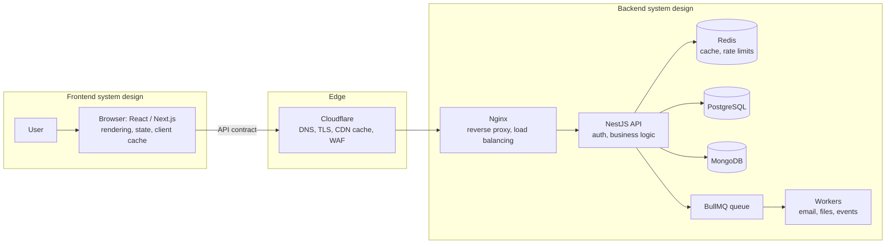
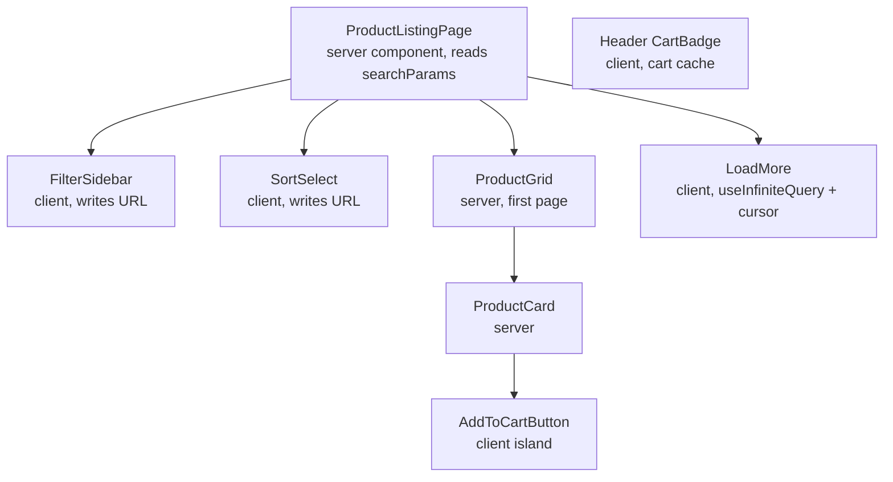
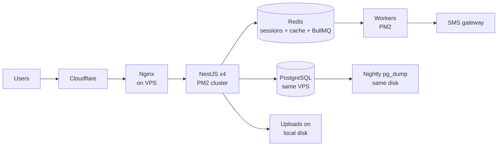

# System Design Interview Roadmap

Nov 2, 2026 · @tareqnmd

## How the three disciplines fit together

System design is one request path seen at three zoom levels. Overall design owns the whole path and its trade-offs; frontend design owns the client half; backend design owns the server half. They meet at the API contract.



Overall system design is the whole diagram plus the numbers behind it: how many users, how fast, how reliable, and what each box costs to run.

- **Overall system design** answers: what are we building, for how many users, how fast, how reliable, and what is the simplest architecture that meets that? It covers requirements, estimation, high-level components, data flow, and deployment.
- **Frontend system design** answers: how does the client render, hold state, fetch and cache data, stay fast on a slow phone, and stay secure in a hostile browser?
- **Backend system design** answers: how do APIs, data stores, caches, and queues serve correct data at the required scale, and what happens when parts fail?

The same handful of ideas repeats at every layer. Learn them once and you can reason anywhere:

| Idea | Frontend | Backend | Infrastructure |
| --- | --- | --- | --- |
| Caching | React Query cache, HTTP cache, service worker | Redis cache-aside, materialized views | Cloudflare CDN, Nginx proxy cache |
| Consistency | Optimistic update + rollback | Transactions, outbox, eventual consistency | Replica lag |
| Failure handling | Error boundaries, retries, offline mode | Timeouts, circuit breakers, idempotency | Health checks, failover |
| Async work | Streamed SSR, service-worker background sync | BullMQ jobs, events | Queues, workers under PM2/Docker |
| Security boundary | Never trust the client | Authorize every request | TLS, WAF, rate limits at the edge |

The seam matters most. A good API contract (pagination shape, error format, idempotency keys, versioning) lets the frontend and backend scale independently. Most real-world pain comes from a weak contract, not a weak database.

Interview implication: a frontend round still expects you to know how the backend paginates and caches; a backend round still expects you to know what the client needs. Senior candidates move between zoom levels on purpose and say why.

## What each level is judged on

The same question is asked at every level; the bar is how much ambiguity you absorb and how well you justify trade-offs.

| Dimension | Intermediate | Senior | Staff |
| --- | --- | --- | --- |
| Requirements | Asks some clarifying questions when prompted | Drives scoping unprompted, states assumptions, sets non-functional targets | Challenges the problem itself, ties it to business cost and team constraints |
| Architecture | Produces a working design with standard parts | Picks the simplest design that fits, explains why not the alternatives | Designs for evolution: what changes at 10x, what to defer, who owns what |
| Data | Picks a database, sketches tables | Models access patterns, indexes, consistency needs per operation | Plans migrations, multi-region, data lifecycle and compliance |
| Failure | Mentions retries | Walks through specific failure modes and their blast radius | Defines SLOs, degradation strategy, incident and recovery process |
| Trade-offs | Names them when asked | Quantifies them (latency, cost, complexity) | Weighs org cost: team skills, operational load, reversibility |
| Communication | Answers questions | Leads the session, checks in, manages time | Frames the decision so others can act on it (ADR quality) |

Common trap at all levels: jumping to microservices, Kafka, or sharding before the numbers justify it. Starting with a modular monolith on PostgreSQL and saying when you would split it usually scores higher.

## The 6-week roadmap

The order is set for a full-stack target. Method comes first, then frontend (closest to your daily React work), then data, backend, and reliability. Each week ends with a timed mock. Problems that don't fit in six weeks sit in the stretch track in the question bank. Worked exercises and flashcards are at the end of this document.

1. **Week 1 — Foundations and the interview method**
   - Interview framework, functional vs non-functional requirements, scoping and assumptions
   - Back-of-the-envelope estimation: QPS, storage, bandwidth, peak vs average
   - Request path basics: DNS, TLS, reverse proxy, load balancer, CDN (Cloudflare, Nginx)
   - Latency numbers, availability math, SLI / SLO / SLA
   - Monolith vs modular monolith vs microservices: when each fits
   - Done when: you can scope and estimate any problem in under 8 minutes
2. **Week 2 — Frontend system design**
   - CSR, SSR, SSG, ISR, streaming and hydration in Next.js
   - Component architecture, feature-based structure, micro-frontends
   - Design systems, including accessibility and internationalization
   - State: local, Context, Zustand / Redux, server state (React Query)
   - Data fetching: caching, dedup, cancellation, race conditions, optimistic updates
   - Performance: Core Web Vitals, code splitting, virtualization, images, CDN
   - Real-time (WebSockets, SSE, polling) and security (XSS, CSRF, CSP, cookie flags, token storage)
   - Done when: you can draw a component tree with state ownership and justify each rendering choice
3. **Week 3 — Data and caching**
   - SQL vs NoSQL; PostgreSQL and MongoDB modeling from access patterns
   - Indexing, query plans, N+1, connection pooling
   - Transactions, isolation levels, optimistic vs pessimistic locking
   - Cursor vs offset pagination; replication, read replicas, partitioning, sharding
   - Redis: cache-aside, write-through, TTLs, invalidation, stampede prevention
   - Done when: you can design a schema plus indexes and defend every index
4. **Week 4 — Backend architecture, APIs and security**
   - REST contract design, errors, versioning, idempotency keys; REST vs GraphQL vs gRPC
   - Layered, Clean and Hexagonal architecture in NestJS; DDD bounded contexts; API gateway and BFF
   - Rate limiting algorithms and where to enforce them
   - Sessions vs JWT, refresh rotation, OAuth 2.0 / OIDC, RBAC vs ABAC, OWASP API risks
   - Queues, background jobs (BullMQ), and file upload design
   - Done when: you can write a full API contract and defend its error and versioning rules
5. **Week 5 — Distributed systems, reliability and infrastructure**
   - CAP and consistency models in practice; distributed locks and their limits
   - Delivery semantics, idempotent consumers, outbox, saga; Kafka vs RabbitMQ vs BullMQ
   - Timeouts, retries with backoff and jitter, circuit breakers, bulkheads; frontend resilience (error boundaries, offline / PWA)
   - Observability, feature flags, rolling / blue-green / canary deploys, zero-downtime migrations
   - Docker and orchestration basics, service discovery and config, IaC, backups and DR (RPO / RTO), cloud vs VPS cost
   - Done when: you can walk any design through five failure modes and their blast radius
6. **Week 6 — Full simulations and revision**
   - Full-stack problems: multi-tenant SaaS, contest / voting platform, e-commerce
   - Senior scenarios: 10x traffic, Redis down, duplicate events, monolith migration
   - Three 60-minute mocks, one 30-minute cold mock, then targeted fixes on weak areas

**Optional build track (weekends).** Interview exercises are design-only and sized for 45 minutes. If you want hands-on proof, build these in your stack: a Redis token-bucket limiter in NestJS, a streaming file upload to object storage, and a BullMQ outbox relay.

## Daily plan

There are five study days a week, about 90 minutes each: 45 minutes learning and 45 minutes on one design exercise. Day 6 is a timed mock. Day 7 is 20 minutes of that week's flashcards, then rest. Codes E1–E10 point to the worked exercises in the Exercises section; the rest get answered in the lessons.

**Week 1 — Foundations**

- [ ] D1: Interview framework + requirements. Exercise: scope a URL shortener in 8 minutes
- [ ] D2: Estimation. Exercise: QPS and storage for a 1M-DAU chat app
- [ ] D3: DNS, TLS, Nginx, load balancers, Cloudflare. Exercise: draw your VPS request path end to end
- [ ] D4: Latency numbers, availability, SLI / SLO. Exercise: error budget for 99.9% vs 99.99%
- [ ] D5: Monolith vs modular monolith vs microservices. Exercise: E10 (ADR)
- [ ] D6: 30-minute mock — URL shortener

**Week 2 — Frontend system design**

- [ ] D1: Rendering strategies in Next.js. Exercise: choose rendering per page for an e-commerce site
- [ ] D2: Component architecture, design systems, accessibility, i18n. Exercise: E3 (component hierarchy)
- [ ] D3: State and data fetching. Exercise: optimistic "add to cart" with rollback; race-safe search results
- [ ] D4: Performance and Core Web Vitals. Exercise: plan LCP and CLS fixes for a listing page
- [ ] D5: Real-time and frontend security. Exercise: chat UI with reconnection, plus a CSP and cookie plan
- [ ] D6: 45-minute mock — autocomplete or product listing page

**Week 3 — Data and caching**

- [ ] D1: SQL vs NoSQL, modeling by access pattern. Exercise: E2 (schema and indexes)
- [ ] D2: Indexes, EXPLAIN, N+1, pooling. Exercise: E6 (slow query)
- [ ] D3: Transactions, isolation, locking. Exercise: prevent double-booking of a seat two ways
- [ ] D4: Pagination, replicas, partitioning, sharding. Exercise: cursor-paginate a feed; pick a shard key
- [ ] D5: Redis caching patterns and stampedes. Exercise: E7 part B (cache)
- [ ] D6: 45-minute mock — inventory and order service

**Week 4 — Backend architecture, APIs, security**

- [ ] D1: REST contracts, errors, versioning, idempotency. Exercise: E1 (API contract) + E7 part C (idempotency)
- [ ] D2: Clean / Hexagonal in NestJS, bounded contexts, BFF. Exercise: E4 (refactor)
- [ ] D3: Rate limiting. Exercise: E7 part A (rate limiter)
- [ ] D4: Sessions, JWT, OAuth / OIDC, RBAC vs ABAC. Exercise: refresh-token rotation with reuse detection
- [ ] D5: Queues, background jobs, file uploads. Exercise: E8 (consumer and retry policy)
- [ ] D6: 45-minute mock — rate limiter or auth service

**Week 5 — Distributed systems, reliability, infrastructure**

- [ ] D1: CAP, consistency models, distributed locks. Exercise: label each e-commerce operation strong vs eventual
- [ ] D2: Outbox, saga, idempotent consumers. Exercise: order → payment → inventory saga with compensation
- [ ] D3: Timeouts, retries, circuit breakers, frontend resilience. Exercise: E9 (failure-point review)
- [ ] D4: Observability, feature flags, deployments, migrations. Exercise: canary rollout + zero-downtime column rename
- [ ] D5: Docker, config, IaC, backups, DR, cost. Exercise: E5 (architecture smells) + RPO / RTO plan for a single-VPS app
- [ ] D6: 60-minute mock — notification service

**Week 6 — Simulations and revision**

- [ ] D1: 60-minute mock — multi-tenant SaaS
- [ ] D2: Senior scenarios round (5 scenarios, 10 minutes each)
- [ ] D3: 60-minute mock — contest / voting platform
- [ ] D4: 60-minute mock — e-commerce platform or payment workflow
- [ ] D5: Fix the top three weak areas; full flashcard pass; final checklist
- [ ] D6: 30-minute mock, cold, no notes

## Interview answer framework

Use the same seven phases in every design round; only the time per phase changes. Most failed rounds over-spend on high-level boxes and never reach failure modes.

| Phase | 45 min | 60 min | What you produce |
| --- | --- | --- | --- |
| 1. Clarify scope | 4 | 5 | Users, core use cases, what is out of scope |
| 2. Requirements | 3 | 5 | Functional list + targets: latency, availability, consistency, scale |
| 3. Estimate | 3 | 5 | QPS (avg and peak), storage per year, read/write ratio |
| 4. API + data model | 7 | 10 | 3–5 endpoints, core entities, key indexes |
| 5. High-level design | 10 | 12 | Simplest architecture that works, one main flow traced |
| 6. Deep dive | 13 | 17 | The 1–2 hardest parts: bottleneck, consistency, failure, scaling |
| 7. Wrap-up | 5 | 6 | Trade-offs, what changes at 10x, what you would monitor |

Frontend rounds swap phase 4 for component tree + state ownership + API needs, and phase 6 for rendering, performance, and resilience.

Three habits that read as senior: say the assumption out loud before using it; name the alternative you rejected and why; check in with the interviewer before each deep dive.

## Question bank

Every problem now has a slot. The priority column is my judgment of what full-stack interview loops ask most often, not measured data, so re-weight it once you know your target companies.

| Priority | Problem | Type | Where it's practised | Core skill tested |
| --- | --- | --- | --- | --- |
| 1 | URL shortener | Backend | Mock W1 | Estimation, ID generation, caching |
| 1 | Product listing page | Frontend | Mock W2 option, E3 | Rendering, pagination, filters, performance |
| 1 | Autocomplete / search | Frontend | Mock W2 option | Debounce, cancellation, caching, ranking |
| 1 | Rate limiter | Backend | Mock W4 option, E7 | Redis atomicity, algorithms, distributed counting |
| 1 | Authentication and session service | Backend | Mock W4 option | Tokens, rotation, revocation |
| 1 | Notification service (email, SMS, push) | Backend | Mock W5 | Queues, fan-out, retries, preferences |
| 1 | Multi-tenant SaaS platform | Full-stack | Mock W6 D1 | Tenant isolation, data model, noisy neighbours |
| 2 | Inventory and order management | Backend | Mock W3 | Locking, overselling, consistency |
| 2 | Contest / voting platform | Full-stack | Mock W6 D3 | RBAC, vote integrity, burst traffic |
| 2 | E-commerce platform | Full-stack | Mock W6 D4 option | Boundaries, checkout flow, caching |
| 2 | Payment processing workflow | Backend | Mock W6 D4 option, saga W5 | Idempotency, saga, reconciliation |
| 2 | Real-time chat interface | Frontend | Exercise W2 D5 | WebSockets, ordering, offline, reconnection |
| 2 | Ticket booking system | Full-stack | Exercise W3 D3, then stretch | Seat holds, contention, expiry |
| 2 | File upload and processing | Backend | Lesson W4 D5, then stretch | Streaming, presigned URLs, async jobs |
| 2 | Notification center | Frontend | Stretch | Real-time updates, unread counts, pagination |
| 3 | Real-time messaging platform | Full-stack | Stretch | Presence, delivery guarantees, scale |
| 3 | Analytics dashboard, large datasets | Frontend | Stretch | Virtualization, aggregation, streaming |
| 3 | Reusable design system | Frontend | Lesson W2 D2, then stretch | Versioning, theming, distribution |
| 3 | Learning management system | Full-stack | Stretch | Roles, content delivery, progress tracking |
| 3 | Personal finance application | Full-stack | Stretch | Data integrity, security, sync |
| 3 | Collaborative editor | Frontend | Stretch | CRDT vs OT, conflict resolution |

**Stretch track.** Use weekends or a Week 7–8 extension, one 45-minute problem per session, in this order: ticket booking, file upload, notification center, real-time messaging, analytics dashboard, design system, LMS, personal finance, collaborative editor.

**Senior scenarios** (Week 5 lessons, Week 6 D2 round): slow system investigation, 10x traffic, Redis outage, DB down mid-payment, duplicate events, cache stampede, cross-service consistency, breaking API change, large uploads, end-to-end latency debugging, cost reduction, monolith-to-microservices migration.

## Final revision checklist

Tick these off in Week 6; anything you cannot explain aloud in two minutes goes into the tracker below.

- [ ] Scope and estimate any problem in under 8 minutes
- [ ] Explain when a modular monolith beats microservices, with a trigger for splitting
- [ ] Choose PostgreSQL vs MongoDB from access patterns, not habit
- [ ] Justify every index you draw; explain a compound index's column order
- [ ] Explain isolation levels and prevent a double-booking two ways
- [ ] Cache-aside, invalidation, and stampede prevention with Redis
- [ ] Cursor vs offset pagination, with the failure case of each
- [ ] Idempotency keys end to end: client, API, database constraint
- [ ] Outbox and saga, with a compensation example
- [ ] Retries with backoff and jitter, timeouts, circuit breakers
- [ ] Sessions vs JWT, refresh rotation, where to store tokens and why
- [ ] CSR / SSR / SSG / ISR choice per page, and hydration costs
- [ ] XSS, CSRF, CSP, and cookie flags in one coherent answer
- [ ] Optimistic updates with rollback and race-condition handling
- [ ] Canary or blue-green deploy plus a zero-downtime schema change
- [ ] What breaks first at 10x on a single VPS, in order

**Weak-areas tracker** — filled in after each mock interview.

| Mock | Status | Weak area | Evidence | Fix planned |
| --- | --- | --- | --- | --- |
| W1 D6 · URL shortener, 30 min | Not done |  |  |  |
| W2 D6 · Autocomplete or product listing, 45 min | Not done |  |  |  |
| W3 D6 · Inventory and order service, 45 min | Not done |  |  |  |
| W4 D6 · Rate limiter or auth service, 45 min | Not done |  |  |  |
| W5 D6 · Notification service, 60 min | Not done |  |  |  |
| W6 D1 · Multi-tenant SaaS, 60 min | Not done |  |  |  |
| W6 D2 · Senior scenarios round | Not done |  |  |  |
| W6 D3 · Contest / voting platform, 60 min | Not done |  |  |  |
| W6 D4 · E-commerce or payment workflow, 60 min | Not done |  |  |  |
| W6 D6 · Cold mock, 30 min | Not done |  |  |  |

## Exercises

Ten design exercises, each sized for 45 minutes. Each one has a starter brief, the expected solution, how it is scored, and the usual mistakes. Attempt it before reading the solution.

### E1 — Design a REST API contract

**Starter.** Design the Orders API for an e-commerce app. Customers create an order from their cart, pay, cancel within 30 minutes, and list their orders. Mobile clients on flaky networks retry requests.

**Expected solution**

- `POST /v1/orders` with an `Idempotency-Key` header → `201` with `id`, `status: "pending_payment"`, items, and total. A replay with the same key returns the same response, not a second order.
- `GET /v1/orders?status=&limit=20&cursor=` → `{ data, nextCursor }`
- `GET /v1/orders/{id}` → `404` (not `403`) when the order belongs to someone else, so IDs can't be enumerated.
- `POST /v1/orders/{id}/cancel` → `409` if the order has shipped. State changes are explicit actions, not a free-form status field.
- `POST /v1/orders/{id}/payments` with `Idempotency-Key` → `202 { paymentId, status: "processing" }`. The final result arrives by gateway webhook (bKash, Nagad, SSLCommerz) and is readable via `GET`.
- One error shape everywhere: `{ error: { code, message, details, requestId } }`, or RFC 9457 problem details.
- Money as integer minor units plus an ISO currency code.
- `/v1` in the path; additive fields are non-breaking; removals need `/v2` or a deprecation window.

**Evaluation criteria:** idempotency on every unsafe call · correct status codes (201, 202, 404, 409, 422) · cursor pagination · one error format · per-resource authorization · money handling · versioning rule stated.

**Common mistakes:** `PATCH /orders/{id}` accepting any status · floats for money · `200` with an error body · offset pagination on a growing list · no plan for client retries.

### E2 — Schema and indexes

**Starter.** Same orders domain. Support four queries:

1. A customer's orders, newest first, paginated
2. Admin view of orders by status within a date range
3. One order with its items
4. Daily sales totals per product

**Expected solution (PostgreSQL)**

- `orders(id, customer_id FK, status CHECK, total_minor BIGINT, currency CHAR(3), created_at TIMESTAMPTZ)`
- `order_items(order_id FK, product_id FK, qty, unit_price_minor, PRIMARY KEY (order_id, product_id))`. Copy the unit price so history survives price changes.
- Q1 → index `orders(customer_id, created_at DESC, id DESC)`. Equality column first, then the sort columns; `id` breaks ties for the cursor.
- Q2 → index `orders(status, created_at)`. Equality first, then the range.
- Q3 → already covered by the `order_items` primary key.
- Q4 → no index. Use a nightly rollup table or materialized view; analytics should not run on the OLTP path.

**Expected solution (MongoDB)**

- An `orders` document embeds its items (bounded, always read together) and a snapshot of customer name and address.
- Indexes `{ customerId: 1, createdAt: -1, _id: -1 }` and `{ status: 1, createdAt: 1 }`.
- Never embed orders inside the customer document; that array is unbounded.

**Evaluation criteria:** every index traced to a query · column order explained (equality, then sort or range) · price snapshot · bounded embedding · constraints in the database, not just the app.

**Common mistakes:** an index per column · a lone index on low-cardinality `status` · unbounded arrays in MongoDB · running reports on the primary.

### E3 — Frontend component hierarchy

**Starter.** Product listing page in Next.js App Router: 50,000 products, filters (category, price, brand), sort, load more, add to cart. SEO matters.

**Expected solution**



- The first page renders on the server for SEO and a fast LCP. Category pages can use ISR with a short revalidate window.
- **State ownership:** filters, sort, and page live in the URL (shareable, survive refresh, back button works). Server data lives in React Query. The cart is server state with an optimistic client update. UI state like an open drawer stays local.
- **Client boundary:** only interactive leaves are client components, keeping the JS bundle small.
- **Performance:** `next/image` with `sizes`, `priority` on the first row, skeletons with fixed size to avoid CLS. Virtualize only if one session renders hundreds of cards.
- **Accessibility:** filters as labelled fieldsets, result count announced via `aria-live`.

**Evaluation criteria:** state ownership justified · server/client split · URL as state · rendering choice tied to SEO and LCP · accessibility mentioned unprompted.

**Common mistakes:** `'use client'` at the page root · filters in `useState`, lost on refresh · `useEffect` fetch waterfalls · Redux holding server data.

### E4 — Refactor a tightly coupled backend

**Starter.** This NestJS service is hard to test, and a failed email fails the whole order. Refactor it.

```ts
@Injectable()
export class OrdersService {
  constructor(private prisma: PrismaClient, private redis: Redis) {}

  async createOrder(userId: string, cart: CartItem[]) {
    const order = await this.prisma.order.create({ data: { userId, items: { create: cart } } });
    const res = await axios.post(SSLCZ_URL, { amount: order.total });
    await nodemailer.createTransport(cfg).sendMail({ to: user.email, subject: 'Order placed' });
    await this.redis.del(`orders:${userId}`);
    return { order, paymentUrl: res.data.GatewayPageURL };
  }
}
```

**Expected solution**

- Name the four responsibilities mixed together: persistence, payment, notification, caching.
- **Ports and adapters:** an `OrderRepository` port with a Prisma adapter, and a `PaymentGateway` port with an SSLCommerz adapter, injected through Nest provider tokens. The domain no longer imports Prisma or axios.
- **Domain logic in the entity:** `Order` computes totals and owns its state transitions.
- **Side effects leave the request:** write an `OrderCreated` row to an outbox table in the same transaction as the order. A BullMQ worker sends the email and invalidates the cache. An email failure now retries instead of failing checkout.
- Payment initiation stays synchronous because the user needs the redirect URL, but it gets a timeout and sits behind its port.
- `NotificationsModule` consumes events; `OrdersModule` exports only its service.
- Unit tests use an in-memory repository and a fake gateway.

**Evaluation criteria:** responsibilities identified · dependencies point inward · failure isolation · testability · stays a modular monolith.

**Common mistakes:** jumping to microservices · enqueuing the email after commit without an outbox (a crash in between loses it) · one-line wrapper interfaces while the domain still builds HTTP calls · a generic repository for every entity.

### E5 — Identify architecture smells

**Starter.** Review this system and rank the problems:

> Five NestJS services share one PostgreSQL database and read each other's tables. Service A calls B, which calls C, synchronously on every page load. A shared `common` npm package holds DTOs, entities, and business helpers, and every release bumps all five services. Cron jobs run inside the app on every PM2 cluster instance. Sessions are stored in process memory. One Redis instance serves as cache, BullMQ queue, and lock store, with no memory policy set.

**Expected solution**

| Smell | Consequence | Fix |
| --- | --- | --- |
| Shared database, cross-service table reads | Distributed monolith: schema changes break other services | Each service owns its tables; expose APIs or events, or merge back into a modular monolith |
| Synchronous A → B → C chain | Latency adds up; availability multiplies (three services at 99.9% give about 99.7%) | Collapse services, cache, or compose in a BFF; go async where the user doesn't wait |
| Business logic in a shared package | Lockstep releases across all services | Share only contracts or generated clients |
| Cron on every PM2 instance | Jobs run N times: duplicate emails, double charges | One scheduler (BullMQ repeatable job) or a leader lock |
| In-memory sessions | Breaks horizontal scaling; users logged out on restart | Redis session store or stateless tokens |
| One Redis for cache and queue | Cache growth can evict queue keys or hit OOM; BullMQ needs `noeviction` | Separate instances, or at least separate memory policies |

**Evaluation criteria:** each smell paired with a concrete consequence · fixes ordered by risk · spots the Redis eviction conflict · doesn't propose a rewrite.

**Common mistakes:** "rebuild as proper microservices" · listing smells with no consequence · missing the duplicate-cron problem.

### E6 — Improve a slow query

**Starter (PostgreSQL).** `orders` has 20 million rows and an index on `created_at` only. p99 is 2.5 seconds.

```sql
SELECT * FROM orders
WHERE lower(email) = 'a@b.com' AND status IN ('paid', 'shipped')
ORDER BY created_at DESC
OFFSET 10000 LIMIT 20;
```

**Expected solution**

1. Measure first: `EXPLAIN (ANALYZE, BUFFERS)`. Expect a scan of the `created_at` index that filters millions of rows.
2. `lower(email)` on the column prevents a plain index on `email` from being used. Add an expression index on `(lower(email), created_at DESC)`, or store email as `citext`. Better still, filter by `customer_id`.
3. `OFFSET 10000` reads and discards 10,000 rows. Switch to keyset pagination: `WHERE (created_at, id) < ($1, $2)`.
4. Select only the needed columns instead of `*`; that can allow an index-only scan.
5. Re-run `EXPLAIN` and compare plan and timing.

**Starter (MongoDB).** `find({ customerId, status: 'paid' }).sort({ createdAt: -1 })` with indexes `{ createdAt: -1 }` and `{ status: 1 }`. `explain` shows 2 million documents examined.

**Expected solution:** add a compound index `{ customerId: 1, status: 1, createdAt: -1 }` following the ESR rule (Equality, Sort, Range). Verify with `explain('executionStats')`: keys examined should be close to documents returned.

**Evaluation criteria:** measures before and after · explains why the index wasn't used · column order reasoning · fixes pagination too · weighs index write cost.

**Common mistakes:** adding indexes blindly · caching to hide a bad query · forgetting that every index slows writes.

### E7 — Rate limiting, caching, idempotency

**Part A — Rate limiter.** Limit login to 5 attempts per minute per IP + username, and the public API to 100 requests per minute per API key. Three Node instances run behind Nginx.

**Expected solution (A)**

- The counter lives in Redis so all three instances share it; in-memory counters let users get 3x the limit.
- **Algorithm choice:** fixed window is simple but allows a 2x burst at the boundary. A sliding-window log is exact but stores every request. A sliding-window counter is cheap and close enough. Token bucket allows controlled bursts. Pick one and say why.
- **Atomicity:** `INCR` then `EXPIRE` as two calls can leave a key with no expiry. Run it as one Lua script:

```lua
local n = redis.call('INCR', KEYS[1])
if n == 1 then redis.call('PEXPIRE', KEYS[1], ARGV[1]) end
return n
```

- Return `429` with `Retry-After` (and `RateLimit-*` headers).
- **Layering:** Cloudflare or Nginx `limit_req` absorbs per-IP floods cheaply; the app enforces per-user and per-key business limits.
- **When Redis is down:** fail open for the general API (availability) and fail closed for login (security). State the choice.

**Part B — Cache.** A product page gets 50,000 reads per minute; prices change a few times a day.

**Expected solution (B)**

- Cache-aside: read Redis, on a miss read the database and set the key with a TTL plus random jitter, so keys don't all expire together.
- On a price update, commit to the database first, then delete the key.
- **Stampede protection:** on a miss, one request takes a short lock (`SET lock NX PX 3000`) and rebuilds; others serve stale data or wait briefly. Alternatives: stale-while-revalidate or early probabilistic refresh.
- Cache "not found" briefly, so lookups for missing IDs don't hit the database every time.

**Part C — Idempotency.** `POST /payments` must charge once even when the client retries.

**Expected solution (C)**

- Table `idempotency_keys(user_id, key, request_hash, status, response, created_at)` with `UNIQUE (user_id, key)`.
- Insert the row as `in_progress` before doing any work. On a unique violation: if `completed`, return the stored response; if `in_progress`, return `409` and let the client retry later; if the request hash differs, return `422`.
- After the work, store the response and mark the row `completed`. Expire rows after 24 hours.
- The database constraint is the source of truth. Redis alone can lose keys on restart or eviction.

**Evaluation criteria (A–C):** shared state across instances · atomic operations · explicit failure behaviour · stampede plan · DB-enforced idempotency · correct status codes.

**Common mistakes:** per-process limiters · non-atomic counters · deleting the cache before the DB commit · idempotency checked with a read-then-write race · no TTL jitter.

### E8 — Queue consumer and retry policy

**Starter.** A BullMQ worker sends order emails through a provider that allows 10 requests per second and sometimes times out. No duplicate emails and no lost emails.

**Expected solution**

- Delivery is at least once, so the consumer must be idempotent. Record `(order_id, template)` in a table with a unique constraint before sending, or pass an idempotency key the provider honours.
- Deduplicate at enqueue too, with a deterministic `jobId`.
- **Classify errors:** timeouts, 429, and 5xx are retryable; a 400 such as an invalid address is permanent, so throw `UnrecoverableError` and don't retry.
- **Backoff:** exponential with jitter, so retries don't arrive in synchronized waves.
- Keep the provider timeout well under the job lock duration, otherwise a stalled job can run twice in parallel.
- After the final attempt, the job stays in the failed set as a dead-letter queue. Alert on it and keep a replay tool.
- Monitor queue depth, age of the oldest job, and failure rate.
- Ordering isn't guaranteed with concurrency above 1, so don't depend on it.

```ts
new Worker('emails', handler, {
  concurrency: 5,
  limiter: { max: 10, duration: 1000 },
});

await queue.add('order-placed', data, {
  jobId: `order-placed:${orderId}`,
  attempts: 5,
  backoff: { type: 'exponential', delay: 2000 },
  removeOnComplete: 1000,
});
```

**Evaluation criteria:** idempotent consumer · error classification · backoff with jitter · DLQ plus alerting · provider rate limit respected · metrics named.

**Common mistakes:** infinite retries · retrying permanent errors · assuming exactly-once delivery · no visibility into failed jobs.

### E9 — Review an architecture diagram for failure points

**Starter.** A SaaS app runs on one VPS. Find the failure points, rank them, and propose a cheap evolution path.



**Expected solution**

| Failure point | What happens | Fix | Priority |
| --- | --- | --- | --- |
| Backups on the same disk | A disk failure loses the database and its backups together | Off-site backups (R2, S3, B2) plus a tested restore; WAL archiving for a smaller RPO | 1 |
| No monitoring or alerting shown | Outages are discovered by users | Uptime checks, error tracking, disk and memory alerts | 1 |
| Whole stack on one VPS | Any host failure is a full outage | Accept for now with a documented RTO; later add a second node or a managed database | 2 |
| Uploads on local disk | Data lost with the disk; blocks adding a second app node | Object storage with presigned uploads | 2 |
| Redis with sessions and queue, persistence unknown | A restart logs everyone out and drops queued jobs | Enable AOF; separate cache from queue; `noeviction` for BullMQ | 2 |
| App and DB share memory and CPU | A traffic spike or heavy query starves the database | Resource limits; check `max_connections` against 4 instances × pool size plus workers; PgBouncer | 3 |
| Workers call SMS with no circuit breaker | A slow gateway backs up the queue and burns retries | Timeouts, breaker, rate limit, DLQ alerting | 3 |

Evolution path, cheapest first: off-site backups and alerts this week → object storage for uploads → managed PostgreSQL or a streaming replica → a second app node behind Cloudflare load balancing.

**Evaluation criteria:** ranked by likelihood × impact · each failure tied to a consequence · RPO and RTO named · the path is incremental and costed.

**Common mistakes:** jumping straight to Kubernetes · missing the backup-on-same-disk risk · treating PM2 restarts as high availability.

### E10 — Write an ADR

**Starter.** A team of three is building a multi-tenant SaaS MVP due in four months. Decide between a monolith, a modular monolith, microservices, and serverless, and record it.

**Expected solution**

> **ADR-001: Start as a modular monolith**
>
> **Status:** Accepted
>
> **Context.** Three full-stack engineers; MVP in four months. Expected load in year one is under 200 tenants and under 50 requests per second. Budget is one or two VPS instances. Domains: tenants and billing, core product, notifications, analytics.
>
> **Decision.** One NestJS application and one PostgreSQL database. One module per bounded context; no module reads another's tables. Modules talk through public services and in-process domain events. Async work runs on BullMQ.
>
> **Alternatives considered.** Microservices: rejected because of ops cost, distributed transactions, and a team too small to own several services. Serverless: rejected because of long-running jobs and cold starts. A layered monolith with no module boundaries: rejected because it is hard to split later.
>
> **Consequences.** Simple deploys and real transactions. One deploy unit and one database scaling ceiling. Risk of boundary erosion, mitigated by lint rules that block cross-module imports.
>
> **Revisit when** a module needs independent scaling, a separate team owns a module, or deploy cadence starts to conflict.

**Evaluation criteria:** context has numbers · alternatives are real options · consequences include the downsides · revisit triggers are observable.

**Common mistakes:** an ADR that reads like a sales pitch · no alternatives · no revisit triggers · written months later without the original context.

## Flashcards

Cover the answer column and say each answer aloud in under 30 seconds. Review each week's cards on Day 7, and do all of them in Week 6.

| Week | Question | Answer |
| --- | --- | --- |
| 1 | Functional vs non-functional requirements? | What the system does vs how well it does it: latency, availability, consistency, scale, security, cost |
| 1 | 1M DAU × 10 requests a day: average QPS? | About 115 (86,400 seconds a day). Plan peak at 2–3x, roughly 350 |
| 1 | Downtime allowed at 99.9% and 99.99%? | About 43 minutes a month vs about 4.3 minutes a month |
| 1 | SLI vs SLO vs SLA? | The measured indicator; the internal target; the contractual promise with penalties |
| 1 | Reverse proxy vs load balancer? | Proxy fronts servers (TLS, caching, routing); balancer spreads traffic across instances. Nginx does both |
| 1 | Modular monolith? | One deployable with enforced module boundaries: cheap to run, splittable later |
| 1 | Rough latencies: RAM, SSD read, same-DC round trip, cross-continent? | About 100 ns, about 100 µs, about 0.5 ms, about 150 ms |
| 2 | SSR vs SSG vs ISR? | Rendered per request; at build time; static but regenerated after a revalidate window or on demand |
| 2 | What is hydration and its cost? | Client JS attaches handlers to server HTML; costs download and execution time; mismatches cause errors |
| 2 | Server state vs client state? | Server state is a cached copy of server data (React Query); client state is UI-owned (useState, Zustand) |
| 2 | Good Core Web Vitals thresholds? | LCP ≤ 2.5 s, INP ≤ 200 ms, CLS ≤ 0.1 |
| 2 | Race condition in search-as-you-type? | Debounce, cancel the previous request with AbortController, or drop stale responses |
| 2 | XSS vs CSRF? | XSS runs attacker script in your origin (escape, CSP); CSRF rides the victim's cookies from another site (SameSite, tokens) |
| 2 | Where to keep auth tokens in a browser? | HttpOnly, Secure, SameSite cookies; not localStorage, which XSS can read |
| 2 | Why is frontend authorization not enough? | Client code can be changed; the API must authorize every request |
| 2 | When do micro-frontends pay off? | Several independent teams needing independent deploys; otherwise duplication and bundle bloat |
| 3 | MongoDB or PostgreSQL? | Mongo for document aggregates read together; Postgres for relations, joins, constraints, multi-row transactions |
| 3 | Compound index column order? | Equality, then Sort, then Range (ESR); queries must use a leftmost prefix |
| 3 | PostgreSQL isolation levels and default? | Read Committed (default), Repeatable Read, Serializable |
| 3 | Optimistic vs pessimistic locking? | Version check on update vs `SELECT … FOR UPDATE`; optimistic suits low contention |
| 3 | Why cursor over offset pagination? | Offset reads and discards rows and shifts on inserts; a cursor is stable and uses the index |
| 3 | N+1 problem and fix? | One list query plus one per item; fix with a join, `IN` batching, or DataLoader |
| 3 | Cache stampede and fixes? | Many misses rebuild one key at once; lock or single-flight, stale-while-revalidate, TTL jitter |
| 3 | Replica lag problem? | Users don't see their own writes; read from the primary right after a write |
| 3 | Good shard key? | High cardinality, even spread, matches the main query (often `tenant_id`); avoid hot keys |
| 4 | Which HTTP methods are idempotent? | GET, PUT, DELETE are; POST is not; PATCH not by default |
| 4 | 401 vs 403? | Not authenticated vs authenticated but not allowed |
| 4 | Hexagonal architecture? | Domain core with ports; adapters for DB and HTTP; dependencies point inward |
| 4 | What is a BFF? | A backend shaped for one client type that aggregates and trims data for it |
| 4 | JWT vs server sessions? | JWT is stateless but hard to revoke (short TTL + refresh); sessions are revocable but need a store |
| 4 | Refresh token reuse detection? | Rotate on every use; if an old token is reused, revoke the whole token family |
| 4 | RBAC vs ABAC? | Roles map to permissions vs policies over attributes (owner, tenant, time) |
| 4 | OAuth 2.0 vs OIDC? | Delegated authorization (access tokens) vs an identity layer on top (ID token) |
| 4 | Token bucket in one line? | Tokens refill at rate r up to capacity b; each request takes one; bursts up to b |
| 5 | CAP in practice? | During a partition you choose consistency or availability; otherwise latency vs consistency (PACELC) |
| 5 | Outbox pattern? | Write the event in the same DB transaction; a relay publishes it; no dual-write gap |
| 5 | Saga? | Local transactions with compensations; choreographed by events or run by an orchestrator |
| 5 | How do you get "effectively once"? | At-least-once delivery plus an idempotent consumer |
| 5 | Why add jitter to retries? | To avoid synchronized retry waves hammering a recovering service |
| 5 | Circuit breaker states? | Closed, open, half-open |
| 5 | Limits of a Redis distributed lock? | Unsafe under GC pauses, clock drift, or failover; use fencing tokens or DB constraints |
| 5 | RPO vs RTO? | Maximum data loss tolerated vs maximum downtime tolerated |
| 5 | Canary vs blue-green? | A small share of traffic to the new version vs switching all traffic between two full environments |
| 5 | Zero-downtime column rename? | Expand and contract: add new, dual-write, backfill, switch reads, drop old |
| 5 | Liveness vs readiness probe? | Restart if dead vs keep out of traffic until ready |
